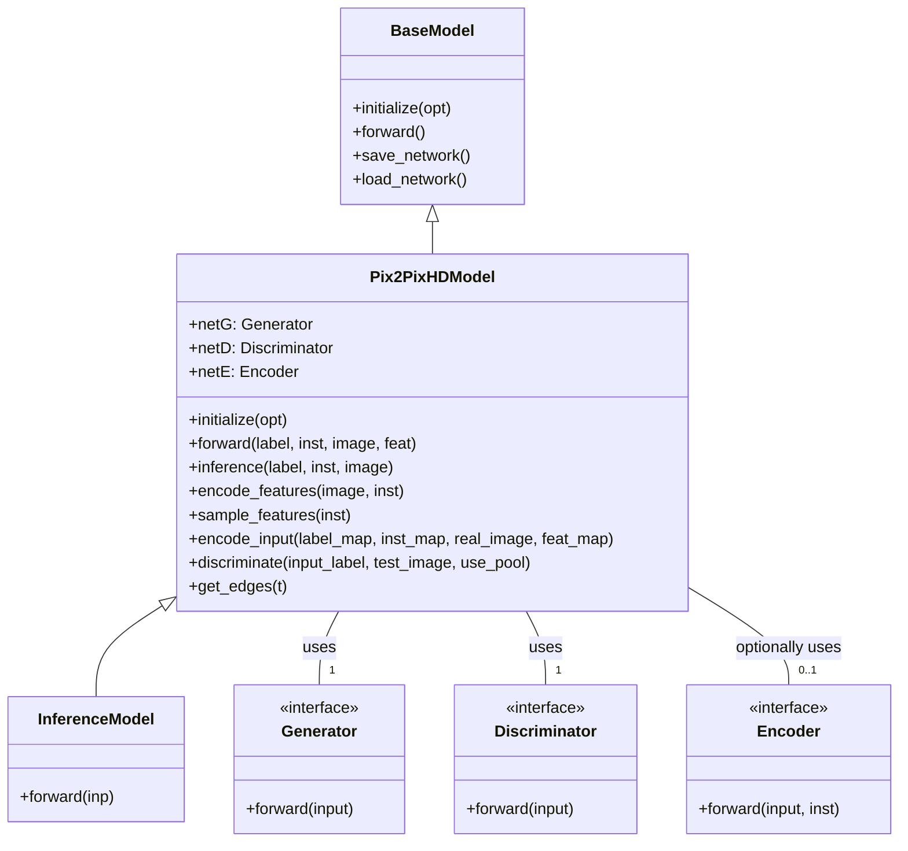
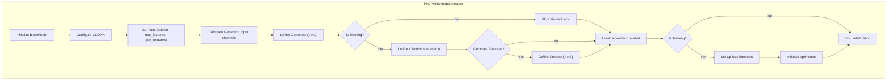
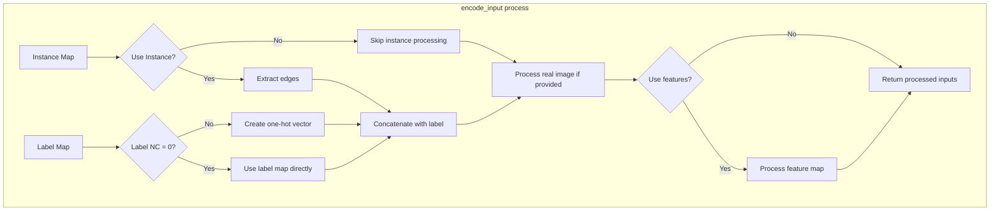
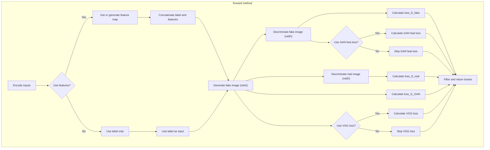
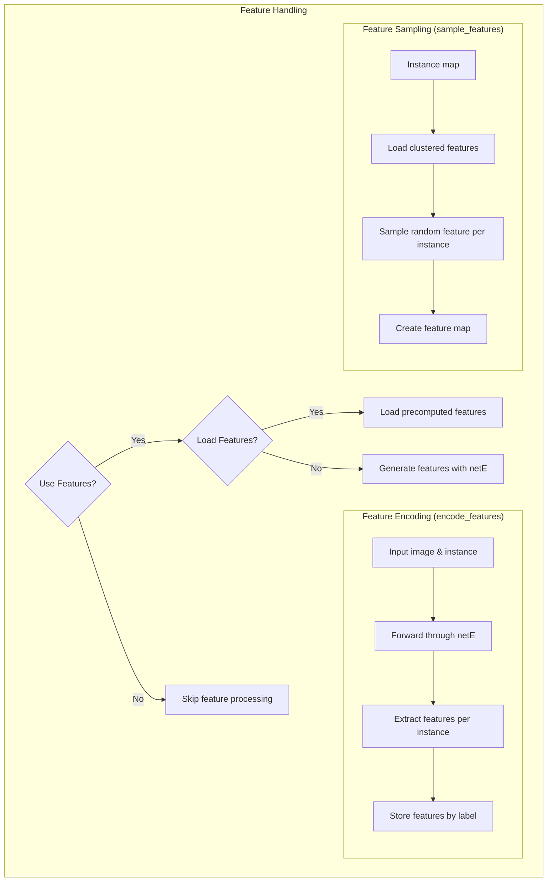
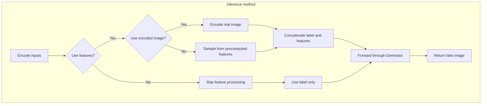
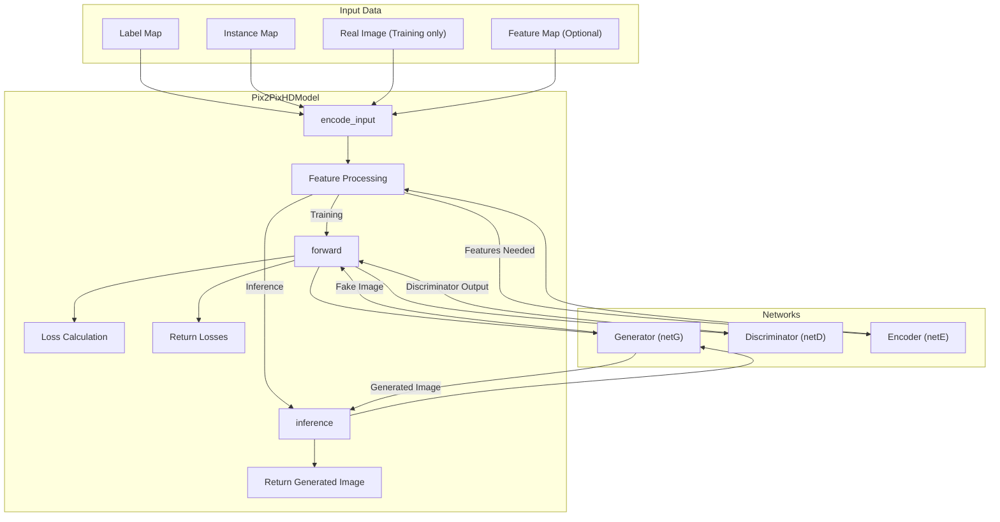

<!-- source: DeepWiki mcp.deepwiki.com · repo NVIDIA/pix2pixHD · page 3.1 Pix2PixHD Model · fetched 2026-10-26 -->

# Pix2PixHD Model

<details>
<summary>Relevant source files</summary>

The following files were used as context for generating this wiki page:

- [models/pix2pixHD_model.py](models/pix2pixHD_model.py)

</details>


## Purpose and Scope

This document provides a detailed technical explanation of the Pix2PixHD model architecture, components, and functionality within the pix2pixHD repository. It covers the core implementation in `pix2pixHD_model.py`, including the model's initialization, training process, loss functions, and inference capabilities. For information about specific neural network architectures used in the model, see [Neural Network Architectures](#3.2).

## Overview

The Pix2PixHD model implements high-resolution image-to-image translation with conditional GANs. It extends the BaseModel class and supports features such as multi-scale discrimination, feature encoding, and enhanced loss functions for photorealistic results.



Sources: [models/pix2pixHD_model.py:9-297]()

## Model Initialization

The Pix2PixHD model is initialized with configuration options that determine its behavior. The initialization process creates the generator, discriminator, and (optionally) encoder networks.



Sources: [models/pix2pixHD_model.py:19-109]()

During initialization, the model performs the following key steps:

1. Configures CUDA settings based on options
2. Determines feature usage flags
3. Calculates input channels for the generator
4. Creates network architectures (Generator, Discriminator, Encoder)
5. Loads pretrained networks if specified
6. Sets up loss functions and optimizers for training

The network architectures are defined through function calls to `networks.define_G()` and `networks.define_D()`, which create the generator and discriminator networks based on specified parameters.

## Input Processing

The Pix2PixHD model processes inputs through the `encode_input` method, which prepares label maps, instance maps, and images for use by the model.



Sources: [models/pix2pixHD_model.py:111-142]()

Key aspects of input processing:

- Labels are either used directly or converted to one-hot vectors
- Instance maps can be used to extract edge information
- Real images are prepared for training
- Feature maps are handled if the model uses features

## Forward Pass and Training

The forward pass of the Pix2PixHD model orchestrates the flow of data through the generator and discriminator networks during training.



Sources: [models/pix2pixHD_model.py:152-193]()

During training, the model:

1. Processes input data (labels, instances, images, features)
2. Generates fake images through the generator network
3. Evaluates both real and fake images with the discriminator
4. Calculates multiple loss components:
   - GAN loss for generator and discriminator
   - Feature matching loss
   - VGG perceptual loss
5. Returns filtered losses based on configuration

## Loss Functions

The Pix2PixHD model employs several loss functions to achieve high-quality results:

| Loss Function | Purpose | Implementation |
|---------------|---------|----------------|
| GAN Loss | Adversarial loss for generator/discriminator | `criterionGAN` |
| Feature Matching Loss | Matches intermediate features between real/fake | `criterionFeat` |
| VGG Perceptual Loss | Matches perceptual features using VGG network | `criterionVGG` |

The loss functions are initialized during model setup:

```python
self.criterionGAN = networks.GANLoss(use_lsgan=not opt.no_lsgan, tensor=self.Tensor)   
self.criterionFeat = torch.nn.L1Loss()
if not opt.no_vgg_loss:             
    self.criterionVGG = networks.VGGLoss(self.gpu_ids)
```

Sources: [models/pix2pixHD_model.py:72-77](), [models/pix2pixHD_model.py:173-190]()

## Feature Handling

The Pix2PixHD model can utilize features to enhance the generation process, either by encoding features from real images or by sampling from precomputed feature clusters.



Sources: [models/pix2pixHD_model.py:219-260]()

Feature handling includes two key processes:

1. **Feature Encoding** (`encode_features`): Extracts features from real images using the encoder network
2. **Feature Sampling** (`sample_features`): Samples features from precomputed clusters based on instance labels

These features provide additional semantic information that helps the generator produce more detailed and realistic images.

## Inference Process

During inference, the model generates images from label maps and instance maps without requiring backpropagation.



Sources: [models/pix2pixHD_model.py:195-217]()

The inference process is streamlined compared to training:

1. Input label and instance maps are encoded
2. Features are either encoded from a real image or sampled from precomputed clusters
3. The generator produces the output image
4. No loss calculation or backpropagation occurs

## InferenceModel Class

For simplified inference, the codebase provides an `InferenceModel` class that inherits from `Pix2PixHDModel` but provides a simplified interface.

```python
class InferenceModel(Pix2PixHDModel):
    def forward(self, inp):
        label, inst = inp
        return self.inference(label, inst)
```

Sources: [models/pix2pixHD_model.py:299-302]()

This class allows for easy integration of the model into production workflows by accepting a tuple of (label, instance) and returning the generated image.

## Utility Functions

The Pix2PixHD model includes several utility functions that support its operations:

| Function | Purpose |
|----------|---------|
| `get_edges` | Extracts edges from instance maps |
| `save` | Saves model networks to disk |
| `update_fixed_params` | Updates optimizer parameters after fixing global generator |
| `update_learning_rate` | Decreases learning rate during training |

Sources: [models/pix2pixHD_model.py:262-297]()

## Data Flow During Operation

The following diagram illustrates the overall data flow during both training and inference with the Pix2PixHD model:



Sources: [models/pix2pixHD_model.py:152-217]()

## Summary

The Pix2PixHD model is a sophisticated implementation of image-to-image translation that supports high-resolution output. Key features include:

1. Multi-scale discrimination for improved quality
2. Feature encoding for enhanced semantic control
3. Multiple loss functions for perceptual quality
4. Support for instance-level control through instance maps
5. Flexible architecture with global and local enhancement options

The model is designed for both training and inference, with optimizations for each mode of operation.

---

