<!-- source: DeepWiki mcp.deepwiki.com · repo NVIDIA/pix2pixHD · page 3.2 Neural Network Architectures · fetched 2026-10-26 -->

# Neural Network Architectures

Relevant source files

The following files were used as context for generating this wiki page:

- [models/networks.py](models/networks.py)

## Purpose and Scope

This document details the neural network architectures used in the pix2pixHD system, including generators, discriminators, and loss functions. It explains the structure, functionality, and relationships between different network components that enable high-resolution image-to-image translation. For information about the overall pix2pixHD model implementation, see [Pix2PixHD Model](#3.1).

## Core Architecture Components

The pix2pixHD framework implements several specialized neural network architectures to achieve high-resolution image synthesis. The key components include:

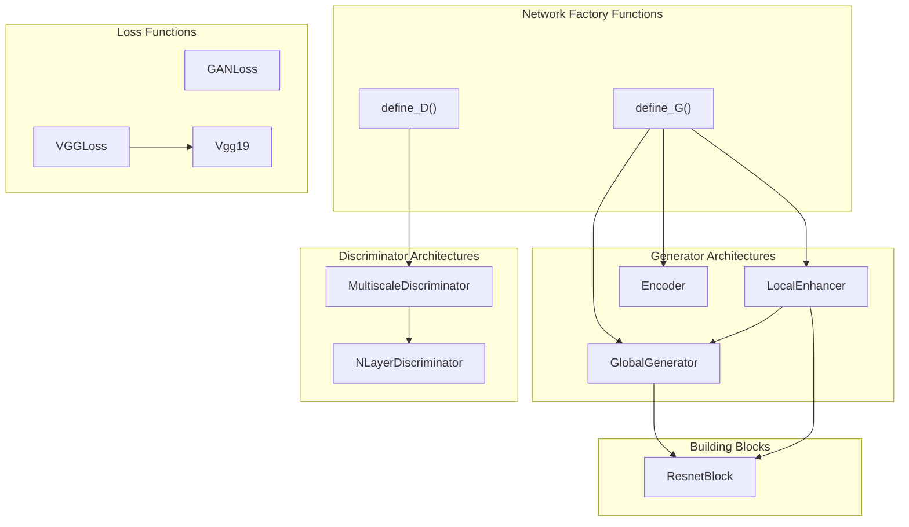

Sources: [models/networks.py:27-54](), [models/networks.py:65-124]()

## Generator Architectures

The pix2pixHD system implements three generator variants, each designed for specific purposes within the image synthesis pipeline.

### Factory Function

The generator networks are instantiated through the `define_G` factory function, which supports three types of generators:

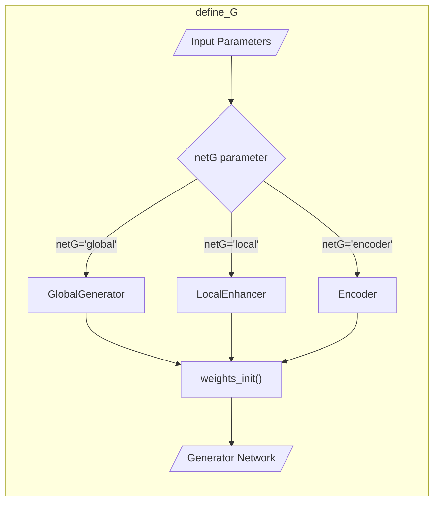

Sources: [models/networks.py:27-44]()

### GlobalGenerator

The GlobalGenerator is the foundation of the pix2pixHD generation system, implementing a classic encoder-decoder architecture with residual blocks.

```mermaid
flowchart TB
    subgraph "GlobalGenerator"
        input[/"Input Image"/] --> reflect1["ReflectionPad2d(3)"]
        reflect1 --> conv1["Conv2d(input_nc, ngf, k=7)"]
        conv1 --> norm1["norm_layer(ngf)"]
        norm1 --> relu1["ReLU"]
        
        relu1 --> down["Downsampling Blocks (×n_downsampling)"]
        down --> res["ResNet Blocks (×n_blocks)"]
        res --> up["Upsampling Blocks (×n_downsampling)"]
        
        up --> reflect2["ReflectionPad2d(3)"]
        reflect2 --> conv2["Conv2d(ngf, output_nc, k=7)"]
        conv2 --> tanh["Tanh"]
        tanh --> output[/"Output Image"/]
    end
```

Key characteristics:
- Initial reflection padding and 7×7 convolutional layer
- Multiple downsampling layers (typically 3) that reduce spatial dimensions and increase feature channels
- A sequence of ResNet blocks (typically 9) for transformation in feature space
- Symmetric upsampling layers with transposed convolutions
- Final 7×7 convolution with Tanh activation to produce the output image

Sources: [models/networks.py:183-211]()

### LocalEnhancer

The LocalEnhancer extends the GlobalGenerator with multi-scale processing for improved detail generation.

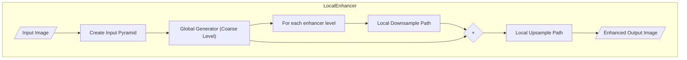

Key characteristics:
- Builds on top of a GlobalGenerator for coarse feature generation
- Creates an input pyramid with multiple resolutions
- For each enhancer level, processes the corresponding input resolution
- Combines the local processing path with the global features
- Progressively refines the output through multiple enhancer levels
- Supports hierarchical generation with multiple local enhancers (typically 1-3)

Sources: [models/networks.py:129-181]()

### Encoder

The Encoder is used for feature extraction, particularly for instance-level feature encoding.

```mermaid
flowchart TB
    subgraph "Encoder"
        input[/"Input Image"/] --> reflect1["ReflectionPad2d(3)"]
        reflect1 --> conv1["Conv2d(input_nc, ngf, k=7)"]
        conv1 --> norm1["norm_layer(ngf)"]
        norm1 --> relu1["ReLU"]
        
        relu1 --> down["Downsampling Blocks (×n_downsampling)"]
        down --> up["Upsampling Blocks (×n_downsampling)"]
        
        up --> reflect2["ReflectionPad2d(3)"]
        reflect2 --> conv2["Conv2d(ngf, output_nc, k=7)"]
        conv2 --> tanh["Tanh"]
        
        tanh --> instPool["Instance-wise Average Pooling"]
        instPool --> output[/"Feature Maps"/]
    end
```

Key characteristics:
- Similar architecture to GlobalGenerator but designed for feature extraction
- Takes both an input image and an instance map
- Performs instance-wise average pooling to get consistent features for each object instance
- Outputs feature maps that can be used to control the generator's output

Sources: [models/networks.py:255-290]()

### ResnetBlock

The ResnetBlock is a fundamental building block used in the generator architectures.

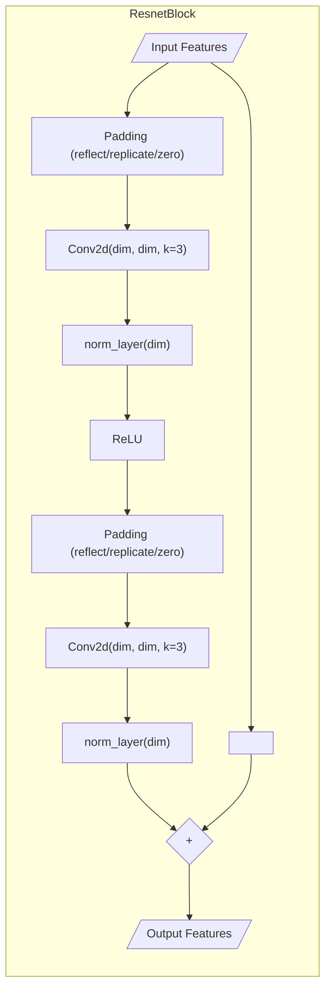

Key characteristics:
- Implements a residual connection (skip connection)
- Two convolutional layers with normalization
- Supports different padding types (reflect, replicate, zero)
- Optionally includes dropout for regularization

Sources: [models/networks.py:213-253]()

## Discriminator Architectures

The pix2pixHD system uses a multi-scale PatchGAN discriminator architecture to evaluate generated images at different resolutions.

### Factory Function

The discriminator networks are instantiated through the `define_D` factory function:

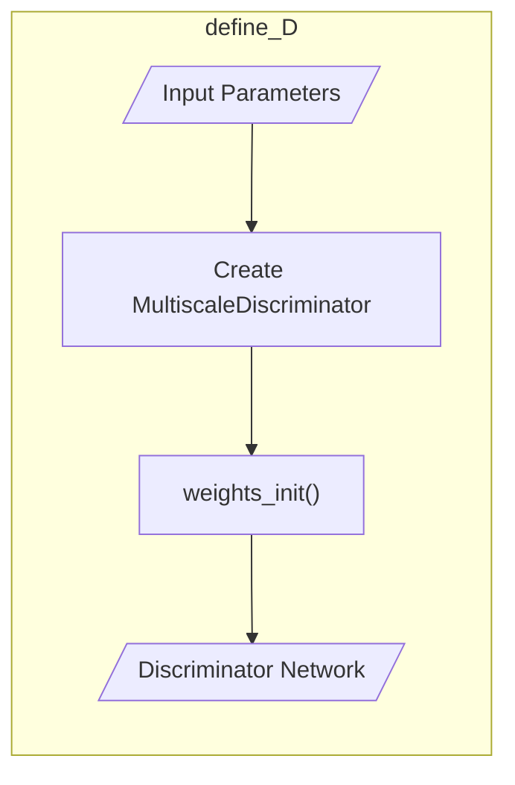

Sources: [models/networks.py:46-54]()

### MultiscaleDiscriminator

The MultiscaleDiscriminator consists of multiple NLayerDiscriminators operating at different scales.

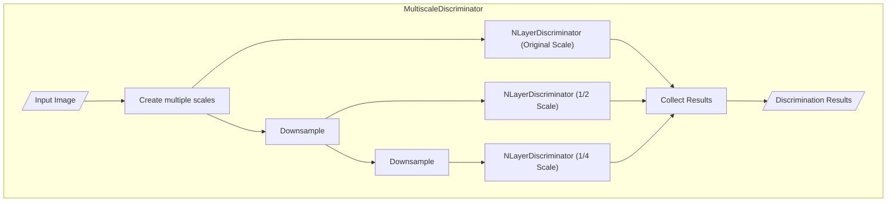

Key characteristics:
- Creates multiple discriminators (typically 3) at different image scales
- Each scale processes a progressively downsampled version of the input
- Uses average pooling for downsampling between scales
- Can optionally return intermediate features from each discriminator

Sources: [models/networks.py:292-331]()

### NLayerDiscriminator

The NLayerDiscriminator is the basic PatchGAN discriminator used within the multi-scale architecture.

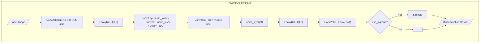

Key characteristics:
- Series of convolutional layers with increasing feature channels
- Uses stride of 2 for downsampling in the initial layers
- LeakyReLU activations with slope 0.2
- Optional sigmoid activation for the final output
- Can return intermediate features if the `getIntermFeat` flag is set

Sources: [models/networks.py:334-383]()

## Loss Functions

The pix2pixHD system employs specialized loss functions for training the generator and discriminator networks.

### GANLoss

The GANLoss class implements the adversarial loss used in GAN training.

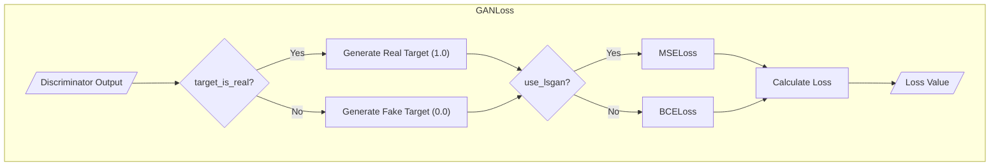

Key characteristics:
- Supports both Least Squares GAN (LSGAN) and standard GAN loss
- Automatically creates target tensors for real and fake samples
- Handles both single discriminator outputs and lists of outputs (for multi-scale)
- Real targets are set to 1.0 by default, fake targets to 0.0

Sources: [models/networks.py:68-110]()

### VGGLoss

The VGGLoss implements a perceptual loss using the VGG19 network.

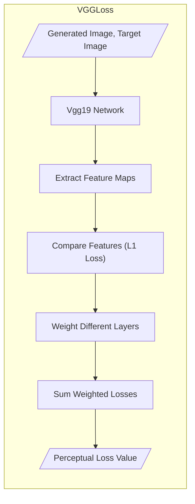

Key characteristics:
- Uses a pre-trained VGG19 network to extract features
- Compares features at multiple layers between generated and target images
- Applies different weights to losses from different layers
- Results in a perceptual loss that captures high-level features and textures

Sources: [models/networks.py:112-124](), [models/networks.py:386-416]()

## Code Integration and Usage

The network architectures are integrated into the pix2pixHD system through the factory functions and model creation process.

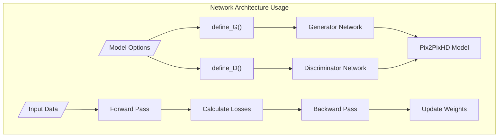

Key integration points:
- Networks are initialized through factory functions with configurable parameters
- Multiple generator architectures can be selected based on the task requirements
- Multi-scale discriminators provide feedback at different resolutions
- Specialized loss functions guide the training process
- Weight initialization is standardized across all network components

Sources: [models/networks.py:10-16](), [models/networks.py:27-54]()

## Network Configuration Parameters

The network architectures can be configured through various parameters to adjust their capacity and behavior.

| Parameter | Description | Typical Values |
|-----------|-------------|----------------|
| `netG` | Generator architecture type | 'global', 'local', 'encoder' |
| `ngf` | Number of generator filters | 32, 64 |
| `n_downsample_global` | Downsample layers in global generator | 3, 4 |
| `n_blocks_global` | ResNet blocks in global generator | 9 |
| `n_local_enhancers` | Number of local enhancers | 1, 2 |
| `n_blocks_local` | ResNet blocks in local enhancer | 3 |
| `ndf` | Number of discriminator filters | 64 |
| `n_layers_D` | Layers in each discriminator | 3, 4 |
| `num_D` | Number of discriminators (scales) | 3 |
| `norm` | Normalization type | 'instance', 'batch' |
| `use_sigmoid` | Whether to use sigmoid in discriminator | False (for LSGAN) |
| `getIntermFeat` | Return intermediate features | True, False |

Sources: [models/networks.py:18-25](), [models/networks.py:27-37](), [models/networks.py:46-48]()

---

