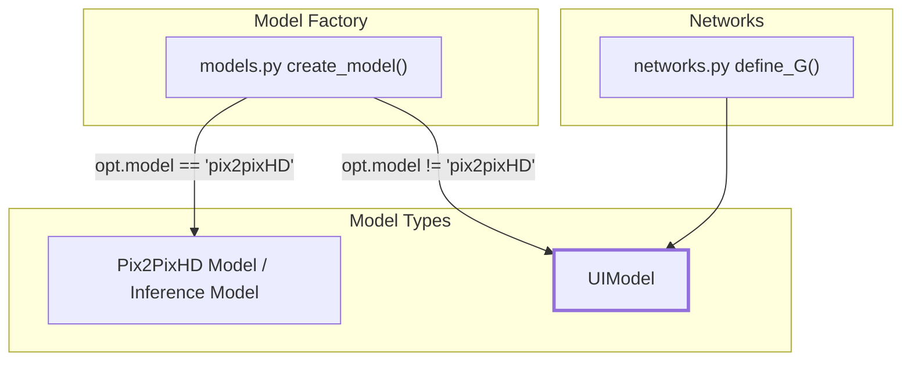
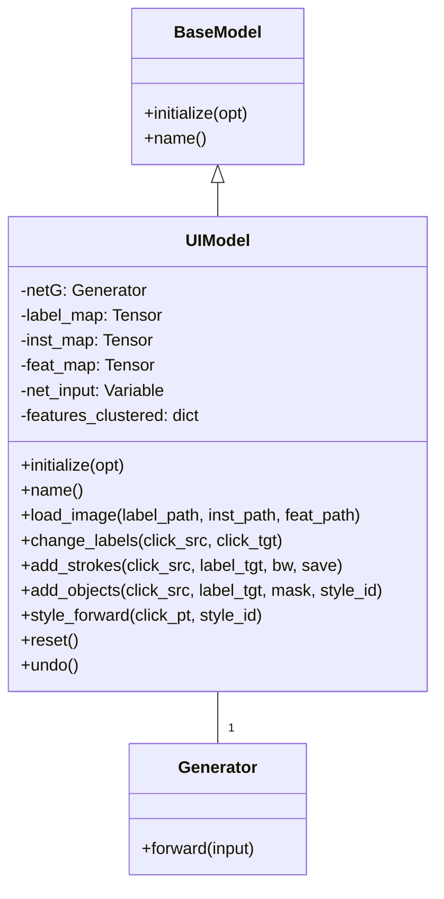
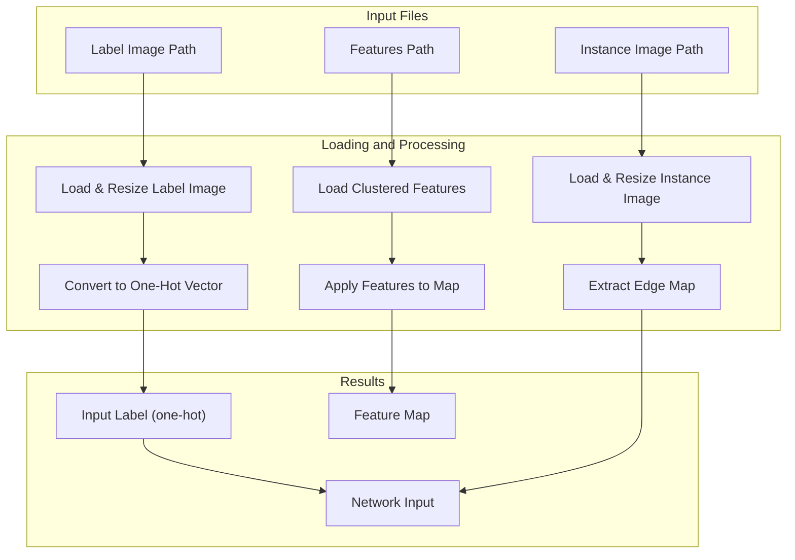
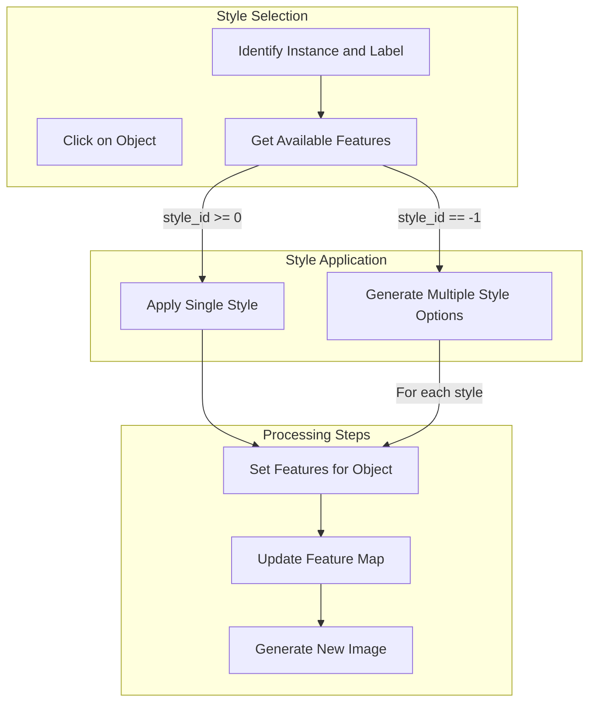

<!-- source: DeepWiki mcp.deepwiki.com · repo NVIDIA/pix2pixHD · page 3.3 UI Model · fetched 2026-10-26 -->

# UI Model

<details>
<summary>Relevant source files</summary>

The following files were used as context for generating this wiki page:

- [models/models.py](models/models.py)
- [models/ui_model.py](models/ui_model.py)

</details>


## Purpose and Scope

The UI Model is a specialized component within the pix2pixHD system that enables interactive image manipulation and editing. Unlike the main Pix2PixHD Model which focuses on training and inference, the UI Model provides tools for users to interactively modify generated images by changing labels, adding strokes, incorporating new objects, and applying different styles to objects.

For information about the main Pix2PixHD Model used for training and standard inference, see [Pix2PixHD Model](#3.1).

Sources: [models/ui_model.py:11-14](), [models/models.py:10-12]()

## Architecture and Position in System

The UI Model extends the base model framework and integrates with the generator network to provide interactive image manipulation capabilities.

### System Context



The UI Model is created by the model factory (`create_model` function in `models.py`) when the model option is not set to 'pix2pixHD'. It utilizes network architectures defined in `networks.py`, specifically the generator network created via `define_G`.

Sources: [models/models.py:3-20](), [models/ui_model.py:15-31]()

### Class Structure



The UIModel inherits from BaseModel and contains:
- A generator network (`netG`)
- Tensors for label maps, instance maps, and feature maps
- Input variable for the network
- Clustered features dictionary
- Methods for various interactive operations

Sources: [models/ui_model.py:11-14](), [models/ui_model.py:15-31]()

## Core Components and Data Flow

The UI Model manages several types of data to enable interactive image manipulation:

```mermaid
flowchart TD
    subgraph "Input Data"
        label["Label Map"]
        inst["Instance Map"]
        features["Feature Clusters"]
    end
    
    subgraph "Processed Data"
        input_label["One-hot Encoded Label Map"]
        edge_map["Edge Map"]
        feat_map["Feature Map"]
        net_input["Network Input"]
    end
    
    subgraph "Model Operations"
        load["load_image()"]
        change["change_labels()"]
        strokes["add_strokes()"]
        objects["add_objects()"]
        style["style_forward()"]
    end
    
    subgraph "Output"
        gen["Generator Network (netG)"]
        fake["Generated Image"]
    end
    
    label --> load
    inst --> load
    features --> load
    
    load --> input_label
    load --> edge_map
    load --> feat_map
    
    input_label --> net_input
    edge_map --> net_input
    
    change --> net_input
    change --> feat_map
    strokes --> net_input
    strokes --> feat_map
    objects --> net_input
    objects --> feat_map
    style --> net_input
    style --> feat_map
    
    net_input --> gen
    feat_map --> gen
    gen --> fake
```

The UI Model loads and processes label maps, instance maps, and features. It applies various operations to these data structures based on user interactions, then combines them to create the network input for the generator to produce the final image.

Sources: [models/ui_model.py:41-89](), [models/ui_model.py:215-221]()

## Initialization and Setup

The UI Model is initialized in a non-training mode and loads a pre-trained generator network:

1. The `initialize` method sets up the model with the provided options
2. It verifies the model is not in training mode (`assert(not opt.isTrain)`)
3. It configures the generator input channels based on options:
   - Base input channels from label categories
   - Additional channel for instance map (if enabled)
   - Additional channels for features (if enabled)
4. It creates the generator network using `networks.define_G`
5. It loads pre-trained weights from a specified epoch

Sources: [models/ui_model.py:15-31]()

## Image Loading and Processing

The UI Model provides methods to load and process images for interactive manipulation:

### Image Loading Process



The `load_image` method:
1. Loads and resizes the label image
2. Converts it to a one-hot vector representation
3. Loads and processes the instance map (if enabled)
4. Extracts edge maps from the instance map
5. Loads clustered features and applies them to the feature map
6. Stores original states for undo/reset functionality

Sources: [models/ui_model.py:41-89](), [models/ui_model.py:91-97](), [models/ui_model.py:98-105]()

## Interactive Features

The UI Model provides four main interactive features for image manipulation:

### 1. Changing Labels

The `change_labels` method allows changing the label of an object from one class to another:

1. Takes source and target click positions
2. Identifies the label and instance at the source position
3. Finds all pixels with the same instance ID
4. Updates the label map, instance map, and feature map for those pixels
5. Regenerates the image with the updated maps

This enables transferring the appearance of one object type to another object in the image.

Sources: [models/ui_model.py:117-149]()

### 2. Adding Strokes

The `add_strokes` method adds strokes of a target label to the image:

1. Takes a click position, target label, and brush width
2. Identifies the region affected by the stroke
3. Updates the label map, instance map, and feature map for that region
4. Regenerates the image with the updated maps

This allows for painting or sketching new elements into the image.

Sources: [models/ui_model.py:152-187]()

### 3. Adding Objects

The `add_objects` method adds entire objects to the image:

1. Takes a click position, target label, object mask, and style ID
2. Positions the mask at the click location
3. Updates the label map, instance map, and feature map using the mask
4. Applies the specified style to the new object
5. Regenerates the image with the updated maps

This enables inserting predefined objects with specific styles into the image.

Sources: [models/ui_model.py:190-213]()

### 4. Applying Styles



The `style_forward` method applies different styles to a selected object:

1. If no click point is provided, it generates the image with current settings
2. If a click point is provided:
   - It identifies the object at that position
   - It retrieves available feature clusters for that object type
   - If a specific style ID is provided, it applies that style
   - If no style ID is provided, it generates images with all available styles
3. It updates the feature map and regenerates the image(s)

This allows exploring different appearance variations for the same object.

Sources: [models/ui_model.py:225-284]()

## Feature Handling

The UI Model provides several methods to manage and manipulate feature maps:

### Feature Setting and Copying

- `set_features`: Assigns feature values from a specific cluster to selected pixels
- `copy_features`: Copies feature values from a target position to source positions
- `update_features`: Updates the feature map when objects are added or labels changed
- `get_crop_region`: Identifies the region of interest around an object for efficient processing

These methods enable sophisticated control over object appearances by manipulating underlying feature representations.

Sources: [models/ui_model.py:326-334](), [models/ui_model.py:292-307](), [models/ui_model.py:309-324]()

## Summary

The UI Model extends the core pix2pixHD functionality to provide interactive image manipulation capabilities. It enables users to:

1. Change object labels to transform appearances
2. Add brushstrokes to paint new elements
3. Insert complete objects with specific styles
4. Explore different stylistic variations of objects

These capabilities are implemented through manipulation of label maps, instance maps, and feature maps, which are then processed by a pre-trained generator network to produce the modified images.

Sources: [models/ui_model.py:11-347]()

---

