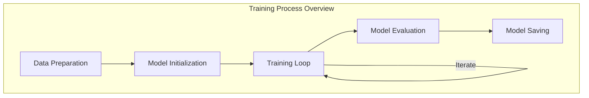
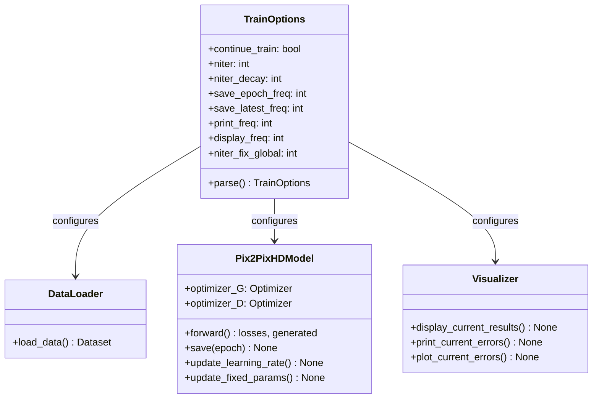
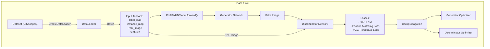
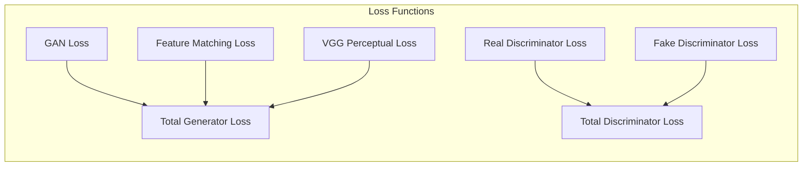
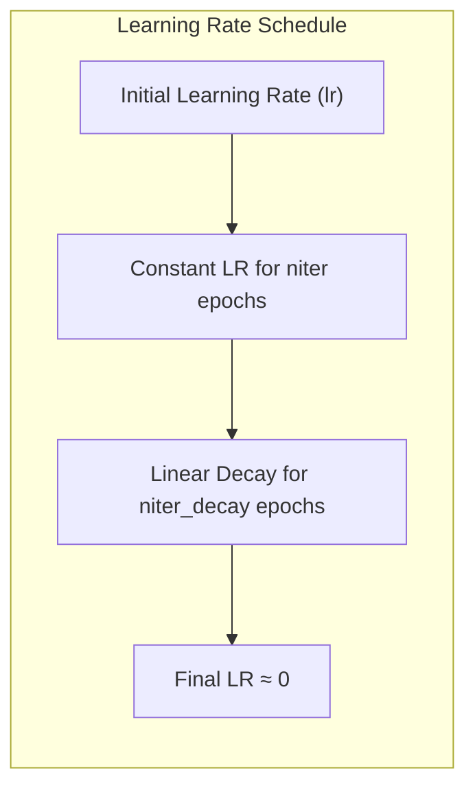
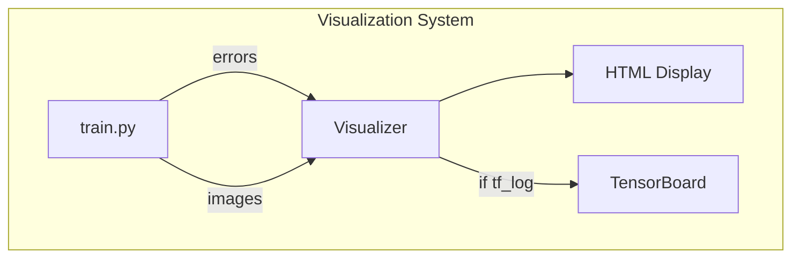
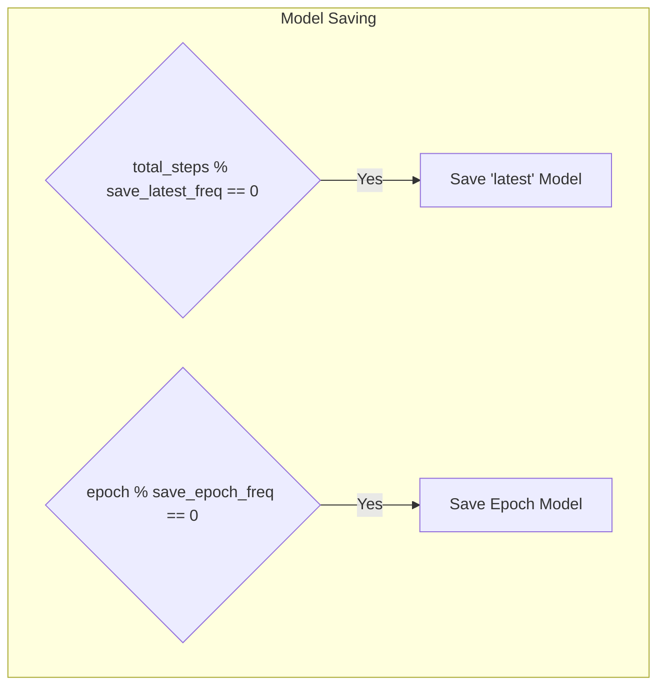
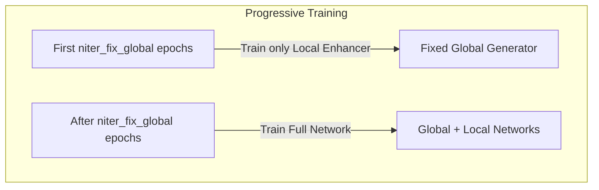

<!-- source: DeepWiki mcp.deepwiki.com · repo NVIDIA/pix2pixHD · page 4 Training · fetched 2026-10-26 -->

# Training

<details>
<summary>Relevant source files</summary>

The following files were used as context for generating this wiki page:

- [README.md](README.md)
- [train.py](train.py)
- [util/util.py](util/util.py)

</details>


This page documents the training process for pix2pixHD, a high-resolution image-to-image translation framework. It covers the workflow for training the model, configuration options, and best practices. For information about testing and inference, see [Testing and Inference](#5).

## 1. Training Overview

The pix2pixHD training system takes semantic label maps as input and trains a conditional GAN model to generate photorealistic images. The training process involves a generator network that learns to translate label maps to realistic images, and a discriminator network that learns to distinguish between real and generated images.



Sources: [train.py:16-142]()

## 2. Training Workflow

The training workflow in pix2pixHD follows a standard GAN training approach with specialized components for high-resolution image synthesis.

```mermaid
flowchart TD
    subgraph "Detailed Training Workflow"
        init["Initialize Options"] --> loadData["Load Training Data"]
        loadData --> createModel["Create pix2pixHD Model"]
        createModel --> createVis["Create Visualizer"]
        createVis --> epochLoop["Epoch Loop"]
        
        epochLoop --> |"For each batch"| forward["Forward Pass: 
        Generate Image from Label"]
        forward --> calcLoss["Calculate Losses:
        - GAN Loss
        - Feature Matching Loss
        - VGG Loss"]
        calcLoss --> backwardG["Backward Pass & Update Generator"]
        backwardG --> backwardD["Backward Pass & Update Discriminator"]
        backwardD --> checkSave["Check for Visualization & Saving"]
        checkSave --> |"Next batch"| forward
        
        checkSave --> |"End of epoch"| updateLR["Update Learning Rate"]
        updateLR --> checkFixed["Check for Fixed Parameters Update"]
        checkFixed --> |"Next epoch"| epochLoop
    end
```



Sources: [train.py:16-142]()

### 2.1 Initialization

The training process begins by parsing command-line options using `TrainOptions` and initializing the data loader, model, and visualizer.



Sources: [train.py:11-42]()

### 2.2 Training Loop

The training loop iterates over epochs and batches, performing forward and backward passes and updating the model parameters.

1. **Forward Pass**: The model takes label maps, instance maps, real images, and features as input and generates a synthetic image.
2. **Loss Calculation**: The model calculates losses for the generator and discriminator.
3. **Backward Pass**: The gradients are computed and parameters are updated.
4. **Visualization**: The training progress is visualized at regular intervals.

Sources: [train.py:56-122]()

### 2.3 Model Updates and Learning Rate Decay

At the end of each epoch, the model is saved and learning rate is updated if necessary:

1. Model is saved at the configured frequency (`save_epoch_freq`)
2. Fixed parameters are updated after a certain number of iterations (`niter_fix_global`)
3. Learning rate is linearly decayed after a certain number of iterations (`niter`)

Sources: [train.py:123-142]()

## 3. Training Configuration

pix2pixHD provides extensive configuration options for training through the command-line interface.

### 3.1 Basic Training Options

| Option | Description | Default Value |
|--------|-------------|---------------|
| `--name` | Name of the experiment | required |
| `--batchSize` | Input batch size | 1 |
| `--loadSize` | Scale images to this size | 1024 |
| `--fineSize` | Crop to this size | 512 |
| `--label_nc` | Number of input label channels | 35 |
| `--input_nc` | Number of input image channels | 3 |
| `--output_nc` | Number of output image channels | 3 |
| `--niter` | Number of epochs with initial learning rate | 100 |
| `--niter_decay` | Number of epochs with linearly decaying learning rate | 100 |
| `--lr` | Initial learning rate | 0.0002 |

Sources: [README.md:125-126]()

### 3.2 Model Architecture Options

| Option | Description | Default Value |
|--------|-------------|---------------|
| `--netG` | Generator architecture (`global`, `local`, or `encoder`) | `global` |
| `--ngf` | Number of generator filters in first conv layer | 64 |
| `--n_downsample_global` | Number of downsampling layers in global generator | 4 |
| `--n_blocks_global` | Number of residual blocks in global generator | 9 |
| `--n_local_enhancers` | Number of local enhancers | 1 |
| `--n_blocks_local` | Number of residual blocks in local enhancer | 3 |
| `--ndf` | Number of discriminator filters in first conv layer | 64 |
| `--n_layers_D` | Number of discriminator layers | 3 |

Sources: [README.md:125-126]()

### 3.3 Loss Function Options

| Option | Description | Default Value |
|--------|-------------|---------------|
| `--no_ganFeat_loss` | Do not use GAN feature matching loss | False |
| `--no_vgg_loss` | Do not use VGG feature matching loss | False |
| `--lambda_feat` | Weight for feature matching loss | 10.0 |
| `--lambda_vgg` | Weight for VGG loss | 10.0 |

Sources: [README.md:125-126]()

## 4. Training Scripts

pix2pixHD provides several example training scripts in the `scripts` directory for different scenarios.

### 4.1 Basic Training

To train a model at 512p resolution:

```bash
python train.py --name label2city_512p
```

Sources: [README.md:90-94]()

### 4.2 Multi-GPU Training

To train using multiple GPUs:

```bash
python train.py --name label2city_512p --batchSize 8 --gpu_ids 0,1,2,3,4,5,6,7
```

Sources: [README.md:98-104]()

### 4.3 Mixed Precision Training

To train with Automatic Mixed Precision (AMP) for faster speed:

```bash
python -m torch.distributed.launch train.py --name label2city_512p --fp16
```

This can speed up training by about 80% on Volta architecture GPUs.

Sources: [README.md:106-113]()

### 4.4 Training at Full Resolution

For training at 2048x1024 resolution, different scripts are provided based on available GPU memory:

- 24G memory GPU: `./scripts/train_1024p_24G.sh`
- 16G memory GPU with mixed precision: `./scripts/train_1024p_16G.sh`
- 12G memory GPU (with cropping): `./scripts/train_1024p_12G.sh`

Sources: [README.md:115-117]()

## 5. Data Flow During Training



Sources: [train.py:36-96]()

### 5.1 Input Data Format

pix2pixHD expects the following data format for training:

1. **Label Maps**: One-channel images where pixel values correspond to object labels (0,1,...,N-1)
2. **Instance Maps**: Instance segmentation maps (optional, can be disabled with `--no_instance`)
3. **Real Images**: Target photorealistic images
4. **Features**: Encoded features (optional, used for instance-aware generation)

Sources: [README.md:119-123](), [train.py:70-71]()

### 5.2 Data Preprocessing

The default preprocessing for training data is:

- **`scale_width`**: Scales the width of all training images to `opt.loadSize` (1024) while preserving aspect ratio
- **`crop`**: Random cropping to size `(opt.fineSize, opt.fineSize)`
- **`scale_width_and_crop`**: Combines width scaling and random cropping
- **`none`**: No preprocessing except ensuring the image is divisible by 32

Sources: [README.md:123]()

## 6. Training Mechanics

### 6.1 Loss Functions

pix2pixHD uses multiple loss functions for training:



Sources: [train.py:76-79]()

1. **GAN Loss**: Adversarial loss from the discriminator
2. **Feature Matching Loss**: Matches intermediate features in the discriminator
3. **VGG Perceptual Loss**: Matches features from a pre-trained VGG network
4. **Discriminator Loss**: Combination of real and fake discriminator losses

### 6.2 Optimization Process

The optimization process alternates between updating the generator and discriminator:

1. **Generator Update**:
   ```python
   optimizer_G.zero_grad()
   loss_G.backward()
   optimizer_G.step()
   ```

2. **Discriminator Update**:
   ```python
   optimizer_D.zero_grad()
   loss_D.backward()
   optimizer_D.step()
   ```

Sources: [train.py:82-96]()

### 6.3 Learning Rate Strategy

pix2pixHD uses a linearly decaying learning rate after a fixed number of iterations:



Sources: [train.py:139-141]()

## 7. Monitoring and Visualization

pix2pixHD provides tools for monitoring the training progress and visualizing results.

### 7.1 Training Progress Visualization

The `Visualizer` class is used to display training progress:

1. **Error Plotting**: Plots loss values over time
2. **Image Visualization**: Displays input labels, generated images, and real images
3. **TensorBoard Support**: Optional TensorBoard logging (`--tf_log`)



Sources: [train.py:108-112](), [README.md:95-96]()

### 7.2 Visualized Content

During training, the following images are visualized:

1. **Input Label**: Colorized label map
2. **Synthesized Image**: Output from the generator
3. **Real Image**: Ground truth image

Images are displayed in an HTML file located at `./checkpoints/[experiment_name]/web/index.html`.

Sources: [train.py:108-112](), [util/util.py:10-35]()

## 8. Model Saving and Resuming

pix2pixHD saves model checkpoints periodically and allows resuming training from these checkpoints.

### 8.1 Model Saving

Models are saved at two frequencies:

1. **Latest Model**: Saved every `save_latest_freq` iterations
2. **Epoch Models**: Saved every `save_epoch_freq` epochs



Sources: [train.py:114-118](), [train.py:128-133]()

### 8.2 Resuming Training

To resume training from a saved checkpoint, use the `--continue_train` option:

```bash
python train.py --name label2city_512p --continue_train
```

This will load the latest saved model and resume training from that point.

Sources: [train.py:19-24]()

## 9. Training Strategies and Best Practices

### 9.1 Progressive Training Strategy

pix2pixHD supports a progressive training strategy using the `--niter_fix_global` option:

1. First train only the local enhancer network while keeping the global generator fixed
2. After `niter_fix_global` epochs, train the entire network



Sources: [train.py:135-137]()

### 9.2 Memory Optimization

For high-resolution training, consider the following options:

1. **Mixed Precision Training**: Use `--fp16` for reduced memory usage and faster training
2. **Cropping**: Use smaller crop sizes to fit in memory
3. **Batch Size**: Reduce batch size if necessary

Sources: [README.md:106-117]()

### 9.3 Custom Dataset Training

To train with a custom dataset:

1. Organize data into paired label maps and images
2. Specify the correct number of label channels with `--label_nc`
3. Set `--label_nc 0` for direct RGB input instead of label maps
4. Use `--no_instance` if instance maps are not available

Sources: [README.md:119-123]()

---

