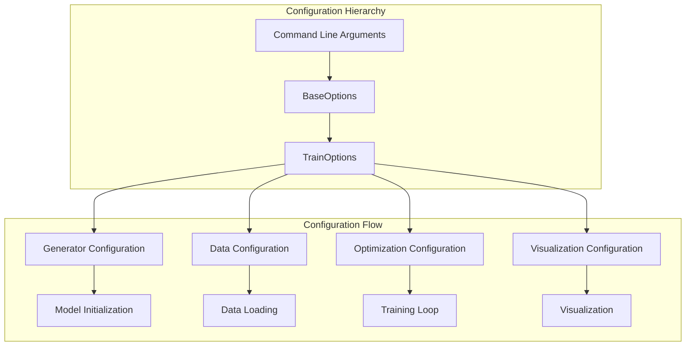
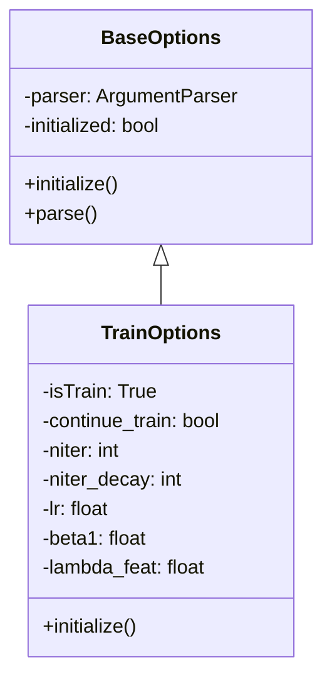
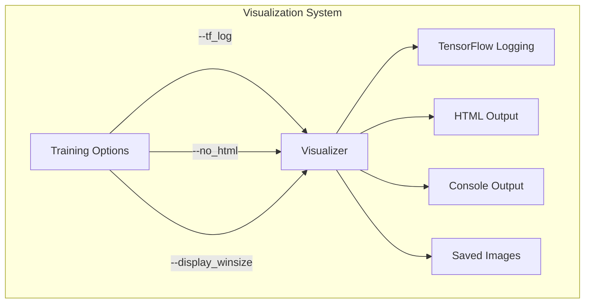

<!-- source: DeepWiki mcp.deepwiki.com · repo NVIDIA/pix2pixHD · page 4.1 Training Configuration · fetched 2026-10-26 -->

# Training Configuration

<details>
<summary>Relevant source files</summary>

The following files were used as context for generating this wiki page:

- [options/base_options.py](options/base_options.py)
- [util/visualizer.py](util/visualizer.py)

</details>


This page documents the training configuration options for the pix2pixHD system. It details how to configure various aspects of the training process, including model architecture, data loading, optimization parameters, and visualization settings. For information about testing configurations, see [Testing Configuration](#5.1).

## 1. Configuration System Overview

The pix2pixHD framework uses a hierarchical configuration system based on command-line arguments. The configuration options are organized in a class hierarchy that allows for flexible customization of the training process.



Sources: [options/base_options.py:6-99]()

## 2. Base Configuration Options

The base configuration options define the fundamental parameters for both training and testing. These are implemented in the `BaseOptions` class.

### 2.1 Experiment Configuration

These options control the basic setup of the experiment:

| Option | Type | Default | Description |
|--------|------|---------|-------------|
| `--name` | str | 'label2city' | Name of the experiment, determines where samples and models are stored |
| `--gpu_ids` | str | '0' | GPU IDs to use (e.g., '0,1,2'), '-1' for CPU |
| `--checkpoints_dir` | str | './checkpoints' | Directory where models are saved |
| `--model` | str | 'pix2pixHD' | Which model architecture to use |
| `--norm` | str | 'instance' | Type of normalization (instance or batch) |
| `--use_dropout` | bool | False | Whether to use dropout in the generator |
| `--data_type` | int | 32 | Data precision (8, 16, or 32 bit) |
| `--verbose` | bool | False | Toggles verbose mode |
| `--fp16` | bool | False | Train with Automatic Mixed Precision (AMP) |

Sources: [options/base_options.py:11-22]()

### 2.2 Input/Output Configuration

These options control the dimensions and characteristics of input and output data:

| Option | Type | Default | Description |
|--------|------|---------|-------------|
| `--batchSize` | int | 1 | Input batch size |
| `--loadSize` | int | 1024 | Initial scale size for images |
| `--fineSize` | int | 512 | Final crop size after scaling |
| `--label_nc` | int | 35 | Number of input label channels |
| `--input_nc` | int | 3 | Number of input image channels |
| `--output_nc` | int | 3 | Number of output image channels |

Sources: [options/base_options.py:24-30]()

### 2.3 Dataset Configuration

These options control data loading and preprocessing:

| Option | Type | Default | Description |
|--------|------|---------|-------------|
| `--dataroot` | str | './datasets/cityscapes/' | Path to the dataset |
| `--resize_or_crop` | str | 'scale_width' | Image resizing/cropping strategy |
| `--serial_batches` | bool | False | Use sequential image order for batches |
| `--no_flip` | bool | False | Disable image flipping for data augmentation |
| `--nThreads` | int | 2 | Number of threads for data loading |
| `--max_dataset_size` | int | inf | Maximum number of samples per dataset |

Sources: [options/base_options.py:32-38]()

### 2.4 Generator Architecture Configuration

These options define the structure of the generator network:

| Option | Type | Default | Description |
|--------|------|---------|-------------|
| `--netG` | str | 'global' | Type of generator architecture |
| `--ngf` | int | 64 | Number of generator filters in first conv layer |
| `--n_downsample_global` | int | 4 | Number of downsampling layers in global generator |
| `--n_blocks_global` | int | 9 | Number of residual blocks in global generator network |
| `--n_blocks_local` | int | 3 | Number of residual blocks in local enhancer network |
| `--n_local_enhancers` | int | 1 | Number of local enhancers to use |
| `--niter_fix_global` | int | 0 | Number of epochs to only train the local enhancer |

Sources: [options/base_options.py:44-51]()

### 2.5 Feature Encoding Configuration

These options control instance-wise feature encoding:

| Option | Type | Default | Description |
|--------|------|---------|-------------|
| `--no_instance` | bool | False | If true, don't add instance map as input |
| `--instance_feat` | bool | False | If true, add encoded instance features as input |
| `--label_feat` | bool | False | If true, add encoded label features as input |
| `--feat_num` | int | 3 | Vector length for encoded features |
| `--load_features` | bool | False | If true, load precomputed feature maps |
| `--n_downsample_E` | int | 4 | Number of downsampling layers in encoder |
| `--nef` | int | 16 | Number of encoder filters in first conv layer |
| `--n_clusters` | int | 10 | Number of clusters for features |

Sources: [options/base_options.py:53-61]()

## 3. Training-Specific Configuration

While not directly visible in the provided code snippets, the training configuration extends base options with parameters specifically for the training process. These likely include learning rates, optimization settings, and training scheduling.



### 3.1 Training Process Configuration

Based on the system architecture, common training-specific configuration options would include:

| Option | Type | Typical Values | Description |
|--------|------|----------------|-------------|
| `--continue_train` | bool | False | Resume training from latest checkpoint |
| `--niter` | int | 100 | Number of epochs with constant learning rate |
| `--niter_decay` | int | 100 | Number of epochs with linearly decaying learning rate |
| `--lr` | float | 0.0002 | Initial learning rate |
| `--beta1` | float | 0.5 | Momentum term for Adam optimizer |
| `--no_html` | bool | False | Disable HTML visuals during training |
| `--display_freq` | int | 1000 | Frequency of showing training results |
| `--print_freq` | int | 100 | Frequency of showing training losses |
| `--save_latest_freq` | int | 5000 | Frequency of saving the latest model |
| `--save_epoch_freq` | int | 10 | Frequency of saving checkpoints at epoch end |

## 4. Visualization Configuration

The visualization system is configured through several options that control how training progress is displayed and saved.



| Option | Type | Default | Description |
|--------|------|---------|-------------|
| `--tf_log` | bool | False | Use TensorBoard for logging (requires TensorFlow) |
| `--display_winsize` | int | 512 | Display window size for visuals |
| `--no_html` | bool | False | Disable HTML visualization output |

Sources: [util/visualizer.py:13-34](), [options/base_options.py:40-42]()

## 5. Configuration Files and Saving

When training begins, the configuration is parsed from command-line arguments and saved to a text file in the experiment's checkpoint directory. This allows you to:

1. Document the exact configuration used for a training run
2. Reproduce experiments with the same settings
3. Continue training from checkpoints using the same configuration

The saved configuration file is located at:
```
<checkpoints_dir>/<experiment_name>/opt.txt
```

Sources: [options/base_options.py:89-98]()

## 6. Training Configuration Example

A typical pix2pixHD training command might look like:

```bash
python train.py --name cityscapes_hd --dataroot ./datasets/cityscapes/ --label_nc 35 \
                --loadSize 1024 --fineSize 512 --batchSize 8 \
                --netG local --ngf 32 --n_local_enhancers 2 \
                --niter 100 --niter_decay 100 --lr 0.0002 \
                --tf_log --nThreads 4
```

This configuration would:
- Name the experiment "cityscapes_hd"
- Use the Cityscapes dataset
- Set input label channels to 35 (Cityscapes classes)
- Load images at 1024px, then crop to 512px
- Use batch size of 8
- Use a local enhancer network architecture with 2 enhancers
- Train for 100 epochs at constant learning rate, then 100 epochs with decay
- Use TensorFlow logging
- Use 4 threads for data loading

---

