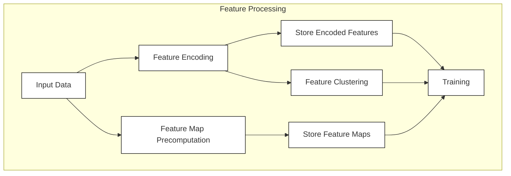
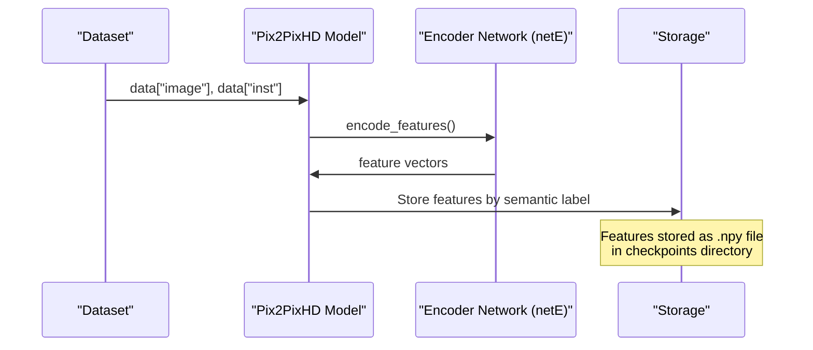
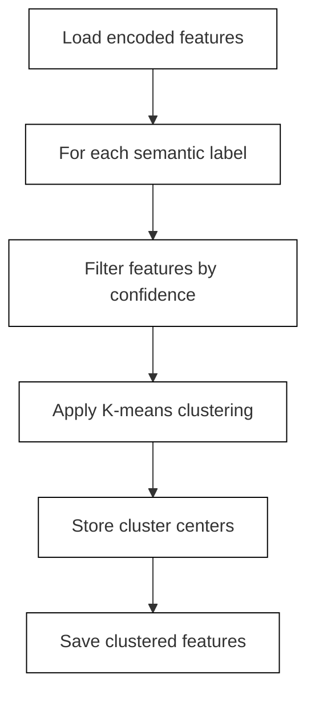
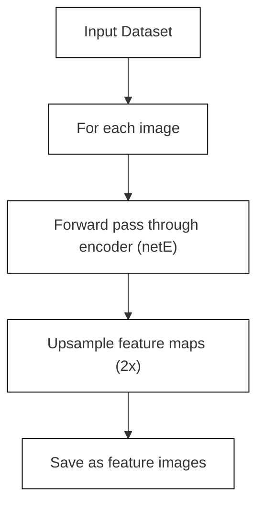
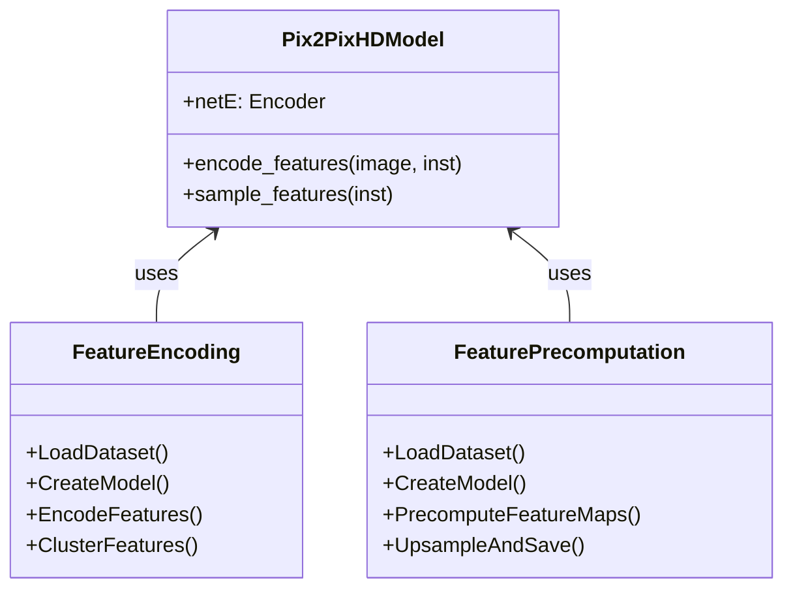

<!-- source: DeepWiki mcp.deepwiki.com · repo NVIDIA/pix2pixHD · page 4.2 Feature Processing · fetched 2026-10-26 -->

# Feature Processing

<details>
<summary>Relevant source files</summary>

The following files were used as context for generating this wiki page:

- [encode_features.py](encode_features.py)
- [precompute_feature_maps.py](precompute_feature_maps.py)

</details>


This page documents the feature processing subsystems in pix2pixHD, which are critical for enabling instance-level control and style manipulation in image generation. Feature processing consists of two main components: **Feature Encoding** and **Feature Map Precomputation**. For information about the overall training process, see [Training](#4), and for model architecture details, see [Neural Network Architectures](#3.2).

## Overview

Feature processing in pix2pixHD enhances the model's ability to:
1. Capture instance-specific style information
2. Transfer styles between instances of the same semantic class
3. Improve high-resolution image generation quality



Sources: [encode_features.py](), [precompute_feature_maps.py]()

## Feature Encoding

Feature encoding extracts style information from input images and their corresponding instance maps. This process captures instance-specific details that can later be transferred between different objects of the same semantic class.

### Encoding Process



Sources: [encode_features.py:24-37]()

The encoding process works as follows:

1. The script initializes a data structure to store features for each semantic label
2. For each image in the dataset:
   - It passes the image and instance map to the model's encoder
   - The encoder extracts feature vectors organized by semantic label
   - These features are accumulated for each label class
3. All features are saved to a single numpy file for later use

### Feature Clustering

After encoding, the features are clustered using K-means to create a more manageable set of style options for each semantic class.



Sources: [encode_features.py:39-54]()

Key properties of the clustering process:

| Property | Description |
|----------|-------------|
| Clustering Algorithm | K-means |
| Number of Clusters | Configurable via `opt.n_clusters` |
| Feature Selection | Only features with confidence > 0.5 are used |
| Storage Format | Numpy array of cluster centers per label |
| File Naming | `features_clustered_[n_clusters].npy` |

The clustered features represent "style prototypes" that can be used during training and inference to control the appearance of specific object instances.

## Feature Map Precomputation

Feature map precomputation generates spatial feature representations for training high-resolution images (specifically 1024p). This improves both training efficiency and output quality.



Sources: [precompute_feature_maps.py:26-33]()

The precomputation process:

1. Creates a dedicated directory for precomputed feature maps (`train_feat`)
2. For each training image:
   - Passes the image through the encoder network to generate feature maps
   - Upsamples the feature maps by a factor of 2 using nearest-neighbor interpolation
   - Converts the feature maps to image format
   - Saves the feature maps to the dedicated directory, maintaining the same filename structure

### Implementation Details



Sources: [encode_features.py](), [precompute_feature_maps.py]()

The scripts require specific options to be set:

| Option | Value | Purpose |
|--------|-------|---------|
| nThreads | 1 | Single-threaded processing |
| batchSize | 1 | Process one image at a time |
| serial_batches | True | Maintain consistent order |
| no_flip | True | Disable data augmentation |
| instance_feat | True | Enable instance feature extraction |

## Integration with Training

Feature processing is performed before the main training process. During training, the model can utilize:

1. **Encoded and clustered features** for style transfer between instances
2. **Precomputed feature maps** for generating high-resolution outputs

The feature processing scripts create necessary data assets that the main training system (`train.py`) can then utilize through options like:

- `instance_feat`: Enable the use of instance features
- `load_features`: Load preprocessed features
- `feat_num`: Specify the dimensionality of features

Sources: [encode_features.py:12](), [precompute_feature_maps.py:14]()

## Running Feature Processing

### Feature Encoding and Clustering

To encode features and perform clustering:

1. Ensure your dataset is properly organized
2. Run the feature encoding script:
   ```
   python encode_features.py --name [experiment_name] --dataroot [path_to_data] --label_nc [num_classes] --n_clusters [num_clusters]
   ```
3. The script will:
   - Encode features from all images in the dataset
   - Cluster the features using K-means
   - Save both raw features and cluster centers in the checkpoints directory

Sources: [encode_features.py:7-17]()

### Feature Map Precomputation

To precompute feature maps for high-resolution training:

1. Ensure your dataset is properly organized
2. Run the feature precomputation script:
   ```
   python precompute_feature_maps.py --name [experiment_name] --dataroot [path_to_data] --label_nc [num_classes]
   ```
3. The script will:
   - Process each image in the dataset
   - Generate and upsample feature maps
   - Save them to the `[dataroot]/train_feat` directory

Sources: [precompute_feature_maps.py:9-17](), [precompute_feature_maps.py:24]()

## Conclusion

Feature processing in pix2pixHD provides powerful capabilities for instance-level control and high-resolution generation. The two main components, feature encoding/clustering and feature map precomputation, work together to enhance the model's ability to generate detailed, controllable outputs. These preprocessing steps create the data assets necessary for the model to achieve its advanced style transfer capabilities during training and inference.

---

