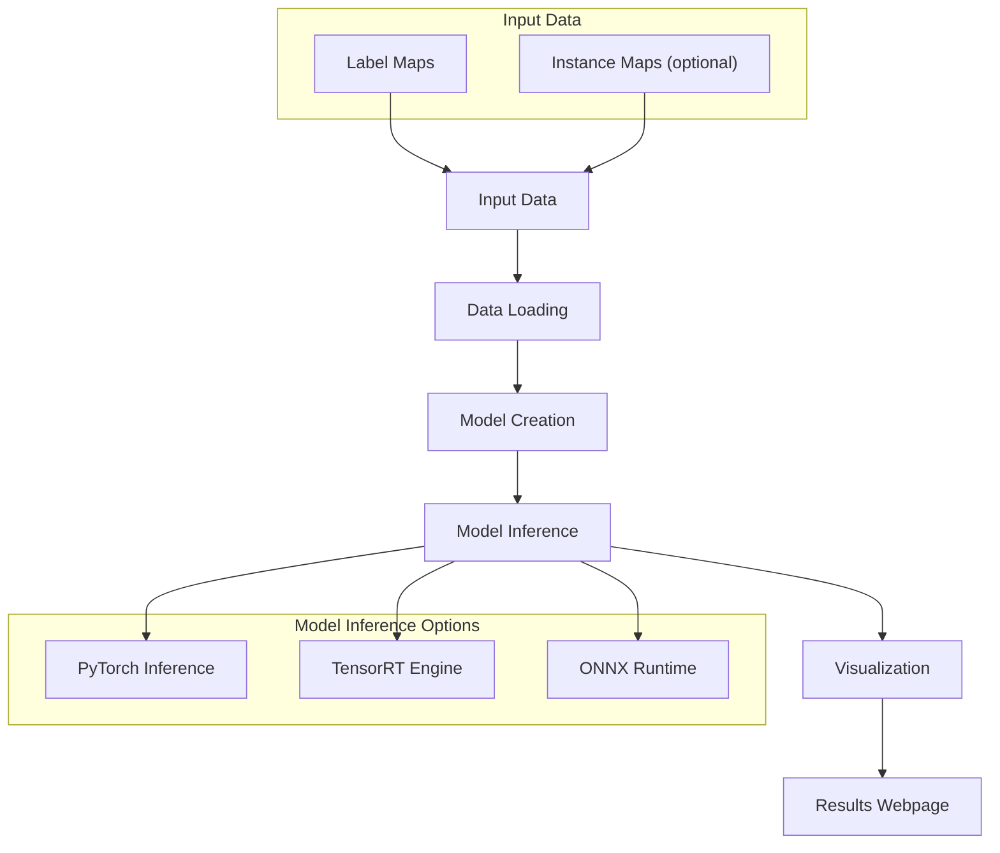
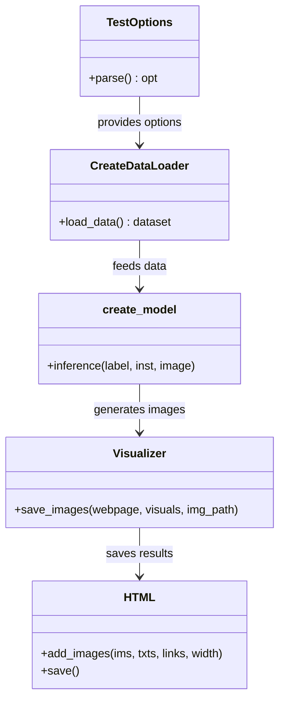
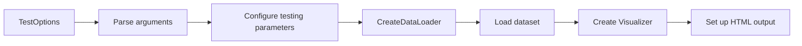
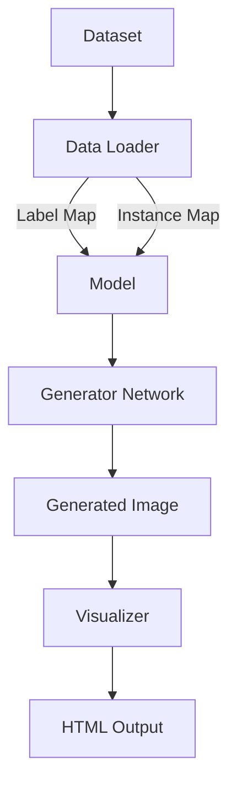
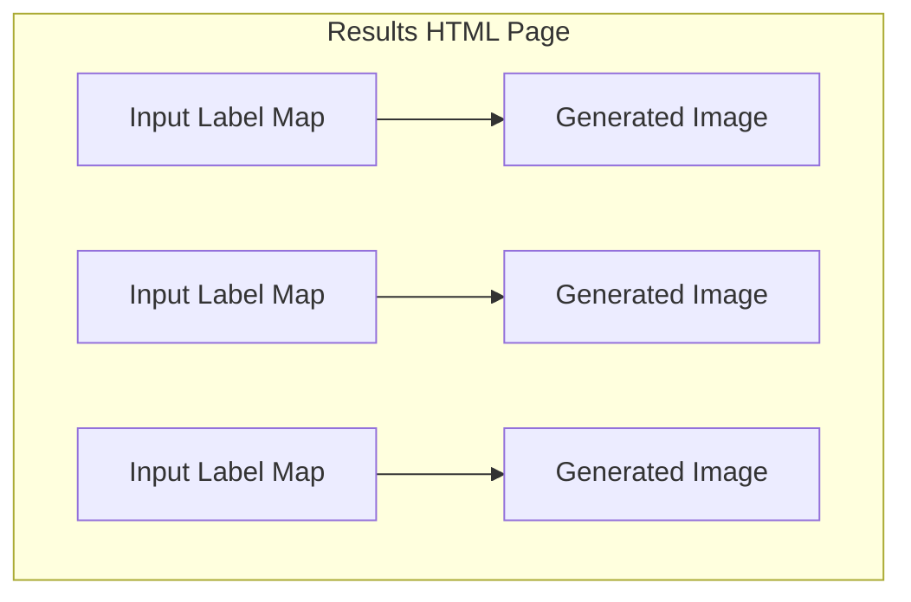

<!-- source: DeepWiki mcp.deepwiki.com · repo NVIDIA/pix2pixHD · page 5 Testing and Inference · fetched 2026-10-26 -->

# Testing and Inference

<details>
<summary>Relevant source files</summary>

The following files were used as context for generating this wiki page:

- [README.md](README.md)
- [test.py](test.py)
- [util/util.py](util/util.py)

</details>


This document provides a comprehensive guide to the testing and inference processes in the pix2pixHD system. It covers how to run inference using the pre-trained models, options for configuring the inference process, and explains different inference modes including standard PyTorch inference, TensorRT acceleration, and ONNX support. For information on the testing configuration options, see [Testing Configuration](#5.1).

## Overview of the Inference Process

The pix2pixHD system provides a streamlined workflow for generating high-resolution images from semantic label maps. The inference process follows a straightforward pipeline that loads input data (labels and optionally instance maps), processes it through the generator network, and produces photorealistic output images.



Sources: [test.py:1-67]()

## Key Components

The testing and inference system consists of several key components that work together to process input label maps and generate realistic output images.



Sources: [test.py:1-25]()

### Configuration and Setup

The inference process begins with setting up the appropriate options and data loaders:



Sources: [test.py:12-23]()

The test options include:
- Data type precision (`--data_type`): 32 (float), 16 (half), or 8 (uint8)
- Inference engine (`--engine`, `--onnx`)
- Number of images to process (`--how_many`)
- Batch size (fixed to 1 for testing)
- Model architecture options (`--netG`, `--ngf`)

## Running Inference

To run inference with pix2pixHD, you need to use the `test.py` script with appropriate options. The system will process input label maps and instance maps (if available) and generate corresponding photorealistic images.

### Basic Testing Command

The simplest way to run inference is with the standard PyTorch model:

```bash
python test.py --name label2city_1024p --netG local --ngf 32 --resize_or_crop none
```

This command loads a pre-trained model named "label2city_1024p" with a local generator architecture and processes the test dataset.

Sources: [README.md:72-79]()

### Data Flow During Inference

During inference, the data flows through the system as follows:



Sources: [test.py:38-67]()

## Inference Modes

The pix2pixHD system supports multiple inference modes to accommodate different deployment requirements.

### PyTorch Inference

This is the default inference mode, using the PyTorch framework to run the model. It supports various precision levels:

- Full precision (32-bit float): Default mode
- Half precision (16-bit float): Use `--data_type 16` for faster inference with minor quality loss
- Quantized (8-bit integer): Use `--data_type 8` for maximum speed but potential quality degradation

Sources: [test.py:26-34](), [test.py:58-59]()

### TensorRT Acceleration

For optimized inference performance, pix2pixHD supports TensorRT:

```bash
python test.py --engine /path/to/engine.trt
```

When using TensorRT, the system bypasses the standard PyTorch model and runs inference through the TensorRT engine, typically resulting in significant speed improvements.

Sources: [test.py:54-55]()

### ONNX Support

The system also supports ONNX format for cross-platform deployment:

#### Exporting to ONNX

```bash
python test.py --export_onnx model.onnx
```

#### Running Inference with ONNX

```bash
python test.py --onnx /path/to/model.onnx
```

Sources: [test.py:47-52](), [test.py:56-57]()

## Inference Process Details

The actual inference process differs slightly depending on the selected mode:

1. **PyTorch Inference**:
   - The model loads input label maps and optional instance maps
   - The generator produces an output image
   - For conditional generation, instance-level features can be used

2. **TensorRT/ONNX Inference**:
   - Input data is passed to the respective runtime
   - The engine/runtime handles the computation
   - Results are collected and converted to images

Sources: [test.py:38-59]()

## Visualization and Output

After inference, the system visualizes the results and saves them in an organized HTML webpage:

1. The input label map is converted to a colorized representation using `tensor2label`
2. The generated image is converted from tensor to image using `tensor2im`
3. Both images are saved alongside each other in the results directory
4. An HTML page is created to display the results in a user-friendly format

Sources: [test.py:61-67](), [util/util.py:10-35]()

The output directory structure is:

```
results/
└── [model_name]/
    └── test_[epoch]/
        ├── index.html       # Main result page
        └── images/          # Generated images
            ├── input_label_[filename].png
            └── synthesized_image_[filename].png
```

## Sample Testing Results

When running inference, the system produces side-by-side comparisons of input label maps and the corresponding generated images. The results are organized in an HTML webpage for easy viewing and comparison.



Sources: [test.py:61-67]()

## Summary

The testing and inference system in pix2pixHD provides:

1. A flexible framework for generating high-resolution images from semantic label maps
2. Support for multiple inference modes (PyTorch, TensorRT, ONNX)
3. Different precision options for performance optimization
4. Comprehensive visualization and result organization

To get started with testing, download the pre-trained models referenced in the README and run the appropriate testing script for your needs.

Sources: [README.md:72-79](), [test.py:1-67]()

---

