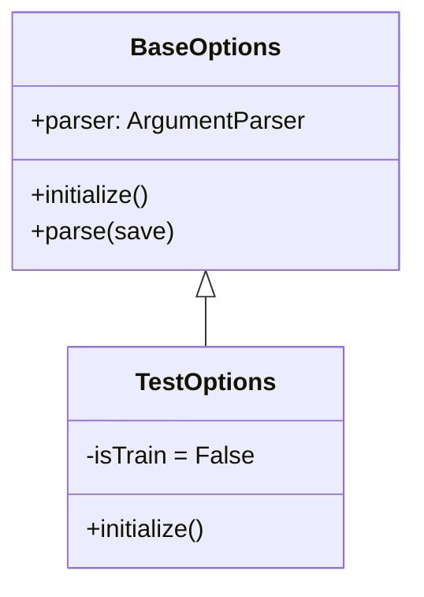
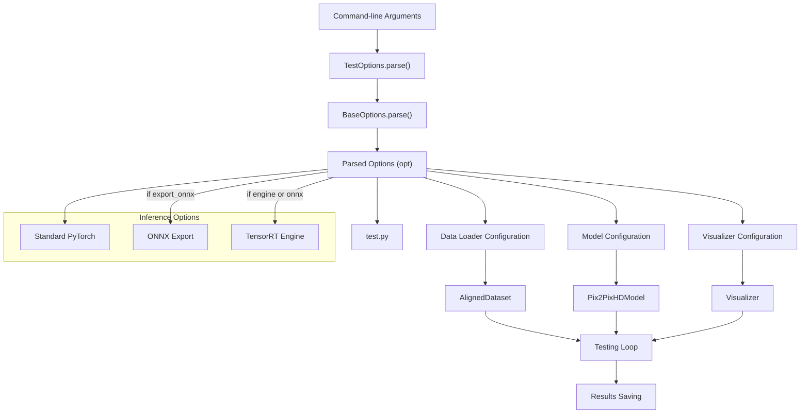
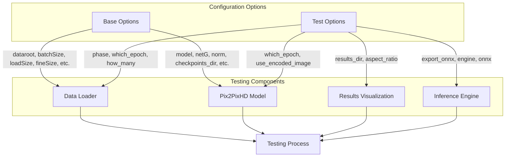
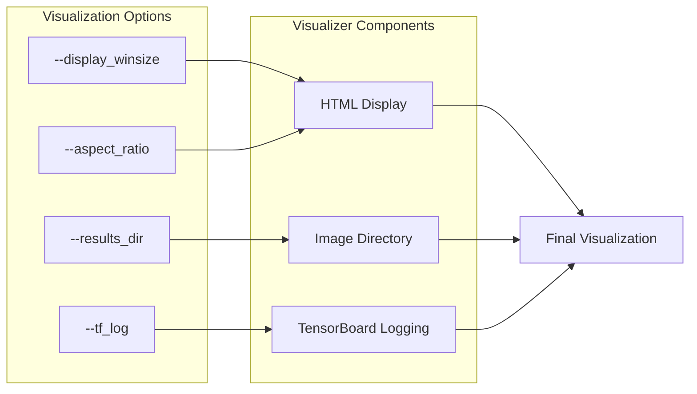

<!-- source: DeepWiki mcp.deepwiki.com · repo NVIDIA/pix2pixHD · page 5.1 Testing Configuration · fetched 2026-10-26 -->

# Testing Configuration

<details>
<summary>Relevant source files</summary>

The following files were used as context for generating this wiki page:

- [options/base_options.py](options/base_options.py)
- [options/test_options.py](options/test_options.py)
- [util/visualizer.py](util/visualizer.py)

</details>


## Purpose

This page documents the configuration options available for testing and inference in the pix2pixHD system. It covers command-line arguments, configuration inheritance, and how these settings affect the testing process. For information about training configuration, see [Training Configuration](#4.1).

## Configuration Inheritance Structure

The testing configuration in pix2pixHD follows an inheritance pattern where test-specific options extend the common base options.



Sources: [options/base_options.py:6-99](), [options/test_options.py:3-17]()

## Base Configuration Options

The base configuration options define common parameters used in both training and testing. These are initialized in the `BaseOptions` class and include settings for the model, data, and hardware.

### Model Settings

| Option | Type | Default | Description |
|--------|------|---------|-------------|
| `--name` | str | 'label2city' | Name of the experiment, determines storage location |
| `--model` | str | 'pix2pixHD' | Which model to use |
| `--netG` | str | 'global' | Model to use for the generator |
| `--checkpoints_dir` | str | './checkpoints' | Directory where models are saved |
| `--norm` | str | 'instance' | Normalization type (instance or batch) |
| `--use_dropout` | bool | False | Whether to use dropout in the generator |
| `--ngf` | int | 64 | Number of generator filters in the first conv layer |
| `--n_downsample_global` | int | 4 | Number of downsampling layers in netG |
| `--n_blocks_global` | int | 9 | Number of residual blocks in the global generator |

### Hardware and Performance Options

| Option | Type | Default | Description |
|--------|------|---------|-------------|
| `--gpu_ids` | str | '0' | GPU IDs to use (e.g., '0,1,2') |
| `--data_type` | int | 32 | Data type precision (8, 16, or 32 bit) |
| `--fp16` | bool | False | Whether to use mixed precision training |
| `--local_rank` | int | 0 | Local rank for distributed training |

### Data Settings

| Option | Type | Default | Description |
|--------|------|---------|-------------|
| `--dataroot` | str | './datasets/cityscapes/' | Data root directory |
| `--batchSize` | int | 1 | Input batch size |
| `--loadSize` | int | 1024 | Scale images to this size before processing |
| `--fineSize` | int | 512 | Crop to this size after scaling |
| `--label_nc` | int | 35 | Number of input label channels |
| `--input_nc` | int | 3 | Number of input image channels |
| `--output_nc` | int | 3 | Number of output image channels |
| `--resize_or_crop` | str | 'scale_width' | Scaling and cropping strategy |
| `--no_flip` | bool | False | If specified, do not flip images for data augmentation |

### Instance Feature Settings

| Option | Type | Default | Description |
|--------|------|---------|-------------|
| `--no_instance` | bool | False | If specified, do not add instance map as input |
| `--instance_feat` | bool | False | If specified, add encoded instance features as input |
| `--label_feat` | bool | False | If specified, add encoded label features as input |
| `--feat_num` | int | 3 | Vector length for encoded features |
| `--load_features` | bool | False | If specified, load precomputed feature maps |

Sources: [options/base_options.py:11-62]()

## Test-Specific Configuration Options

The `TestOptions` class adds testing-specific parameters:

| Option | Type | Default | Description |
|--------|------|---------|-------------|
| `--ntest` | int | inf | Maximum number of test examples |
| `--results_dir` | str | './results/' | Directory to save results |
| `--aspect_ratio` | float | 1.0 | Aspect ratio for results |
| `--phase` | str | 'test' | Dataset phase to use (test, train, val) |
| `--which_epoch` | str | 'latest' | Which epoch to load for testing |
| `--how_many` | int | 50 | Number of test images to process |
| `--cluster_path` | str | 'features_clustered_010.npy' | Path for clustered feature results |
| `--use_encoded_image` | bool | False | Encode real image to get feature map |

### Inference Engine Options

The test configuration includes special options for optimized inference:

| Option | Type | Description |
|--------|------|-------------|
| `--export_onnx` | str | Export model to ONNX format |
| `--engine` | str | Run serialized TensorRT engine |
| `--onnx` | str | Run ONNX model via TensorRT |

Sources: [options/test_options.py:4-16]()

## Configuration Flow in Testing Process

The following diagram illustrates how configuration options flow through the testing process:



Sources: [options/base_options.py:65-99](), [options/test_options.py:3-17]()

## Configuration Components and their Relationships

The following diagram shows how testing configuration affects different components of the system:



Sources: [options/base_options.py:11-62](), [options/test_options.py:4-16]()

## Visualization Configuration

The testing configuration includes options that affect how results are visualized and saved:



Sources: [options/base_options.py:40-42](), [options/test_options.py:7-8](), [util/visualizer.py:13-34]()

## Common Testing Use Cases

Here are some common testing scenarios and the corresponding configuration options:

### Standard Testing

For standard image generation with a pre-trained model:

```
python test.py --name label2city --netG local --ngf 32 --resize_or_crop none
```

### High-Resolution Testing

For generating high-resolution results:

```
python test.py --name label2city_1024 --netG local --ngf 32 --loadSize 1024
```

### TensorRT Acceleration

For accelerated inference using TensorRT:

```
python test.py --name label2city --engine /path/to/engine_file
```

### Feature-based Generation

For testing with instance-level features:

```
python test.py --name label2city_features --instance_feat --load_features
```

## Conclusion

The testing configuration system in pix2pixHD provides flexible options for controlling the inference process, from basic settings like input/output directories to advanced features like TensorRT acceleration. Understanding these options allows for efficient testing and deployment of pix2pixHD models.

---

