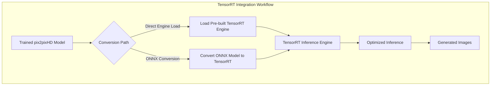
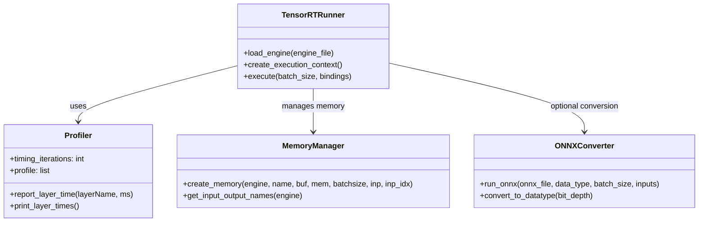
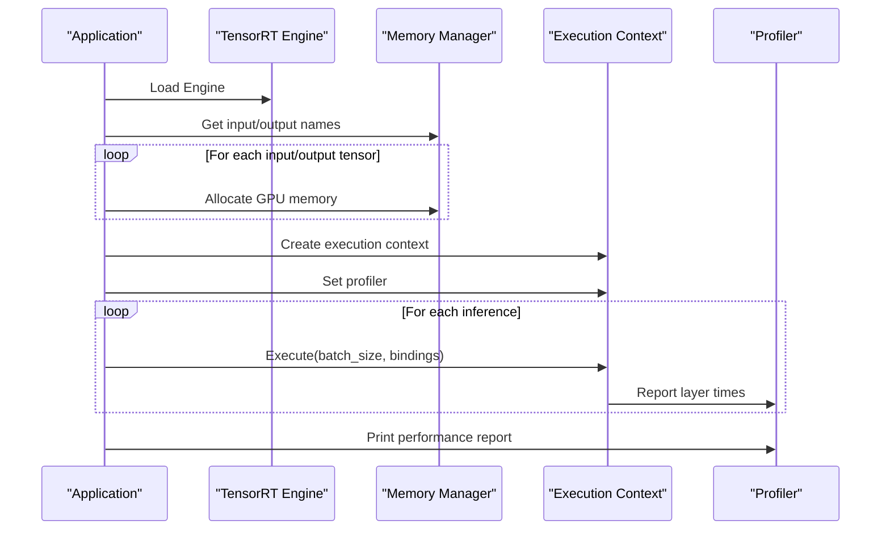
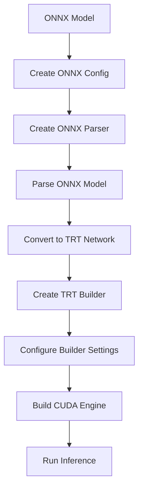
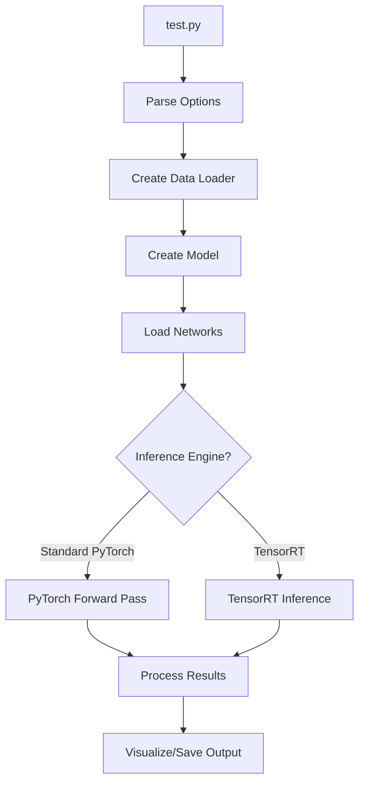

<!-- source: DeepWiki mcp.deepwiki.com · repo NVIDIA/pix2pixHD · page 5.2 TensorRT Integration · fetched 2026-10-26 -->

# TensorRT Integration

<details>
<summary>Relevant source files</summary>

The following files were used as context for generating this wiki page:

- [run_engine.py](run_engine.py)
- [scripts/test_1024p.sh](scripts/test_1024p.sh)

</details>


## Purpose and Scope

This document describes the integration of NVIDIA TensorRT into the pix2pixHD framework for optimized and accelerated inference. TensorRT provides significant performance improvements through platform-specific optimizations, reduced precision operation, and dynamic tensor memory management. For information about general testing and inference configuration, see [Testing and Inference](#5) and [Testing Configuration](#5.1).

## Overview of TensorRT in pix2pixHD

TensorRT is a high-performance deep learning inference optimizer and runtime that delivers low latency and high throughput for inference applications. In the pix2pixHD framework, TensorRT serves as an alternative inference engine for deploying trained models in production environments.



Sources: [run_engine.py:134-173]()

## TensorRT Components in pix2pixHD

The TensorRT integration in pix2pixHD consists of several key components that work together to provide optimized inference.



Sources: [run_engine.py:35-59](), [run_engine.py:62-80](), [run_engine.py:82-100](), [run_engine.py:138-173]()

## Setup Requirements

To use TensorRT with pix2pixHD, you need to have the following dependencies installed:

- CUDA and cuDNN
- TensorRT library
- PyCUDA
- PIL (Python Imaging Library)

The code includes error handling to check for these dependencies:

```python
try:
    from PIL import Image
    import pycuda.driver as cuda
    import pycuda.gpuarray as gpuarray
    import pycuda.autoinit
    import argparse
except ImportError as err:
    sys.stderr.write("""ERROR: failed to import module ({})
Please make sure you have pycuda and the example dependencies installed.
https://wiki.tiker.net/PyCuda/Installation/Linux
pip(3) install tensorrt[examples]
""".format(err))
    exit(1)
```

Sources: [run_engine.py:7-19]()

## Running Inference with TensorRT

Inference with TensorRT in pix2pixHD follows these steps:

1. Load a pre-built TensorRT engine or convert an ONNX model to TensorRT
2. Configure memory for inputs and outputs
3. Create an execution context
4. Run inference with optional profiling
5. Process and display/save results



Sources: [run_engine.py:104-120](), [run_engine.py:134-136]()

## Memory Management

TensorRT requires careful management of GPU memory. The `create_memory` function in `run_engine.py` handles the allocation of device memory for inputs and outputs:

```python
def create_memory(engine, name, buf, mem, batchsize, inp, inp_idx):
    binding_idx = engine.get_binding_index(name)
    if binding_idx == -1:
        raise AttributeError("Not a valid binding")
    print("Binding: name={}, bindingIndex={}".format(name, str(binding_idx)))
    dims = engine.get_binding_dimensions(binding_idx).to_DimsCHW()
    eltCount = dims.C() * dims.H() * dims.W() * batchsize

    if engine.binding_is_input(binding_idx):
        h_mem = inp[inp_idx]
        inp_idx = inp_idx + 1
    else:
        h_mem = np.random.uniform(0.0, 255.0, eltCount).astype(np.dtype('f4'))

    d_mem = cuda.mem_alloc(eltCount * 4)
    cuda.memcpy_htod(d_mem, h_mem)
    buf.insert(binding_idx, int(d_mem))
    mem.append(d_mem)
    return inp_idx
```

This function:
1. Gets the binding index for the tensor name
2. Retrieves the tensor dimensions
3. Calculates the required memory size
4. Allocates device memory
5. Copies data from host to device

Sources: [run_engine.py:82-100]()

## Performance Profiling

The TensorRT integration includes a Profiler class that extends `trt.infer.Profiler` to measure and report layer execution times:

```python
class Profiler(trt.infer.Profiler):
    def __init__(self, timing_iter):
        trt.infer.Profiler.__init__(self)
        self.timing_iterations = timing_iter
        self.profile = []

    def report_layer_time(self, layerName, ms):
        record = next((r for r in self.profile if r[0] == layerName), (None, None))
        if record == (None, None):
            self.profile.append((layerName, ms))
        else:
            self.profile[self.profile.index(record)] = (record[0], record[1] + ms)

    def print_layer_times(self):
        totalTime = 0
        for i in range(len(self.profile)):
            print("{:40.40} {:4.3f}ms".format(self.profile[i][0], self.profile[i][1] / self.timing_iterations))
            totalTime += self.profile[i][1]
        print("Time over all layers: {:4.2f} ms per iteration".format(totalTime / self.timing_iterations))
```

This profiler:
1. Records execution time for each layer in the network
2. Accumulates times across multiple iterations
3. Prints a summary of layer times and overall performance

Sources: [run_engine.py:35-59]()

## Precision Options

TensorRT supports multiple precision modes to balance accuracy and performance:

| Precision | Data Type | Description |
|-----------|-----------|-------------|
| FP32      | 32-bit floating point | Highest precision, baseline performance |
| FP16      | 16-bit floating point | Good precision with higher performance |
| INT8      | 8-bit integer | Lowest precision with maximum performance |

The code includes functions to select the appropriate precision mode:

```python
def convert_to_datatype(v):
    if v==8:
        return trt.infer.DataType.INT8
    elif v==16:
        return trt.infer.DataType.HALF
    elif v==32:
        return trt.infer.DataType.FLOAT
    else:
        print("ERROR: Invalid model data type bit depth: " + str(v))
        return trt.infer.DataType.INT8
```

When building a TensorRT engine, the precision mode is set based on the configuration:

```python
if (apex.get_model_dtype() == trt.infer.DataType_kHALF):
    print("-------------------  Running FP16 -----------------------------")
    trt_builder.set_half2_mode(True)
elif (apex.get_model_dtype() == trt.infer.DataType_kINT8): 
    print("-------------------  Running INT8 -----------------------------")
    trt_builder.set_int8_mode(True)
else:
    print("-------------------  Running FP32 -----------------------------")
```

Sources: [run_engine.py:123-132](), [run_engine.py:160-167]()

## ONNX Model Conversion

TensorRT can load pre-built engines or convert ONNX models to optimized TensorRT engines. The conversion process is handled by the `run_onnx` function:



The conversion process:
1. Creates an ONNX configuration with the desired precision
2. Creates and configures an ONNX parser
3. Parses the ONNX model and converts it to a TensorRT network
4. Creates a TensorRT builder with appropriate settings (batch size, workspace size, precision)
5. Builds a CUDA engine from the network
6. Runs inference with the optimized engine

Sources: [run_engine.py:138-173]()

## Integration with pix2pixHD Testing Flow

TensorRT fits into the pix2pixHD testing workflow as an alternative inference engine. The normal testing process can be configured to use TensorRT for accelerated inference.



Sources: [run_engine.py:134-173]()

## Performance Considerations

When using TensorRT with pix2pixHD, consider the following performance factors:

| Factor | Impact | Recommendation |
|--------|--------|----------------|
| Batch Size | Larger batch sizes can improve throughput | Use the largest batch size that fits in GPU memory |
| Precision | Lower precision improves performance but may affect quality | Start with FP32, then try FP16 and INT8 if quality is acceptable |
| Workspace Size | Larger workspace allows more optimizations | Allocate as much workspace as available GPU memory permits |
| Layer Profiling | Identifies bottlenecks | Use the profiler to identify and optimize slow layers |
| Input Dimensions | Fixed dimensions can be more efficient | Use consistent input dimensions when possible |

Sources: [run_engine.py:104-120](), [run_engine.py:134-173]()

## Summary

TensorRT integration in pix2pixHD provides a path to significantly accelerate inference for production deployments. By leveraging GPU-specific optimizations, reduced precision operations, and efficient memory management, TensorRT can deliver substantial performance improvements compared to standard PyTorch inference. The integration supports loading pre-built TensorRT engines or converting ONNX models on-the-fly, with extensive profiling capabilities to measure and optimize performance.

---

