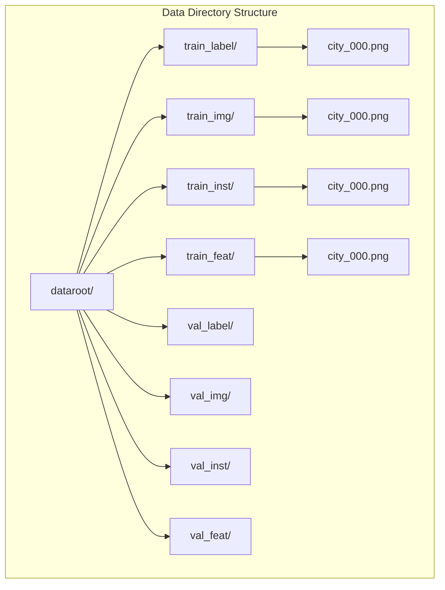
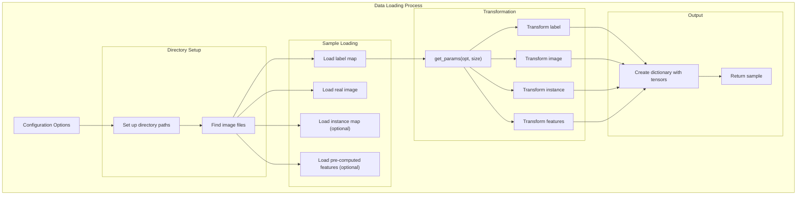
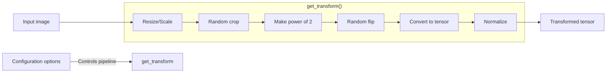
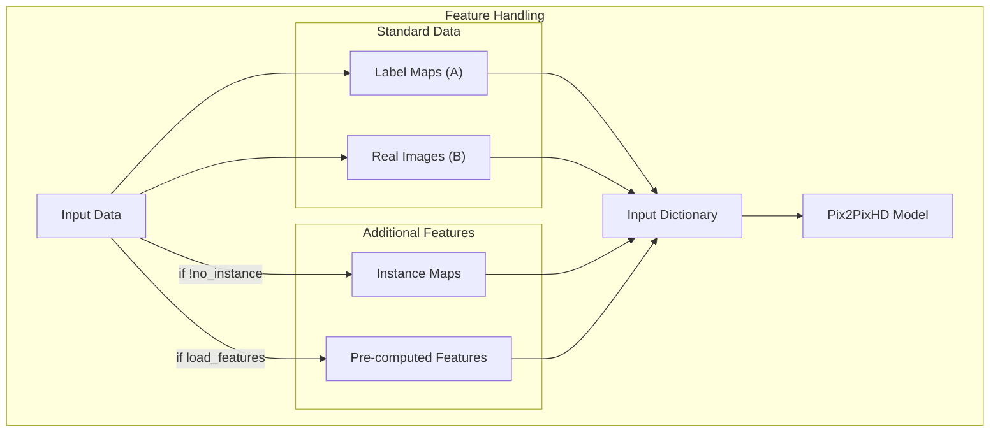

<!-- source: DeepWiki mcp.deepwiki.com · repo NVIDIA/pix2pixHD · page 6 Data Handling · fetched 2026-10-26 -->

# Data Handling

<details>
<summary>Relevant source files</summary>

The following files were used as context for generating this wiki page:

- [LICENSE.txt](LICENSE.txt)
- [data/aligned_dataset.py](data/aligned_dataset.py)
- [data/base_dataset.py](data/base_dataset.py)
- [options/train_options.py](options/train_options.py)

</details>


## Purpose and Scope

This document explains how data is loaded, processed, and used within the pix2pixHD system. It covers the dataset organization, data loading mechanisms, image transformations, and feature handling. For specific details about dataset implementations, see [Datasets](#6.1), and for image manipulation utilities, see [Image Utilities](#6.2).

## Data Organization

The pix2pixHD system expects data to be organized in a specific directory structure to facilitate the loading of aligned image pairs, instance maps, and pre-computed features.



Sources: [data/aligned_dataset.py:7-31]()

Key points about data organization:
- The root directory path is specified by `opt.dataroot`
- Data is separated by phase (train, val, test) with corresponding subdirectories
- Each sample requires matching filenames across directories
- Necessary directories depend on the configuration:
  - Label maps: `{phase}_label` or `{phase}_A`
  - Real images: `{phase}_img` or `{phase}_B` 
  - Instance maps: `{phase}_inst` (optional)
  - Pre-computed features: `{phase}_feat` (optional)

## Dataset Hierarchy

The dataset classes follow a hierarchical structure to promote code reuse and extensibility.

```mermaid
classDiagram
    class "torch.utils.data.Dataset" {
        +__getitem__(index)
        +__len__()
    }
    
    class "BaseDataset" {
        +initialize(opt)
        +name()
    }
    
    class "AlignedDataset" {
        -opt
        -dir_A
        -dir_B
        -dir_inst
        -dir_feat
        -A_paths
        -B_paths
        -inst_paths
        -feat_paths
        +initialize(opt)
        +__getitem__(index)
        +__len__()
        +name()
    }
    
    "torch.utils.data.Dataset" <|-- "BaseDataset"
    "BaseDataset" <|-- "AlignedDataset"
```

Sources: [data/base_dataset.py:7-15](), [data/aligned_dataset.py:6-33]()

- `BaseDataset`: Extends PyTorch's `Dataset` class and provides common functionality
- `AlignedDataset`: Implements specific loading logic for aligned image pairs and associated data

## Data Flow

The following diagram illustrates how data flows through the system during loading and processing:



Sources: [data/aligned_dataset.py:35-69](), [data/base_dataset.py:17-31]()

## Transformation Pipeline

The pix2pixHD data handling system includes a robust transformation pipeline that prepares images for the model:



Sources: [data/base_dataset.py:33-58]()

### Transformation Options

The transformation pipeline is controlled by several options:

| Option | Description | Effect |
|--------|-------------|--------|
| `resize_or_crop` | Transformation strategy | Controls which transforms are applied (resize, scale_width, crop) |
| `loadSize` | Size for loading images | Target size for resize operations |
| `fineSize` | Size after cropping | Target size for crop operations |
| `no_flip` | Disable random flipping | Controls whether images are randomly flipped |
| `n_downsample_global` | Global downsampling factor | Used for power-of-2 resizing |
| `n_local_enhancers` | Local enhancers count | Used for power-of-2 resizing |

Sources: [data/base_dataset.py:17-58]()

## Feature Handling

The pix2pixHD system supports two types of additional features beyond basic label and image pairs:

1. **Instance Maps**: Provide instance-level information, enabling the model to distinguish between different instances of the same class
2. **Pre-computed Features**: Encoded features that can be used to control appearance



Sources: [data/aligned_dataset.py:22-31](), [data/aligned_dataset.py:55-65]()

The system can be configured to:
- Disable instance maps with `no_instance=True`
- Enable pre-computed features with `load_features=True`

## Sample Retrieval Process

The `__getitem__` method in `AlignedDataset` demonstrates the complete sample retrieval process:

1. Load the label map (A) from disk
2. Apply appropriate transformations based on whether it's a class label or RGB image
3. Load and transform the real image (B) if in training mode or using encoded images
4. Load and transform instance maps if enabled
5. Load and transform pre-computed features if enabled
6. Return all components in a dictionary with keys: 'label', 'inst', 'image', 'feat', 'path'

Sources: [data/aligned_dataset.py:35-70]()

## Data Batching and Iteration

The pix2pixHD system uses PyTorch's `DataLoader` to batch and iterate through samples. The `__len__` method in `AlignedDataset` ensures that the number of samples is divisible by the batch size:

```python
def __len__(self):
    return len(self.A_paths) // self.opt.batchSize * self.opt.batchSize
```

This guarantees consistent batch sizes during training, which is important for stable training.

Sources: [data/aligned_dataset.py:72-73]()

---

