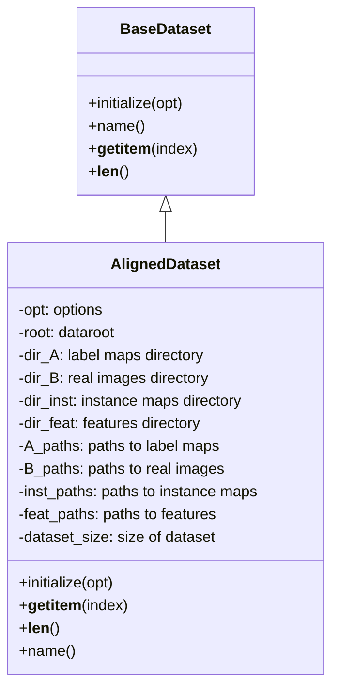
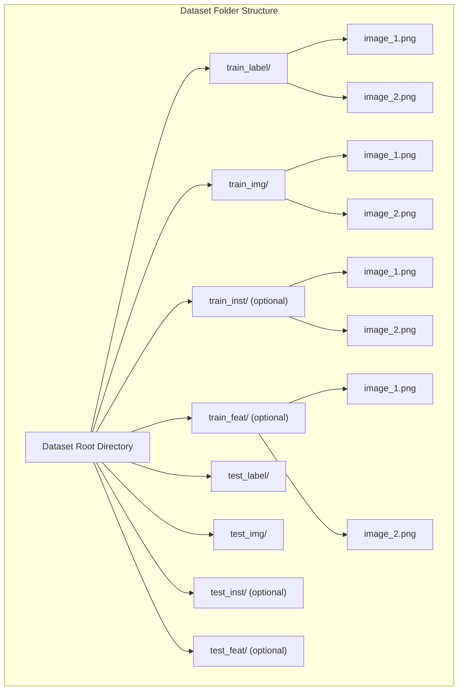
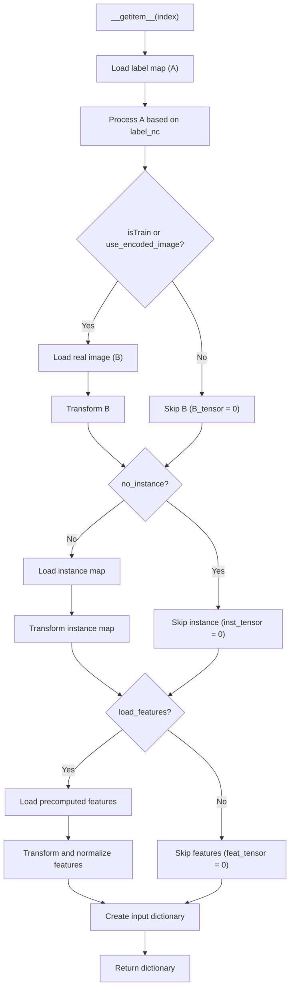
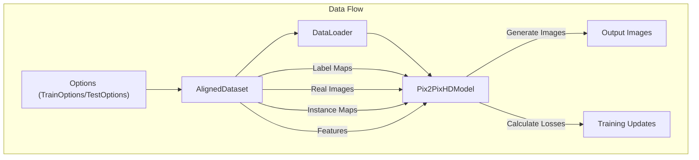

<!-- source: DeepWiki mcp.deepwiki.com · repo NVIDIA/pix2pixHD · page 6.1 Datasets · fetched 2026-10-26 -->

# Datasets

Relevant source files

The following files were used as context for generating this wiki page:

- [data/aligned_dataset.py](data/aligned_dataset.py)
- [datasets/cityscapes/train_img/aachen_000005_000019_leftImg8bit.png](datasets/cityscapes/train_img/aachen_000005_000019_leftImg8bit.png)
- [datasets/cityscapes/train_inst/aachen_000005_000019_gtFine_instanceIds.png](datasets/cityscapes/train_inst/aachen_000005_000019_gtFine_instanceIds.png)
- [datasets/cityscapes/train_label/aachen_000005_000019_gtFine_labelIds.png](datasets/cityscapes/train_label/aachen_000005_000019_gtFine_labelIds.png)

This page describes the dataset system used in pix2pixHD, explaining how data is organized, loaded, and processed during training and inference. The dataset system handles the reading and preprocessing of aligned image pairs (label maps and real images), instance maps, and precomputed features. For information about utilities for image loading and manipulation, see [Image Utilities](#6.2).

## Dataset Class Hierarchy

The pix2pixHD dataset system follows a hierarchical structure with a base class that defines common functionality and derived classes that implement specific dataset types.

### BaseDataset
The `BaseDataset` is the abstract base class that provides common functionality for all dataset implementations. It defines methods for initialization, accessing items, calculating dataset length, and retrieving the dataset name.

### AlignedDataset
The `AlignedDataset` class inherits from `BaseDataset` and implements a dataset for aligned image pairs. It is designed to work with datasets where each input (label map) has a corresponding target (real image), and optionally instance maps and features.

Key features of `AlignedDataset`:
- Supports label maps, real images, instance maps, and precomputed features
- Handles different label types (semantic labels or RGB images)
- Applies appropriate transformations to different types of inputs
- Returns a dictionary containing all necessary data for training/testing

Sources: [data/aligned_dataset.py:6-76]()

## Data Organization

The pix2pixHD dataset system expects data to be organized in a specific folder structure to facilitate loading aligned pairs of images, instance maps, and features.

The folder structure follows these conventions:
1. A root directory contains all dataset files
2. Separate subdirectories for different phases (train/test) and data types
3. Corresponding files in each directory share the same name
4. Files can be accessed based on their path and index

Key directories:
- `*_label`: Contains semantic label maps (input to the generator)
- `*_img`: Contains real images (target for the generator)
- `*_inst`: Contains instance maps (optional, used for instance-aware features)
- `*_feat`: Contains precomputed features (optional, encode object features)

The dataset will automatically detect and use these directories based on the configuration options provided.

Sources: [data/aligned_dataset.py:7-31]()

## Data Types and Loading

The pix2pixHD dataset system handles several types of data, each with specific loading and preprocessing steps.

### Label Maps (Input A)
Label maps are the input to the generator and can be either:
- Semantic segmentation maps (if `label_nc > 0`): Loaded as single-channel images where pixel values represent class labels
- RGB images (if `label_nc = 0`): Loaded as regular RGB images

### Real Images (Input B)
Real images are the ground truth targets for the generator. They are only required during training or when using encoded images.

### Instance Maps
Instance maps are optional and contain instance-level segmentation information. They are used to distinguish between different instances of the same class.

### Precomputed Features
Precomputed features are optional and contain encoded features for each instance. They are used when the `load_features` option is enabled.

The following diagram illustrates the data loading process in the `__getitem__` method:

The dataset loading process applies appropriate transformations to each type of data:
- For label maps: Different transformations depending on whether they are semantic labels or RGB images
- For real images: Standard transformations for RGB images
- For instance maps: Same transformations as label maps
- For features: Transformations plus normalization

All loaded and processed data is returned in a dictionary with keys for each data type.

Sources: [data/aligned_dataset.py:35-70]()

## Configuration Options

The dataset system in pix2pixHD is highly configurable through various options. Here are the key configuration options that affect dataset behavior:

| Option | Description | Impact on Dataset |
|--------|-------------|------------------|
| `dataroot` | Root directory of dataset | Determines where the dataset looks for data files |
| `phase` | Current phase (train/test) | Determines which subdirectories to use |
| `label_nc` | Number of label classes | If 0, treats label as RGB; if > 0, treats as semantic map |
| `no_instance` | Whether to use instance maps | If true, ignores instance maps |
| `load_features` | Whether to load precomputed features | If true, loads features from *_feat directory |
| `use_encoded_image` | Whether to use encoded images in test | If true, loads real images during testing |
| `isTrain` | Whether in training mode | Determines if real images are loaded |
| `batchSize` | Batch size | Used to calculate the dataset length |

These options should be set in the configuration system before initializing the dataset.

Sources: [data/aligned_dataset.py:7-31](), [data/aligned_dataset.py:72-73]()

## Dataset Integration with Training Pipeline

The dataset system is a critical component of the training and testing pipeline in pix2pixHD. Here's how it integrates with the rest of the system:

The integration process follows these steps:

1. Configuration options are defined for the dataset
2. An `AlignedDataset` instance is created with these options
3. The dataset is wrapped in a PyTorch `DataLoader` for batch processing
4. During training/testing, data is fetched from the dataloader
5. Each batch contains label maps, real images, instance maps, and features
6. The model processes this data to generate images and calculate losses

This tight integration ensures that data is correctly loaded, processed, and fed into the model during both training and inference.

Sources: [data/aligned_dataset.py:67-70]()

## Example Datasets

The pix2pixHD repository is designed to work with several datasets, including:

1. **Cityscapes**: Urban street scene dataset with semantic segmentation labels
   - Label maps: Semantic segmentation of road scenes
   - Real images: Photos of urban street scenes
   - Instance maps: Instance segmentation for cars, pedestrians, etc.

2. **ADE20K**: Scene parsing dataset with a large variety of scenes
   - Label maps: Semantic segmentation of various scenes
   - Real images: Photos of various indoor and outdoor scenes

3. **Custom datasets**: Users can create their own datasets following the folder structure described above

For all datasets, the preparation involves creating the appropriate folder structure and ensuring that corresponding files in different directories have matching names.

Sources: [datasets/cityscapes/train_img/aachen_000005_000019_leftImg8bit.png:1-1]()

## Creating a Custom Dataset

To create a custom dataset for pix2pixHD:

1. Organize your data following the folder structure described above
2. Ensure all corresponding files have matching names
3. Create label maps (semantic segmentation or RGB images)
4. Prepare real images as the ground truth
5. Optionally create instance maps for instance-aware features
6. Optionally precompute features (or let the model do it)

The dataset will be automatically loaded based on the directory structure and configuration options.

If your data doesn't fit the expected format, you may need to create a custom dataset class by inheriting from `BaseDataset` and implementing the required methods.

---

