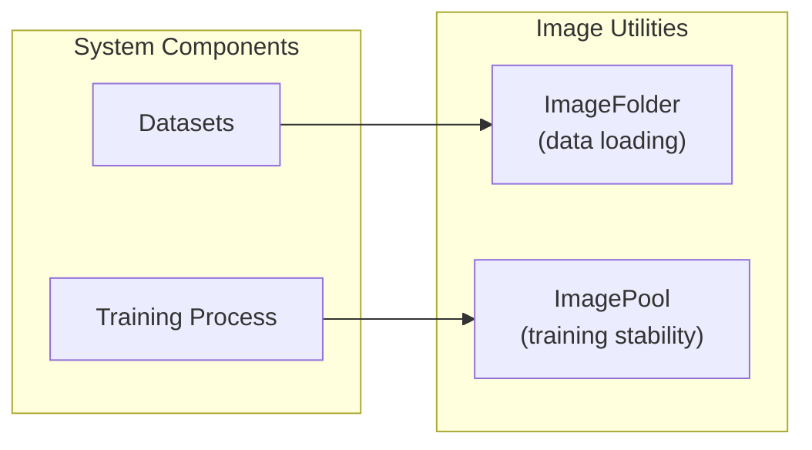
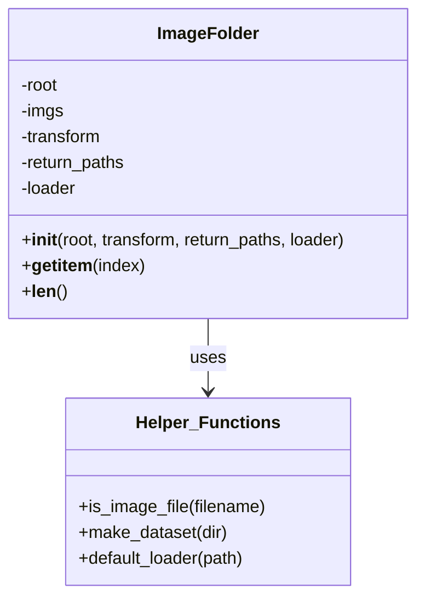
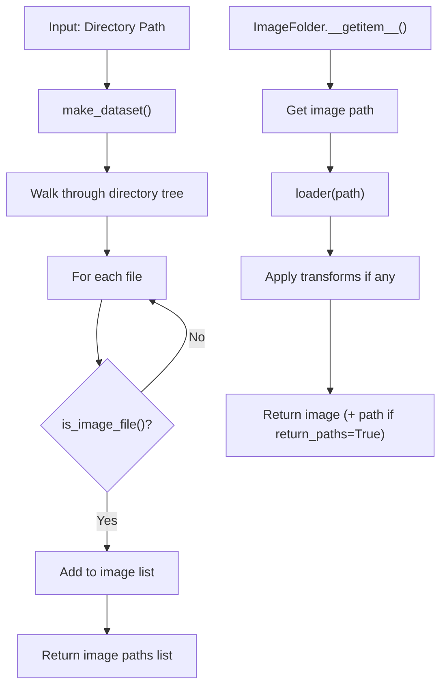
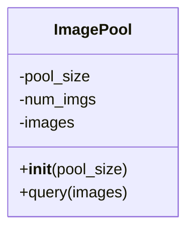
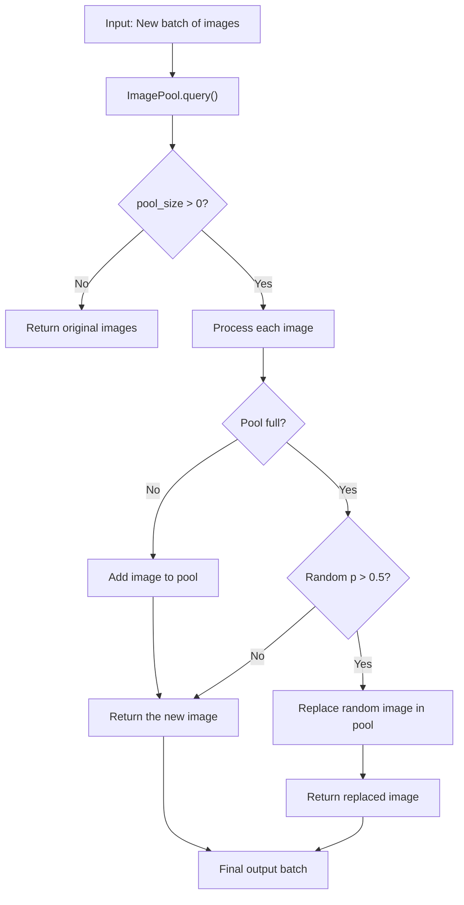
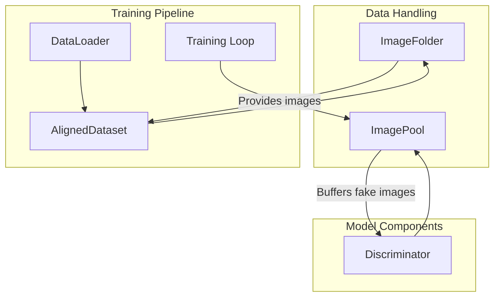

<!-- source: DeepWiki mcp.deepwiki.com · repo NVIDIA/pix2pixHD · page 6.2 Image Utilities · fetched 2026-10-26 -->

# Image Utilities

Relevant source files

The following files were used as context for generating this wiki page:

- [data/image_folder.py](data/image_folder.py)
- [util/image_pool.py](util/image_pool.py)

This page documents the image handling utilities within the pix2pixHD codebase. These utilities provide essential functionality for loading, managing, and manipulating images throughout the training and inference processes. For information about dataset implementation and organization, see [Datasets](#6.1).

## Overview

The pix2pixHD system includes two primary image utility components:

1. **Image Loading** - Utilities for loading and organizing image files from directories
2. **Image Pool** - A mechanism for improving GAN training stability by maintaining a history of previously generated images

These components support the data pipeline and training process by providing robust image handling capabilities.

Sources: [data/image_folder.py](), [util/image_pool.py]()

## Image Loading

The `ImageFolder` class provides a standardized way to load image files from directories. It's a customized version of PyTorch's image folder implementation with modifications to support loading images from both the current directory and its subdirectories.

### Key Features

- Supports common image formats (JPG, PNG, BMP, etc.)
- Recursively scans directories for images
- Compatible with PyTorch's data loading pipeline
- Provides options for image transformation and path tracking

### Implementation Details

The image loading functionality consists of several components:

Sources: [data/image_folder.py]()

#### Image Detection and Loading Process

Sources: [data/image_folder.py:21-31](), [data/image_folder.py:54-62]()

### Implementation Components

1. **File Extension Recognition**: 
   - `IMG_EXTENSIONS` defines a list of valid image file extensions
   - `is_image_file()` checks if a file has a valid image extension

2. **Directory Scanning**:
   - `make_dataset()` walks through a directory and collects image paths
   - Verifies that the provided directory exists
   - Returns a list of valid image file paths

3. **Image Loading**:
   - `default_loader()` uses PIL to open images and convert them to RGB mode
   - Custom loaders can be provided if needed

4. **Dataset Interface**:
   - `ImageFolder` implements the PyTorch `Dataset` interface
   - `__getitem__()` loads and returns individual images
   - `__len__()` returns the total number of available images

Sources: [data/image_folder.py:11-65]()

## Image Pool

The `ImagePool` class implements a history buffer for generated images, primarily used to improve training stability for the discriminator in GAN training.

### Purpose

In GAN training, the discriminator can sometimes "forget" about previous generator outputs if it only sees the most recent ones. The image pool helps prevent this by:

1. Maintaining a history of previously generated images
2. Randomly returning either new images or previously stored images
3. Creating more stable training dynamics by exposing the discriminator to a wider variety of generated samples

### Implementation Details

Sources: [util/image_pool.py:4-31]()

### Image Pool Operation

Sources: [util/image_pool.py:11-31]()

### Key Mechanisms

1. **Pool Initialization**:
   - The pool is initialized with a specified maximum size (`pool_size`)
   - If `pool_size` is 0, the pool is effectively disabled

2. **Image Query Process**:
   - For each new image:
     - If the pool is not full, add the image to the pool and return it
     - If the pool is full, with 50% probability:
       - Return a random image from the pool and replace it with the new image
       - Otherwise, simply return the new image without storing it

3. **Return Value**:
   - Returns a PyTorch Variable containing a batch of images
   - The returned batch may contain a mix of new and previously stored images

Sources: [util/image_pool.py:11-31]()

## Integration with System Components

These image utilities are integrated with other components of the pix2pixHD system:

### Image Folder Usage

- `ImageFolder` serves as a foundation for dataset classes like `AlignedDataset`
- It provides a standardized way to load images that can be extended with dataset-specific processing

### Image Pool Usage

- `ImagePool` is used during the training process to manage generated images
- It helps maintain training stability for the discriminator
- The implementation supports batch processing of images

Sources: [util/image_pool.py](), [data/image_folder.py]()

## Summary

The image utilities in pix2pixHD provide essential functionality for:

1. **Loading and organizing images** through the `ImageFolder` class, which handles file discovery, validation, and loading
2. **Stabilizing GAN training** through the `ImagePool` class, which maintains a history of generated images to improve discriminator training

These utilities form a crucial part of the data handling infrastructure, enabling efficient image processing and stable model training. They are designed to be modular and can be easily integrated with other components of the system.

---

