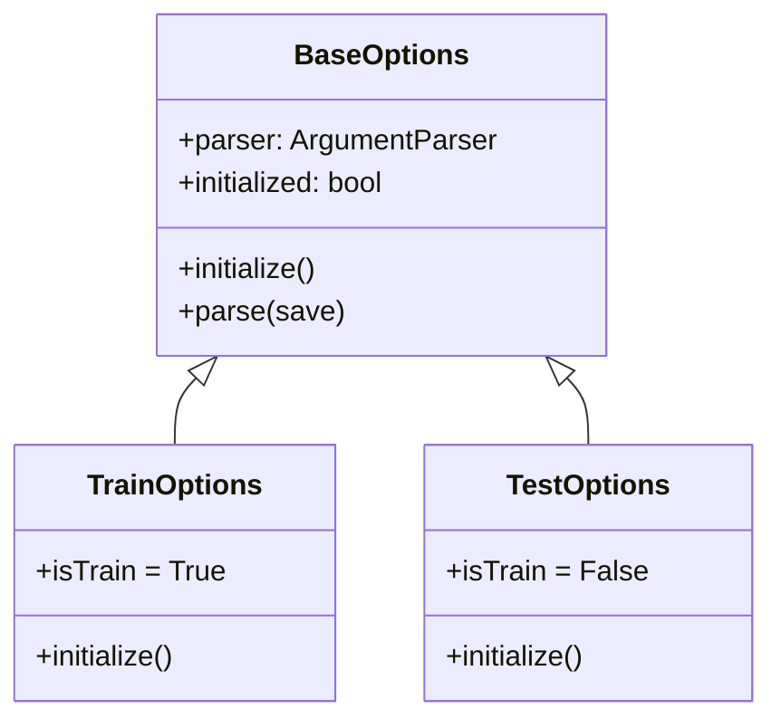
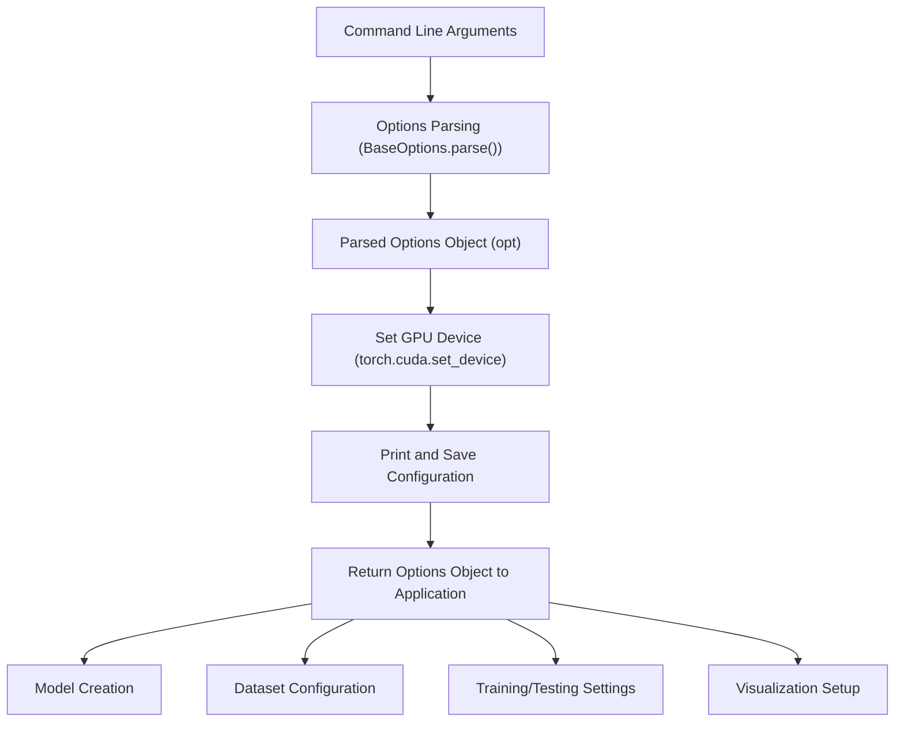
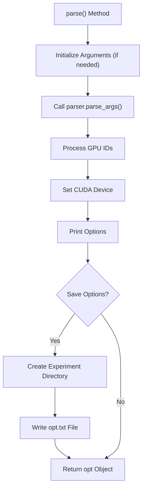
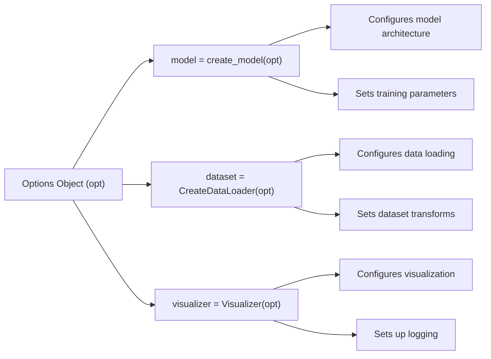

<!-- source: DeepWiki mcp.deepwiki.com · repo NVIDIA/pix2pixHD · page 7 Configuration System · fetched 2026-10-26 -->

# Configuration System

<details>
<summary>Relevant source files</summary>

The following files were used as context for generating this wiki page:

- [options/base_options.py](options/base_options.py)
- [options/test_options.py](options/test_options.py)
- [util/visualizer.py](util/visualizer.py)

</details>


The pix2pixHD configuration system provides a flexible framework for controlling all aspects of model training, testing, and inference through command-line arguments. This page explains the structure and usage of this system, which enables users to configure datasets, model architectures, training parameters, and visualization options without modifying code.

For information about specific training or testing configurations, see [Training Configuration](#4.1) and [Testing and Inference](#5).

## Configuration Architecture

The configuration system follows a hierarchical design centered around option classes that parse and manage command-line arguments. The system uses Python's `argparse` library to define, parse, and validate user inputs.



**Options Hierarchy Diagram**

Sources: [options/base_options.py:6-64](). [options/test_options.py:3-17]()

The configuration system uses the following workflow:



**Configuration Workflow Diagram**

Sources: [options/base_options.py:65-99]()

## Configuration Categories

The configuration parameters are organized into functional categories:

### Experiment Configuration

These options identify and organize experiments:

| Option | Default | Purpose |
|--------|---------|---------|
| `--name` | label2city | Name of the experiment, determines storage location |
| `--checkpoints_dir` | ./checkpoints | Directory for saving models |
| `--results_dir` | ./results/ | Directory for storing results (test only) |
| `--phase` | test | Current phase (train, val, test) (test only) |

Sources: [options/base_options.py:12-22](), [options/test_options.py:7-9]()

### Hardware Configuration

Options for controlling hardware usage:

| Option | Default | Purpose |
|--------|---------|---------|
| `--gpu_ids` | 0 | Which GPUs to use (e.g., '0', '0,1,2') |
| `--nThreads` | 2 | Number of threads for data loading |
| `--fp16` | False | Whether to use mixed precision training |
| `--data_type` | 32 | Supported data type (8, 16, 32 bit) |
| `--local_rank` | 0 | Local rank for distributed training |

Sources: [options/base_options.py:14-22](), [options/base_options.py:37]()

### Model Configuration

Options that define the model architecture:

| Option | Default | Purpose |
|--------|---------|---------|
| `--model` | pix2pixHD | Which model to use |
| `--netG` | global | Generator architecture (global, local) |
| `--ngf` | 64 | Number of generator filters in first conv layer |
| `--n_downsample_global` | 4 | Number of downsampling layers |
| `--n_blocks_global` | 9 | Residual blocks in global generator |
| `--n_blocks_local` | 3 | Residual blocks in local enhancer |
| `--n_local_enhancers` | 1 | Number of local enhancers to use |
| `--norm` | instance | Normalization type (instance or batch) |
| `--use_dropout` | False | Whether to use dropout in the generator |

Sources: [options/base_options.py:16-18](), [options/base_options.py:45-51]()

### Input/Output Configuration

Options controlling input and output dimensions:

| Option | Default | Purpose |
|--------|---------|---------|
| `--batchSize` | 1 | Input batch size |
| `--loadSize` | 1024 | Size to scale images to |
| `--fineSize` | 512 | Size to crop images to |
| `--label_nc` | 35 | Number of input label channels |
| `--input_nc` | 3 | Number of input image channels |
| `--output_nc` | 3 | Number of output image channels |
| `--aspect_ratio` | 1.0 | Aspect ratio of result images (test only) |

Sources: [options/base_options.py:24-30](), [options/test_options.py:8]()

### Dataset Configuration

Options for dataset handling:

| Option | Default | Purpose |
|--------|---------|---------|
| `--dataroot` | ./datasets/cityscapes/ | Path to dataset |
| `--resize_or_crop` | scale_width | Image resizing and cropping strategy |
| `--serial_batches` | False | Whether to load images in order |
| `--no_flip` | False | Whether to disable flipping for data augmentation |
| `--max_dataset_size` | inf | Maximum number of samples per dataset |
| `--ntest` | inf | Number of test examples (test only) |
| `--how_many` | 50 | Number of test images to run (test only) |

Sources: [options/base_options.py:33-38](), [options/test_options.py:6-11]()

### Feature Configuration

Options for instance-wise feature encoding:

| Option | Default | Purpose |
|--------|---------|---------|
| `--no_instance` | False | Whether to exclude instance maps as input |
| `--instance_feat` | False | Whether to add encoded instance features |
| `--label_feat` | False | Whether to add encoded label features |
| `--feat_num` | 3 | Vector length for encoded features |
| `--load_features` | False | Whether to load precomputed feature maps |
| `--n_downsample_E` | 4 | Number of downsampling layers in encoder |
| `--nef` | 16 | Number of encoder filters in first conv layer |
| `--n_clusters` | 10 | Number of clusters for features |
| `--cluster_path` | features_clustered_010.npy | Path for clustered results (test only) |

Sources: [options/base_options.py:54-61](), [options/test_options.py:12-13]()

### Visualization and Logging

Options for visualization and logging:

| Option | Default | Purpose |
|--------|---------|---------|
| `--display_winsize` | 512 | Display window size |
| `--tf_log` | False | Whether to use TensorBoard logging |
| `--verbose` | False | Toggles verbose output |

Sources: [options/base_options.py:40-42](), [options/base_options.py:20]()

## Options Parsing and Usage

The configuration system processes command-line arguments in several steps:



**Options Parsing Flow Diagram**

Sources: [options/base_options.py:65-99]()

### How Options Are Saved

For reproducibility, the configuration system saves all options to a text file in the experiment's checkpoint directory. This is done in the `parse` method of `BaseOptions`:

1. The experiment directory is created at `<checkpoints_dir>/<name>/`
2. All options are written to `<checkpoints_dir>/<name>/opt.txt`
3. This file can be referenced later to recreate the exact experiment conditions

Sources: [options/base_options.py:89-98]()

### How Options Are Used

The options object (`opt`) is passed to various system components:



**Options Usage Diagram**

Sources: [options/base_options.py:65-99](), [util/visualizer.py:14-34]()

For example, the `Visualizer` uses options to configure HTML output and TensorFlow logging:

```python
# In Visualizer.__init__:
self.tf_log = opt.tf_log
self.use_html = opt.isTrain and not opt.no_html
self.win_size = opt.display_winsize
self.name = opt.name
```

Sources: [util/visualizer.py:15-18]()

## Command-Line Usage Examples

### Training Example

```
python train.py --name cityscapes_full --dataroot ./datasets/cityscapes/ \
                --label_nc 35 --loadSize 1024 --fineSize 512 --batchSize 8 \
                --gpu_ids 0,1,2,3 --n_local_enhancers 1 --n_blocks_local 3
```

### Testing Example

```
python test.py --name cityscapes_full --dataroot ./datasets/cityscapes/ \
               --label_nc 35 --netG local --n_local_enhancers 1 \
               --n_blocks_local 3 --results_dir ./results/ --how_many 50
```

## Integration with Other Systems

The configuration system interfaces with other components of pix2pixHD:

1. **Model System**: The `opt` object determines which model to create and configures its architecture
2. **Data System**: Dataset loading parameters are specified through the options
3. **Training System**: Learning rates, batch sizes, and iterations are controlled via options
4. **Visualization**: Output directories and visualization parameters are derived from options

This centralized configuration approach provides a consistent interface for controlling all aspects of the pix2pixHD system.

---

