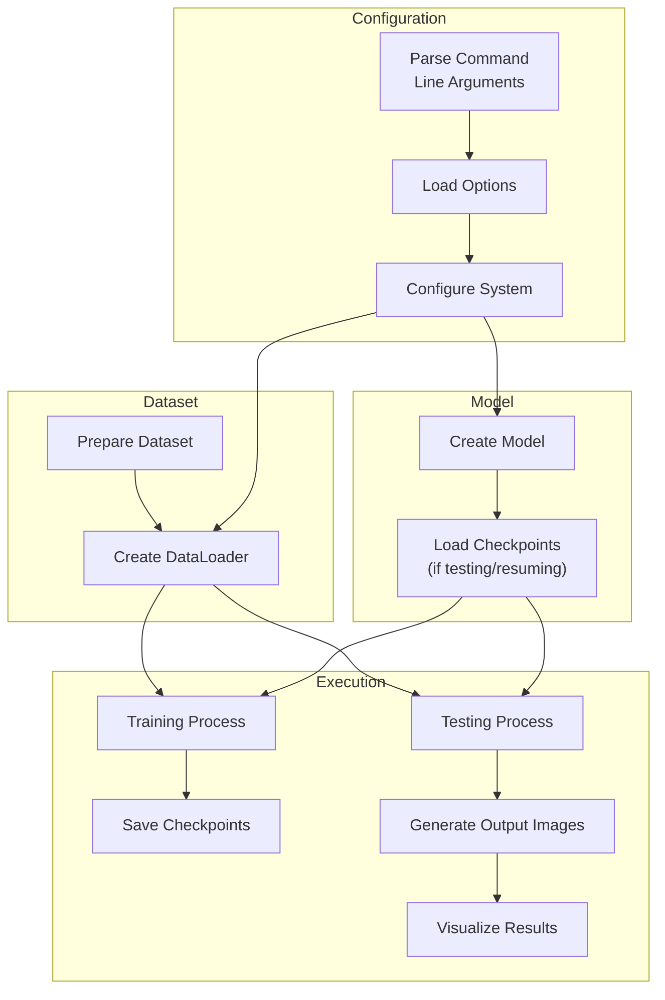
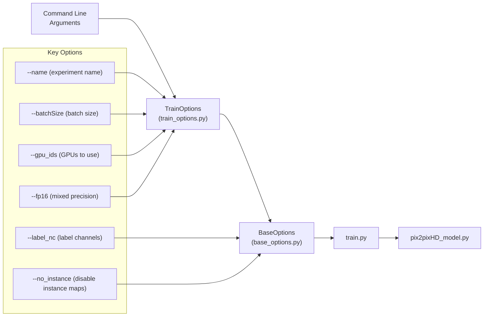
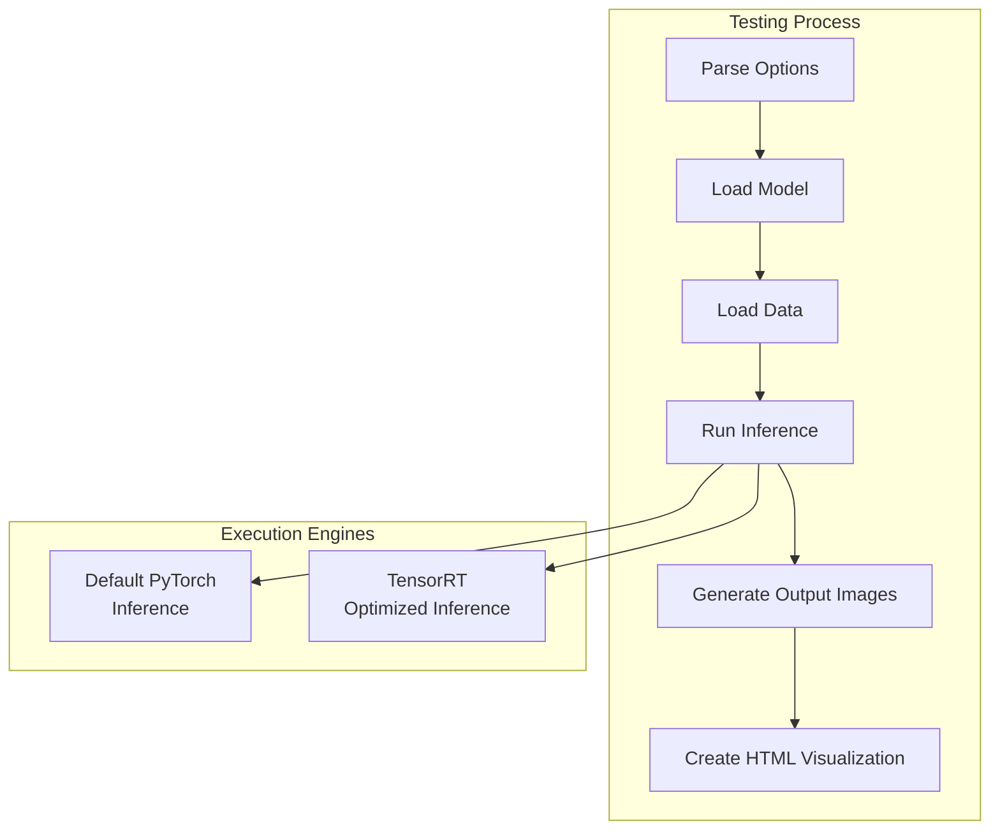
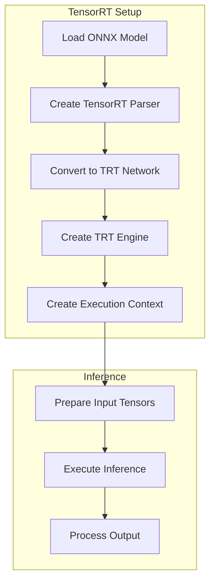

<!-- source: DeepWiki mcp.deepwiki.com · repo NVIDIA/pix2pixHD · page 9 Running the System · fetched 2026-10-26 -->

# Running the System

<details>
<summary>Relevant source files</summary>

The following files were used as context for generating this wiki page:

- [README.md](README.md)
- [run_engine.py](run_engine.py)
- [scripts/test_1024p.sh](scripts/test_1024p.sh)
- [scripts/train_512p_fp16.sh](scripts/train_512p_fp16.sh)
- [scripts/train_512p_fp16_multigpu.sh](scripts/train_512p_fp16_multigpu.sh)
- [util/util.py](util/util.py)

</details>


This document provides comprehensive technical instructions for running the pix2pixHD system, including training models, performing inference, and utilizing advanced features like multi-GPU training and mixed precision. For information about system architecture, see [System Architecture](#2), and for detailed model explanations, see [Models](#3).

## 1. System Requirements and Setup

Before running pix2pixHD, ensure your environment meets the following prerequisites:

- Linux or macOS operating system
- Python 2 or 3
- NVIDIA GPU with at least 11GB memory
- CUDA and cuDNN installed
- PyTorch framework

### Installation Steps

1. Install PyTorch and dependencies from http://pytorch.org
2. Install the required Python library:
   ```bash
   pip install dominate
   ```
3. Clone the repository:
   ```bash
   git clone https://github.com/NVIDIA/pix2pixHD
   cd pix2pixHD
   ```

For mixed precision training (optional):
```bash
# Install Apex for AMP support
git clone https://github.com/NVIDIA/apex
cd apex
pip install -v --no-cache-dir --global-option="--cpp_ext" --global-option="--cuda_ext" ./
```

Sources: [README.md:52-68]()

## 2. Execution Workflow

The pix2pixHD system follows a specific workflow for both training and inference processes:

**System Execution Workflow**


Sources: [README.md:72-81](), [README.md:89-96]()

## 3. Running Training

The training process converts semantic label maps into photorealistic images. You can run training with different configurations depending on your hardware and requirements.

### 3.1 Basic Training (512p resolution)

To train a model at 512p resolution, use the following command:

```bash
python train.py --name label2city_512p
```

This will train a model using the default configuration, which includes:
- 512p resolution images
- Single GPU training
- Default hyperparameters (learning rate, batch size, etc.)

Training progress can be monitored via:
- Web visualizations: `./checkpoints/label2city_512p/web/index.html`
- TensorBoard (if enabled): `./checkpoints/label2city_512p/logs`

Sources: [README.md:89-96]()

### 3.2 Training Command Options Flow



Sources: [README.md:125-127]()

### 3.3 Advanced Training Options

#### Training at Higher Resolution (1024p)

For 2048×1024 resolution training, GPU memory requirements increase:
- 24GB GPU memory:
  ```bash
  python train.py --name label2city_1024p --netG local --ngf 32 --num_D 3
  ```
- 12GB GPU memory (with cropping):
  ```bash
  python train.py --name label2city_1024p --netG local --ngf 32 --num_D 3 --resize_or_crop crop
  ```

#### Multi-GPU Training

To accelerate training using multiple GPUs:
```bash
python train.py --name label2city_512p --batchSize 8 --gpu_ids 0,1,2,3,4,5,6,7
```

#### Mixed Precision Training (FP16)

For faster training with automatic mixed precision:
```bash
python -m torch.distributed.launch train.py --name label2city_512p --fp16
```

This can provide up to 80% speedup on compatible hardware.

Sources: [README.md:99-117](), [scripts/train_512p_fp16.sh:1-2](), [scripts/train_512p_fp16_multigpu.sh:1-2]()

## 4. Running Testing/Inference

After training a model or downloading a pre-trained one, you can run inference to generate images from label maps.

### 4.1 Basic Testing Workflow



Sources: [README.md:72-81](), [run_engine.py:134-173]()

### 4.2 Testing with Pre-trained Model

1. Download the pre-trained Cityscapes model from the link provided in the README
2. Place it under `./checkpoints/label2city_1024p/`
3. Run the testing script:
   ```bash
   python test.py --name label2city_1024p --netG local --ngf 32 --resize_or_crop none
   ```
4. View results in `./results/label2city_1024p/test_latest/index.html`

You can find additional testing scripts in the `scripts` directory, such as `test_1024p.sh`.

Sources: [README.md:72-81](), [scripts/test_1024p.sh:1-4]()

### 4.3 Testing Options

Common testing options include:

| Option | Description | Default |
|--------|-------------|---------|
| `--name` | Name of the experiment | required |
| `--netG` | Generator architecture (`global`, `local`) | `global` |
| `--ngf` | Number of generator filters | 64 |
| `--resize_or_crop` | Resizing/cropping strategy | `resize_and_crop` |
| `--no_instance` | Disable instance maps | False |
| `--label_nc` | Number of label channels | 35 |

Sources: [README.md:125-127]()

## 5. Working with Custom Datasets

You can train pix2pixHD with your own datasets by following these guidelines:

### 5.1 Dataset Organization

The dataset should be organized in the following structure:
```
datasets/
├── YOUR_DATASET_NAME/
│   ├── train_A/        # For non-label input (--label_nc 0)
│   ├── train_B/        # For non-label input (--label_nc 0)
│   ├── train_label/    # For label input
│   ├── train_img/      # Ground truth images
│   ├── train_inst/     # Instance maps (optional)
│   ├── test_label/     # Test label maps
│   ├── test_img/       # Test ground truth (optional)
│   └── test_inst/      # Test instance maps (optional)
```

### 5.2 Custom Dataset Configuration

For datasets with label maps:
- Ensure label maps are one-channel images where pixel values (0,1,...,N-1) correspond to object labels
- Specify the number of labels with `--label_nc N`

For non-label map inputs:
- Use `--label_nc 0` to directly use RGB colors as input
- Place input and target images in `train_A` and `train_B` directories

For datasets without instance maps:
- Use the `--no_instance` flag

Sources: [README.md:119-123]()

### 5.3 Image Processing Options

Control how images are processed during training:

| Option | Description |
|--------|-------------|
| `scale_width` | Scale width to `opt.loadSize` (1024) while preserving aspect ratio (default) |
| `scale_width_and_crop` | Scale width then randomly crop to `(opt.fineSize, opt.fineSize)` |
| `crop` | Only perform random cropping without resizing |
| `none` | No preprocessing (ensures images are divisible by 32) |

Sources: [README.md:123-124]()

## 6. TensorRT Acceleration

For optimized inference, you can use TensorRT integration:

### 6.1 TensorRT Inference Flow



Sources: [run_engine.py:134-173]()

### 6.2 Running TensorRT

1. First, convert your model to ONNX format
2. Then run inference using the TensorRT engine:
   ```python
   from run_engine import run_onnx, run_trt_engine
   
   # For ONNX models
   run_onnx("model.onnx", 32, batch_size, input_data)
   
   # For existing TensorRT engines
   run_trt_engine("engine.trt", batch_size, input_data)
   ```

The system supports different precision modes: FP32 (default), FP16, and INT8.

Sources: [run_engine.py:134-173](), [run_engine.py:103-120]()

## 7. Visualizing Results

The system automatically generates visualizations during training and testing:

1. Web-based visualizations:
   - Training: `./checkpoints/[experiment_name]/web/index.html`
   - Testing: `./results/[experiment_name]/test_latest/index.html`

2. TensorBoard visualizations (if enabled with `--tf_log`):
   - Available at: `./checkpoints/[experiment_name]/logs`

These visualizations include:
- Input label maps
- Generated images
- Ground truth images
- Intermediate results

Sources: [README.md:95-96](), [README.md:78-79](), [util/util.py:38-39]()