# Page: Overview

# Overview

<details>
<summary>Relevant source files</summary>

The following files were used as context for generating this wiki page:

- [README.md](README.md)
- [util/util.py](util/util.py)

</details>


This document provides an introduction to the pix2pixHD repository, a PyTorch implementation for high-resolution photorealistic image-to-image translation using conditional GANs. For detailed information about specific components, please refer to the corresponding wiki pages linked throughout this document.

## What is pix2pixHD?

pix2pixHD is a framework for high-resolution (up to 2048×1024) photorealistic image-to-image translation. It extends the original pix2pix model with new capabilities for generating higher resolution outputs and incorporating instance information. The model is specifically designed for:

1. Converting semantic label maps into photo-realistic images
2. Synthesizing portraits from face label maps
3. Interactive image editing and manipulation

Sources: [README.md:5-11]()

## Key Capabilities

pix2pixHD features several key capabilities that make it powerful for high-resolution image synthesis:

1. **High-Resolution Output**: Capable of generating images at 2048×1024 resolution
2. **Instance-Level Control**: Uses instance maps for more precise object control
3. **Multi-Scale Architecture**: Employs a coarse-to-fine generator architecture
4. **Feature Encoding**: Enables appearance control and style transfer
5. **Interactive Editing**: Supports real-time image manipulation tools

The system demonstrates these capabilities primarily in two domains:
- Street scene generation from semantic labels (Cityscapes dataset)
- Portrait generation from face label maps

Sources: [README.md:13-50]()

## System Architecture Overview

The following diagram illustrates the high-level architecture of the pix2pixHD framework:

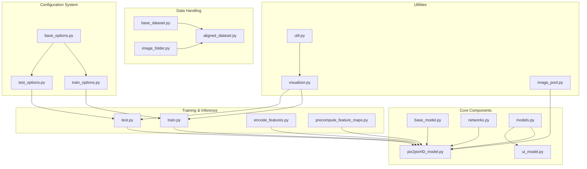

Sources: [README.md:5-11]()

## Model Architecture

The pix2pixHD model consists of several key neural network components:

```mermaid
classDiagram
    class "Pix2PixHDModel" {
        +netG: Generator
        +netD: Discriminator
        +netE: Encoder (optional)
        +forward()
        +inference()
        +encode_features()
    }
    
    class "Generator" {
        +GlobalGenerator
        +LocalEnhancer
    }
    
    class "Discriminator" {
        +MultiscaleDiscriminator
        +NLayerDiscriminator
    }
    
    class "Encoder" {
        +encode()
        +sample_features()
    }
    
    "Pix2PixHDModel" --> "Generator"
    "Pix2PixHDModel" --> "Discriminator"
    "Pix2PixHDModel" --> "Encoder"
```

Sources: [README.md:5-11]()

## Data Flow During Training and Inference

The following diagram illustrates the data flow during training and inference:

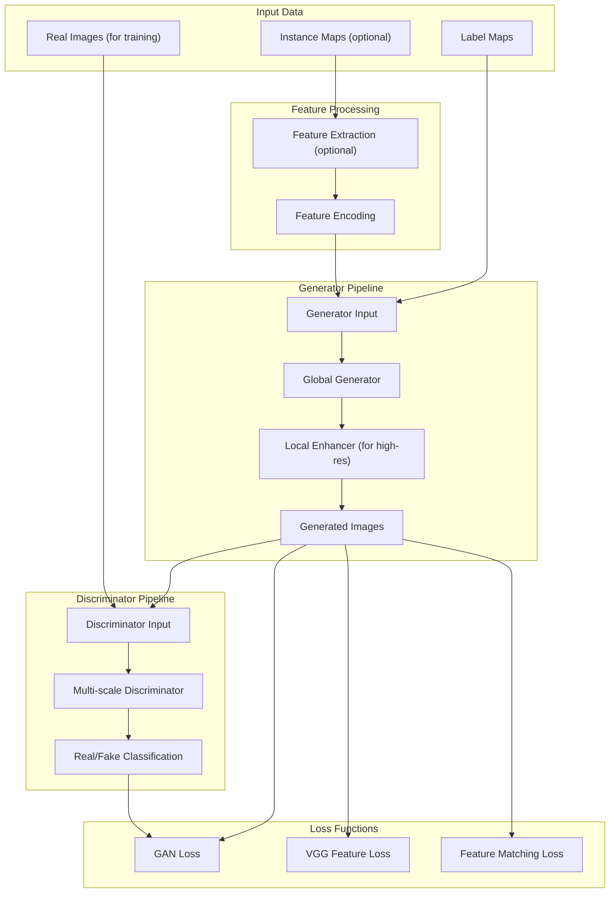

Sources: [util/util.py:10-100](), [README.md:72-79]()

## Basic Workflow

The typical workflow for using pix2pixHD consists of the following steps:

### Training
1. Prepare dataset (label maps, instance maps, and real images)
2. Configure training options
3. Run training script
4. Monitor results via web interface or TensorBoard

### Testing/Inference
1. Load pre-trained model
2. Provide input label maps (and instance maps if applicable)
3. Generate high-resolution output images

### Interactive Editing (UI Model)
1. Load trained model
2. Modify semantic labels interactively
3. Apply style from reference images
4. Generate real-time results

Sources: [README.md:72-124]()

## System Requirements and Setup

pix2pixHD requires:
- Linux or macOS operating system
- Python 2 or 3
- NVIDIA GPU (11GB+ memory recommended, 24GB for full resolution training)
- PyTorch and CUDA with cuDNN
- Python libraries including `dominate`

For accelerated training, the system supports:
- Multi-GPU training
- Automatic Mixed Precision (AMP) via NVIDIA Apex

Sources: [README.md:52-56](), [README.md:57-68]()

## Wiki Organization

This wiki is organized into the following main sections:

1. **Overview** (current page): Introduction to pix2pixHD
2. **System Architecture** [System Architecture](#2): Detailed explanation of system components
3. **Models** [Models](#3): Core model implementations and neural networks
4. **Training** [Training](#4): Training process and configuration
5. **Testing and Inference** [Testing and Inference](#5): Testing process and inference
6. **Data Handling** [Data Handling](#6): Dataset management and processing
7. **Configuration System** [Configuration System](#7): Options management
8. **Visualization** [Visualization](#8): Visualization utilities
9. **Running the System** [Running the System](#9): Practical usage guides

Each section provides detailed information about specific aspects of the pix2pixHD framework.

---

# Page: System Architecture

# System Architecture

<details>
<summary>Relevant source files</summary>

The following files were used as context for generating this wiki page:

- [README.md](README.md)
- [models/base_model.py](models/base_model.py)
- [models/models.py](models/models.py)
- [models/pix2pixHD_model.py](models/pix2pixHD_model.py)
- [models/ui_model.py](models/ui_model.py)
- [util/util.py](util/util.py)

</details>


This document provides a detailed overview of the pix2pixHD system architecture, explaining the core components, their relationships, and data flow within the system. It covers the model hierarchy, network components, and the architecture patterns used in the implementation.

For an introduction to the pix2pixHD system's purpose and capabilities, see [Overview](#1). For specific details about the model implementation, see [Models](#3).

## Core System Components

The pix2pixHD system is built around a hierarchical model structure that follows object-oriented design principles. The architecture uses inheritance to define specialized models for different purposes while sharing common functionality.

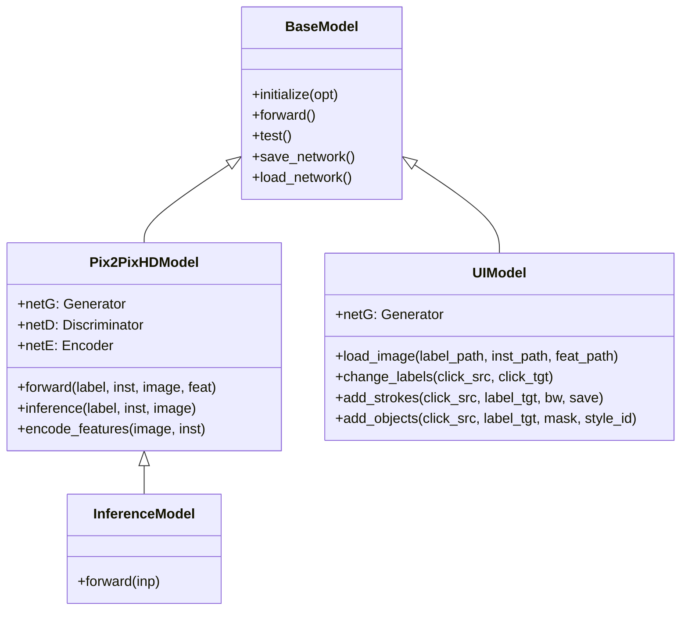

Sources: [models/base_model.py](), [models/pix2pixHD_model.py:9-111](), [models/pix2pixHD_model.py:299-302](), [models/ui_model.py:11-37]()

The class hierarchy shows the main model classes in the system. `BaseModel` defines the common interface, `Pix2PixHDModel` implements the core functionality for training and inference, `InferenceModel` provides a simplified interface for inference, and `UIModel` adds interactive capabilities.

## Model Factory

The system uses a factory pattern to create appropriate model instances based on configuration:

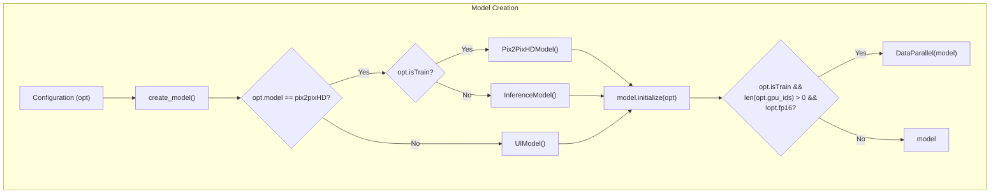

Sources: [models/models.py:3-20]()

The model factory determines which model class to instantiate based on the provided configuration options. For the `pix2pixHD` model type, it creates either a `Pix2PixHDModel` for training or an `InferenceModel` for inference. For other model types (e.g., interactive usage), it creates a `UIModel`.

## Network Architecture

The pix2pixHD system uses several neural network architectures for different purposes:

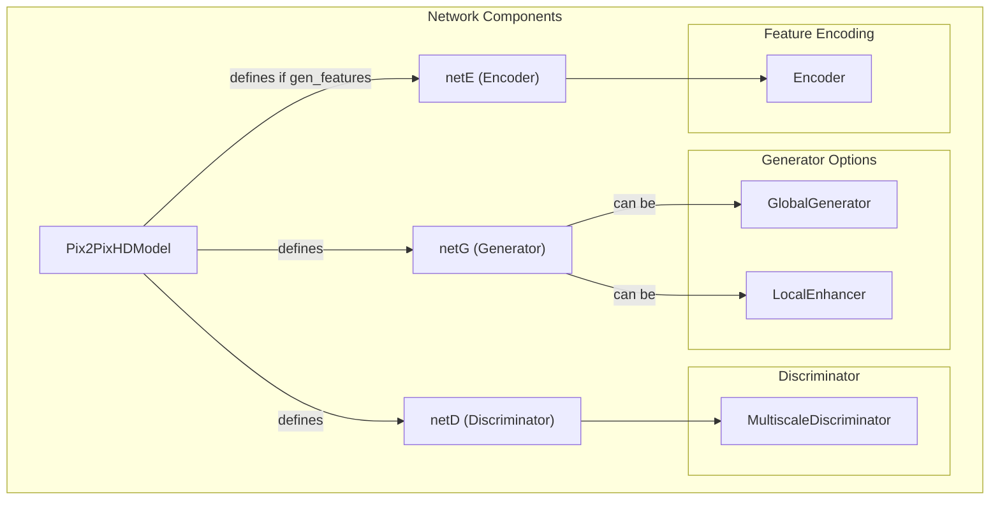

Sources: [models/pix2pixHD_model.py:29-51]()

The system defines three main network components:
1. **Generator (netG)**: Can be either a `GlobalGenerator` or a `LocalEnhancer` based on configuration. It generates the output images from the input label maps.
2. **Discriminator (netD)**: A `MultiscaleDiscriminator` that evaluates the realism of generated images during training.
3. **Encoder (netE)**: Used when generating features from images, allows for feature encoding.

## Data Flow During Training

The following diagram illustrates the data flow during the training process:

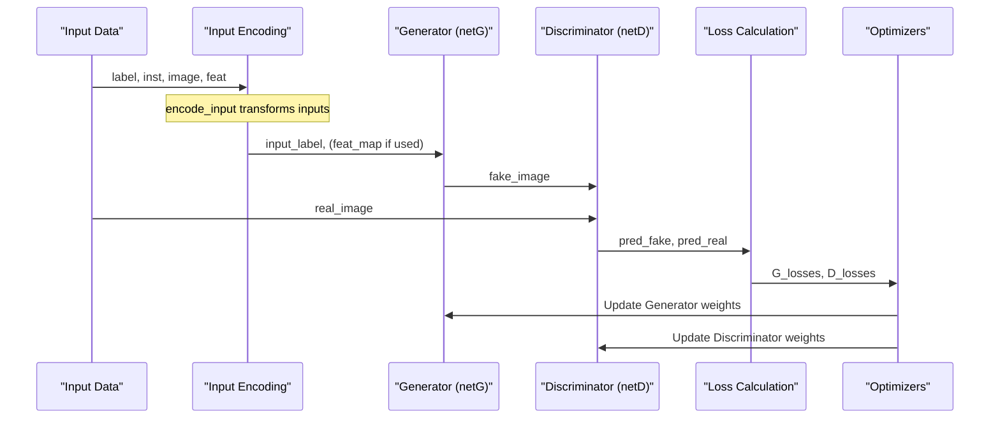

Sources: [models/pix2pixHD_model.py:152-193]()

During training, the system:
1. Encodes the input data (label maps, instance maps, images, features) using `encode_input`
2. Passes the encoded input through the generator to produce a fake image
3. Evaluates both the real and fake images with the discriminator
4. Calculates several losses (GAN loss, feature matching loss, VGG loss)
5. Updates the generator and discriminator weights

## Data Flow During Inference

The inference process is simpler as it only requires the generator:

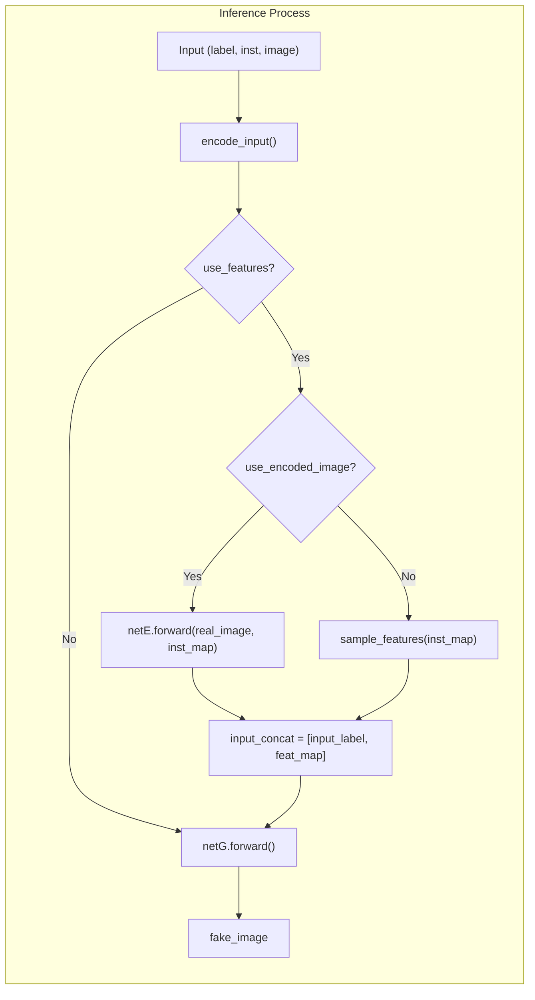

Sources: [models/pix2pixHD_model.py:195-217]()

During inference, the system:
1. Encodes the input data
2. If using features:
   a. Either encodes the real image using the encoder
   b. Or samples features from precomputed feature clusters
3. Passes the input (and features if used) through the generator
4. Returns the generated image

## Feature Processing

The system has specialized handling for features, allowing it to encode features from images and sample from feature clusters:

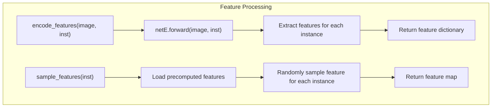

Sources: [models/pix2pixHD_model.py:219-261]()

The feature processing includes:
1. **Feature Encoding**: Extracts features from real images using the encoder
2. **Feature Sampling**: Samples from precomputed feature clusters for specific instances

## UI Model Architecture

The `UIModel` extends the system with interactive capabilities:

```mermaid
flowchart TD
    subgraph "UI Model Components"
        load["load_image()"] --> inputs["Process inputs (label, inst, feat)"]
        
        change["change_labels()"] --> update1["Update label and instance maps"]
        update1 --> forward1["Generate new image"]
        
        strokes["add_strokes()"] --> update2["Update maps in stroke region"]
        update2 --> forward2["Generate new image"]
        
        objects["add_objects()"] --> update3["Add object with selected style"]
        update3 --> forward3["Generate new image"]
        
        style["style_forward()"] --> check{"click_pt is None?"}
        check -->|Yes| simple["Generate image with current maps"]
        check -->|No| multiple["Generate multiple style options"]
    end
```

Sources: [models/ui_model.py:41-286]()

The UI model provides several interactive features:
1. **Loading Images**: Processes label maps, instance maps, and feature data
2. **Changing Labels**: Allows switching labels between regions
3. **Adding Strokes**: Enables painting with different labels
4. **Adding Objects**: Inserts new objects with selected styles
5. **Style Variations**: Generates different style options for selected objects

## System Initialization Flow

The following diagram shows the initialization process for the system:

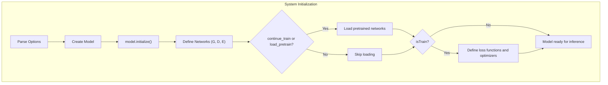

Sources: [models/pix2pixHD_model.py:19-110]()

During initialization, the system:
1. Parses command-line options
2. Creates the appropriate model type
3. Initializes the model by defining networks
4. Optionally loads pretrained networks
5. Sets up loss functions and optimizers if in training mode

## Summary

The pix2pixHD system architecture is designed with modularity and flexibility in mind. It uses inheritance to share functionality between different model types, factory patterns for model creation, and specialized handling for various inputs and features.

The core components work together to enable both training and inference of high-resolution image-to-image translation models, with additional features for interactive usage through the UI model.

The system can be configured through extensive options, allowing it to adapt to different datasets and tasks while maintaining the same overall architecture.

Sources: [models/pix2pixHD_model.py](), [models/base_model.py](), [models/models.py](), [models/ui_model.py]()

---

# Page: Models

# Models

<details>
<summary>Relevant source files</summary>

The following files were used as context for generating this wiki page:

- [models/base_model.py](models/base_model.py)
- [models/models.py](models/models.py)
- [models/ui_model.py](models/ui_model.py)

</details>


This document provides an overview of the model architecture within the pix2pixHD system, explaining how different models are created, organized, and used. For detailed information about specific model implementations, see [Pix2PixHD Model](#3.1), [Neural Network Architectures](#3.2), and [UI Model](#3.3).

## Model System Overview

The pix2pixHD system employs a modular approach to models with a well-defined hierarchy and factory pattern for model creation. This design enables different operational modes (training, inference, and interactive) with appropriate model implementations for each use case.

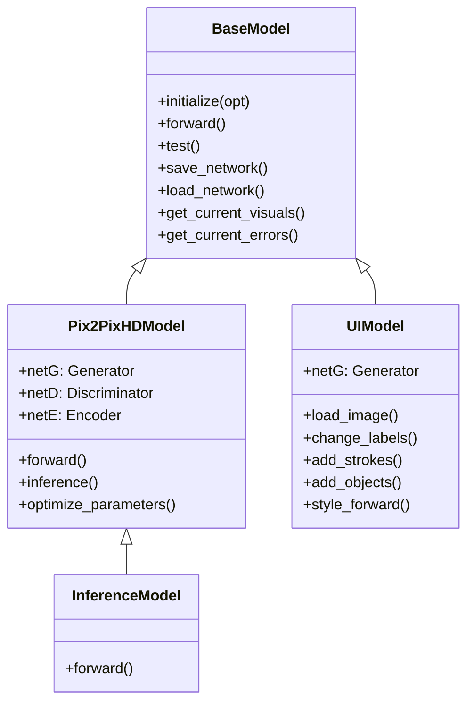

Sources: [models/base_model.py:5-91](), [models/models.py:3-20](), [models/ui_model.py:11-347]()

## Model Factory Pattern

The model system uses a factory pattern to instantiate the appropriate model based on configuration options. This pattern is implemented in the `create_model` function in `models.py`:

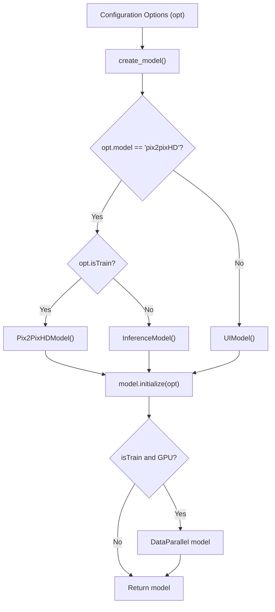

The factory produces one of three model types:
1. `Pix2PixHDModel` - Used for training
2. `InferenceModel` - Used for efficient testing/inference
3. `UIModel` - Used for interactive applications

After creating the model, the factory initializes it with the provided options and optionally wraps it with `DataParallel` for multi-GPU training.

Sources: [models/models.py:3-20]()

## BaseModel

The `BaseModel` class serves as the foundation for all model implementations, providing common functionality and interfaces that specific models must implement:

| Method | Purpose |
|--------|---------|
| `initialize(opt)` | Configure the model with options |
| `forward()` | Perform forward pass (abstract) |
| `test()` | Run inference without gradient calculation |
| `get_current_visuals()` | Return current visual outputs |
| `get_current_errors()` | Return current error metrics |
| `save_network()` | Save network weights to disk |
| `load_network()` | Load network weights from disk |
| `update_learning_rate()` | Update learning rate (during training) |

The `BaseModel` implements robust network loading functionality that handles:
- Loading weights with exact matches
- Loading weights with partial matches (some layers missing)
- Loading weights with mismatched layer sizes

Sources: [models/base_model.py:5-91]()

## Model Implementations

### Pix2PixHDModel

The main model used for training the pix2pixHD system. While not shown in the provided files, the factory pattern indicates it includes:
- A generator network (netG)
- A discriminator network (netD)
- An optional encoder network (netE)
- Methods for forward/backward passes and optimization

### InferenceModel

A simplified version of `Pix2PixHDModel` optimized for inference, containing only the components necessary for generating images (without training-related components).

### UIModel

The `UIModel` extends `BaseModel` to provide interactive capabilities for manipulating and generating images in real-time:

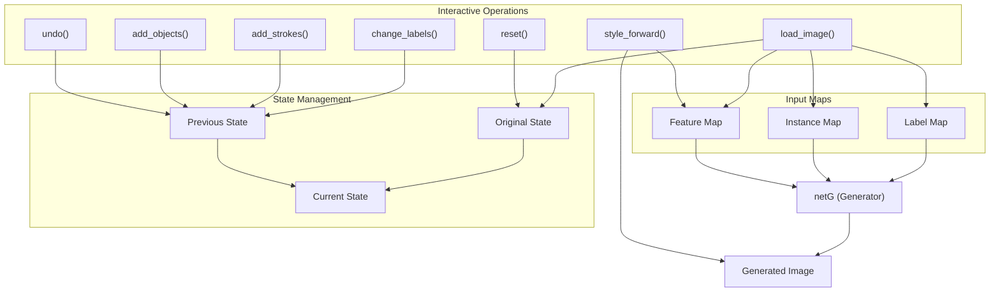

Key features of the `UIModel` include:
- Loading and processing input maps (label maps, instance maps, feature maps)
- Interactive editing operations:
  - Changing object labels
  - Adding strokes with specified labels
  - Adding objects with specific styles
  - Applying different style variations
- State management for undo/reset functionality
- Real-time image generation using the generator network

Sources: [models/ui_model.py:11-347]()

## Model Integration with the System

Models in pix2pixHD integrate with other system components through well-defined interfaces:

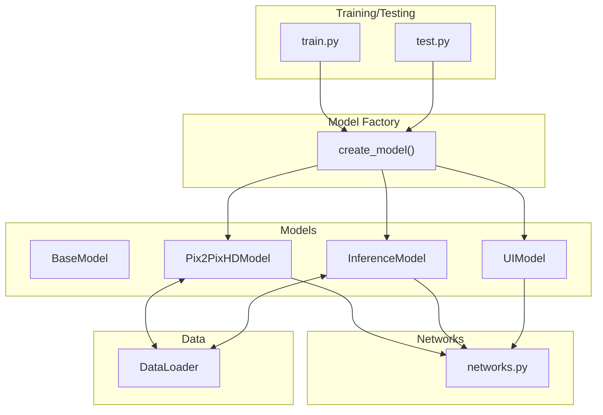

Training and testing scripts use the model factory to create appropriate model instances, which in turn utilize network definitions to construct their neural network components. The models interact with data loaders to process input data and generate outputs according to their specific purposes.

Sources: [models/models.py:3-20]()

## Summary

The pix2pixHD model system employs an object-oriented design with:
- A common base class providing shared functionality
- Specialized model implementations for different use cases
- A factory pattern for model creation and configuration
- Clear interfaces for integration with other system components

This architecture enables the system to operate in different modes (training, inference, interactive) while maintaining consistent interfaces and sharing common functionality across model implementations.

---

# Page: Pix2PixHD Model

# Pix2PixHD Model

<details>
<summary>Relevant source files</summary>

The following files were used as context for generating this wiki page:

- [models/pix2pixHD_model.py](models/pix2pixHD_model.py)

</details>


## Purpose and Scope

This document provides a detailed technical explanation of the Pix2PixHD model architecture, components, and functionality within the pix2pixHD repository. It covers the core implementation in `pix2pixHD_model.py`, including the model's initialization, training process, loss functions, and inference capabilities. For information about specific neural network architectures used in the model, see [Neural Network Architectures](#3.2).

## Overview

The Pix2PixHD model implements high-resolution image-to-image translation with conditional GANs. It extends the BaseModel class and supports features such as multi-scale discrimination, feature encoding, and enhanced loss functions for photorealistic results.

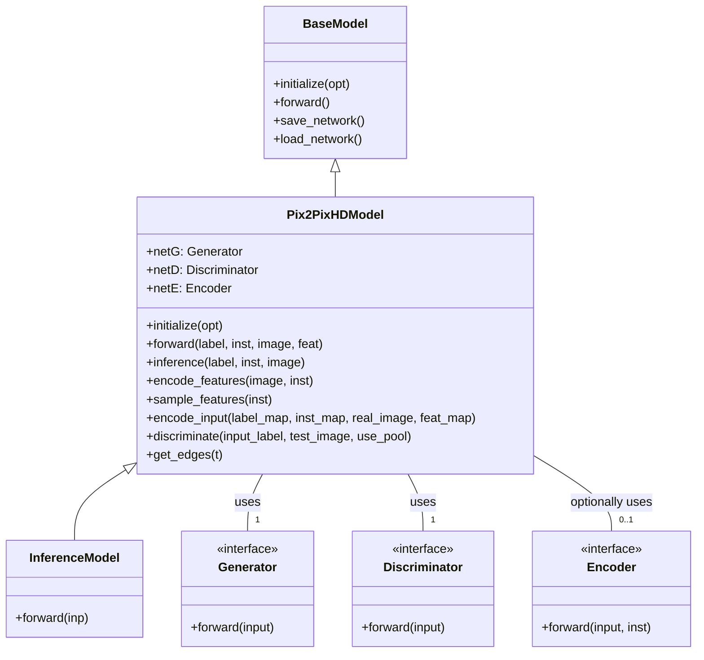

Sources: [models/pix2pixHD_model.py:9-297]()

## Model Initialization

The Pix2PixHD model is initialized with configuration options that determine its behavior. The initialization process creates the generator, discriminator, and (optionally) encoder networks.

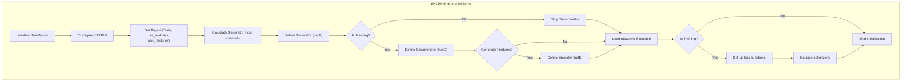

Sources: [models/pix2pixHD_model.py:19-109]()

During initialization, the model performs the following key steps:

1. Configures CUDA settings based on options
2. Determines feature usage flags
3. Calculates input channels for the generator
4. Creates network architectures (Generator, Discriminator, Encoder)
5. Loads pretrained networks if specified
6. Sets up loss functions and optimizers for training

The network architectures are defined through function calls to `networks.define_G()` and `networks.define_D()`, which create the generator and discriminator networks based on specified parameters.

## Input Processing

The Pix2PixHD model processes inputs through the `encode_input` method, which prepares label maps, instance maps, and images for use by the model.

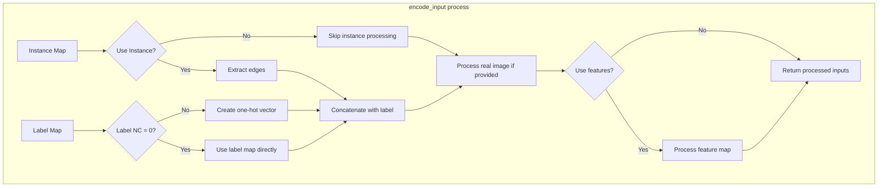

Sources: [models/pix2pixHD_model.py:111-142]()

Key aspects of input processing:

- Labels are either used directly or converted to one-hot vectors
- Instance maps can be used to extract edge information
- Real images are prepared for training
- Feature maps are handled if the model uses features

## Forward Pass and Training

The forward pass of the Pix2PixHD model orchestrates the flow of data through the generator and discriminator networks during training.

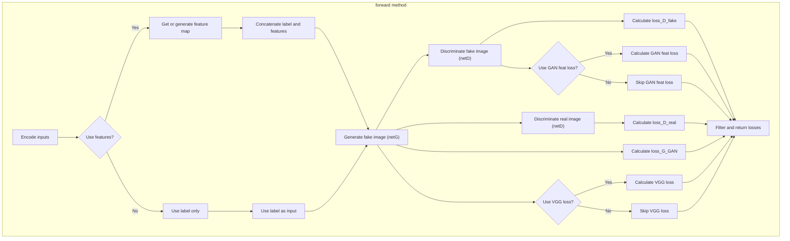

Sources: [models/pix2pixHD_model.py:152-193]()

During training, the model:

1. Processes input data (labels, instances, images, features)
2. Generates fake images through the generator network
3. Evaluates both real and fake images with the discriminator
4. Calculates multiple loss components:
   - GAN loss for generator and discriminator
   - Feature matching loss
   - VGG perceptual loss
5. Returns filtered losses based on configuration

## Loss Functions

The Pix2PixHD model employs several loss functions to achieve high-quality results:

| Loss Function | Purpose | Implementation |
|---------------|---------|----------------|
| GAN Loss | Adversarial loss for generator/discriminator | `criterionGAN` |
| Feature Matching Loss | Matches intermediate features between real/fake | `criterionFeat` |
| VGG Perceptual Loss | Matches perceptual features using VGG network | `criterionVGG` |

The loss functions are initialized during model setup:

```python
self.criterionGAN = networks.GANLoss(use_lsgan=not opt.no_lsgan, tensor=self.Tensor)   
self.criterionFeat = torch.nn.L1Loss()
if not opt.no_vgg_loss:             
    self.criterionVGG = networks.VGGLoss(self.gpu_ids)
```

Sources: [models/pix2pixHD_model.py:72-77](), [models/pix2pixHD_model.py:173-190]()

## Feature Handling

The Pix2PixHD model can utilize features to enhance the generation process, either by encoding features from real images or by sampling from precomputed feature clusters.

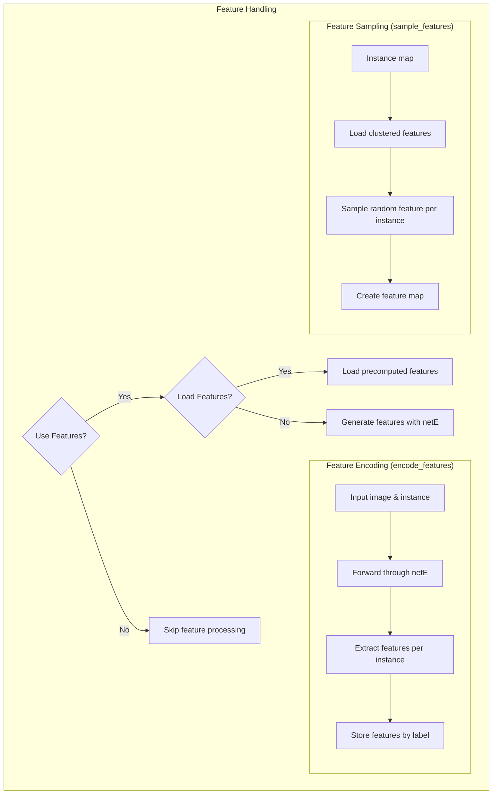

Sources: [models/pix2pixHD_model.py:219-260]()

Feature handling includes two key processes:

1. **Feature Encoding** (`encode_features`): Extracts features from real images using the encoder network
2. **Feature Sampling** (`sample_features`): Samples features from precomputed clusters based on instance labels

These features provide additional semantic information that helps the generator produce more detailed and realistic images.

## Inference Process

During inference, the model generates images from label maps and instance maps without requiring backpropagation.

```mermaid
flowchart TD
    subgraph "inference method"
        A["Encode inputs"] --> B{"Use features?"}
        B -->|"Yes"| C{"Use encoded image?"}
        C -->|"Yes"| D["Encode real image"]
        C -->|"No"| E["Sample from precomputed features"]
        
        B -->|"No"| F["Skip feature processing"]
        
        D --> G["Concatenate label and features"]
        E --> G
        F --> H["Use label only"]
        
        G --> I["Forward through Generator"]
        H --> I
        
        I --> J["Return fake image"]
    end
```

Sources: [models/pix2pixHD_model.py:195-217]()

The inference process is streamlined compared to training:

1. Input label and instance maps are encoded
2. Features are either encoded from a real image or sampled from precomputed clusters
3. The generator produces the output image
4. No loss calculation or backpropagation occurs

## InferenceModel Class

For simplified inference, the codebase provides an `InferenceModel` class that inherits from `Pix2PixHDModel` but provides a simplified interface.

```python
class InferenceModel(Pix2PixHDModel):
    def forward(self, inp):
        label, inst = inp
        return self.inference(label, inst)
```

Sources: [models/pix2pixHD_model.py:299-302]()

This class allows for easy integration of the model into production workflows by accepting a tuple of (label, instance) and returning the generated image.

## Utility Functions

The Pix2PixHD model includes several utility functions that support its operations:

| Function | Purpose |
|----------|---------|
| `get_edges` | Extracts edges from instance maps |
| `save` | Saves model networks to disk |
| `update_fixed_params` | Updates optimizer parameters after fixing global generator |
| `update_learning_rate` | Decreases learning rate during training |

Sources: [models/pix2pixHD_model.py:262-297]()

## Data Flow During Operation

The following diagram illustrates the overall data flow during both training and inference with the Pix2PixHD model:

```mermaid
flowchart TD
    subgraph "Input Data"
        I1["Label Map"] 
        I2["Instance Map"]
        I3["Real Image (Training only)"]
        I4["Feature Map (Optional)"]
    end
    
    subgraph "Pix2PixHDModel"
        P1["encode_input"] --> P2["Feature Processing"]
        P2 -->|"Training"| P3["forward"]
        P2 -->|"Inference"| P4["inference"]
        
        P3 --> P5["Loss Calculation"]
        P3 --> P6["Return Losses"]
        
        P4 --> P7["Return Generated Image"]
    end
    
    subgraph "Networks"
        N1["Generator (netG)"]
        N2["Discriminator (netD)"]
        N3["Encoder (netE)"]
    end
    
    I1 --> P1
    I2 --> P1
    I3 --> P1
    I4 --> P1
    
    P2 -->|"Features Needed"| N3
    N3 --> P2
    
    P3 --> N1
    N1 -->|"Fake Image"| P3
    P3 --> N2
    N2 -->|"Discriminator Output"| P3
    
    P4 --> N1
    N1 -->|"Generated Image"| P4
```

Sources: [models/pix2pixHD_model.py:152-217]()

## Summary

The Pix2PixHD model is a sophisticated implementation of image-to-image translation that supports high-resolution output. Key features include:

1. Multi-scale discrimination for improved quality
2. Feature encoding for enhanced semantic control
3. Multiple loss functions for perceptual quality
4. Support for instance-level control through instance maps
5. Flexible architecture with global and local enhancement options

The model is designed for both training and inference, with optimizations for each mode of operation.

---

# Page: Neural Network Architectures

# Neural Network Architectures

<details>
<summary>Relevant source files</summary>

The following files were used as context for generating this wiki page:

- [models/networks.py](models/networks.py)

</details>


## Purpose and Scope

This document details the neural network architectures used in the pix2pixHD system, including generators, discriminators, and loss functions. It explains the structure, functionality, and relationships between different network components that enable high-resolution image-to-image translation. For information about the overall pix2pixHD model implementation, see [Pix2PixHD Model](#3.1).

## Core Architecture Components

The pix2pixHD framework implements several specialized neural network architectures to achieve high-resolution image synthesis. The key components include:

```mermaid
graph TD
    subgraph "Network Factory Functions"
        define_G["define_G()"]
        define_D["define_D()"]
    end
    
    subgraph "Generator Architectures"
        Global["GlobalGenerator"]
        Local["LocalEnhancer"]
        Encoder["Encoder"]
    end
    
    subgraph "Discriminator Architectures"
        MultiD["MultiscaleDiscriminator"]
        NLayerD["NLayerDiscriminator"]
    end
    
    subgraph "Building Blocks"
        ResBlock["ResnetBlock"]
    end
    
    subgraph "Loss Functions"
        GANLoss["GANLoss"]
        VGGLoss["VGGLoss"]
        VGG["Vgg19"]
    end
    
    define_G --> Global
    define_G --> Local
    define_G --> Encoder
    define_D --> MultiD
    MultiD --> NLayerD
    Global --> ResBlock
    Local --> Global
    Local --> ResBlock
    VGGLoss --> VGG
```

Sources: [models/networks.py:27-54](), [models/networks.py:65-124]()

## Generator Architectures

The pix2pixHD system implements three generator variants, each designed for specific purposes within the image synthesis pipeline.

### Factory Function

The generator networks are instantiated through the `define_G` factory function, which supports three types of generators:

```mermaid
flowchart LR
    subgraph "define_G"
        input[/"Input Parameters"/] --> selector{"netG parameter"}
        selector -->|"netG='global'"| global["GlobalGenerator"]
        selector -->|"netG='local'"| local["LocalEnhancer"]
        selector -->|"netG='encoder'"| encoder["Encoder"]
        global & local & encoder --> weights["weights_init()"]
        weights --> output[/"Generator Network"/]
    end
```

Sources: [models/networks.py:27-44]()

### GlobalGenerator

The GlobalGenerator is the foundation of the pix2pixHD generation system, implementing a classic encoder-decoder architecture with residual blocks.

```mermaid
flowchart TB
    subgraph "GlobalGenerator"
        input[/"Input Image"/] --> reflect1["ReflectionPad2d(3)"]
        reflect1 --> conv1["Conv2d(input_nc, ngf, k=7)"]
        conv1 --> norm1["norm_layer(ngf)"]
        norm1 --> relu1["ReLU"]
        
        relu1 --> down["Downsampling Blocks (×n_downsampling)"]
        down --> res["ResNet Blocks (×n_blocks)"]
        res --> up["Upsampling Blocks (×n_downsampling)"]
        
        up --> reflect2["ReflectionPad2d(3)"]
        reflect2 --> conv2["Conv2d(ngf, output_nc, k=7)"]
        conv2 --> tanh["Tanh"]
        tanh --> output[/"Output Image"/]
    end
```

Key characteristics:
- Initial reflection padding and 7×7 convolutional layer
- Multiple downsampling layers (typically 3) that reduce spatial dimensions and increase feature channels
- A sequence of ResNet blocks (typically 9) for transformation in feature space
- Symmetric upsampling layers with transposed convolutions
- Final 7×7 convolution with Tanh activation to produce the output image

Sources: [models/networks.py:183-211]()

### LocalEnhancer

The LocalEnhancer extends the GlobalGenerator with multi-scale processing for improved detail generation.

```mermaid
flowchart TB
    subgraph "LocalEnhancer"
        input[/"Input Image"/] --> pyramid["Create Input Pyramid"]
        pyramid --> global["Global Generator (Coarse Level)"]
        
        global --> loop["For each enhancer level"]
        
        loop --> downsample["Local Downsample Path"]
        downsample --> add{"+"}
        global --> add
        add --> upsample["Local Upsample Path"]
        
        upsample --> output[/"Enhanced Output Image"/]
    end
```

Key characteristics:
- Builds on top of a GlobalGenerator for coarse feature generation
- Creates an input pyramid with multiple resolutions
- For each enhancer level, processes the corresponding input resolution
- Combines the local processing path with the global features
- Progressively refines the output through multiple enhancer levels
- Supports hierarchical generation with multiple local enhancers (typically 1-3)

Sources: [models/networks.py:129-181]()

### Encoder

The Encoder is used for feature extraction, particularly for instance-level feature encoding.

```mermaid
flowchart TB
    subgraph "Encoder"
        input[/"Input Image"/] --> reflect1["ReflectionPad2d(3)"]
        reflect1 --> conv1["Conv2d(input_nc, ngf, k=7)"]
        conv1 --> norm1["norm_layer(ngf)"]
        norm1 --> relu1["ReLU"]
        
        relu1 --> down["Downsampling Blocks (×n_downsampling)"]
        down --> up["Upsampling Blocks (×n_downsampling)"]
        
        up --> reflect2["ReflectionPad2d(3)"]
        reflect2 --> conv2["Conv2d(ngf, output_nc, k=7)"]
        conv2 --> tanh["Tanh"]
        
        tanh --> instPool["Instance-wise Average Pooling"]
        instPool --> output[/"Feature Maps"/]
    end
```

Key characteristics:
- Similar architecture to GlobalGenerator but designed for feature extraction
- Takes both an input image and an instance map
- Performs instance-wise average pooling to get consistent features for each object instance
- Outputs feature maps that can be used to control the generator's output

Sources: [models/networks.py:255-290]()

### ResnetBlock

The ResnetBlock is a fundamental building block used in the generator architectures.

```mermaid
flowchart LR
    subgraph "ResnetBlock"
        input[/"Input Features"/] --> pad1["Padding (reflect/replicate/zero)"]
        pad1 --> conv1["Conv2d(dim, dim, k=3)"]
        conv1 --> norm1["norm_layer(dim)"]
        norm1 --> act1["ReLU"]
        
        act1 --> pad2["Padding (reflect/replicate/zero)"]
        pad2 --> conv2["Conv2d(dim, dim, k=3)"]
        conv2 --> norm2["norm_layer(dim)"]
        
        input --> skip[" "]
        norm2 --> add{"+"}
        skip --> add
        
        add --> output[/"Output Features"/]
    end
```

Key characteristics:
- Implements a residual connection (skip connection)
- Two convolutional layers with normalization
- Supports different padding types (reflect, replicate, zero)
- Optionally includes dropout for regularization

Sources: [models/networks.py:213-253]()

## Discriminator Architectures

The pix2pixHD system uses a multi-scale PatchGAN discriminator architecture to evaluate generated images at different resolutions.

### Factory Function

The discriminator networks are instantiated through the `define_D` factory function:

```mermaid
flowchart LR
    subgraph "define_D"
        input[/"Input Parameters"/] --> create["Create MultiscaleDiscriminator"]
        create --> weights["weights_init()"]
        weights --> output[/"Discriminator Network"/]
    end
```

Sources: [models/networks.py:46-54]()

### MultiscaleDiscriminator

The MultiscaleDiscriminator consists of multiple NLayerDiscriminators operating at different scales.

```mermaid
flowchart TB
    subgraph "MultiscaleDiscriminator"
        input[/"Input Image"/] --> fork["Create multiple scales"]
        
        fork --> D1["NLayerDiscriminator (Original Scale)"]
        fork --> down1["Downsample"]
        down1 --> D2["NLayerDiscriminator (1/2 Scale)"]
        down1 --> down2["Downsample"]
        down2 --> D3["NLayerDiscriminator (1/4 Scale)"]
        
        D1 & D2 & D3 --> collect["Collect Results"]
        collect --> output[/"Discrimination Results"/]
    end
```

Key characteristics:
- Creates multiple discriminators (typically 3) at different image scales
- Each scale processes a progressively downsampled version of the input
- Uses average pooling for downsampling between scales
- Can optionally return intermediate features from each discriminator

Sources: [models/networks.py:292-331]()

### NLayerDiscriminator

The NLayerDiscriminator is the basic PatchGAN discriminator used within the multi-scale architecture.

```mermaid
flowchart TB
    subgraph "NLayerDiscriminator"
        input[/"Input Image"/] --> conv1["Conv2d(input_nc, ndf, k=4, s=2)"]
        conv1 --> leaky1["LeakyReLU(0.2)"]
        
        leaky1 --> convLayers["Conv Layers (×n_layers)
        Conv2d + norm_layer + LeakyReLU"]
        
        convLayers --> convPre["Conv2d(nf_prev, nf, k=4, s=1)"]
        convPre --> normPre["norm_layer(nf)"]
        normPre --> leakyPre["LeakyReLU(0.2)"]
        
        leakyPre --> convFinal["Conv2d(nf, 1, k=4, s=1)"]
        convFinal --> sigmoid{"use_sigmoid?"}
        sigmoid -->|"Yes"| sigAct["Sigmoid"]
        sigmoid -->|"No"| skip[" "]
        
        sigAct & skip --> output[/"Discrimination Results"/]
    end
```

Key characteristics:
- Series of convolutional layers with increasing feature channels
- Uses stride of 2 for downsampling in the initial layers
- LeakyReLU activations with slope 0.2
- Optional sigmoid activation for the final output
- Can return intermediate features if the `getIntermFeat` flag is set

Sources: [models/networks.py:334-383]()

## Loss Functions

The pix2pixHD system employs specialized loss functions for training the generator and discriminator networks.

### GANLoss

The GANLoss class implements the adversarial loss used in GAN training.

```mermaid
flowchart TB
    subgraph "GANLoss"
        input[/"Discriminator Output"/] --> isReal{"target_is_real?"}
        
        isReal -->|"Yes"| genTarget1["Generate Real Target (1.0)"]
        isReal -->|"No"| genTarget0["Generate Fake Target (0.0)"]
        
        genTarget1 & genTarget0 --> lossType{"use_lsgan?"}
        
        lossType -->|"Yes"| mseLoss["MSELoss"]
        lossType -->|"No"| bceLoss["BCELoss"]
        
        mseLoss & bceLoss --> calc["Calculate Loss"]
        calc --> output[/"Loss Value"/]
    end
```

Key characteristics:
- Supports both Least Squares GAN (LSGAN) and standard GAN loss
- Automatically creates target tensors for real and fake samples
- Handles both single discriminator outputs and lists of outputs (for multi-scale)
- Real targets are set to 1.0 by default, fake targets to 0.0

Sources: [models/networks.py:68-110]()

### VGGLoss

The VGGLoss implements a perceptual loss using the VGG19 network.

```mermaid
flowchart LR
    subgraph "VGGLoss"
        input[/"Generated Image, Target Image"/] --> vgg["Vgg19 Network"]
        
        vgg --> extract["Extract Feature Maps"]
        extract --> compare["Compare Features (L1 Loss)"]
        compare --> weight["Weight Different Layers"]
        weight --> sum["Sum Weighted Losses"]
        
        sum --> output[/"Perceptual Loss Value"/]
    end
```

Key characteristics:
- Uses a pre-trained VGG19 network to extract features
- Compares features at multiple layers between generated and target images
- Applies different weights to losses from different layers
- Results in a perceptual loss that captures high-level features and textures

Sources: [models/networks.py:112-124](), [models/networks.py:386-416]()

## Code Integration and Usage

The network architectures are integrated into the pix2pixHD system through the factory functions and model creation process.

```mermaid
flowchart TB
    subgraph "Network Architecture Usage"
        options[/"Model Options"/] --> createG["define_G()"]
        options --> createD["define_D()"]
        
        createG --> generator["Generator Network"]
        createD --> discriminator["Discriminator Network"]
        
        generator & discriminator --> model["Pix2PixHD Model"]
        
        input[/"Input Data"/] --> forward["Forward Pass"]
        forward --> loss["Calculate Losses"]
        loss --> backward["Backward Pass"]
        backward --> update["Update Weights"]
    end
```

Key integration points:
- Networks are initialized through factory functions with configurable parameters
- Multiple generator architectures can be selected based on the task requirements
- Multi-scale discriminators provide feedback at different resolutions
- Specialized loss functions guide the training process
- Weight initialization is standardized across all network components

Sources: [models/networks.py:10-16](), [models/networks.py:27-54]()

## Network Configuration Parameters

The network architectures can be configured through various parameters to adjust their capacity and behavior.

| Parameter | Description | Typical Values |
|-----------|-------------|----------------|
| `netG` | Generator architecture type | 'global', 'local', 'encoder' |
| `ngf` | Number of generator filters | 32, 64 |
| `n_downsample_global` | Downsample layers in global generator | 3, 4 |
| `n_blocks_global` | ResNet blocks in global generator | 9 |
| `n_local_enhancers` | Number of local enhancers | 1, 2 |
| `n_blocks_local` | ResNet blocks in local enhancer | 3 |
| `ndf` | Number of discriminator filters | 64 |
| `n_layers_D` | Layers in each discriminator | 3, 4 |
| `num_D` | Number of discriminators (scales) | 3 |
| `norm` | Normalization type | 'instance', 'batch' |
| `use_sigmoid` | Whether to use sigmoid in discriminator | False (for LSGAN) |
| `getIntermFeat` | Return intermediate features | True, False |

Sources: [models/networks.py:18-25](), [models/networks.py:27-37](), [models/networks.py:46-48]()

---

# Page: UI Model

# UI Model

<details>
<summary>Relevant source files</summary>

The following files were used as context for generating this wiki page:

- [models/models.py](models/models.py)
- [models/ui_model.py](models/ui_model.py)

</details>


## Purpose and Scope

The UI Model is a specialized component within the pix2pixHD system that enables interactive image manipulation and editing. Unlike the main Pix2PixHD Model which focuses on training and inference, the UI Model provides tools for users to interactively modify generated images by changing labels, adding strokes, incorporating new objects, and applying different styles to objects.

For information about the main Pix2PixHD Model used for training and standard inference, see [Pix2PixHD Model](#3.1).

Sources: [models/ui_model.py:11-14](), [models/models.py:10-12]()

## Architecture and Position in System

The UI Model extends the base model framework and integrates with the generator network to provide interactive image manipulation capabilities.

### System Context

```mermaid
flowchart TD
    subgraph "Model Factory"
        models["models.py create_model()"]
    end
    
    subgraph "Model Types"
        pix2pixHD["Pix2PixHD Model / Inference Model"]
        ui["UIModel"]
    end
    
    subgraph "Networks"
        networks["networks.py define_G()"]
    end
    
    models --> |"opt.model == 'pix2pixHD'"| pix2pixHD
    models --> |"opt.model != 'pix2pixHD'"| ui
    networks --> ui
    
    style ui stroke-width:3px
```

The UI Model is created by the model factory (`create_model` function in `models.py`) when the model option is not set to 'pix2pixHD'. It utilizes network architectures defined in `networks.py`, specifically the generator network created via `define_G`.

Sources: [models/models.py:3-20](), [models/ui_model.py:15-31]()

### Class Structure

```mermaid
classDiagram
    BaseModel <|-- UIModel
    UIModel -- "1" Generator

    class BaseModel {
        +initialize(opt)
        +name()
    }
    
    class UIModel {
        -netG: Generator
        -label_map: Tensor
        -inst_map: Tensor
        -feat_map: Tensor
        -net_input: Variable
        -features_clustered: dict
        +initialize(opt)
        +name()
        +load_image(label_path, inst_path, feat_path)
        +change_labels(click_src, click_tgt)
        +add_strokes(click_src, label_tgt, bw, save)
        +add_objects(click_src, label_tgt, mask, style_id)
        +style_forward(click_pt, style_id)
        +reset()
        +undo()
    }

    class Generator {
        +forward(input)
    }
```

The UIModel inherits from BaseModel and contains:
- A generator network (`netG`)
- Tensors for label maps, instance maps, and feature maps
- Input variable for the network
- Clustered features dictionary
- Methods for various interactive operations

Sources: [models/ui_model.py:11-14](), [models/ui_model.py:15-31]()

## Core Components and Data Flow

The UI Model manages several types of data to enable interactive image manipulation:

```mermaid
flowchart TD
    subgraph "Input Data"
        label["Label Map"]
        inst["Instance Map"]
        features["Feature Clusters"]
    end
    
    subgraph "Processed Data"
        input_label["One-hot Encoded Label Map"]
        edge_map["Edge Map"]
        feat_map["Feature Map"]
        net_input["Network Input"]
    end
    
    subgraph "Model Operations"
        load["load_image()"]
        change["change_labels()"]
        strokes["add_strokes()"]
        objects["add_objects()"]
        style["style_forward()"]
    end
    
    subgraph "Output"
        gen["Generator Network (netG)"]
        fake["Generated Image"]
    end
    
    label --> load
    inst --> load
    features --> load
    
    load --> input_label
    load --> edge_map
    load --> feat_map
    
    input_label --> net_input
    edge_map --> net_input
    
    change --> net_input
    change --> feat_map
    strokes --> net_input
    strokes --> feat_map
    objects --> net_input
    objects --> feat_map
    style --> net_input
    style --> feat_map
    
    net_input --> gen
    feat_map --> gen
    gen --> fake
```

The UI Model loads and processes label maps, instance maps, and features. It applies various operations to these data structures based on user interactions, then combines them to create the network input for the generator to produce the final image.

Sources: [models/ui_model.py:41-89](), [models/ui_model.py:215-221]()

## Initialization and Setup

The UI Model is initialized in a non-training mode and loads a pre-trained generator network:

1. The `initialize` method sets up the model with the provided options
2. It verifies the model is not in training mode (`assert(not opt.isTrain)`)
3. It configures the generator input channels based on options:
   - Base input channels from label categories
   - Additional channel for instance map (if enabled)
   - Additional channels for features (if enabled)
4. It creates the generator network using `networks.define_G`
5. It loads pre-trained weights from a specified epoch

Sources: [models/ui_model.py:15-31]()

## Image Loading and Processing

The UI Model provides methods to load and process images for interactive manipulation:

### Image Loading Process

```mermaid
flowchart TD
    subgraph "Input Files"
        label_path["Label Image Path"]
        inst_path["Instance Image Path"]
        feat_path["Features Path"]
    end
    
    subgraph "Loading and Processing"
        load_label["Load & Resize Label Image"]
        one_hot["Convert to One-Hot Vector"]
        load_inst["Load & Resize Instance Image"]
        edge_map["Extract Edge Map"]
        load_feat["Load Clustered Features"]
        apply_feat["Apply Features to Map"]
    end
    
    subgraph "Results"
        input_label["Input Label (one-hot)"]
        net_input["Network Input"]
        feat_map["Feature Map"]
    end
    
    label_path --> load_label
    load_label --> one_hot
    one_hot --> input_label
    
    inst_path --> load_inst
    load_inst --> edge_map
    
    input_label --> net_input
    edge_map --> net_input
    
    feat_path --> load_feat
    load_feat --> apply_feat
    apply_feat --> feat_map
```

The `load_image` method:
1. Loads and resizes the label image
2. Converts it to a one-hot vector representation
3. Loads and processes the instance map (if enabled)
4. Extracts edge maps from the instance map
5. Loads clustered features and applies them to the feature map
6. Stores original states for undo/reset functionality

Sources: [models/ui_model.py:41-89](), [models/ui_model.py:91-97](), [models/ui_model.py:98-105]()

## Interactive Features

The UI Model provides four main interactive features for image manipulation:

### 1. Changing Labels

The `change_labels` method allows changing the label of an object from one class to another:

1. Takes source and target click positions
2. Identifies the label and instance at the source position
3. Finds all pixels with the same instance ID
4. Updates the label map, instance map, and feature map for those pixels
5. Regenerates the image with the updated maps

This enables transferring the appearance of one object type to another object in the image.

Sources: [models/ui_model.py:117-149]()

### 2. Adding Strokes

The `add_strokes` method adds strokes of a target label to the image:

1. Takes a click position, target label, and brush width
2. Identifies the region affected by the stroke
3. Updates the label map, instance map, and feature map for that region
4. Regenerates the image with the updated maps

This allows for painting or sketching new elements into the image.

Sources: [models/ui_model.py:152-187]()

### 3. Adding Objects

The `add_objects` method adds entire objects to the image:

1. Takes a click position, target label, object mask, and style ID
2. Positions the mask at the click location
3. Updates the label map, instance map, and feature map using the mask
4. Applies the specified style to the new object
5. Regenerates the image with the updated maps

This enables inserting predefined objects with specific styles into the image.

Sources: [models/ui_model.py:190-213]()

### 4. Applying Styles

```mermaid
flowchart TD
    subgraph "Style Selection"
        click["Click on Object"]
        identify["Identify Instance and Label"]
        get_features["Get Available Features"]
    end
    
    subgraph "Style Application"
        option1["Apply Single Style"]
        option2["Generate Multiple Style Options"]
    end
    
    subgraph "Processing Steps"
        set_features["Set Features for Object"]
        update_maps["Update Feature Map"]
        generate["Generate New Image"]
    end
    
    click --> identify
    identify --> get_features
    get_features --> |"style_id >= 0"| option1
    get_features --> |"style_id == -1"| option2
    
    option1 --> set_features
    option2 --> |"For each style"| set_features
    
    set_features --> update_maps
    update_maps --> generate
```

The `style_forward` method applies different styles to a selected object:

1. If no click point is provided, it generates the image with current settings
2. If a click point is provided:
   - It identifies the object at that position
   - It retrieves available feature clusters for that object type
   - If a specific style ID is provided, it applies that style
   - If no style ID is provided, it generates images with all available styles
3. It updates the feature map and regenerates the image(s)

This allows exploring different appearance variations for the same object.

Sources: [models/ui_model.py:225-284]()

## Feature Handling

The UI Model provides several methods to manage and manipulate feature maps:

### Feature Setting and Copying

- `set_features`: Assigns feature values from a specific cluster to selected pixels
- `copy_features`: Copies feature values from a target position to source positions
- `update_features`: Updates the feature map when objects are added or labels changed
- `get_crop_region`: Identifies the region of interest around an object for efficient processing

These methods enable sophisticated control over object appearances by manipulating underlying feature representations.

Sources: [models/ui_model.py:326-334](), [models/ui_model.py:292-307](), [models/ui_model.py:309-324]()

## Summary

The UI Model extends the core pix2pixHD functionality to provide interactive image manipulation capabilities. It enables users to:

1. Change object labels to transform appearances
2. Add brushstrokes to paint new elements
3. Insert complete objects with specific styles
4. Explore different stylistic variations of objects

These capabilities are implemented through manipulation of label maps, instance maps, and feature maps, which are then processed by a pre-trained generator network to produce the modified images.

Sources: [models/ui_model.py:11-347]()

---

# Page: Training

# Training

<details>
<summary>Relevant source files</summary>

The following files were used as context for generating this wiki page:

- [README.md](README.md)
- [train.py](train.py)
- [util/util.py](util/util.py)

</details>


This page documents the training process for pix2pixHD, a high-resolution image-to-image translation framework. It covers the workflow for training the model, configuration options, and best practices. For information about testing and inference, see [Testing and Inference](#5).

## 1. Training Overview

The pix2pixHD training system takes semantic label maps as input and trains a conditional GAN model to generate photorealistic images. The training process involves a generator network that learns to translate label maps to realistic images, and a discriminator network that learns to distinguish between real and generated images.

```mermaid
flowchart TD
    subgraph "Training Process Overview"
        A["Data Preparation"] --> B["Model Initialization"]
        B --> C["Training Loop"]
        C --> D["Model Evaluation"]
        D --> E["Model Saving"]
        C --> |"Iterate"| C
    end
```

Sources: [train.py:16-142]()

## 2. Training Workflow

The training workflow in pix2pixHD follows a standard GAN training approach with specialized components for high-resolution image synthesis.

```mermaid
flowchart TD
    subgraph "Detailed Training Workflow"
        init["Initialize Options"] --> loadData["Load Training Data"]
        loadData --> createModel["Create pix2pixHD Model"]
        createModel --> createVis["Create Visualizer"]
        createVis --> epochLoop["Epoch Loop"]
        
        epochLoop --> |"For each batch"| forward["Forward Pass: 
        Generate Image from Label"]
        forward --> calcLoss["Calculate Losses:
        - GAN Loss
        - Feature Matching Loss
        - VGG Loss"]
        calcLoss --> backwardG["Backward Pass & Update Generator"]
        backwardG --> backwardD["Backward Pass & Update Discriminator"]
        backwardD --> checkSave["Check for Visualization & Saving"]
        checkSave --> |"Next batch"| forward
        
        checkSave --> |"End of epoch"| updateLR["Update Learning Rate"]
        updateLR --> checkFixed["Check for Fixed Parameters Update"]
        checkFixed --> |"Next epoch"| epochLoop
    end
```

Sources: [train.py:16-142]()

### 2.1 Initialization

The training process begins by parsing command-line options using `TrainOptions` and initializing the data loader, model, and visualizer.

```mermaid
classDiagram
    class TrainOptions {
        +continue_train: bool
        +niter: int
        +niter_decay: int
        +save_epoch_freq: int
        +save_latest_freq: int
        +print_freq: int
        +display_freq: int
        +niter_fix_global: int
        +parse() TrainOptions
    }
    
    class DataLoader {
        +load_data() Dataset
    }
    
    class Pix2PixHDModel {
        +optimizer_G: Optimizer
        +optimizer_D: Optimizer
        +forward() losses, generated
        +save(epoch) None
        +update_learning_rate() None
        +update_fixed_params() None
    }
    
    class Visualizer {
        +display_current_results() None
        +print_current_errors() None
        +plot_current_errors() None
    }
    
    TrainOptions --> DataLoader: configures
    TrainOptions --> Pix2PixHDModel: configures
    TrainOptions --> Visualizer: configures
```

Sources: [train.py:11-42]()

### 2.2 Training Loop

The training loop iterates over epochs and batches, performing forward and backward passes and updating the model parameters.

1. **Forward Pass**: The model takes label maps, instance maps, real images, and features as input and generates a synthetic image.
2. **Loss Calculation**: The model calculates losses for the generator and discriminator.
3. **Backward Pass**: The gradients are computed and parameters are updated.
4. **Visualization**: The training progress is visualized at regular intervals.

Sources: [train.py:56-122]()

### 2.3 Model Updates and Learning Rate Decay

At the end of each epoch, the model is saved and learning rate is updated if necessary:

1. Model is saved at the configured frequency (`save_epoch_freq`)
2. Fixed parameters are updated after a certain number of iterations (`niter_fix_global`)
3. Learning rate is linearly decayed after a certain number of iterations (`niter`)

Sources: [train.py:123-142]()

## 3. Training Configuration

pix2pixHD provides extensive configuration options for training through the command-line interface.

### 3.1 Basic Training Options

| Option | Description | Default Value |
|--------|-------------|---------------|
| `--name` | Name of the experiment | required |
| `--batchSize` | Input batch size | 1 |
| `--loadSize` | Scale images to this size | 1024 |
| `--fineSize` | Crop to this size | 512 |
| `--label_nc` | Number of input label channels | 35 |
| `--input_nc` | Number of input image channels | 3 |
| `--output_nc` | Number of output image channels | 3 |
| `--niter` | Number of epochs with initial learning rate | 100 |
| `--niter_decay` | Number of epochs with linearly decaying learning rate | 100 |
| `--lr` | Initial learning rate | 0.0002 |

Sources: [README.md:125-126]()

### 3.2 Model Architecture Options

| Option | Description | Default Value |
|--------|-------------|---------------|
| `--netG` | Generator architecture (`global`, `local`, or `encoder`) | `global` |
| `--ngf` | Number of generator filters in first conv layer | 64 |
| `--n_downsample_global` | Number of downsampling layers in global generator | 4 |
| `--n_blocks_global` | Number of residual blocks in global generator | 9 |
| `--n_local_enhancers` | Number of local enhancers | 1 |
| `--n_blocks_local` | Number of residual blocks in local enhancer | 3 |
| `--ndf` | Number of discriminator filters in first conv layer | 64 |
| `--n_layers_D` | Number of discriminator layers | 3 |

Sources: [README.md:125-126]()

### 3.3 Loss Function Options

| Option | Description | Default Value |
|--------|-------------|---------------|
| `--no_ganFeat_loss` | Do not use GAN feature matching loss | False |
| `--no_vgg_loss` | Do not use VGG feature matching loss | False |
| `--lambda_feat` | Weight for feature matching loss | 10.0 |
| `--lambda_vgg` | Weight for VGG loss | 10.0 |

Sources: [README.md:125-126]()

## 4. Training Scripts

pix2pixHD provides several example training scripts in the `scripts` directory for different scenarios.

### 4.1 Basic Training

To train a model at 512p resolution:

```bash
python train.py --name label2city_512p
```

Sources: [README.md:90-94]()

### 4.2 Multi-GPU Training

To train using multiple GPUs:

```bash
python train.py --name label2city_512p --batchSize 8 --gpu_ids 0,1,2,3,4,5,6,7
```

Sources: [README.md:98-104]()

### 4.3 Mixed Precision Training

To train with Automatic Mixed Precision (AMP) for faster speed:

```bash
python -m torch.distributed.launch train.py --name label2city_512p --fp16
```

This can speed up training by about 80% on Volta architecture GPUs.

Sources: [README.md:106-113]()

### 4.4 Training at Full Resolution

For training at 2048x1024 resolution, different scripts are provided based on available GPU memory:

- 24G memory GPU: `./scripts/train_1024p_24G.sh`
- 16G memory GPU with mixed precision: `./scripts/train_1024p_16G.sh`
- 12G memory GPU (with cropping): `./scripts/train_1024p_12G.sh`

Sources: [README.md:115-117]()

## 5. Data Flow During Training

```mermaid
flowchart TD
    subgraph "Data Flow"
        data["Dataset (Cityscapes)"] --> |"CreateDataLoader"| loader["DataLoader"]
        loader --> |"Batch"| inputs["Input Tensors:
        - label_map
        - instance_map
        - real_image
        - features"]
        
        inputs --> model["Pix2PixHDModel.forward()"]
        model --> generator["Generator Network"]
        generator --> fake["Fake Image"]
        
        fake --> discrim["Discriminator Network"]
        inputs --> |"Real Image"| discrim
        
        discrim --> losses["Losses:
        - GAN Loss
        - Feature Matching Loss
        - VGG Perceptual Loss"]
        
        losses --> backprop["Backpropagation"]
        backprop --> optimG["Generator Optimizer"]
        backprop --> optimD["Discriminator Optimizer"]
    end
```

Sources: [train.py:36-96]()

### 5.1 Input Data Format

pix2pixHD expects the following data format for training:

1. **Label Maps**: One-channel images where pixel values correspond to object labels (0,1,...,N-1)
2. **Instance Maps**: Instance segmentation maps (optional, can be disabled with `--no_instance`)
3. **Real Images**: Target photorealistic images
4. **Features**: Encoded features (optional, used for instance-aware generation)

Sources: [README.md:119-123](), [train.py:70-71]()

### 5.2 Data Preprocessing

The default preprocessing for training data is:

- **`scale_width`**: Scales the width of all training images to `opt.loadSize` (1024) while preserving aspect ratio
- **`crop`**: Random cropping to size `(opt.fineSize, opt.fineSize)`
- **`scale_width_and_crop`**: Combines width scaling and random cropping
- **`none`**: No preprocessing except ensuring the image is divisible by 32

Sources: [README.md:123]()

## 6. Training Mechanics

### 6.1 Loss Functions

pix2pixHD uses multiple loss functions for training:

```mermaid
flowchart LR
    subgraph "Loss Functions"
        A["GAN Loss"] --> totalG["Total Generator Loss"]
        B["Feature Matching Loss"] --> totalG
        C["VGG Perceptual Loss"] --> totalG
        
        D["Real Discriminator Loss"] --> totalD["Total Discriminator Loss"]
        E["Fake Discriminator Loss"] --> totalD
    end
```

Sources: [train.py:76-79]()

1. **GAN Loss**: Adversarial loss from the discriminator
2. **Feature Matching Loss**: Matches intermediate features in the discriminator
3. **VGG Perceptual Loss**: Matches features from a pre-trained VGG network
4. **Discriminator Loss**: Combination of real and fake discriminator losses

### 6.2 Optimization Process

The optimization process alternates between updating the generator and discriminator:

1. **Generator Update**:
   ```python
   optimizer_G.zero_grad()
   loss_G.backward()
   optimizer_G.step()
   ```

2. **Discriminator Update**:
   ```python
   optimizer_D.zero_grad()
   loss_D.backward()
   optimizer_D.step()
   ```

Sources: [train.py:82-96]()

### 6.3 Learning Rate Strategy

pix2pixHD uses a linearly decaying learning rate after a fixed number of iterations:

```mermaid
flowchart LR
    subgraph "Learning Rate Schedule"
        A["Initial Learning Rate (lr)"] --> B["Constant LR for niter epochs"]
        B --> C["Linear Decay for niter_decay epochs"]
        C --> D["Final LR ≈ 0"]
    end
```

Sources: [train.py:139-141]()

## 7. Monitoring and Visualization

pix2pixHD provides tools for monitoring the training progress and visualizing results.

### 7.1 Training Progress Visualization

The `Visualizer` class is used to display training progress:

1. **Error Plotting**: Plots loss values over time
2. **Image Visualization**: Displays input labels, generated images, and real images
3. **TensorBoard Support**: Optional TensorBoard logging (`--tf_log`)

```mermaid
flowchart TD
    subgraph "Visualization System"
        train["train.py"] --> |"errors"| visualizer["Visualizer"]
        train --> |"images"| visualizer
        
        visualizer --> html["HTML Display"]
        visualizer --> |"if tf_log"| tensorboard["TensorBoard"]
    end
```

Sources: [train.py:108-112](), [README.md:95-96]()

### 7.2 Visualized Content

During training, the following images are visualized:

1. **Input Label**: Colorized label map
2. **Synthesized Image**: Output from the generator
3. **Real Image**: Ground truth image

Images are displayed in an HTML file located at `./checkpoints/[experiment_name]/web/index.html`.

Sources: [train.py:108-112](), [util/util.py:10-35]()

## 8. Model Saving and Resuming

pix2pixHD saves model checkpoints periodically and allows resuming training from these checkpoints.

### 8.1 Model Saving

Models are saved at two frequencies:

1. **Latest Model**: Saved every `save_latest_freq` iterations
2. **Epoch Models**: Saved every `save_epoch_freq` epochs

```mermaid
flowchart TD
    subgraph "Model Saving"
        check1{"total_steps % save_latest_freq == 0"} --> |"Yes"| save1["Save 'latest' Model"]
        check2{"epoch % save_epoch_freq == 0"} --> |"Yes"| save2["Save Epoch Model"]
    end
```

Sources: [train.py:114-118](), [train.py:128-133]()

### 8.2 Resuming Training

To resume training from a saved checkpoint, use the `--continue_train` option:

```bash
python train.py --name label2city_512p --continue_train
```

This will load the latest saved model and resume training from that point.

Sources: [train.py:19-24]()

## 9. Training Strategies and Best Practices

### 9.1 Progressive Training Strategy

pix2pixHD supports a progressive training strategy using the `--niter_fix_global` option:

1. First train only the local enhancer network while keeping the global generator fixed
2. After `niter_fix_global` epochs, train the entire network

```mermaid
flowchart TD
    subgraph "Progressive Training"
        A["First niter_fix_global epochs"] --> |"Train only Local Enhancer"| B["Fixed Global Generator"]
        C["After niter_fix_global epochs"] --> |"Train Full Network"| D["Global + Local Networks"]
    end
```

Sources: [train.py:135-137]()

### 9.2 Memory Optimization

For high-resolution training, consider the following options:

1. **Mixed Precision Training**: Use `--fp16` for reduced memory usage and faster training
2. **Cropping**: Use smaller crop sizes to fit in memory
3. **Batch Size**: Reduce batch size if necessary

Sources: [README.md:106-117]()

### 9.3 Custom Dataset Training

To train with a custom dataset:

1. Organize data into paired label maps and images
2. Specify the correct number of label channels with `--label_nc`
3. Set `--label_nc 0` for direct RGB input instead of label maps
4. Use `--no_instance` if instance maps are not available

Sources: [README.md:119-123]()

---

# Page: Training Configuration

# Training Configuration

<details>
<summary>Relevant source files</summary>

The following files were used as context for generating this wiki page:

- [options/base_options.py](options/base_options.py)
- [util/visualizer.py](util/visualizer.py)

</details>


This page documents the training configuration options for the pix2pixHD system. It details how to configure various aspects of the training process, including model architecture, data loading, optimization parameters, and visualization settings. For information about testing configurations, see [Testing Configuration](#5.1).

## 1. Configuration System Overview

The pix2pixHD framework uses a hierarchical configuration system based on command-line arguments. The configuration options are organized in a class hierarchy that allows for flexible customization of the training process.

```mermaid
flowchart TD
    subgraph "Configuration Hierarchy"
        cmdArgs["Command Line Arguments"]
        baseOpt["BaseOptions"] 
        trainOpt["TrainOptions"]
        
        cmdArgs --> baseOpt
        baseOpt --> trainOpt
    end
    
    subgraph "Configuration Flow"
        trainOpt --> genConfig["Generator Configuration"]
        trainOpt --> dataConfig["Data Configuration"]
        trainOpt --> optConfig["Optimization Configuration"]
        trainOpt --> visConfig["Visualization Configuration"]
        
        genConfig --> modelInit["Model Initialization"]
        dataConfig --> dataLoading["Data Loading"]
        optConfig --> training["Training Loop"]
        visConfig --> visualization["Visualization"]
    end
```

Sources: [options/base_options.py:6-99]()

## 2. Base Configuration Options

The base configuration options define the fundamental parameters for both training and testing. These are implemented in the `BaseOptions` class.

### 2.1 Experiment Configuration

These options control the basic setup of the experiment:

| Option | Type | Default | Description |
|--------|------|---------|-------------|
| `--name` | str | 'label2city' | Name of the experiment, determines where samples and models are stored |
| `--gpu_ids` | str | '0' | GPU IDs to use (e.g., '0,1,2'), '-1' for CPU |
| `--checkpoints_dir` | str | './checkpoints' | Directory where models are saved |
| `--model` | str | 'pix2pixHD' | Which model architecture to use |
| `--norm` | str | 'instance' | Type of normalization (instance or batch) |
| `--use_dropout` | bool | False | Whether to use dropout in the generator |
| `--data_type` | int | 32 | Data precision (8, 16, or 32 bit) |
| `--verbose` | bool | False | Toggles verbose mode |
| `--fp16` | bool | False | Train with Automatic Mixed Precision (AMP) |

Sources: [options/base_options.py:11-22]()

### 2.2 Input/Output Configuration

These options control the dimensions and characteristics of input and output data:

| Option | Type | Default | Description |
|--------|------|---------|-------------|
| `--batchSize` | int | 1 | Input batch size |
| `--loadSize` | int | 1024 | Initial scale size for images |
| `--fineSize` | int | 512 | Final crop size after scaling |
| `--label_nc` | int | 35 | Number of input label channels |
| `--input_nc` | int | 3 | Number of input image channels |
| `--output_nc` | int | 3 | Number of output image channels |

Sources: [options/base_options.py:24-30]()

### 2.3 Dataset Configuration

These options control data loading and preprocessing:

| Option | Type | Default | Description |
|--------|------|---------|-------------|
| `--dataroot` | str | './datasets/cityscapes/' | Path to the dataset |
| `--resize_or_crop` | str | 'scale_width' | Image resizing/cropping strategy |
| `--serial_batches` | bool | False | Use sequential image order for batches |
| `--no_flip` | bool | False | Disable image flipping for data augmentation |
| `--nThreads` | int | 2 | Number of threads for data loading |
| `--max_dataset_size` | int | inf | Maximum number of samples per dataset |

Sources: [options/base_options.py:32-38]()

### 2.4 Generator Architecture Configuration

These options define the structure of the generator network:

| Option | Type | Default | Description |
|--------|------|---------|-------------|
| `--netG` | str | 'global' | Type of generator architecture |
| `--ngf` | int | 64 | Number of generator filters in first conv layer |
| `--n_downsample_global` | int | 4 | Number of downsampling layers in global generator |
| `--n_blocks_global` | int | 9 | Number of residual blocks in global generator network |
| `--n_blocks_local` | int | 3 | Number of residual blocks in local enhancer network |
| `--n_local_enhancers` | int | 1 | Number of local enhancers to use |
| `--niter_fix_global` | int | 0 | Number of epochs to only train the local enhancer |

Sources: [options/base_options.py:44-51]()

### 2.5 Feature Encoding Configuration

These options control instance-wise feature encoding:

| Option | Type | Default | Description |
|--------|------|---------|-------------|
| `--no_instance` | bool | False | If true, don't add instance map as input |
| `--instance_feat` | bool | False | If true, add encoded instance features as input |
| `--label_feat` | bool | False | If true, add encoded label features as input |
| `--feat_num` | int | 3 | Vector length for encoded features |
| `--load_features` | bool | False | If true, load precomputed feature maps |
| `--n_downsample_E` | int | 4 | Number of downsampling layers in encoder |
| `--nef` | int | 16 | Number of encoder filters in first conv layer |
| `--n_clusters` | int | 10 | Number of clusters for features |

Sources: [options/base_options.py:53-61]()

## 3. Training-Specific Configuration

While not directly visible in the provided code snippets, the training configuration extends base options with parameters specifically for the training process. These likely include learning rates, optimization settings, and training scheduling.

```mermaid
classDiagram
    class BaseOptions {
        +initialize()
        +parse()
        -parser: ArgumentParser
        -initialized: bool
    }
    
    class TrainOptions {
        +initialize()
        -isTrain: True
        -continue_train: bool
        -niter: int
        -niter_decay: int
        -lr: float
        -beta1: float
        -lambda_feat: float
    }
    
    BaseOptions <|-- TrainOptions
```

### 3.1 Training Process Configuration

Based on the system architecture, common training-specific configuration options would include:

| Option | Type | Typical Values | Description |
|--------|------|----------------|-------------|
| `--continue_train` | bool | False | Resume training from latest checkpoint |
| `--niter` | int | 100 | Number of epochs with constant learning rate |
| `--niter_decay` | int | 100 | Number of epochs with linearly decaying learning rate |
| `--lr` | float | 0.0002 | Initial learning rate |
| `--beta1` | float | 0.5 | Momentum term for Adam optimizer |
| `--no_html` | bool | False | Disable HTML visuals during training |
| `--display_freq` | int | 1000 | Frequency of showing training results |
| `--print_freq` | int | 100 | Frequency of showing training losses |
| `--save_latest_freq` | int | 5000 | Frequency of saving the latest model |
| `--save_epoch_freq` | int | 10 | Frequency of saving checkpoints at epoch end |

## 4. Visualization Configuration

The visualization system is configured through several options that control how training progress is displayed and saved.

```mermaid
flowchart TD
    subgraph "Visualization System"
        trainOpt["Training Options"]
        vis["Visualizer"]
        
        trainOpt -->|"--tf_log"| vis
        trainOpt -->|"--no_html"| vis
        trainOpt -->|"--display_winsize"| vis
        
        vis --> tfLog["TensorFlow Logging"]
        vis --> htmlOut["HTML Output"]
        vis --> console["Console Output"]
        vis --> diskImg["Saved Images"]
    end
```

| Option | Type | Default | Description |
|--------|------|---------|-------------|
| `--tf_log` | bool | False | Use TensorBoard for logging (requires TensorFlow) |
| `--display_winsize` | int | 512 | Display window size for visuals |
| `--no_html` | bool | False | Disable HTML visualization output |

Sources: [util/visualizer.py:13-34](), [options/base_options.py:40-42]()

## 5. Configuration Files and Saving

When training begins, the configuration is parsed from command-line arguments and saved to a text file in the experiment's checkpoint directory. This allows you to:

1. Document the exact configuration used for a training run
2. Reproduce experiments with the same settings
3. Continue training from checkpoints using the same configuration

The saved configuration file is located at:
```
<checkpoints_dir>/<experiment_name>/opt.txt
```

Sources: [options/base_options.py:89-98]()

## 6. Training Configuration Example

A typical pix2pixHD training command might look like:

```bash
python train.py --name cityscapes_hd --dataroot ./datasets/cityscapes/ --label_nc 35 \
                --loadSize 1024 --fineSize 512 --batchSize 8 \
                --netG local --ngf 32 --n_local_enhancers 2 \
                --niter 100 --niter_decay 100 --lr 0.0002 \
                --tf_log --nThreads 4
```

This configuration would:
- Name the experiment "cityscapes_hd"
- Use the Cityscapes dataset
- Set input label channels to 35 (Cityscapes classes)
- Load images at 1024px, then crop to 512px
- Use batch size of 8
- Use a local enhancer network architecture with 2 enhancers
- Train for 100 epochs at constant learning rate, then 100 epochs with decay
- Use TensorFlow logging
- Use 4 threads for data loading

---

# Page: Feature Processing

# Feature Processing

<details>
<summary>Relevant source files</summary>

The following files were used as context for generating this wiki page:

- [encode_features.py](encode_features.py)
- [precompute_feature_maps.py](precompute_feature_maps.py)

</details>


This page documents the feature processing subsystems in pix2pixHD, which are critical for enabling instance-level control and style manipulation in image generation. Feature processing consists of two main components: **Feature Encoding** and **Feature Map Precomputation**. For information about the overall training process, see [Training](#4), and for model architecture details, see [Neural Network Architectures](#3.2).

## Overview

Feature processing in pix2pixHD enhances the model's ability to:
1. Capture instance-specific style information
2. Transfer styles between instances of the same semantic class
3. Improve high-resolution image generation quality

```mermaid
flowchart TD
    subgraph "Feature Processing"
        A["Input Data"] --> B["Feature Encoding"]
        A --> C["Feature Map Precomputation"]
        B --> D["Store Encoded Features"]
        B --> E["Feature Clustering"]
        C --> F["Store Feature Maps"]
        D --> G["Training"]
        E --> G
        F --> G
    end

    style A fill:white,stroke:black
    style B fill:white,stroke:black
    style C fill:white,stroke:black
    style D fill:white,stroke:black
    style E fill:white,stroke:black
    style F fill:white,stroke:black
    style G fill:white,stroke:black
```

Sources: [encode_features.py](), [precompute_feature_maps.py]()

## Feature Encoding

Feature encoding extracts style information from input images and their corresponding instance maps. This process captures instance-specific details that can later be transferred between different objects of the same semantic class.

### Encoding Process

```mermaid
sequenceDiagram
    participant D as "Dataset"
    participant M as "Pix2PixHD Model"
    participant E as "Encoder Network (netE)"
    participant S as "Storage"
    
    D->>M: data["image"], data["inst"]
    M->>E: encode_features()
    E->>M: feature vectors
    M->>S: Store features by semantic label
    
    Note over S: Features stored as .npy file<br/>in checkpoints directory
```

Sources: [encode_features.py:24-37]()

The encoding process works as follows:

1. The script initializes a data structure to store features for each semantic label
2. For each image in the dataset:
   - It passes the image and instance map to the model's encoder
   - The encoder extracts feature vectors organized by semantic label
   - These features are accumulated for each label class
3. All features are saved to a single numpy file for later use

### Feature Clustering

After encoding, the features are clustered using K-means to create a more manageable set of style options for each semantic class.

```mermaid
flowchart TD
    A["Load encoded features"] --> B["For each semantic label"]
    B --> C["Filter features by confidence"]
    C --> D["Apply K-means clustering"]
    D --> E["Store cluster centers"]
    E --> F["Save clustered features"]
    
    style A fill:white,stroke:black
    style B fill:white,stroke:black
    style C fill:white,stroke:black
    style D fill:white,stroke:black
    style E fill:white,stroke:black
    style F fill:white,stroke:black
```

Sources: [encode_features.py:39-54]()

Key properties of the clustering process:

| Property | Description |
|----------|-------------|
| Clustering Algorithm | K-means |
| Number of Clusters | Configurable via `opt.n_clusters` |
| Feature Selection | Only features with confidence > 0.5 are used |
| Storage Format | Numpy array of cluster centers per label |
| File Naming | `features_clustered_[n_clusters].npy` |

The clustered features represent "style prototypes" that can be used during training and inference to control the appearance of specific object instances.

## Feature Map Precomputation

Feature map precomputation generates spatial feature representations for training high-resolution images (specifically 1024p). This improves both training efficiency and output quality.

```mermaid
flowchart TD
    A["Input Dataset"] --> B["For each image"]
    B --> C["Forward pass through encoder (netE)"]
    C --> D["Upsample feature maps (2x)"]
    D --> E["Save as feature images"]
    
    style A fill:white,stroke:black
    style B fill:white,stroke:black
    style C fill:white,stroke:black
    style D fill:white,stroke:black
    style E fill:white,stroke:black
```

Sources: [precompute_feature_maps.py:26-33]()

The precomputation process:

1. Creates a dedicated directory for precomputed feature maps (`train_feat`)
2. For each training image:
   - Passes the image through the encoder network to generate feature maps
   - Upsamples the feature maps by a factor of 2 using nearest-neighbor interpolation
   - Converts the feature maps to image format
   - Saves the feature maps to the dedicated directory, maintaining the same filename structure

### Implementation Details

```mermaid
classDiagram
    class Pix2PixHDModel {
        +netE: Encoder
        +encode_features(image, inst)
        +sample_features(inst)
    }
    
    class FeatureEncoding {
        +LoadDataset()
        +CreateModel()
        +EncodeFeatures()
        +ClusterFeatures()
    }
    
    class FeaturePrecomputation {
        +LoadDataset()
        +CreateModel()
        +PrecomputeFeatureMaps()
        +UpsampleAndSave()
    }
    
    Pix2PixHDModel <-- FeatureEncoding: uses
    Pix2PixHDModel <-- FeaturePrecomputation: uses
```

Sources: [encode_features.py](), [precompute_feature_maps.py]()

The scripts require specific options to be set:

| Option | Value | Purpose |
|--------|-------|---------|
| nThreads | 1 | Single-threaded processing |
| batchSize | 1 | Process one image at a time |
| serial_batches | True | Maintain consistent order |
| no_flip | True | Disable data augmentation |
| instance_feat | True | Enable instance feature extraction |

## Integration with Training

Feature processing is performed before the main training process. During training, the model can utilize:

1. **Encoded and clustered features** for style transfer between instances
2. **Precomputed feature maps** for generating high-resolution outputs

The feature processing scripts create necessary data assets that the main training system (`train.py`) can then utilize through options like:

- `instance_feat`: Enable the use of instance features
- `load_features`: Load preprocessed features
- `feat_num`: Specify the dimensionality of features

Sources: [encode_features.py:12](), [precompute_feature_maps.py:14]()

## Running Feature Processing

### Feature Encoding and Clustering

To encode features and perform clustering:

1. Ensure your dataset is properly organized
2. Run the feature encoding script:
   ```
   python encode_features.py --name [experiment_name] --dataroot [path_to_data] --label_nc [num_classes] --n_clusters [num_clusters]
   ```
3. The script will:
   - Encode features from all images in the dataset
   - Cluster the features using K-means
   - Save both raw features and cluster centers in the checkpoints directory

Sources: [encode_features.py:7-17]()

### Feature Map Precomputation

To precompute feature maps for high-resolution training:

1. Ensure your dataset is properly organized
2. Run the feature precomputation script:
   ```
   python precompute_feature_maps.py --name [experiment_name] --dataroot [path_to_data] --label_nc [num_classes]
   ```
3. The script will:
   - Process each image in the dataset
   - Generate and upsample feature maps
   - Save them to the `[dataroot]/train_feat` directory

Sources: [precompute_feature_maps.py:9-17](), [precompute_feature_maps.py:24]()

## Conclusion

Feature processing in pix2pixHD provides powerful capabilities for instance-level control and high-resolution generation. The two main components, feature encoding/clustering and feature map precomputation, work together to enhance the model's ability to generate detailed, controllable outputs. These preprocessing steps create the data assets necessary for the model to achieve its advanced style transfer capabilities during training and inference.

---

# Page: Testing and Inference

# Testing and Inference

<details>
<summary>Relevant source files</summary>

The following files were used as context for generating this wiki page:

- [README.md](README.md)
- [test.py](test.py)
- [util/util.py](util/util.py)

</details>


This document provides a comprehensive guide to the testing and inference processes in the pix2pixHD system. It covers how to run inference using the pre-trained models, options for configuring the inference process, and explains different inference modes including standard PyTorch inference, TensorRT acceleration, and ONNX support. For information on the testing configuration options, see [Testing Configuration](#5.1).

## Overview of the Inference Process

The pix2pixHD system provides a streamlined workflow for generating high-resolution images from semantic label maps. The inference process follows a straightforward pipeline that loads input data (labels and optionally instance maps), processes it through the generator network, and produces photorealistic output images.

```mermaid
flowchart TD
    A["Input Data"] --> B["Data Loading"]
    B --> C["Model Creation"]
    C --> D["Model Inference"]
    D --> E["Visualization"]
    E --> F["Results Webpage"]

    subgraph "Input Data"
        A1["Label Maps"]
        A2["Instance Maps (optional)"]
    end

    subgraph "Model Inference Options"
        D1["PyTorch Inference"]
        D2["TensorRT Engine"]
        D3["ONNX Runtime"]
    end

    A1 --> A
    A2 --> A
    D --> D1
    D --> D2
    D --> D3
```

Sources: [test.py:1-67]()

## Key Components

The testing and inference system consists of several key components that work together to process input label maps and generate realistic output images.

```mermaid
classDiagram
    class TestOptions {
        +parse() opt
    }
    class CreateDataLoader {
        +load_data() dataset
    }
    class create_model {
        +inference(label, inst, image)
    }
    class Visualizer {
        +save_images(webpage, visuals, img_path)
    }
    class HTML {
        +add_images(ims, txts, links, width)
        +save()
    }
    
    TestOptions --> CreateDataLoader: provides options
    CreateDataLoader --> create_model: feeds data
    create_model --> Visualizer: generates images
    Visualizer --> HTML: saves results
```

Sources: [test.py:1-25]()

### Configuration and Setup

The inference process begins with setting up the appropriate options and data loaders:

```mermaid
flowchart LR
    A["TestOptions"] --> B["Parse arguments"]
    B --> C["Configure testing parameters"]
    C --> D["CreateDataLoader"]
    D --> E["Load dataset"]
    E --> F["Create Visualizer"]
    F --> G["Set up HTML output"]
```

Sources: [test.py:12-23]()

The test options include:
- Data type precision (`--data_type`): 32 (float), 16 (half), or 8 (uint8)
- Inference engine (`--engine`, `--onnx`)
- Number of images to process (`--how_many`)
- Batch size (fixed to 1 for testing)
- Model architecture options (`--netG`, `--ngf`)

## Running Inference

To run inference with pix2pixHD, you need to use the `test.py` script with appropriate options. The system will process input label maps and instance maps (if available) and generate corresponding photorealistic images.

### Basic Testing Command

The simplest way to run inference is with the standard PyTorch model:

```bash
python test.py --name label2city_1024p --netG local --ngf 32 --resize_or_crop none
```

This command loads a pre-trained model named "label2city_1024p" with a local generator architecture and processes the test dataset.

Sources: [README.md:72-79]()

### Data Flow During Inference

During inference, the data flows through the system as follows:

```mermaid
flowchart TD
    A["Dataset"] --> B["Data Loader"]
    B --> |"Label Map"| C["Model"]
    B --> |"Instance Map"| C
    C --> D["Generator Network"]
    D --> E["Generated Image"]
    E --> F["Visualizer"]
    F --> G["HTML Output"]
```

Sources: [test.py:38-67]()

## Inference Modes

The pix2pixHD system supports multiple inference modes to accommodate different deployment requirements.

### PyTorch Inference

This is the default inference mode, using the PyTorch framework to run the model. It supports various precision levels:

- Full precision (32-bit float): Default mode
- Half precision (16-bit float): Use `--data_type 16` for faster inference with minor quality loss
- Quantized (8-bit integer): Use `--data_type 8` for maximum speed but potential quality degradation

Sources: [test.py:26-34](), [test.py:58-59]()

### TensorRT Acceleration

For optimized inference performance, pix2pixHD supports TensorRT:

```bash
python test.py --engine /path/to/engine.trt
```

When using TensorRT, the system bypasses the standard PyTorch model and runs inference through the TensorRT engine, typically resulting in significant speed improvements.

Sources: [test.py:54-55]()

### ONNX Support

The system also supports ONNX format for cross-platform deployment:

#### Exporting to ONNX

```bash
python test.py --export_onnx model.onnx
```

#### Running Inference with ONNX

```bash
python test.py --onnx /path/to/model.onnx
```

Sources: [test.py:47-52](), [test.py:56-57]()

## Inference Process Details

The actual inference process differs slightly depending on the selected mode:

1. **PyTorch Inference**:
   - The model loads input label maps and optional instance maps
   - The generator produces an output image
   - For conditional generation, instance-level features can be used

2. **TensorRT/ONNX Inference**:
   - Input data is passed to the respective runtime
   - The engine/runtime handles the computation
   - Results are collected and converted to images

Sources: [test.py:38-59]()

## Visualization and Output

After inference, the system visualizes the results and saves them in an organized HTML webpage:

1. The input label map is converted to a colorized representation using `tensor2label`
2. The generated image is converted from tensor to image using `tensor2im`
3. Both images are saved alongside each other in the results directory
4. An HTML page is created to display the results in a user-friendly format

Sources: [test.py:61-67](), [util/util.py:10-35]()

The output directory structure is:

```
results/
└── [model_name]/
    └── test_[epoch]/
        ├── index.html       # Main result page
        └── images/          # Generated images
            ├── input_label_[filename].png
            └── synthesized_image_[filename].png
```

## Sample Testing Results

When running inference, the system produces side-by-side comparisons of input label maps and the corresponding generated images. The results are organized in an HTML webpage for easy viewing and comparison.

```mermaid
graph TD
    subgraph "Results HTML Page"
        A["Input Label Map"] --> B["Generated Image"]
        C["Input Label Map"] --> D["Generated Image"]
        E["Input Label Map"] --> F["Generated Image"]
    end
```

Sources: [test.py:61-67]()

## Summary

The testing and inference system in pix2pixHD provides:

1. A flexible framework for generating high-resolution images from semantic label maps
2. Support for multiple inference modes (PyTorch, TensorRT, ONNX)
3. Different precision options for performance optimization
4. Comprehensive visualization and result organization

To get started with testing, download the pre-trained models referenced in the README and run the appropriate testing script for your needs.

Sources: [README.md:72-79](), [test.py:1-67]()

---

# Page: Testing Configuration

# Testing Configuration

<details>
<summary>Relevant source files</summary>

The following files were used as context for generating this wiki page:

- [options/base_options.py](options/base_options.py)
- [options/test_options.py](options/test_options.py)
- [util/visualizer.py](util/visualizer.py)

</details>


## Purpose

This page documents the configuration options available for testing and inference in the pix2pixHD system. It covers command-line arguments, configuration inheritance, and how these settings affect the testing process. For information about training configuration, see [Training Configuration](#4.1).

## Configuration Inheritance Structure

The testing configuration in pix2pixHD follows an inheritance pattern where test-specific options extend the common base options.

```mermaid
classDiagram
    BaseOptions <|-- TestOptions
    
    class BaseOptions {
        +parser: ArgumentParser
        +initialize()
        +parse(save)
    }
    
    class TestOptions {
        +initialize()
        -isTrain = False
    }
```

Sources: [options/base_options.py:6-99](), [options/test_options.py:3-17]()

## Base Configuration Options

The base configuration options define common parameters used in both training and testing. These are initialized in the `BaseOptions` class and include settings for the model, data, and hardware.

### Model Settings

| Option | Type | Default | Description |
|--------|------|---------|-------------|
| `--name` | str | 'label2city' | Name of the experiment, determines storage location |
| `--model` | str | 'pix2pixHD' | Which model to use |
| `--netG` | str | 'global' | Model to use for the generator |
| `--checkpoints_dir` | str | './checkpoints' | Directory where models are saved |
| `--norm` | str | 'instance' | Normalization type (instance or batch) |
| `--use_dropout` | bool | False | Whether to use dropout in the generator |
| `--ngf` | int | 64 | Number of generator filters in the first conv layer |
| `--n_downsample_global` | int | 4 | Number of downsampling layers in netG |
| `--n_blocks_global` | int | 9 | Number of residual blocks in the global generator |

### Hardware and Performance Options

| Option | Type | Default | Description |
|--------|------|---------|-------------|
| `--gpu_ids` | str | '0' | GPU IDs to use (e.g., '0,1,2') |
| `--data_type` | int | 32 | Data type precision (8, 16, or 32 bit) |
| `--fp16` | bool | False | Whether to use mixed precision training |
| `--local_rank` | int | 0 | Local rank for distributed training |

### Data Settings

| Option | Type | Default | Description |
|--------|------|---------|-------------|
| `--dataroot` | str | './datasets/cityscapes/' | Data root directory |
| `--batchSize` | int | 1 | Input batch size |
| `--loadSize` | int | 1024 | Scale images to this size before processing |
| `--fineSize` | int | 512 | Crop to this size after scaling |
| `--label_nc` | int | 35 | Number of input label channels |
| `--input_nc` | int | 3 | Number of input image channels |
| `--output_nc` | int | 3 | Number of output image channels |
| `--resize_or_crop` | str | 'scale_width' | Scaling and cropping strategy |
| `--no_flip` | bool | False | If specified, do not flip images for data augmentation |

### Instance Feature Settings

| Option | Type | Default | Description |
|--------|------|---------|-------------|
| `--no_instance` | bool | False | If specified, do not add instance map as input |
| `--instance_feat` | bool | False | If specified, add encoded instance features as input |
| `--label_feat` | bool | False | If specified, add encoded label features as input |
| `--feat_num` | int | 3 | Vector length for encoded features |
| `--load_features` | bool | False | If specified, load precomputed feature maps |

Sources: [options/base_options.py:11-62]()

## Test-Specific Configuration Options

The `TestOptions` class adds testing-specific parameters:

| Option | Type | Default | Description |
|--------|------|---------|-------------|
| `--ntest` | int | inf | Maximum number of test examples |
| `--results_dir` | str | './results/' | Directory to save results |
| `--aspect_ratio` | float | 1.0 | Aspect ratio for results |
| `--phase` | str | 'test' | Dataset phase to use (test, train, val) |
| `--which_epoch` | str | 'latest' | Which epoch to load for testing |
| `--how_many` | int | 50 | Number of test images to process |
| `--cluster_path` | str | 'features_clustered_010.npy' | Path for clustered feature results |
| `--use_encoded_image` | bool | False | Encode real image to get feature map |

### Inference Engine Options

The test configuration includes special options for optimized inference:

| Option | Type | Description |
|--------|------|-------------|
| `--export_onnx` | str | Export model to ONNX format |
| `--engine` | str | Run serialized TensorRT engine |
| `--onnx` | str | Run ONNX model via TensorRT |

Sources: [options/test_options.py:4-16]()

## Configuration Flow in Testing Process

The following diagram illustrates how configuration options flow through the testing process:

```mermaid
flowchart TD
    A["Command-line Arguments"] --> B["TestOptions.parse()"]
    B --> C["BaseOptions.parse()"]
    C --> D["Parsed Options (opt)"]
    
    D --> E["test.py"]
    D --> F["Data Loader Configuration"]
    D --> G["Model Configuration"]
    D --> H["Visualizer Configuration"]
    
    F --> I["AlignedDataset"]
    G --> J["Pix2PixHDModel"]
    H --> K["Visualizer"]
    
    I --> L["Testing Loop"]
    J --> L
    K --> L
    
    L --> M["Results Saving"]
    
    subgraph "Inference Options"
        N["Standard PyTorch"]
        O["ONNX Export"]
        P["TensorRT Engine"]
    end
    
    D --> N
    D --"if export_onnx"--> O
    D --"if engine or onnx"--> P
```

Sources: [options/base_options.py:65-99](), [options/test_options.py:3-17]()

## Configuration Components and their Relationships

The following diagram shows how testing configuration affects different components of the system:

```mermaid
graph TD
    subgraph "Configuration Options"
        baseOpt["Base Options"]
        testOpt["Test Options"]
    end
    
    subgraph "Testing Components"
        dataLoader["Data Loader"]
        model["Pix2PixHD Model"]
        results["Results Visualization"]
        inference["Inference Engine"]
    end
    
    baseOpt --"dataroot, batchSize, loadSize, fineSize, etc."--> dataLoader
    baseOpt --"model, netG, norm, checkpoints_dir, etc."--> model
    
    testOpt --"phase, which_epoch, how_many"--> dataLoader
    testOpt --"which_epoch, use_encoded_image"--> model
    testOpt --"results_dir, aspect_ratio"--> results
    testOpt --"export_onnx, engine, onnx"--> inference
    
    dataLoader --> testProcess["Testing Process"]
    model --> testProcess
    results --> testProcess
    inference --> testProcess
```

Sources: [options/base_options.py:11-62](), [options/test_options.py:4-16]()

## Visualization Configuration

The testing configuration includes options that affect how results are visualized and saved:

```mermaid
graph LR
    subgraph "Visualization Options"
        displaySize["--display_winsize"]
        resultsDir["--results_dir"]
        aspectRatio["--aspect_ratio"]
        tfLog["--tf_log"]
    end
    
    subgraph "Visualizer Components"
        webDisplay["HTML Display"]
        imageDir["Image Directory"]
        tensorboard["TensorBoard Logging"]
    end
    
    displaySize --> webDisplay
    resultsDir --> imageDir
    aspectRatio --> webDisplay
    tfLog --> tensorboard
    
    webDisplay --> finalVis["Final Visualization"]
    imageDir --> finalVis
    tensorboard --> finalVis
```

Sources: [options/base_options.py:40-42](), [options/test_options.py:7-8](), [util/visualizer.py:13-34]()

## Common Testing Use Cases

Here are some common testing scenarios and the corresponding configuration options:

### Standard Testing

For standard image generation with a pre-trained model:

```
python test.py --name label2city --netG local --ngf 32 --resize_or_crop none
```

### High-Resolution Testing

For generating high-resolution results:

```
python test.py --name label2city_1024 --netG local --ngf 32 --loadSize 1024
```

### TensorRT Acceleration

For accelerated inference using TensorRT:

```
python test.py --name label2city --engine /path/to/engine_file
```

### Feature-based Generation

For testing with instance-level features:

```
python test.py --name label2city_features --instance_feat --load_features
```

## Conclusion

The testing configuration system in pix2pixHD provides flexible options for controlling the inference process, from basic settings like input/output directories to advanced features like TensorRT acceleration. Understanding these options allows for efficient testing and deployment of pix2pixHD models.

---

# Page: TensorRT Integration

# TensorRT Integration

<details>
<summary>Relevant source files</summary>

The following files were used as context for generating this wiki page:

- [run_engine.py](run_engine.py)
- [scripts/test_1024p.sh](scripts/test_1024p.sh)

</details>


## Purpose and Scope

This document describes the integration of NVIDIA TensorRT into the pix2pixHD framework for optimized and accelerated inference. TensorRT provides significant performance improvements through platform-specific optimizations, reduced precision operation, and dynamic tensor memory management. For information about general testing and inference configuration, see [Testing and Inference](#5) and [Testing Configuration](#5.1).

## Overview of TensorRT in pix2pixHD

TensorRT is a high-performance deep learning inference optimizer and runtime that delivers low latency and high throughput for inference applications. In the pix2pixHD framework, TensorRT serves as an alternative inference engine for deploying trained models in production environments.

```mermaid
flowchart TD
    subgraph "TensorRT Integration Workflow"
        A["Trained pix2pixHD Model"] --> B{"Conversion Path"}
        B -->|"Direct Engine Load"| C["Load Pre-built TensorRT Engine"]
        B -->|"ONNX Conversion"| D["Convert ONNX Model to TensorRT"]
        C --> E["TensorRT Inference Engine"]
        D --> E
        E --> F["Optimized Inference"]
        F --> G["Generated Images"]
    end
```

Sources: [run_engine.py:134-173]()

## TensorRT Components in pix2pixHD

The TensorRT integration in pix2pixHD consists of several key components that work together to provide optimized inference.

```mermaid
classDiagram
    class Profiler {
        +timing_iterations: int
        +profile: list
        +report_layer_time(layerName, ms)
        +print_layer_times()
    }
    
    class TensorRTRunner {
        +load_engine(engine_file)
        +create_execution_context()
        +execute(batch_size, bindings)
    }
    
    class MemoryManager {
        +create_memory(engine, name, buf, mem, batchsize, inp, inp_idx)
        +get_input_output_names(engine)
    }
    
    class ONNXConverter {
        +run_onnx(onnx_file, data_type, batch_size, inputs)
        +convert_to_datatype(bit_depth)
    }
    
    TensorRTRunner --> Profiler: uses
    TensorRTRunner --> MemoryManager: manages memory
    TensorRTRunner --> ONNXConverter: optional conversion
```

Sources: [run_engine.py:35-59](), [run_engine.py:62-80](), [run_engine.py:82-100](), [run_engine.py:138-173]()

## Setup Requirements

To use TensorRT with pix2pixHD, you need to have the following dependencies installed:

- CUDA and cuDNN
- TensorRT library
- PyCUDA
- PIL (Python Imaging Library)

The code includes error handling to check for these dependencies:

```python
try:
    from PIL import Image
    import pycuda.driver as cuda
    import pycuda.gpuarray as gpuarray
    import pycuda.autoinit
    import argparse
except ImportError as err:
    sys.stderr.write("""ERROR: failed to import module ({})
Please make sure you have pycuda and the example dependencies installed.
https://wiki.tiker.net/PyCuda/Installation/Linux
pip(3) install tensorrt[examples]
""".format(err))
    exit(1)
```

Sources: [run_engine.py:7-19]()

## Running Inference with TensorRT

Inference with TensorRT in pix2pixHD follows these steps:

1. Load a pre-built TensorRT engine or convert an ONNX model to TensorRT
2. Configure memory for inputs and outputs
3. Create an execution context
4. Run inference with optional profiling
5. Process and display/save results

```mermaid
sequenceDiagram
    participant App as "Application"
    participant TRT as "TensorRT Engine"
    participant Memory as "Memory Manager"
    participant Context as "Execution Context"
    participant Profiler as "Profiler"
    
    App->>TRT: Load Engine
    App->>Memory: Get input/output names
    Loop For each input/output tensor
        App->>Memory: Allocate GPU memory
    end
    App->>Context: Create execution context
    App->>Context: Set profiler
    
    Loop For each inference
        App->>Context: Execute(batch_size, bindings)
        Context->>Profiler: Report layer times
    end
    
    App->>Profiler: Print performance report
```

Sources: [run_engine.py:104-120](), [run_engine.py:134-136]()

## Memory Management

TensorRT requires careful management of GPU memory. The `create_memory` function in `run_engine.py` handles the allocation of device memory for inputs and outputs:

```python
def create_memory(engine, name, buf, mem, batchsize, inp, inp_idx):
    binding_idx = engine.get_binding_index(name)
    if binding_idx == -1:
        raise AttributeError("Not a valid binding")
    print("Binding: name={}, bindingIndex={}".format(name, str(binding_idx)))
    dims = engine.get_binding_dimensions(binding_idx).to_DimsCHW()
    eltCount = dims.C() * dims.H() * dims.W() * batchsize

    if engine.binding_is_input(binding_idx):
        h_mem = inp[inp_idx]
        inp_idx = inp_idx + 1
    else:
        h_mem = np.random.uniform(0.0, 255.0, eltCount).astype(np.dtype('f4'))

    d_mem = cuda.mem_alloc(eltCount * 4)
    cuda.memcpy_htod(d_mem, h_mem)
    buf.insert(binding_idx, int(d_mem))
    mem.append(d_mem)
    return inp_idx
```

This function:
1. Gets the binding index for the tensor name
2. Retrieves the tensor dimensions
3. Calculates the required memory size
4. Allocates device memory
5. Copies data from host to device

Sources: [run_engine.py:82-100]()

## Performance Profiling

The TensorRT integration includes a Profiler class that extends `trt.infer.Profiler` to measure and report layer execution times:

```python
class Profiler(trt.infer.Profiler):
    def __init__(self, timing_iter):
        trt.infer.Profiler.__init__(self)
        self.timing_iterations = timing_iter
        self.profile = []

    def report_layer_time(self, layerName, ms):
        record = next((r for r in self.profile if r[0] == layerName), (None, None))
        if record == (None, None):
            self.profile.append((layerName, ms))
        else:
            self.profile[self.profile.index(record)] = (record[0], record[1] + ms)

    def print_layer_times(self):
        totalTime = 0
        for i in range(len(self.profile)):
            print("{:40.40} {:4.3f}ms".format(self.profile[i][0], self.profile[i][1] / self.timing_iterations))
            totalTime += self.profile[i][1]
        print("Time over all layers: {:4.2f} ms per iteration".format(totalTime / self.timing_iterations))
```

This profiler:
1. Records execution time for each layer in the network
2. Accumulates times across multiple iterations
3. Prints a summary of layer times and overall performance

Sources: [run_engine.py:35-59]()

## Precision Options

TensorRT supports multiple precision modes to balance accuracy and performance:

| Precision | Data Type | Description |
|-----------|-----------|-------------|
| FP32      | 32-bit floating point | Highest precision, baseline performance |
| FP16      | 16-bit floating point | Good precision with higher performance |
| INT8      | 8-bit integer | Lowest precision with maximum performance |

The code includes functions to select the appropriate precision mode:

```python
def convert_to_datatype(v):
    if v==8:
        return trt.infer.DataType.INT8
    elif v==16:
        return trt.infer.DataType.HALF
    elif v==32:
        return trt.infer.DataType.FLOAT
    else:
        print("ERROR: Invalid model data type bit depth: " + str(v))
        return trt.infer.DataType.INT8
```

When building a TensorRT engine, the precision mode is set based on the configuration:

```python
if (apex.get_model_dtype() == trt.infer.DataType_kHALF):
    print("-------------------  Running FP16 -----------------------------")
    trt_builder.set_half2_mode(True)
elif (apex.get_model_dtype() == trt.infer.DataType_kINT8): 
    print("-------------------  Running INT8 -----------------------------")
    trt_builder.set_int8_mode(True)
else:
    print("-------------------  Running FP32 -----------------------------")
```

Sources: [run_engine.py:123-132](), [run_engine.py:160-167]()

## ONNX Model Conversion

TensorRT can load pre-built engines or convert ONNX models to optimized TensorRT engines. The conversion process is handled by the `run_onnx` function:

```mermaid
flowchart TD
    A["ONNX Model"] --> B["Create ONNX Config"]
    B --> C["Create ONNX Parser"]
    C --> D["Parse ONNX Model"]
    D --> E["Convert to TRT Network"]
    E --> F["Create TRT Builder"]
    F --> G["Configure Builder Settings"]
    G --> H["Build CUDA Engine"]
    H --> I["Run Inference"]
```

The conversion process:
1. Creates an ONNX configuration with the desired precision
2. Creates and configures an ONNX parser
3. Parses the ONNX model and converts it to a TensorRT network
4. Creates a TensorRT builder with appropriate settings (batch size, workspace size, precision)
5. Builds a CUDA engine from the network
6. Runs inference with the optimized engine

Sources: [run_engine.py:138-173]()

## Integration with pix2pixHD Testing Flow

TensorRT fits into the pix2pixHD testing workflow as an alternative inference engine. The normal testing process can be configured to use TensorRT for accelerated inference.

```mermaid
flowchart TD
    A["test.py"] --> B["Parse Options"]
    B --> C["Create Data Loader"]
    C --> D["Create Model"]
    D --> E["Load Networks"]
    E --> F{"Inference Engine?"}
    F -->|"Standard PyTorch"| G["PyTorch Forward Pass"]
    F -->|"TensorRT"| H["TensorRT Inference"]
    G --> I["Process Results"]
    H --> I
    I --> J["Visualize/Save Output"]
```

Sources: [run_engine.py:134-173]()

## Performance Considerations

When using TensorRT with pix2pixHD, consider the following performance factors:

| Factor | Impact | Recommendation |
|--------|--------|----------------|
| Batch Size | Larger batch sizes can improve throughput | Use the largest batch size that fits in GPU memory |
| Precision | Lower precision improves performance but may affect quality | Start with FP32, then try FP16 and INT8 if quality is acceptable |
| Workspace Size | Larger workspace allows more optimizations | Allocate as much workspace as available GPU memory permits |
| Layer Profiling | Identifies bottlenecks | Use the profiler to identify and optimize slow layers |
| Input Dimensions | Fixed dimensions can be more efficient | Use consistent input dimensions when possible |

Sources: [run_engine.py:104-120](), [run_engine.py:134-173]()

## Summary

TensorRT integration in pix2pixHD provides a path to significantly accelerate inference for production deployments. By leveraging GPU-specific optimizations, reduced precision operations, and efficient memory management, TensorRT can deliver substantial performance improvements compared to standard PyTorch inference. The integration supports loading pre-built TensorRT engines or converting ONNX models on-the-fly, with extensive profiling capabilities to measure and optimize performance.

---

# Page: Data Handling

# Data Handling

<details>
<summary>Relevant source files</summary>

The following files were used as context for generating this wiki page:

- [LICENSE.txt](LICENSE.txt)
- [data/aligned_dataset.py](data/aligned_dataset.py)
- [data/base_dataset.py](data/base_dataset.py)
- [options/train_options.py](options/train_options.py)

</details>


## Purpose and Scope

This document explains how data is loaded, processed, and used within the pix2pixHD system. It covers the dataset organization, data loading mechanisms, image transformations, and feature handling. For specific details about dataset implementations, see [Datasets](#6.1), and for image manipulation utilities, see [Image Utilities](#6.2).

## Data Organization

The pix2pixHD system expects data to be organized in a specific directory structure to facilitate the loading of aligned image pairs, instance maps, and pre-computed features.

```mermaid
graph TD
    subgraph "Data Directory Structure"
        dataroot["dataroot/"]
        train_label["train_label/"] 
        train_img["train_img/"]
        train_inst["train_inst/"]
        train_feat["train_feat/"]
        val_label["val_label/"]
        val_img["val_img/"]
        val_inst["val_inst/"]
        val_feat["val_feat/"]
        
        dataroot --> train_label
        dataroot --> train_img
        dataroot --> train_inst
        dataroot --> train_feat
        dataroot --> val_label
        dataroot --> val_img
        dataroot --> val_inst
        dataroot --> val_feat
        
        train_label --> label1["city_000.png"]
        train_img --> img1["city_000.png"]
        train_inst --> inst1["city_000.png"]
        train_feat --> feat1["city_000.png"]
    end
```

Sources: [data/aligned_dataset.py:7-31]()

Key points about data organization:
- The root directory path is specified by `opt.dataroot`
- Data is separated by phase (train, val, test) with corresponding subdirectories
- Each sample requires matching filenames across directories
- Necessary directories depend on the configuration:
  - Label maps: `{phase}_label` or `{phase}_A`
  - Real images: `{phase}_img` or `{phase}_B` 
  - Instance maps: `{phase}_inst` (optional)
  - Pre-computed features: `{phase}_feat` (optional)

## Dataset Hierarchy

The dataset classes follow a hierarchical structure to promote code reuse and extensibility.

```mermaid
classDiagram
    class "torch.utils.data.Dataset" {
        +__getitem__(index)
        +__len__()
    }
    
    class "BaseDataset" {
        +initialize(opt)
        +name()
    }
    
    class "AlignedDataset" {
        -opt
        -dir_A
        -dir_B
        -dir_inst
        -dir_feat
        -A_paths
        -B_paths
        -inst_paths
        -feat_paths
        +initialize(opt)
        +__getitem__(index)
        +__len__()
        +name()
    }
    
    "torch.utils.data.Dataset" <|-- "BaseDataset"
    "BaseDataset" <|-- "AlignedDataset"
```

Sources: [data/base_dataset.py:7-15](), [data/aligned_dataset.py:6-33]()

- `BaseDataset`: Extends PyTorch's `Dataset` class and provides common functionality
- `AlignedDataset`: Implements specific loading logic for aligned image pairs and associated data

## Data Flow

The following diagram illustrates how data flows through the system during loading and processing:

```mermaid
flowchart TD
    subgraph "Data Loading Process"
        config["Configuration Options"]
        
        subgraph "Directory Setup"
            dir_setup["Set up directory paths"]
            find_files["Find image files"]
        end
        
        subgraph "Sample Loading"
            load_label["Load label map"]
            load_image["Load real image"]
            load_inst["Load instance map (optional)"]
            load_feat["Load pre-computed features (optional)"]
        end
        
        subgraph "Transformation"
            get_params["get_params(opt, size)"]
            transform_label["Transform label"]
            transform_image["Transform image"]
            transform_inst["Transform instance"]
            transform_feat["Transform features"]
        end
        
        subgraph "Output"
            create_dict["Create dictionary with tensors"]
            return_sample["Return sample"]
        end
        
        config --> dir_setup
        dir_setup --> find_files
        find_files --> load_label
        find_files --> load_image
        find_files --> load_inst
        find_files --> load_feat
        
        load_label --> get_params
        get_params --> transform_label
        get_params --> transform_image
        get_params --> transform_inst
        get_params --> transform_feat
        
        transform_label --> create_dict
        transform_image --> create_dict
        transform_inst --> create_dict
        transform_feat --> create_dict
        create_dict --> return_sample
    end
```

Sources: [data/aligned_dataset.py:35-69](), [data/base_dataset.py:17-31]()

## Transformation Pipeline

The pix2pixHD data handling system includes a robust transformation pipeline that prepares images for the model:

```mermaid
flowchart LR
    opt["Configuration options"]
    img["Input image"]
    
    subgraph "get_transform()"
        resize["Resize/Scale"]
        crop["Random crop"]
        power_2["Make power of 2"]
        flip["Random flip"]
        to_tensor["Convert to tensor"]
        normalize["Normalize"]
    end
    
    img --> resize
    resize --> crop
    crop --> power_2
    power_2 --> flip
    flip --> to_tensor
    to_tensor --> normalize
    
    opt --> |"Controls pipeline"| get_transform
    
    normalize --> tensor["Transformed tensor"]
```

Sources: [data/base_dataset.py:33-58]()

### Transformation Options

The transformation pipeline is controlled by several options:

| Option | Description | Effect |
|--------|-------------|--------|
| `resize_or_crop` | Transformation strategy | Controls which transforms are applied (resize, scale_width, crop) |
| `loadSize` | Size for loading images | Target size for resize operations |
| `fineSize` | Size after cropping | Target size for crop operations |
| `no_flip` | Disable random flipping | Controls whether images are randomly flipped |
| `n_downsample_global` | Global downsampling factor | Used for power-of-2 resizing |
| `n_local_enhancers` | Local enhancers count | Used for power-of-2 resizing |

Sources: [data/base_dataset.py:17-58]()

## Feature Handling

The pix2pixHD system supports two types of additional features beyond basic label and image pairs:

1. **Instance Maps**: Provide instance-level information, enabling the model to distinguish between different instances of the same class
2. **Pre-computed Features**: Encoded features that can be used to control appearance

```mermaid
flowchart TD
    subgraph "Feature Handling"
        input_data["Input Data"]
        
        subgraph "Standard Data"
            label["Label Maps (A)"]
            image["Real Images (B)"]
        end
        
        subgraph "Additional Features"
            instance["Instance Maps"]
            features["Pre-computed Features"]
        end
        
        input_data --> label
        input_data --> image
        input_data --> |"if !no_instance"| instance
        input_data --> |"if load_features"| features
        
        label --> input_dict["Input Dictionary"]
        image --> input_dict
        instance --> input_dict
        features --> input_dict
        
        input_dict --> model["Pix2PixHD Model"]
    end
```

Sources: [data/aligned_dataset.py:22-31](), [data/aligned_dataset.py:55-65]()

The system can be configured to:
- Disable instance maps with `no_instance=True`
- Enable pre-computed features with `load_features=True`

## Sample Retrieval Process

The `__getitem__` method in `AlignedDataset` demonstrates the complete sample retrieval process:

1. Load the label map (A) from disk
2. Apply appropriate transformations based on whether it's a class label or RGB image
3. Load and transform the real image (B) if in training mode or using encoded images
4. Load and transform instance maps if enabled
5. Load and transform pre-computed features if enabled
6. Return all components in a dictionary with keys: 'label', 'inst', 'image', 'feat', 'path'

Sources: [data/aligned_dataset.py:35-70]()

## Data Batching and Iteration

The pix2pixHD system uses PyTorch's `DataLoader` to batch and iterate through samples. The `__len__` method in `AlignedDataset` ensures that the number of samples is divisible by the batch size:

```python
def __len__(self):
    return len(self.A_paths) // self.opt.batchSize * self.opt.batchSize
```

This guarantees consistent batch sizes during training, which is important for stable training.

Sources: [data/aligned_dataset.py:72-73]()

---

# Page: Datasets

# Datasets

<details>
<summary>Relevant source files</summary>

The following files were used as context for generating this wiki page:

- [data/aligned_dataset.py](data/aligned_dataset.py)
- [datasets/cityscapes/train_img/aachen_000005_000019_leftImg8bit.png](datasets/cityscapes/train_img/aachen_000005_000019_leftImg8bit.png)
- [datasets/cityscapes/train_inst/aachen_000005_000019_gtFine_instanceIds.png](datasets/cityscapes/train_inst/aachen_000005_000019_gtFine_instanceIds.png)
- [datasets/cityscapes/train_label/aachen_000005_000019_gtFine_labelIds.png](datasets/cityscapes/train_label/aachen_000005_000019_gtFine_labelIds.png)

</details>


This page describes the dataset system used in pix2pixHD, explaining how data is organized, loaded, and processed during training and inference. The dataset system handles the reading and preprocessing of aligned image pairs (label maps and real images), instance maps, and precomputed features. For information about utilities for image loading and manipulation, see [Image Utilities](#6.2).

## Dataset Class Hierarchy

The pix2pixHD dataset system follows a hierarchical structure with a base class that defines common functionality and derived classes that implement specific dataset types.

```mermaid
classDiagram
    BaseDataset <|-- AlignedDataset
    
    class BaseDataset {
        +initialize(opt)
        +name()
        +__getitem__(index)
        +__len__()
    }
    
    class AlignedDataset {
        -opt: options
        -root: dataroot
        -dir_A: label maps directory
        -dir_B: real images directory
        -dir_inst: instance maps directory
        -dir_feat: features directory
        -A_paths: paths to label maps
        -B_paths: paths to real images
        -inst_paths: paths to instance maps
        -feat_paths: paths to features
        -dataset_size: size of dataset
        +initialize(opt)
        +__getitem__(index)
        +__len__()
        +name()
    }
```

### BaseDataset
The `BaseDataset` is the abstract base class that provides common functionality for all dataset implementations. It defines methods for initialization, accessing items, calculating dataset length, and retrieving the dataset name.

### AlignedDataset
The `AlignedDataset` class inherits from `BaseDataset` and implements a dataset for aligned image pairs. It is designed to work with datasets where each input (label map) has a corresponding target (real image), and optionally instance maps and features.

Key features of `AlignedDataset`:
- Supports label maps, real images, instance maps, and precomputed features
- Handles different label types (semantic labels or RGB images)
- Applies appropriate transformations to different types of inputs
- Returns a dictionary containing all necessary data for training/testing

Sources: [data/aligned_dataset.py:6-76]()

## Data Organization

The pix2pixHD dataset system expects data to be organized in a specific folder structure to facilitate loading aligned pairs of images, instance maps, and features.

```mermaid
graph TD
    subgraph "Dataset Folder Structure"
        dataroot["Dataset Root Directory"]
        
        dataroot --> train_label["train_label/"]
        dataroot --> train_img["train_img/"]
        dataroot --> train_inst["train_inst/ (optional)"]
        dataroot --> train_feat["train_feat/ (optional)"]
        
        dataroot --> test_label["test_label/"]
        dataroot --> test_img["test_img/"]
        dataroot --> test_inst["test_inst/ (optional)"]
        dataroot --> test_feat["test_feat/ (optional)"]
        
        train_label --> label_1["image_1.png"]
        train_label --> label_2["image_2.png"]
        
        train_img --> img_1["image_1.png"]
        train_img --> img_2["image_2.png"]
        
        train_inst --> inst_1["image_1.png"]
        train_inst --> inst_2["image_2.png"]
        
        train_feat --> feat_1["image_1.png"]
        train_feat --> feat_2["image_2.png"]
    end
```

The folder structure follows these conventions:
1. A root directory contains all dataset files
2. Separate subdirectories for different phases (train/test) and data types
3. Corresponding files in each directory share the same name
4. Files can be accessed based on their path and index

Key directories:
- `*_label`: Contains semantic label maps (input to the generator)
- `*_img`: Contains real images (target for the generator)
- `*_inst`: Contains instance maps (optional, used for instance-aware features)
- `*_feat`: Contains precomputed features (optional, encode object features)

The dataset will automatically detect and use these directories based on the configuration options provided.

Sources: [data/aligned_dataset.py:7-31]()

## Data Types and Loading

The pix2pixHD dataset system handles several types of data, each with specific loading and preprocessing steps.

### Label Maps (Input A)
Label maps are the input to the generator and can be either:
- Semantic segmentation maps (if `label_nc > 0`): Loaded as single-channel images where pixel values represent class labels
- RGB images (if `label_nc = 0`): Loaded as regular RGB images

### Real Images (Input B)
Real images are the ground truth targets for the generator. They are only required during training or when using encoded images.

### Instance Maps
Instance maps are optional and contain instance-level segmentation information. They are used to distinguish between different instances of the same class.

### Precomputed Features
Precomputed features are optional and contain encoded features for each instance. They are used when the `load_features` option is enabled.

The following diagram illustrates the data loading process in the `__getitem__` method:

```mermaid
flowchart TD
    start["__getitem__(index)"] --> loadA["Load label map (A)"]
    loadA --> processA["Process A based on label_nc"]
    processA --> checkB{"isTrain or use_encoded_image?"}
    
    checkB -->|"Yes"| loadB["Load real image (B)"]
    loadB --> processB["Transform B"]
    
    checkB -->|"No"| skipB["Skip B (B_tensor = 0)"]
    
    processB --> checkInst{"no_instance?"}
    skipB --> checkInst
    
    checkInst -->|"No"| loadInst["Load instance map"]
    checkInst -->|"Yes"| skipInst["Skip instance (inst_tensor = 0)"]
    
    loadInst --> processInst["Transform instance map"]
    processInst --> checkFeat{"load_features?"}
    skipInst --> checkFeat
    
    checkFeat -->|"Yes"| loadFeat["Load precomputed features"]
    checkFeat -->|"No"| skipFeat["Skip features (feat_tensor = 0)"]
    
    loadFeat --> processFeat["Transform and normalize features"]
    processFeat --> createDict["Create input dictionary"]
    skipFeat --> createDict
    
    createDict --> returnDict["Return dictionary"]
```

The dataset loading process applies appropriate transformations to each type of data:
- For label maps: Different transformations depending on whether they are semantic labels or RGB images
- For real images: Standard transformations for RGB images
- For instance maps: Same transformations as label maps
- For features: Transformations plus normalization

All loaded and processed data is returned in a dictionary with keys for each data type.

Sources: [data/aligned_dataset.py:35-70]()

## Configuration Options

The dataset system in pix2pixHD is highly configurable through various options. Here are the key configuration options that affect dataset behavior:

| Option | Description | Impact on Dataset |
|--------|-------------|------------------|
| `dataroot` | Root directory of dataset | Determines where the dataset looks for data files |
| `phase` | Current phase (train/test) | Determines which subdirectories to use |
| `label_nc` | Number of label classes | If 0, treats label as RGB; if > 0, treats as semantic map |
| `no_instance` | Whether to use instance maps | If true, ignores instance maps |
| `load_features` | Whether to load precomputed features | If true, loads features from *_feat directory |
| `use_encoded_image` | Whether to use encoded images in test | If true, loads real images during testing |
| `isTrain` | Whether in training mode | Determines if real images are loaded |
| `batchSize` | Batch size | Used to calculate the dataset length |

These options should be set in the configuration system before initializing the dataset.

Sources: [data/aligned_dataset.py:7-31](), [data/aligned_dataset.py:72-73]()

## Dataset Integration with Training Pipeline

The dataset system is a critical component of the training and testing pipeline in pix2pixHD. Here's how it integrates with the rest of the system:

```mermaid
flowchart TD
    subgraph "Data Flow"
        options["Options (TrainOptions/TestOptions)"] --> dataset["AlignedDataset"]
        dataset --> dataloader["DataLoader"]
        dataloader --> model["Pix2PixHDModel"]
        
        dataset --> |"Label Maps"| model
        dataset --> |"Real Images"| model
        dataset --> |"Instance Maps"| model
        dataset --> |"Features"| model
        
        model --> |"Generate Images"| output["Output Images"]
        model --> |"Calculate Losses"| training["Training Updates"]
    end
```

The integration process follows these steps:

1. Configuration options are defined for the dataset
2. An `AlignedDataset` instance is created with these options
3. The dataset is wrapped in a PyTorch `DataLoader` for batch processing
4. During training/testing, data is fetched from the dataloader
5. Each batch contains label maps, real images, instance maps, and features
6. The model processes this data to generate images and calculate losses

This tight integration ensures that data is correctly loaded, processed, and fed into the model during both training and inference.

Sources: [data/aligned_dataset.py:67-70]()

## Example Datasets

The pix2pixHD repository is designed to work with several datasets, including:

1. **Cityscapes**: Urban street scene dataset with semantic segmentation labels
   - Label maps: Semantic segmentation of road scenes
   - Real images: Photos of urban street scenes
   - Instance maps: Instance segmentation for cars, pedestrians, etc.

2. **ADE20K**: Scene parsing dataset with a large variety of scenes
   - Label maps: Semantic segmentation of various scenes
   - Real images: Photos of various indoor and outdoor scenes

3. **Custom datasets**: Users can create their own datasets following the folder structure described above

For all datasets, the preparation involves creating the appropriate folder structure and ensuring that corresponding files in different directories have matching names.

Sources: [datasets/cityscapes/train_img/aachen_000005_000019_leftImg8bit.png:1-1]()

## Creating a Custom Dataset

To create a custom dataset for pix2pixHD:

1. Organize your data following the folder structure described above
2. Ensure all corresponding files have matching names
3. Create label maps (semantic segmentation or RGB images)
4. Prepare real images as the ground truth
5. Optionally create instance maps for instance-aware features
6. Optionally precompute features (or let the model do it)

The dataset will be automatically loaded based on the directory structure and configuration options.

If your data doesn't fit the expected format, you may need to create a custom dataset class by inheriting from `BaseDataset` and implementing the required methods.

---

# Page: Image Utilities

# Image Utilities

<details>
<summary>Relevant source files</summary>

The following files were used as context for generating this wiki page:

- [data/image_folder.py](data/image_folder.py)
- [util/image_pool.py](util/image_pool.py)

</details>


This page documents the image handling utilities within the pix2pixHD codebase. These utilities provide essential functionality for loading, managing, and manipulating images throughout the training and inference processes. For information about dataset implementation and organization, see [Datasets](#6.1).

## Overview

The pix2pixHD system includes two primary image utility components:

1. **Image Loading** - Utilities for loading and organizing image files from directories
2. **Image Pool** - A mechanism for improving GAN training stability by maintaining a history of previously generated images

These components support the data pipeline and training process by providing robust image handling capabilities.

```mermaid
flowchart LR
    subgraph "Image Utilities"
        direction TB
        IL["ImageFolder
        (data loading)"] 
        IP["ImagePool
        (training stability)"]
    end
    
    subgraph "System Components"
        DS["Datasets"] --> IL
        TR["Training Process"] --> IP
    end
```

Sources: [data/image_folder.py](), [util/image_pool.py]()

## Image Loading

The `ImageFolder` class provides a standardized way to load image files from directories. It's a customized version of PyTorch's image folder implementation with modifications to support loading images from both the current directory and its subdirectories.

### Key Features

- Supports common image formats (JPG, PNG, BMP, etc.)
- Recursively scans directories for images
- Compatible with PyTorch's data loading pipeline
- Provides options for image transformation and path tracking

### Implementation Details

The image loading functionality consists of several components:

```mermaid
classDiagram
    class ImageFolder {
        +__init__(root, transform, return_paths, loader)
        +__getitem__(index)
        +__len__()
        -root
        -imgs
        -transform
        -return_paths
        -loader
    }
    
    class Helper_Functions {
        +is_image_file(filename)
        +make_dataset(dir)
        +default_loader(path)
    }
    
    ImageFolder --> Helper_Functions: uses
```

Sources: [data/image_folder.py]()

#### Image Detection and Loading Process

```mermaid
flowchart TD
    A["Input: Directory Path"] --> B["make_dataset()"]
    B --> C["Walk through directory tree"]
    C --> D["For each file"]
    D --> E{"is_image_file()?"}
    E -->|"Yes"| F["Add to image list"]
    E -->|"No"| D
    F --> G["Return image paths list"]
    
    H["ImageFolder.__getitem__()"] --> I["Get image path"]
    I --> J["loader(path)"]
    J --> K["Apply transforms if any"]
    K --> L["Return image (+ path if return_paths=True)"]
```

Sources: [data/image_folder.py:21-31](), [data/image_folder.py:54-62]()

### Implementation Components

1. **File Extension Recognition**: 
   - `IMG_EXTENSIONS` defines a list of valid image file extensions
   - `is_image_file()` checks if a file has a valid image extension

2. **Directory Scanning**:
   - `make_dataset()` walks through a directory and collects image paths
   - Verifies that the provided directory exists
   - Returns a list of valid image file paths

3. **Image Loading**:
   - `default_loader()` uses PIL to open images and convert them to RGB mode
   - Custom loaders can be provided if needed

4. **Dataset Interface**:
   - `ImageFolder` implements the PyTorch `Dataset` interface
   - `__getitem__()` loads and returns individual images
   - `__len__()` returns the total number of available images

Sources: [data/image_folder.py:11-65]()

## Image Pool

The `ImagePool` class implements a history buffer for generated images, primarily used to improve training stability for the discriminator in GAN training.

### Purpose

In GAN training, the discriminator can sometimes "forget" about previous generator outputs if it only sees the most recent ones. The image pool helps prevent this by:

1. Maintaining a history of previously generated images
2. Randomly returning either new images or previously stored images
3. Creating more stable training dynamics by exposing the discriminator to a wider variety of generated samples

### Implementation Details

```mermaid
classDiagram
    class ImagePool {
        +__init__(pool_size)
        +query(images)
        -pool_size
        -num_imgs
        -images
    }
```

Sources: [util/image_pool.py:4-31]()

### Image Pool Operation

```mermaid
flowchart TD
    A["Input: New batch of images"] --> B["ImagePool.query()"]
    B --> C{"pool_size > 0?"}
    C -->|"No"| D["Return original images"]
    C -->|"Yes"| E["Process each image"]
    
    E --> F{"Pool full?"}
    F -->|"No"| G["Add image to pool"]
    F -->|"Yes"| H{"Random p > 0.5?"}
    
    G --> I["Return the new image"]
    H -->|"No"| I
    H -->|"Yes"| J["Replace random image in pool"]
    J --> K["Return replaced image"]
    
    I --> L["Final output batch"]
    K --> L
```

Sources: [util/image_pool.py:11-31]()

### Key Mechanisms

1. **Pool Initialization**:
   - The pool is initialized with a specified maximum size (`pool_size`)
   - If `pool_size` is 0, the pool is effectively disabled

2. **Image Query Process**:
   - For each new image:
     - If the pool is not full, add the image to the pool and return it
     - If the pool is full, with 50% probability:
       - Return a random image from the pool and replace it with the new image
       - Otherwise, simply return the new image without storing it

3. **Return Value**:
   - Returns a PyTorch Variable containing a batch of images
   - The returned batch may contain a mix of new and previously stored images

Sources: [util/image_pool.py:11-31]()

## Integration with System Components

These image utilities are integrated with other components of the pix2pixHD system:

```mermaid
flowchart TB
    subgraph "Data Handling"
        IF["ImageFolder"]
        IP["ImagePool"]
    end
    
    subgraph "Training Pipeline"
        AD["AlignedDataset"] --> IF
        TL["Training Loop"] --> IP
        DL["DataLoader"] --> AD
    end
    
    subgraph "Model Components"
        D["Discriminator"] --> IP
    end
    
    IF --> |"Provides images"| AD
    IP --> |"Buffers fake images"| D
```

### Image Folder Usage

- `ImageFolder` serves as a foundation for dataset classes like `AlignedDataset`
- It provides a standardized way to load images that can be extended with dataset-specific processing

### Image Pool Usage

- `ImagePool` is used during the training process to manage generated images
- It helps maintain training stability for the discriminator
- The implementation supports batch processing of images

Sources: [util/image_pool.py](), [data/image_folder.py]()

## Summary

The image utilities in pix2pixHD provide essential functionality for:

1. **Loading and organizing images** through the `ImageFolder` class, which handles file discovery, validation, and loading
2. **Stabilizing GAN training** through the `ImagePool` class, which maintains a history of generated images to improve discriminator training

These utilities form a crucial part of the data handling infrastructure, enabling efficient image processing and stable model training. They are designed to be modular and can be easily integrated with other components of the system.

---

# Page: Configuration System

# Configuration System

<details>
<summary>Relevant source files</summary>

The following files were used as context for generating this wiki page:

- [options/base_options.py](options/base_options.py)
- [options/test_options.py](options/test_options.py)
- [util/visualizer.py](util/visualizer.py)

</details>


The pix2pixHD configuration system provides a flexible framework for controlling all aspects of model training, testing, and inference through command-line arguments. This page explains the structure and usage of this system, which enables users to configure datasets, model architectures, training parameters, and visualization options without modifying code.

For information about specific training or testing configurations, see [Training Configuration](#4.1) and [Testing and Inference](#5).

## Configuration Architecture

The configuration system follows a hierarchical design centered around option classes that parse and manage command-line arguments. The system uses Python's `argparse` library to define, parse, and validate user inputs.

```mermaid
classDiagram
    BaseOptions <|-- TrainOptions
    BaseOptions <|-- TestOptions
    
    class BaseOptions {
        +parser: ArgumentParser
        +initialized: bool
        +initialize()
        +parse(save)
    }
    
    class TrainOptions {
        +initialize()
        +isTrain = True
    }
    
    class TestOptions {
        +initialize()
        +isTrain = False
    }
```

**Options Hierarchy Diagram**

Sources: [options/base_options.py:6-64](). [options/test_options.py:3-17]()

The configuration system uses the following workflow:

```mermaid
flowchart TD
    A["Command Line Arguments"] --> B["Options Parsing (BaseOptions.parse())"]
    B --> C["Parsed Options Object (opt)"]
    C --> D["Set GPU Device (torch.cuda.set_device)"]
    D --> E["Print and Save Configuration"]
    E --> F["Return Options Object to Application"]
    
    F --> G1["Model Creation"]
    F --> G2["Dataset Configuration"]
    F --> G3["Training/Testing Settings"]
    F --> G4["Visualization Setup"]
```

**Configuration Workflow Diagram**

Sources: [options/base_options.py:65-99]()

## Configuration Categories

The configuration parameters are organized into functional categories:

### Experiment Configuration

These options identify and organize experiments:

| Option | Default | Purpose |
|--------|---------|---------|
| `--name` | label2city | Name of the experiment, determines storage location |
| `--checkpoints_dir` | ./checkpoints | Directory for saving models |
| `--results_dir` | ./results/ | Directory for storing results (test only) |
| `--phase` | test | Current phase (train, val, test) (test only) |

Sources: [options/base_options.py:12-22](), [options/test_options.py:7-9]()

### Hardware Configuration

Options for controlling hardware usage:

| Option | Default | Purpose |
|--------|---------|---------|
| `--gpu_ids` | 0 | Which GPUs to use (e.g., '0', '0,1,2') |
| `--nThreads` | 2 | Number of threads for data loading |
| `--fp16` | False | Whether to use mixed precision training |
| `--data_type` | 32 | Supported data type (8, 16, 32 bit) |
| `--local_rank` | 0 | Local rank for distributed training |

Sources: [options/base_options.py:14-22](), [options/base_options.py:37]()

### Model Configuration

Options that define the model architecture:

| Option | Default | Purpose |
|--------|---------|---------|
| `--model` | pix2pixHD | Which model to use |
| `--netG` | global | Generator architecture (global, local) |
| `--ngf` | 64 | Number of generator filters in first conv layer |
| `--n_downsample_global` | 4 | Number of downsampling layers |
| `--n_blocks_global` | 9 | Residual blocks in global generator |
| `--n_blocks_local` | 3 | Residual blocks in local enhancer |
| `--n_local_enhancers` | 1 | Number of local enhancers to use |
| `--norm` | instance | Normalization type (instance or batch) |
| `--use_dropout` | False | Whether to use dropout in the generator |

Sources: [options/base_options.py:16-18](), [options/base_options.py:45-51]()

### Input/Output Configuration

Options controlling input and output dimensions:

| Option | Default | Purpose |
|--------|---------|---------|
| `--batchSize` | 1 | Input batch size |
| `--loadSize` | 1024 | Size to scale images to |
| `--fineSize` | 512 | Size to crop images to |
| `--label_nc` | 35 | Number of input label channels |
| `--input_nc` | 3 | Number of input image channels |
| `--output_nc` | 3 | Number of output image channels |
| `--aspect_ratio` | 1.0 | Aspect ratio of result images (test only) |

Sources: [options/base_options.py:24-30](), [options/test_options.py:8]()

### Dataset Configuration

Options for dataset handling:

| Option | Default | Purpose |
|--------|---------|---------|
| `--dataroot` | ./datasets/cityscapes/ | Path to dataset |
| `--resize_or_crop` | scale_width | Image resizing and cropping strategy |
| `--serial_batches` | False | Whether to load images in order |
| `--no_flip` | False | Whether to disable flipping for data augmentation |
| `--max_dataset_size` | inf | Maximum number of samples per dataset |
| `--ntest` | inf | Number of test examples (test only) |
| `--how_many` | 50 | Number of test images to run (test only) |

Sources: [options/base_options.py:33-38](), [options/test_options.py:6-11]()

### Feature Configuration

Options for instance-wise feature encoding:

| Option | Default | Purpose |
|--------|---------|---------|
| `--no_instance` | False | Whether to exclude instance maps as input |
| `--instance_feat` | False | Whether to add encoded instance features |
| `--label_feat` | False | Whether to add encoded label features |
| `--feat_num` | 3 | Vector length for encoded features |
| `--load_features` | False | Whether to load precomputed feature maps |
| `--n_downsample_E` | 4 | Number of downsampling layers in encoder |
| `--nef` | 16 | Number of encoder filters in first conv layer |
| `--n_clusters` | 10 | Number of clusters for features |
| `--cluster_path` | features_clustered_010.npy | Path for clustered results (test only) |

Sources: [options/base_options.py:54-61](), [options/test_options.py:12-13]()

### Visualization and Logging

Options for visualization and logging:

| Option | Default | Purpose |
|--------|---------|---------|
| `--display_winsize` | 512 | Display window size |
| `--tf_log` | False | Whether to use TensorBoard logging |
| `--verbose` | False | Toggles verbose output |

Sources: [options/base_options.py:40-42](), [options/base_options.py:20]()

## Options Parsing and Usage

The configuration system processes command-line arguments in several steps:

```mermaid
flowchart TD
    A["parse() Method"] --> B["Initialize Arguments (if needed)"]
    B --> C["Call parser.parse_args()"]
    C --> D["Process GPU IDs"]
    D --> E["Set CUDA Device"]
    E --> F["Print Options"]
    F --> G{"Save Options?"}
    G -->|"Yes"| H["Create Experiment Directory"]
    H --> I["Write opt.txt File"]
    I --> J["Return opt Object"]
    G -->|"No"| J
```

**Options Parsing Flow Diagram**

Sources: [options/base_options.py:65-99]()

### How Options Are Saved

For reproducibility, the configuration system saves all options to a text file in the experiment's checkpoint directory. This is done in the `parse` method of `BaseOptions`:

1. The experiment directory is created at `<checkpoints_dir>/<name>/`
2. All options are written to `<checkpoints_dir>/<name>/opt.txt`
3. This file can be referenced later to recreate the exact experiment conditions

Sources: [options/base_options.py:89-98]()

### How Options Are Used

The options object (`opt`) is passed to various system components:

```mermaid
flowchart LR
    A["Options Object (opt)"] --> B1["model = create_model(opt)"]
    A --> B2["dataset = CreateDataLoader(opt)"]
    A --> B3["visualizer = Visualizer(opt)"]
    
    B1 --> C1["Configures model architecture"]
    B1 --> C2["Sets training parameters"]
    
    B2 --> D1["Configures data loading"]
    B2 --> D2["Sets dataset transforms"]
    
    B3 --> E1["Configures visualization"]
    B3 --> E2["Sets up logging"]
```

**Options Usage Diagram**

Sources: [options/base_options.py:65-99](), [util/visualizer.py:14-34]()

For example, the `Visualizer` uses options to configure HTML output and TensorFlow logging:

```python
# In Visualizer.__init__:
self.tf_log = opt.tf_log
self.use_html = opt.isTrain and not opt.no_html
self.win_size = opt.display_winsize
self.name = opt.name
```

Sources: [util/visualizer.py:15-18]()

## Command-Line Usage Examples

### Training Example

```
python train.py --name cityscapes_full --dataroot ./datasets/cityscapes/ \
                --label_nc 35 --loadSize 1024 --fineSize 512 --batchSize 8 \
                --gpu_ids 0,1,2,3 --n_local_enhancers 1 --n_blocks_local 3
```

### Testing Example

```
python test.py --name cityscapes_full --dataroot ./datasets/cityscapes/ \
               --label_nc 35 --netG local --n_local_enhancers 1 \
               --n_blocks_local 3 --results_dir ./results/ --how_many 50
```

## Integration with Other Systems

The configuration system interfaces with other components of pix2pixHD:

1. **Model System**: The `opt` object determines which model to create and configures its architecture
2. **Data System**: Dataset loading parameters are specified through the options
3. **Training System**: Learning rates, batch sizes, and iterations are controlled via options
4. **Visualization**: Output directories and visualization parameters are derived from options

This centralized configuration approach provides a consistent interface for controlling all aspects of the pix2pixHD system.

---

# Page: Running the System

# Running the System

<details>
<summary>Relevant source files</summary>

The following files were used as context for generating this wiki page:

- [README.md](README.md)
- [run_engine.py](run_engine.py)
- [scripts/test_1024p.sh](scripts/test_1024p.sh)
- [scripts/train_512p_fp16.sh](scripts/train_512p_fp16.sh)
- [scripts/train_512p_fp16_multigpu.sh](scripts/train_512p_fp16_multigpu.sh)
- [util/util.py](util/util.py)

</details>


This document provides comprehensive technical instructions for running the pix2pixHD system, including training models, performing inference, and utilizing advanced features like multi-GPU training and mixed precision. For information about system architecture, see [System Architecture](#2), and for detailed model explanations, see [Models](#3).

## 1. System Requirements and Setup

Before running pix2pixHD, ensure your environment meets the following prerequisites:

- Linux or macOS operating system
- Python 2 or 3
- NVIDIA GPU with at least 11GB memory
- CUDA and cuDNN installed
- PyTorch framework

### Installation Steps

1. Install PyTorch and dependencies from http://pytorch.org
2. Install the required Python library:
   ```bash
   pip install dominate
   ```
3. Clone the repository:
   ```bash
   git clone https://github.com/NVIDIA/pix2pixHD
   cd pix2pixHD
   ```

For mixed precision training (optional):
```bash
# Install Apex for AMP support
git clone https://github.com/NVIDIA/apex
cd apex
pip install -v --no-cache-dir --global-option="--cpp_ext" --global-option="--cuda_ext" ./
```

Sources: [README.md:52-68]()

## 2. Execution Workflow

The pix2pixHD system follows a specific workflow for both training and inference processes:

**System Execution Workflow**
```mermaid
flowchart TD
    subgraph "Configuration"
        C1["Parse Command\nLine Arguments"] --> C2["Load Options"]
        C2 --> C3["Configure System"]
    end
    
    subgraph "Dataset"
        D1["Prepare Dataset"] --> D2["Create DataLoader"]
    end
    
    subgraph "Model"
        M1["Create Model"] --> M2["Load Checkpoints\n(if testing/resuming)"]
    end
    
    subgraph "Execution"
        E1["Training Process"] --> E2["Save Checkpoints"]
        E3["Testing Process"] --> E4["Generate Output Images"]
        E4 --> E5["Visualize Results"]
    end
    
    C3 --> D2
    C3 --> M1
    D2 --> E1
    D2 --> E3
    M2 --> E1
    M2 --> E3
```

Sources: [README.md:72-81](), [README.md:89-96]()

## 3. Running Training

The training process converts semantic label maps into photorealistic images. You can run training with different configurations depending on your hardware and requirements.

### 3.1 Basic Training (512p resolution)

To train a model at 512p resolution, use the following command:

```bash
python train.py --name label2city_512p
```

This will train a model using the default configuration, which includes:
- 512p resolution images
- Single GPU training
- Default hyperparameters (learning rate, batch size, etc.)

Training progress can be monitored via:
- Web visualizations: `./checkpoints/label2city_512p/web/index.html`
- TensorBoard (if enabled): `./checkpoints/label2city_512p/logs`

Sources: [README.md:89-96]()

### 3.2 Training Command Options Flow

```mermaid
flowchart LR
    cmd["Command Line\nArguments"] --> trainOpt["TrainOptions\n(train_options.py)"]
    trainOpt --> baseOpt["BaseOptions\n(base_options.py)"]
    baseOpt --> trainPy["train.py"]
    trainPy --> pix2pixHD["pix2pixHD_model.py"]
    
    subgraph "Key Options"
        op1["--name (experiment name)"]
        op2["--batchSize (batch size)"]
        op3["--gpu_ids (GPUs to use)"]
        op4["--fp16 (mixed precision)"]
        op5["--label_nc (label channels)"]
        op6["--no_instance (disable instance maps)"]
    end
    
    op1 --> trainOpt
    op2 --> trainOpt
    op3 --> trainOpt
    op4 --> trainOpt
    op5 --> baseOpt
    op6 --> baseOpt
```

Sources: [README.md:125-127]()

### 3.3 Advanced Training Options

#### Training at Higher Resolution (1024p)

For 2048×1024 resolution training, GPU memory requirements increase:
- 24GB GPU memory:
  ```bash
  python train.py --name label2city_1024p --netG local --ngf 32 --num_D 3
  ```
- 12GB GPU memory (with cropping):
  ```bash
  python train.py --name label2city_1024p --netG local --ngf 32 --num_D 3 --resize_or_crop crop
  ```

#### Multi-GPU Training

To accelerate training using multiple GPUs:
```bash
python train.py --name label2city_512p --batchSize 8 --gpu_ids 0,1,2,3,4,5,6,7
```

#### Mixed Precision Training (FP16)

For faster training with automatic mixed precision:
```bash
python -m torch.distributed.launch train.py --name label2city_512p --fp16
```

This can provide up to 80% speedup on compatible hardware.

Sources: [README.md:99-117](), [scripts/train_512p_fp16.sh:1-2](), [scripts/train_512p_fp16_multigpu.sh:1-2]()

## 4. Running Testing/Inference

After training a model or downloading a pre-trained one, you can run inference to generate images from label maps.

### 4.1 Basic Testing Workflow

```mermaid
flowchart TD
    subgraph "Testing Process"
        T1["Parse Options"] --> T2["Load Model"]
        T2 --> T3["Load Data"]
        T3 --> T4["Run Inference"]
        T4 --> T5["Generate Output Images"]
        T5 --> T6["Create HTML Visualization"]
    end
    
    subgraph "Execution Engines"
        E1["Default PyTorch\nInference"]
        E2["TensorRT\nOptimized Inference"]
    end
    
    T4 --> E1
    T4 --> E2
```

Sources: [README.md:72-81](), [run_engine.py:134-173]()

### 4.2 Testing with Pre-trained Model

1. Download the pre-trained Cityscapes model from the link provided in the README
2. Place it under `./checkpoints/label2city_1024p/`
3. Run the testing script:
   ```bash
   python test.py --name label2city_1024p --netG local --ngf 32 --resize_or_crop none
   ```
4. View results in `./results/label2city_1024p/test_latest/index.html`

You can find additional testing scripts in the `scripts` directory, such as `test_1024p.sh`.

Sources: [README.md:72-81](), [scripts/test_1024p.sh:1-4]()

### 4.3 Testing Options

Common testing options include:

| Option | Description | Default |
|--------|-------------|---------|
| `--name` | Name of the experiment | required |
| `--netG` | Generator architecture (`global`, `local`) | `global` |
| `--ngf` | Number of generator filters | 64 |
| `--resize_or_crop` | Resizing/cropping strategy | `resize_and_crop` |
| `--no_instance` | Disable instance maps | False |
| `--label_nc` | Number of label channels | 35 |

Sources: [README.md:125-127]()

## 5. Working with Custom Datasets

You can train pix2pixHD with your own datasets by following these guidelines:

### 5.1 Dataset Organization

The dataset should be organized in the following structure:
```
datasets/
├── YOUR_DATASET_NAME/
│   ├── train_A/        # For non-label input (--label_nc 0)
│   ├── train_B/        # For non-label input (--label_nc 0)
│   ├── train_label/    # For label input
│   ├── train_img/      # Ground truth images
│   ├── train_inst/     # Instance maps (optional)
│   ├── test_label/     # Test label maps
│   ├── test_img/       # Test ground truth (optional)
│   └── test_inst/      # Test instance maps (optional)
```

### 5.2 Custom Dataset Configuration

For datasets with label maps:
- Ensure label maps are one-channel images where pixel values (0,1,...,N-1) correspond to object labels
- Specify the number of labels with `--label_nc N`

For non-label map inputs:
- Use `--label_nc 0` to directly use RGB colors as input
- Place input and target images in `train_A` and `train_B` directories

For datasets without instance maps:
- Use the `--no_instance` flag

Sources: [README.md:119-123]()

### 5.3 Image Processing Options

Control how images are processed during training:

| Option | Description |
|--------|-------------|
| `scale_width` | Scale width to `opt.loadSize` (1024) while preserving aspect ratio (default) |
| `scale_width_and_crop` | Scale width then randomly crop to `(opt.fineSize, opt.fineSize)` |
| `crop` | Only perform random cropping without resizing |
| `none` | No preprocessing (ensures images are divisible by 32) |

Sources: [README.md:123-124]()

## 6. TensorRT Acceleration

For optimized inference, you can use TensorRT integration:

### 6.1 TensorRT Inference Flow

```mermaid
flowchart TD
    subgraph "TensorRT Setup"
        T1["Load ONNX Model"] --> T2["Create TensorRT Parser"]
        T2 --> T3["Convert to TRT Network"]
        T3 --> T4["Create TRT Engine"]
        T4 --> T5["Create Execution Context"]
    end
    
    subgraph "Inference"
        I1["Prepare Input Tensors"] --> I2["Execute Inference"]
        I2 --> I3["Process Output"]
    end
    
    T5 --> I1
```

Sources: [run_engine.py:134-173]()

### 6.2 Running TensorRT

1. First, convert your model to ONNX format
2. Then run inference using the TensorRT engine:
   ```python
   from run_engine import run_onnx, run_trt_engine
   
   # For ONNX models
   run_onnx("model.onnx", 32, batch_size, input_data)
   
   # For existing TensorRT engines
   run_trt_engine("engine.trt", batch_size, input_data)
   ```

The system supports different precision modes: FP32 (default), FP16, and INT8.

Sources: [run_engine.py:134-173](), [run_engine.py:103-120]()

## 7. Visualizing Results

The system automatically generates visualizations during training and testing:

1. Web-based visualizations:
   - Training: `./checkpoints/[experiment_name]/web/index.html`
   - Testing: `./results/[experiment_name]/test_latest/index.html`

2. TensorBoard visualizations (if enabled with `--tf_log`):
   - Available at: `./checkpoints/[experiment_name]/logs`

These visualizations include:
- Input label maps
- Generated images
- Ground truth images
- Intermediate results

Sources: [README.md:95-96](), [README.md:78-79](), [util/util.py:38-39]()