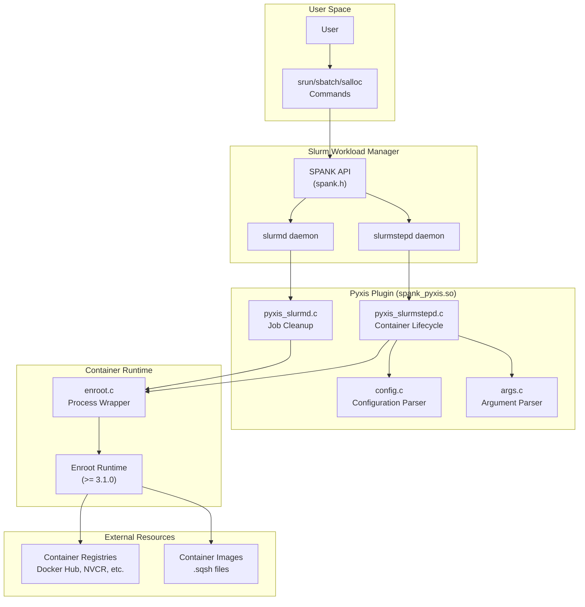
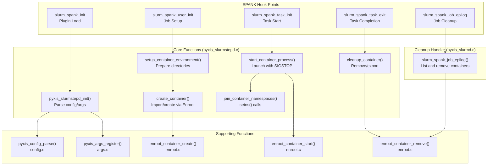
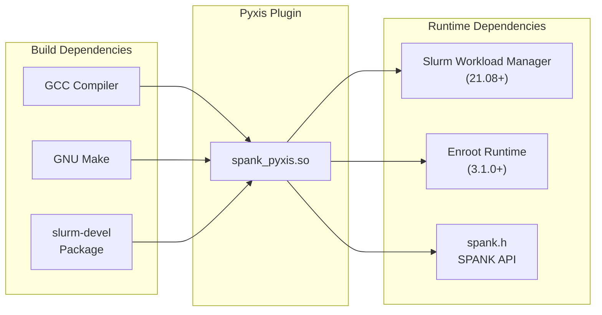

<!-- source: DeepWiki mcp.deepwiki.com · repo NVIDIA/pyxis · page 1 Home · fetched 2026-10-26 -->

# Home

<details>
<summary>Relevant source files</summary>

The following files were used as context for generating this wiki page:

- [README.md](README.md)
- [debian/changelog](debian/changelog)
- [pyxis.spec](pyxis.spec)

</details>


This document provides an overview of Pyxis, a SPANK plugin for the Slurm Workload Manager that enables unprivileged users to execute containerized workloads through standard Slurm commands. This page covers the plugin's purpose, capabilities, system context, and architectural components.

For detailed build and installation instructions, see [Getting Started](#2). For architectural deep-dives, see [Architecture](#3).

## What is Pyxis

Pyxis is a SPANK (Slurm Plug-in Architecture for Node and job (K)control) plugin that extends Slurm's `srun`, `sbatch`, and `salloc` commands with container execution capabilities. It acts as a bridge between Slurm's job scheduling infrastructure and the Enroot container runtime, allowing users to run their HPC workloads inside containers without requiring privileged access.

The plugin integrates into Slurm's daemon processes (`slurmd` and `slurmstepd`) and intercepts job execution lifecycle events to transparently wrap user tasks in container environments.

**Sources:** [README.md:1-6](), [pyxis.spec:16-28]()

## System Context



**Figure 1: Pyxis System Context**

This diagram shows how Pyxis sits between Slurm's workload management infrastructure and the Enroot container runtime. Users interact with standard Slurm commands, which load the plugin through the SPANK API. The plugin components handle container lifecycle management and cleanup, delegating container operations to Enroot.

**Sources:** [README.md:1-19](), [pyxis.spec:14-22]()

## Key Features

Pyxis provides the following capabilities for containerized HPC workloads:

| Feature | Description |
|---------|-------------|
| **Unprivileged Execution** | Users run containers without root privileges or elevated permissions |
| **Native Slurm Integration** | Container options added directly to `srun`, `sbatch`, and `salloc` commands |
| **Fast Image Distribution** | Layer-based caching with sharing across users for efficient image downloads |
| **Multi-Node MPI Support** | Full support for distributed MPI jobs via PMI2 and PMIx |
| **Writable Containers** | Users can install packages and modify container filesystems |
| **Shared Filesystem Support** | Works seamlessly with network filesystems (NFS, Lustre, GPFS) |
| **No UID/GID Management** | No cluster-wide subordinate user/group ID configuration required |
| **Multiple Registries** | Supports Docker Hub, NVIDIA NGC Registry, Google Container Registry, GitLab, and others |

**Sources:** [README.md:8-16]()

## Command-Line Interface

Pyxis extends Slurm commands with container-specific arguments prefixed with `--container-*`:

| Argument | Purpose |
|----------|---------|
| `--container-image` | Specify container image URI or local squashfs path |
| `--container-mounts` | Bind mount host paths into container |
| `--container-workdir` | Set working directory inside container |
| `--container-name` | Name container for persistence across jobs |
| `--container-save` | Export container state to squashfs file |
| `--container-mount-home` | Mount user home directory (or `--no-container-mount-home`) |
| `--container-remap-root` | Remap user to root inside container (or `--no-container-remap-root`) |
| `--container-entrypoint` | Execute image entrypoint script (or `--no-container-entrypoint`) |
| `--container-writable` | Make container filesystem writable (or `--container-readonly`) |
| `--container-env` | Override specific environment variables from host |

**Sources:** [README.md:47-106]()

## Core Components

The following table maps high-level subsystems to their implementing source files:

| Component | Source File | Primary Responsibility | Related Pages |
|-----------|-------------|------------------------|---------------|
| **Container Lifecycle Manager** | `pyxis_slurmstepd.c` | Orchestrates container creation, execution, and teardown within job steps | [#4](#4) |
| **Configuration System** | `config.c`, `config.h` | Parses plugin configuration from `plugstack.conf` | [#5](#5) |
| **Argument Parser** | `args.c`, `args.h` | Registers and parses container-related command-line options | [#6](#6) |
| **Enroot Integration** | `enroot.c` | Wraps Enroot command execution with process management | [#7](#7) |
| **Job Cleanup Handler** | `pyxis_slurmd.c` | Removes job-scoped containers in epilog phase | [#9](#9) |
| **Utility Functions** | `common.c`, `common.h` | Provides shared memory management, string operations, logging | [#13](#13) |
| **Build System** | `Makefile` | Compiles plugin, creates packages, manages installation | [#10](#10), [#11](#11) |
| **Image Import Scripts** | `caching_importer.sh`, `simple_importer.sh` | External importers for container image caching strategies | [#8](#8) |

**Sources:** Architecture Diagrams, [pyxis.spec:1-35]()

## Component Interaction Map



**Figure 2: SPANK Hook Points to Code Functions**

This diagram maps Slurm's SPANK lifecycle hooks to the actual functions in Pyxis that implement container management. The `pyxis_slurmstepd.c` file handles the main execution path, while `pyxis_slurmd.c` handles post-job cleanup. Configuration and argument parsing occur during initialization, and Enroot integration functions are called at appropriate lifecycle stages.

**Sources:** Architecture Diagram 2, [pyxis.spec:1-129]()

## Plugin Architecture

Pyxis consists of two main SPANK plugin components compiled into a single shared library (`spank_pyxis.so`):

1. **`pyxis_slurmstepd` Component**: Loaded by the `slurmstepd` daemon, this component handles the complete container lifecycle within job steps. It intercepts task initialization, creates/starts containers, joins container namespaces, and performs cleanup on task exit.

2. **`pyxis_slurmd` Component**: Loaded by the `slurmd` daemon, this component runs during job epilog to clean up any remaining job-scoped containers that were not removed during normal task exit.

Both components share common infrastructure for configuration parsing, argument handling, and Enroot process management.

**Sources:** Architecture Diagram 1, [Makefile]() (referenced in diagrams)

## Version History

Pyxis has been actively developed since 2019. The current version is 0.21.0, released in October 2025. Major releases include:

| Version | Release Date | Notes |
|---------|--------------|-------|
| 0.21.0 | Oct 2025 | Latest release |
| 0.20.0 | Jul 2024 | Recent stable |
| 0.19.0 | Apr 2024 | |
| 0.18.0 | Mar 2024 | |
| 0.17.0 | Jan 2024 | |
| 0.16.1 | Sep 2023 | Patch release |
| 0.16.0 | Aug 2023 | |
| 0.15.0 | Mar 2023 | |
| 0.1.0 | Jul 2019 | Initial release |

The plugin requires Enroot version 3.1.0 or higher and must be compiled against the specific Slurm version deployed on the cluster (since Slurm 21.08).

**Sources:** [debian/changelog:1-144](), [pyxis.spec:58-128](), [README.md:19-21]()

## Dependencies



**Figure 3: Build and Runtime Dependencies**

**Sources:** [README.md:19-21](), [pyxis.spec:14-22]()

## Installation Overview

Pyxis can be installed through three methods:

1. **Direct Installation**: Compile with `make` and install with `make install`, then create a symlink in `/etc/slurm/plugstack.conf.d/` to enable the plugin.

2. **Debian Package**: Build a `.deb` package with `make deb` and install with `dpkg`. The package (`nvslurm-plugin-pyxis`) includes dependency management.

3. **RPM Package**: Build an `.rpm` package with `make rpm` and install with `rpm`. The package name includes the Slurm version suffix (e.g., `nvslurm-plugin-pyxis-0.21.0-1.sl2308`).

All installation methods place the plugin in the system's Slurm library directory and provide a configuration file in `/usr/share/pyxis/` or `/usr/local/share/pyxis/`.

For detailed installation steps, see [Getting Started](#2). For packaging details, see [Packaging & Distribution](#11).

**Sources:** [README.md:23-45](), [pyxis.spec:1-55]()

## Usage Pattern

A typical Pyxis workflow:

```bash
# Run a single-node containerized task
srun --container-image=ubuntu:20.04 hostname

# Multi-node MPI job with GPU containers
srun -N 4 -n 32 --container-image=nvcr.io#nvidia/pytorch:21.12-py3 \
     --container-mounts=/data:/mnt \
     --container-writable \
     python train.py

# Batch job with named container
sbatch --container-image=centos:8 --container-name=myapp job_script.sh
```

The plugin handles image import, container creation, namespace joining, and cleanup transparently. Users interact only with standard Slurm commands enhanced with container-specific options.

For comprehensive usage examples, see [README.md:108-140]() and the Usage documentation (referenced in [README.md:141-145]()).

**Sources:** [README.md:47-140]()

## Repository Structure

The Pyxis codebase is organized as follows:

| Directory/File | Purpose |
|----------------|---------|
| `*.c`, `*.h` | Core plugin source files |
| `Makefile` | Build system and packaging targets |
| `pyxis.conf` | Default plugin configuration file |
| `pyxis.spec` | RPM package specification |
| `debian/` | Debian package build files |
| `tests/` | BATS integration test suite |
| `*.sh` | Container image import scripts |
| `README.md` | Quick start documentation |
| `LICENSE` | Apache License 2.0 |
| `CONTRIBUTING.md` | Contribution guidelines |

**Sources:** [README.md:1-168](), [pyxis.spec:30-34]()

## Next Steps

- **Build and Install**: See [Getting Started](#2) for compilation and installation instructions
- **Architecture Details**: See [Architecture](#3) for in-depth component descriptions
- **Container Lifecycle**: See [Container Lifecycle Manager](#4) for details on container orchestration
- **Configuration**: See [Configuration System](#5) for plugin configuration options
- **Testing**: See [Testing Infrastructure](#12) for running integration tests

**Sources:** [README.md:141-162]()

---

