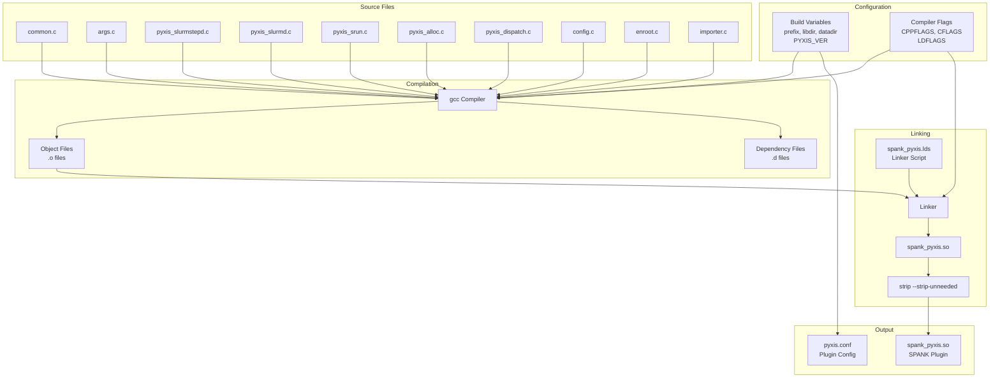
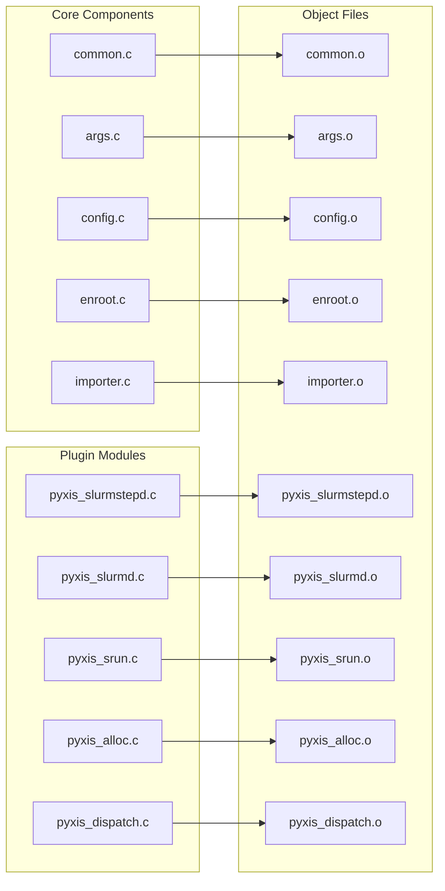
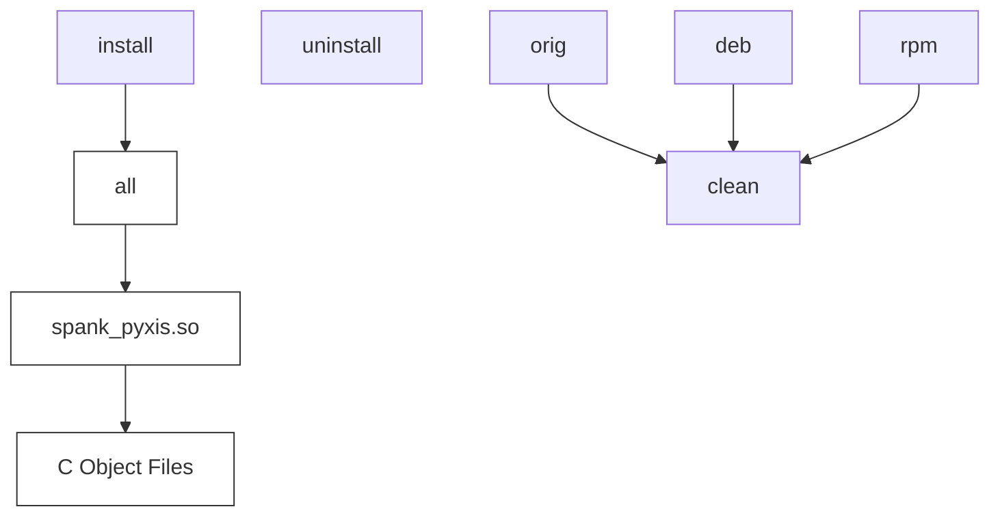
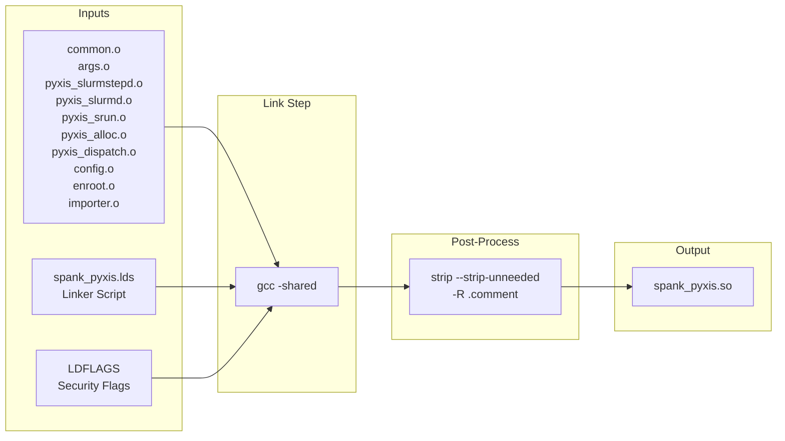
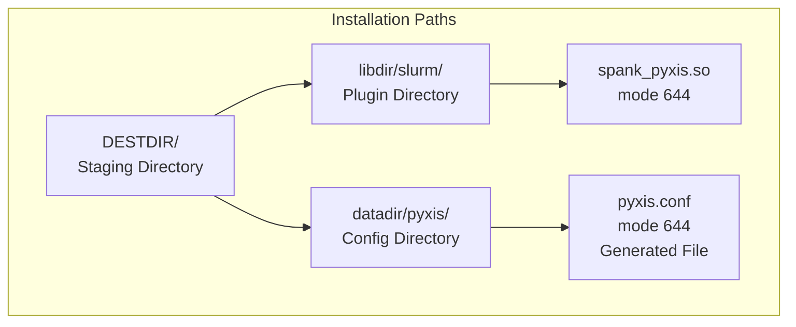
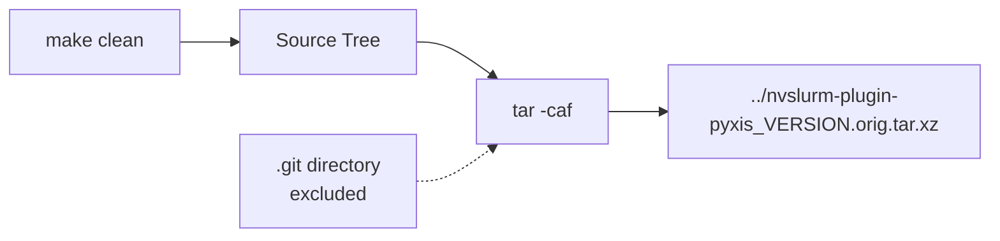
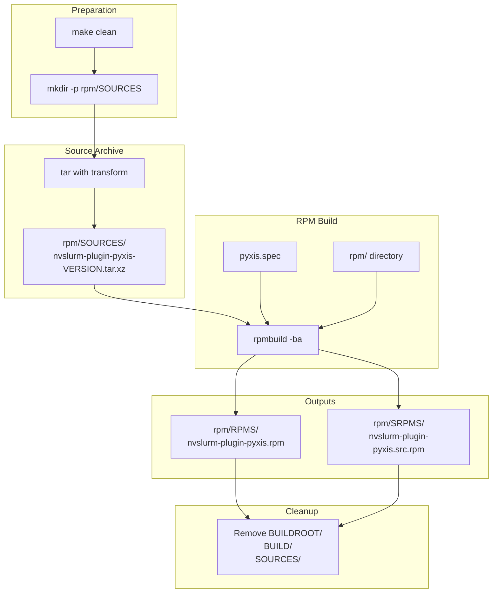
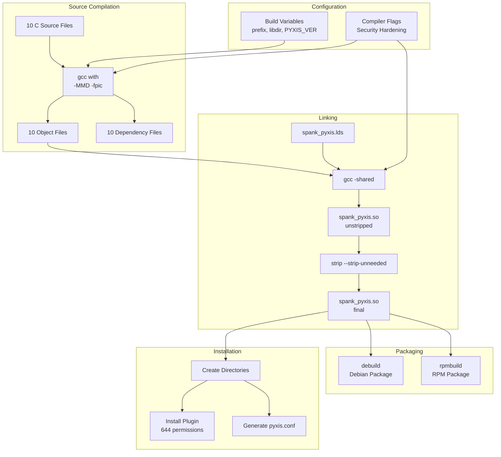

<!-- source: DeepWiki mcp.deepwiki.com · repo NVIDIA/pyxis · page 10 Build System · fetched 2026-10-26 -->

# Build System

<details>
<summary>Relevant source files</summary>

The following files were used as context for generating this wiki page:

- [Makefile](Makefile)

</details>


## Purpose and Scope

This document describes the build system for Pyxis, which compiles the C source files into the SPANK plugin shared library (`spank_pyxis.so`). The build system is implemented in [Makefile:1-60]() and provides targets for compilation, installation, cleanup, and package generation.

For package creation and distribution mechanisms, see [Packaging & Distribution](#11). For the source code organization being compiled, see [Component Overview](#3.2).

## Overview

The build system follows a traditional GNU Make approach, compiling individual C source files into object files with automatic dependency tracking, then linking them into a single shared library suitable for loading by Slurm's SPANK framework.

**Build System Flow**



Sources: [Makefile:1-60]()

## Build Configuration Variables

The build system uses standard GNU Make variables for installation path configuration:

| Variable | Default Value | Purpose |
|----------|---------------|---------|
| `prefix` | `/usr/local` | Installation prefix |
| `libdir` | `$(prefix)/lib` | Library installation directory |
| `datarootdir` | `$(prefix)/share` | Data root directory |
| `datadir` | `$(datarootdir)` | Data installation directory |
| `PYXIS_VER` | `0.21.0` | Plugin version string |
| `DESTDIR` | (empty) | Destination directory prefix for staged installs |

The derived installation paths are:
- `PLUGINDIR`: `$(DESTDIR)/$(libdir)/slurm` - Where `spank_pyxis.so` is installed [Makefile:6]()
- `CONFDIR`: `$(DESTDIR)/$(datadir)/pyxis` - Where `pyxis.conf` is installed [Makefile:7]()

Sources: [Makefile:1-7]()

## Build Artifacts

**Primary Outputs**

```mermaid
graph LR
    subgraph "Build Artifacts"
        PLUGIN["spank_pyxis.so<br/>Shared Library"]
        CONF["pyxis.conf<br/>Plugin Config"]
    end
    
    subgraph "Intermediate Files"
        OBJS["common.o<br/>args.o<br/>pyxis_slurmstepd.o<br/>pyxis_slurmd.o<br/>pyxis_srun.o<br/>pyxis_alloc.o<br/>pyxis_dispatch.o<br/>config.o<br/>enroot.o<br/>importer.o"]
        DEPS[".d dependency files"]
    end
    
    OBJS --> PLUGIN
    DEPS -.."automatic inclusion"..-> PLUGIN
```

The plugin name and configuration file are defined as constants [Makefile:11-12]():
- `PLUGIN := spank_pyxis.so`
- `CONF := pyxis.conf`

Sources: [Makefile:11-12]()

## Compilation Flags and Security

The build system applies multiple layers of security hardening and optimization flags:

**Preprocessor Flags (CPPFLAGS)**

[Makefile:16]() defines:
```makefile
CPPFLAGS := -D_GNU_SOURCE -D_FORTIFY_SOURCE=2 -DPYXIS_VERSION=\"$(PYXIS_VER)\" $(CPPFLAGS)
```

| Flag | Purpose |
|------|---------|
| `-D_GNU_SOURCE` | Enable GNU extensions for POSIX APIs |
| `-D_FORTIFY_SOURCE=2` | Enable buffer overflow detection in libc functions |
| `-DPYXIS_VERSION=\"$(PYXIS_VER)\"` | Embed version string in compiled binary |

**Compiler Flags (CFLAGS)**

[Makefile:17]() defines:
```makefile
CFLAGS := -std=gnu11 -O2 -g -Wall -Wunused-variable -fstack-protector-strong -fpic $(CFLAGS)
```

| Flag | Purpose |
|------|---------|
| `-std=gnu11` | Use GNU C11 standard |
| `-O2` | Optimization level 2 |
| `-g` | Include debugging symbols |
| `-Wall` | Enable all standard warnings |
| `-Wunused-variable` | Warn about unused variables |
| `-fstack-protector-strong` | Stack buffer overflow protection |
| `-fpic` | Position-independent code for shared library |

**Linker Flags (LDFLAGS)**

[Makefile:18]() defines:
```makefile
LDFLAGS := -Wl,-znoexecstack -Wl,-zrelro -Wl,-znow $(LDFLAGS)
```

| Flag | Purpose |
|------|---------|
| `-Wl,-znoexecstack` | Mark stack as non-executable |
| `-Wl,-zrelro` | Mark relocation sections as read-only after loading |
| `-Wl,-znow` | Resolve all symbols at load time (full RELRO) |

These flags implement defense-in-depth security measures including stack protection, immediate binding, and non-executable memory regions.

Sources: [Makefile:16-18]()

## Source File Organization

**Source Files to Object Files Mapping**



The complete list of source files is defined [Makefile:20]():
```makefile
C_SRCS := common.c args.c pyxis_slurmstepd.c pyxis_slurmd.c pyxis_srun.c pyxis_alloc.c pyxis_dispatch.c config.c enroot.c importer.c
```

Object files are derived using Make pattern substitution [Makefile:21]():
```makefile
C_OBJS := $(C_SRCS:.c=.o)
```

Sources: [Makefile:20-21]()

## Build Targets

**Target Dependency Graph**



All targets are declared phony [Makefile:14]():
```makefile
.PHONY: all install uninstall clean deb rpm
```

| Target | Purpose |
|--------|---------|
| `all` | Default target - builds `spank_pyxis.so` [Makefile:25]() |
| `install` | Install plugin and configuration [Makefile:34-38]() |
| `uninstall` | Remove installed files [Makefile:40-42]() |
| `clean` | Remove build artifacts [Makefile:44-45]() |
| `orig` | Create source tarball for Debian packaging [Makefile:47-48]() |
| `deb` | Build Debian package [Makefile:50-51]() |
| `rpm` | Build RPM package [Makefile:53-57]() |

Sources: [Makefile:14](), [Makefile:25](), [Makefile:34-57]()

## Compilation Process

### Object File Generation

Each C source file is compiled to an object file with automatic dependency generation [Makefile:27-28]():

```makefile
$(C_OBJS): %.o: %.c
	$(CC) $(CFLAGS) $(CPPFLAGS) -MMD -MF $*.d -c $<
```

The compilation command:
- Uses pattern rule `%.o: %.c` to match any `.c` file
- Passes `$(CFLAGS)` and `$(CPPFLAGS)` to the compiler
- Generates dependency file with `-MMD -MF $*.d`
- Produces object file with `-c $<`

### Automatic Dependency Tracking

Dependency files are automatically included to track header dependencies [Makefile:23](), [Makefile:59]():

```makefile
DEPS := $(C_OBJS:%.o=%.d)
...
-include $(DEPS)
```

The `-include` directive (note the leading dash) prevents Make from failing if `.d` files don't exist yet. These `.d` files contain make rules showing which header files each `.c` file depends on, enabling automatic recompilation when headers change.

Sources: [Makefile:23](), [Makefile:27-28](), [Makefile:59]()

## Plugin Linking

**Linking Process**



The plugin is linked and stripped [Makefile:30-32]():

```makefile
$(PLUGIN): $(C_OBJS)
	$(CC) -shared $(LDFLAGS) -o $@ spank_pyxis.lds $^
	strip --strip-unneeded -R .comment $@
```

**Linking Steps:**

1. **Link Phase**: Creates shared library with:
   - `-shared`: Produce shared object suitable for dynamic linking
   - `$(LDFLAGS)`: Security hardening flags (see above)
   - `spank_pyxis.lds`: Linker script controlling symbol visibility
   - `$^`: All object files (prerequisite list)

2. **Strip Phase**: Reduces binary size by:
   - `--strip-unneeded`: Remove symbols not needed for relocation
   - `-R .comment`: Remove comment section

The linker script (`spank_pyxis.lds`) controls which symbols are exported from the plugin, typically limiting visibility to only the SPANK hook functions that Slurm needs to call.

Sources: [Makefile:30-32]()

## Installation Process

**Installation Path Structure**



The `install` target [Makefile:34-38]() performs three operations:

```makefile
install: all
	install -d -m 755 $(PLUGINDIR)
	install -m 644 $(PLUGIN) $(PLUGINDIR)
	install -d -m 755 $(CONFDIR)
	echo 'required $(libdir)/slurm/$(PLUGIN)' | install -m 644 /dev/stdin $(CONFDIR)/$(CONF)
```

**Installation Steps:**

| Step | Command | Purpose |
|------|---------|---------|
| 1 | `install -d -m 755 $(PLUGINDIR)` | Create plugin directory with 755 permissions |
| 2 | `install -m 644 $(PLUGIN) $(PLUGINDIR)` | Install `spank_pyxis.so` with 644 permissions |
| 3 | `install -d -m 755 $(CONFDIR)` | Create config directory with 755 permissions |
| 4 | `echo ... \| install -m 644 /dev/stdin $(CONFDIR)/$(CONF)` | Generate and install `pyxis.conf` with 644 permissions |

The configuration file is generated dynamically during installation rather than being a source file. It contains a single line that tells Slurm to load the plugin:
```
required /usr/local/lib/slurm/spank_pyxis.so
```

The `$(libdir)` variable (not `$(PLUGINDIR)`) is used in the generated config to reference the absolute installation path.

Sources: [Makefile:34-38]()

## Uninstallation

The `uninstall` target removes installed files [Makefile:40-42]():

```makefile
uninstall:
	$(RM) $(PLUGINDIR)/$(PLUGIN)
	$(RM) $(CONFDIR)/$(CONF)
```

This removes:
- `$(PLUGINDIR)/spank_pyxis.so` - The plugin shared library
- `$(CONFDIR)/pyxis.conf` - The generated configuration file

Note: Directories are not removed, only the files themselves.

Sources: [Makefile:40-42]()

## Clean Target

The `clean` target removes all build artifacts [Makefile:44-45]():

```makefile
clean:
	rm -rf $(C_OBJS) $(DEPS) $(PLUGIN)
```

This removes:
- `$(C_OBJS)`: All `.o` object files (10 files)
- `$(DEPS)`: All `.d` dependency files (10 files)
- `$(PLUGIN)`: The `spank_pyxis.so` shared library

The clean target is typically invoked before packaging operations to ensure a fresh build.

Sources: [Makefile:44-45]()

## Package Generation

### Source Tarball Generation

**orig Target for Debian**

The `orig` target creates a source tarball for Debian packaging [Makefile:47-48]():

```makefile
orig: clean
	tar -caf ../nvslurm-plugin-pyxis_$(PYXIS_VER).orig.tar.xz --owner=root --group=root --exclude=.git .
```

**Tarball Creation Process:**



Properties:
- Creates `nvslurm-plugin-pyxis_$(PYXIS_VER).orig.tar.xz` in parent directory
- Sets ownership to `root:root` for reproducibility
- Excludes `.git` directory to reduce size
- Uses auto-compression detection (`-a` flag) for `.tar.xz` format
- Cleans build artifacts first

Sources: [Makefile:47-48]()

### Debian Package Build

The `deb` target builds a Debian package [Makefile:50-51]():

```makefile
deb: clean
	debuild -us -uc -G -i -tc
```

**debuild Flags:**

| Flag | Purpose |
|------|---------|
| `-us` | Do not sign source package |
| `-uc` | Do not sign `.changes` file |
| `-G` | Use pristine-tar delta |
| `-i` | Ignore VCS directories |
| `-tc` | Clean source tree after build |

The `debuild` command is a wrapper around `dpkg-buildpackage` that builds the Debian package according to files in the `debian/` directory. See [Packaging & Distribution](#11) for details on Debian package structure.

Sources: [Makefile:50-51]()

### RPM Package Build

**RPM Build Process**



The `rpm` target builds an RPM package [Makefile:53-57]():

```makefile
rpm: clean
	mkdir -p rpm/SOURCES
	tar -caf rpm/SOURCES/nvslurm-plugin-pyxis-$(PYXIS_VER).tar.xz --transform='s,^.,nvslurm-plugin-pyxis-$(PYXIS_VER),' --exclude=rpm --exclude=.git .
	rpmbuild --clean -ba -D"_topdir $(CURDIR)/rpm" -D"PYXIS_VER $(PYXIS_VER)" pyxis.spec
	$(RM) -r $(addprefix rpm/, BUILDROOT BUILD SOURCES)
```

**RPM Build Steps:**

1. **Clean**: Remove existing build artifacts
2. **Create SOURCES directory**: Prepare RPM build structure
3. **Create source tarball**:
   - Archive to `rpm/SOURCES/nvslurm-plugin-pyxis-$(PYXIS_VER).tar.xz`
   - Use `--transform` to add version prefix to paths
   - Exclude `rpm/` and `.git/` directories
4. **Build RPM**:
   - `-ba`: Build both binary and source RPM
   - `--clean`: Clean build tree after successful build
   - `-D"_topdir $(CURDIR)/rpm"`: Use local `rpm/` directory as build root
   - `-D"PYXIS_VER $(PYXIS_VER)"`: Pass version to spec file
   - Uses `pyxis.spec` as spec file
5. **Cleanup**: Remove temporary build directories, keeping final packages

The resulting packages are placed in:
- `rpm/SRPMS/` - Source RPM
- `rpm/RPMS/` - Binary RPM (architecture-dependent subdirectory)

Sources: [Makefile:53-57]()

## Build System Summary

**Complete Build Flow**



The build system provides a complete toolchain for:
1. **Compilation**: C source to object files with security hardening
2. **Linking**: Object files to shared library with controlled symbol visibility
3. **Installation**: Deployment to system directories with appropriate permissions
4. **Packaging**: Creation of distribution packages (Debian and RPM)
5. **Dependency Management**: Automatic header dependency tracking

All build operations support standard Make variables (`prefix`, `DESTDIR`, etc.) for flexible installation paths, enabling both system-wide and user-local installations as well as staged packaging builds.

Sources: [Makefile:1-60]()

---

