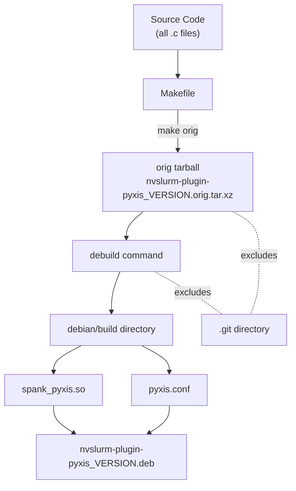
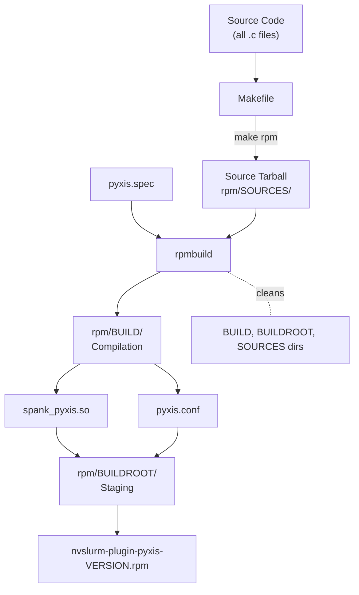
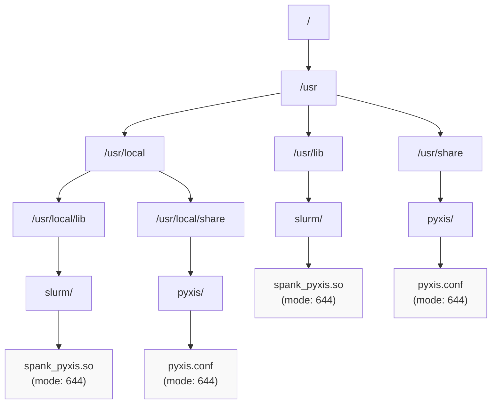
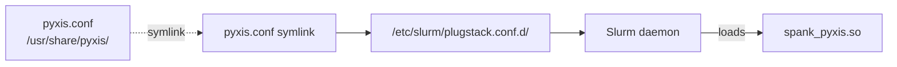
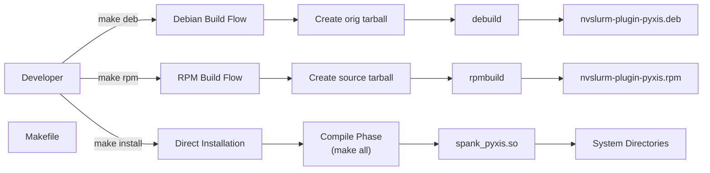

<!-- source: DeepWiki mcp.deepwiki.com · repo NVIDIA/pyxis · page 11 Packaging & Distribution · fetched 2026-10-26 -->

# Packaging & Distribution

<details>
<summary>Relevant source files</summary>

The following files were used as context for generating this wiki page:

- [Makefile](Makefile)
- [debian/changelog](debian/changelog)
- [pyxis.spec](pyxis.spec)

</details>


This document describes the packaging and distribution mechanisms for Pyxis, covering how the compiled plugin is packaged into distributable formats for Debian-based and RPM-based Linux distributions. It includes package build processes, metadata, dependencies, versioning, and installation layouts.

For information about the build system that creates the plugin binaries, see [Build System](#10). For details on plugin configuration after installation, see [Configuration System](#5).

## Package Formats

Pyxis supports two primary package formats to accommodate different Linux distributions:

- **Debian packages (.deb)** - for Ubuntu, Debian, and derivatives
- **RPM packages (.rpm)** - for RHEL, CentOS, SUSE, and derivatives

Both package types are generated from the same source code and contain identical plugin functionality. The package name for both formats is `nvslurm-plugin-pyxis`.

Sources: [Makefile:1-60](), [pyxis.spec:5](), [debian/changelog:1-145]()

## Package Metadata

### Package Identification

| Property | Value |
|----------|-------|
| Package Name | `nvslurm-plugin-pyxis` |
| Current Version | `0.21.0` |
| License | Apache License 2.0 |
| Vendor | NVIDIA CORPORATION |
| Maintainer | NVIDIA CORPORATION <cudatools@nvidia.com> |
| Source Repository | https://github.com/NVIDIA/pyxis/ |

The version is centrally defined in the `PYXIS_VER` variable in the Makefile and propagates to both package formats during the build process.

Sources: [Makefile:9](), [pyxis.spec:5-12](), [debian/changelog:1-5]()

### Dependencies

#### Build-Time Dependencies

Both package formats require the following tools and libraries to build:

- `make` - GNU Make build system
- `gcc` - GNU C Compiler
- `slurm-devel` - Slurm development headers and libraries

Sources: [pyxis.spec:14]()

#### Runtime Dependencies

The RPM package explicitly declares runtime dependencies with version constraints:

```
Requires: (enroot >= 3.1.0 or enroot-hardened >= 3.1.0)
```

The dependency on `libslurm.so` is automatically generated through a custom `find-requires` script that analyzes the compiled plugin binary. This ensures the package is compatible with the installed Slurm version.

**Slurm Version Tagging**: The RPM release field includes a dynamic Slurm version tag (e.g., `1.sl2310` for Slurm 23.10) to indicate which Slurm version the package was built against. This is computed using:

```
%global slurm_version  %(rpm -q slurm-devel --qf "%{VERSION}" | awk -F. '{print "sl"$1$2}' 2>/dev/null)
```

Sources: [pyxis.spec:1](), [pyxis.spec:14-22](), [pyxis.spec:38-46]()

## Build Process

### Debian Package Build



**Debian Package Build Process**

The `make deb` target invokes the Debian build chain:

1. **Clean**: Remove any existing build artifacts
2. **Create Source Tarball**: Execute `make orig` to create the original source tarball with proper ownership and excluding version control files
3. **Build Package**: Run `debuild -us -uc -G -i -tc` which:
   - `-us -uc`: Skip GPG signing (for unsigned builds)
   - `-G`: Clean source tree using git-clean
   - `-i`: Ignore VCS files
   - `-tc`: Clean after successful build

The `orig` target creates a properly formatted Debian source tarball:

```bash
tar -caf ../nvslurm-plugin-pyxis_$(PYXIS_VER).orig.tar.xz \
    --owner=root --group=root --exclude=.git .
```

Sources: [Makefile:47-51]()

### RPM Package Build



**RPM Package Build Process**

The `make rpm` target orchestrates the RPM build:

1. **Clean**: Remove existing build artifacts
2. **Create RPM Directory Structure**: Create `rpm/SOURCES` directory
3. **Create Source Tarball**: Package source with path transformation:
   ```bash
   tar -caf rpm/SOURCES/nvslurm-plugin-pyxis-$(PYXIS_VER).tar.xz \
       --transform='s,^.,nvslurm-plugin-pyxis-$(PYXIS_VER),' \
       --exclude=rpm --exclude=.git .
   ```
4. **Build RPM**: Execute `rpmbuild` with custom top directory:
   ```bash
   rpmbuild --clean -ba -D"_topdir $(CURDIR)/rpm" \
       -D"PYXIS_VER $(PYXIS_VER)" pyxis.spec
   ```
5. **Cleanup**: Remove temporary build directories

The spec file defines three main build phases:

- **%prep**: Creates a dummy libslurm_dummy.c file and custom find-requires script for automatic dependency detection
- **%build**: Compiles the plugin and dummy binary to establish libslurm.so dependency
- **%install**: Installs files using `make install` into the buildroot

Sources: [Makefile:53-57](), [pyxis.spec:36-54]()

## Installation Layout

### Directory Structure



**Standard Installation Paths**

The Makefile defines the default installation prefix as `/usr/local`, but packages typically override this to install under `/usr`:

| Component | Default Path | Package Path | Purpose |
|-----------|--------------|--------------|---------|
| Plugin Binary | `/usr/local/lib/slurm/spank_pyxis.so` | `/usr/lib/slurm/spank_pyxis.so` | SPANK plugin shared library |
| Configuration | `/usr/local/share/pyxis/pyxis.conf` | `/usr/share/pyxis/pyxis.conf` | Plugin loading directive |

The installation process creates directories with mode 755 and installs files with mode 644:

```bash
install -d -m 755 $(PLUGINDIR)
install -m 644 $(PLUGIN) $(PLUGINDIR)
install -d -m 755 $(CONFDIR)
echo 'required $(libdir)/slurm/$(PLUGIN)' | install -m 644 /dev/stdin $(CONFDIR)/$(CONF)
```

The configuration file contains a single line directing Slurm to load the plugin:

```
required /usr/local/lib/slurm/spank_pyxis.so
```

Sources: [Makefile:1-7](), [Makefile:34-38](), [pyxis.spec:33-34]()

### Path Customization

The installation paths can be customized through Makefile variables:

| Variable | Default | Description |
|----------|---------|-------------|
| `prefix` | `/usr/local` | Base installation prefix |
| `libdir` | `$(prefix)/lib` | Library directory |
| `datarootdir` | `$(prefix)/share` | Shared data root directory |
| `datadir` | `$(datarootdir)` | Shared data directory |

For example, to install under `/opt`:

```bash
make install prefix=/opt
```

The `DESTDIR` variable is also supported for staged installations during package builds:

```bash
make install DESTDIR=/tmp/buildroot prefix=/usr
```

Sources: [Makefile:1-7]()

## Slurm Integration

### Plugin Loading Mechanism

After installation, the plugin must be registered with Slurm through its SPANK plugin infrastructure. The typical integration approach uses the `plugstack.conf.d` directory pattern:



**Plugin Loading Sequence**

1. Administrator creates a symlink from the installed configuration to Slurm's plugin directory:
   ```bash
   ln -s /usr/share/pyxis/pyxis.conf /etc/slurm/plugstack.conf.d/pyxis.conf
   ```

2. Slurm reads all configuration files in `plugstack.conf.d/` during daemon startup

3. The configuration line `required /usr/lib/slurm/spank_pyxis.so` instructs Slurm to load the plugin

4. The `required` keyword means Slurm will fail to start if the plugin cannot be loaded

The configuration file can also include plugin-specific options after the plugin path. See [Configuration System](#5) for details on available configuration options.

Sources: [Makefile:38]()

## Package Contents

### File Listing

Both Debian and RPM packages install the same core files:

| File | Installation Path | Description |
|------|-------------------|-------------|
| `spank_pyxis.so` | `$(libdir)/slurm/` | Compiled SPANK plugin (shared library) |
| `pyxis.conf` | `$(datadir)/pyxis/` | Plugin loading configuration |
| `LICENSE` | Package documentation | Apache 2.0 license text (RPM only) |
| `README.md` | Package documentation | User documentation (RPM only) |

The RPM package explicitly declares these files in the `%files` section:

```spec
%files
%license LICENSE
%doc README.md
%{_libdir}/slurm/*
%{_datadir}/pyxis/pyxis.conf
```

The wildcard `%{_libdir}/slurm/*` ensures all files in the plugin directory are included, though typically only `spank_pyxis.so` is present.

Sources: [pyxis.spec:30-34]()

## Version History

Pyxis has evolved through 21 major releases since its initial 0.1.0 release in July 2019. The version history is maintained in both the Debian changelog and RPM spec file:

| Version | Release Date | Notable Milestone |
|---------|--------------|-------------------|
| 0.1.0 | July 25, 2019 | Initial release |
| 0.5.0 | March 12, 2020 | Early adoption phase |
| 0.10.0 | May 10, 2021 | Double-digit milestone |
| 0.15.0 | March 6, 2023 | Maturity phase |
| 0.20.0 | July 31, 2024 | Recent stable release |
| 0.21.0 | October 2, 2025 | Current release |

The changelog follows the Debian changelog format with entries including:

- Package name and version
- Distribution target (UNRELEASED)
- Change description
- Maintainer and timestamp

Example entry format:

```
nvslurm-plugin-pyxis (0.21.0-1) UNRELEASED; urgency=medium

  * Release v0.21.0

 -- NVIDIA CORPORATION <cudatools@nvidia.com>  Thu, 02 Oct 2025 00:05:05 +0000
```

Sources: [debian/changelog:1-145](), [pyxis.spec:57-129]()

## Build System Integration

### Build Artifacts and Workflow



**Build Target Summary**

The Makefile provides several targets for different distribution workflows:

| Target | Command | Purpose |
|--------|---------|---------|
| `all` | `make` or `make all` | Compile plugin binary only |
| `install` | `make install` | Install directly to system (developers) |
| `orig` | `make orig` | Create Debian source tarball |
| `deb` | `make deb` | Build Debian package |
| `rpm` | `make rpm` | Build RPM package |
| `clean` | `make clean` | Remove build artifacts |
| `uninstall` | `make uninstall` | Remove installed files |

The build process ensures proper file stripping and security hardening:

```makefile
$(PLUGIN): $(C_OBJS)
	$(CC) -shared $(LDFLAGS) -o $@ spank_pyxis.lds $^
	strip --strip-unneeded -R .comment $@
```

The `strip` command removes unnecessary symbols and debug information from the shared library, reducing its size for distribution.

Sources: [Makefile:14-59]()

## Distribution and Deployment

Pyxis packages are designed to be distributed through standard Linux package repositories. Administrators can install the package using their distribution's package manager:

**Debian/Ubuntu:**
```bash
dpkg -i nvslurm-plugin-pyxis_0.21.0-1.deb
apt-get install -f  # Install dependencies
```

**RHEL/CentOS:**
```bash
rpm -i nvslurm-plugin-pyxis-0.21.0-1.sl2310.el8.x86_64.rpm
yum install nvslurm-plugin-pyxis  # If in repository
```

After installation, administrators must:

1. Create a symlink to enable the plugin (as described in the Slurm Integration section)
2. Restart Slurm daemons to load the plugin
3. Verify plugin availability by checking `srun --help` for container-related options

Sources: [Makefile:1-60](), [pyxis.spec:1-129](), [debian/changelog:1-145]()

---

