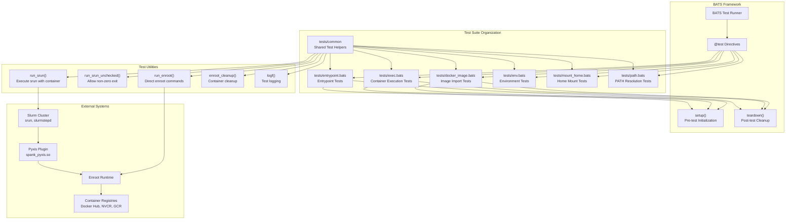
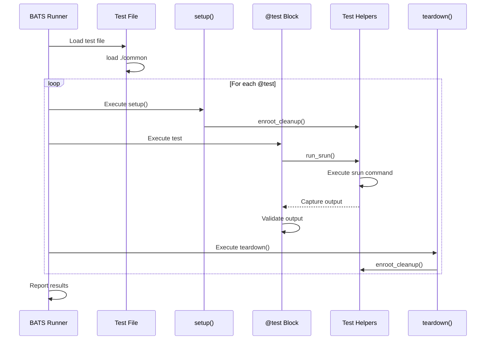
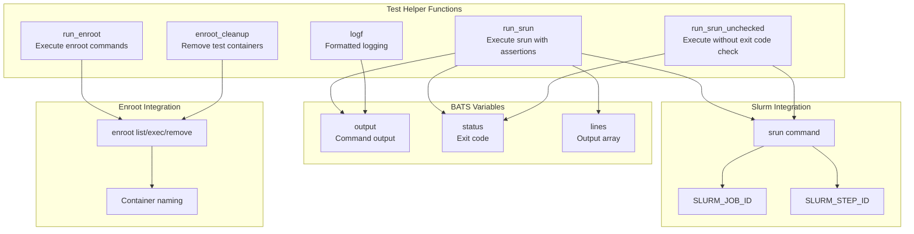
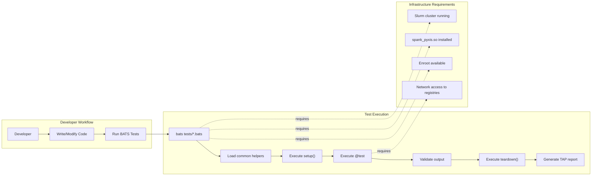
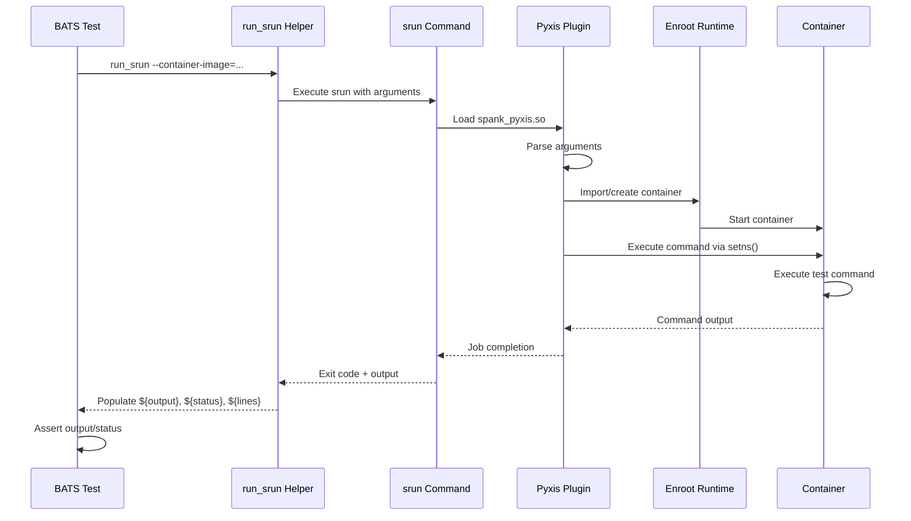

<!-- source: DeepWiki mcp.deepwiki.com · repo NVIDIA/pyxis · page 12 Testing Infrastructure · fetched 2026-10-26 -->

# Testing Infrastructure

<details>
<summary>Relevant source files</summary>

The following files were used as context for generating this wiki page:

- [tests/docker_image.bats](tests/docker_image.bats)
- [tests/entrypoint.bats](tests/entrypoint.bats)
- [tests/env.bats](tests/env.bats)
- [tests/exec.bats](tests/exec.bats)
- [tests/mount_home.bats](tests/mount_home.bats)
- [tests/path.bats](tests/path.bats)

</details>


## Purpose and Scope

This document describes the testing infrastructure used in Pyxis to validate container execution, image import, and feature integration with Slurm. The test suite is implemented using the BATS (Bash Automated Testing System) framework and covers functional validation of the plugin's core capabilities.

For detailed information about specific test categories, see:
- [Container Image Tests](#12.1) - Registry import and image format validation
- [Feature Tests](#12.2) - Entrypoint, environment, and execution tests
- [Validation & Error Tests](#12.3) - Argument validation and error handling

## Testing Framework Architecture

The Pyxis test infrastructure uses BATS as its primary testing framework, providing a bash-based approach to integration testing. Each test spawns actual Slurm jobs using `srun` and validates container behavior through command execution and output verification.



**Test Framework Architecture Diagram**

Sources: [tests/docker_image.bats:1-4](), [tests/exec.bats:1-4](), [tests/entrypoint.bats:1-4](), [tests/env.bats:1-4]()

## Test File Organization

The test suite is organized by functional area, with each BATS file focusing on a specific aspect of Pyxis functionality:

| Test File | Purpose | Key Tests |
|-----------|---------|-----------|
| `docker_image.bats` | Container image import from various registries | Docker Hub, NVCR, GCR, GitLab registry support |
| `exec.bats` | Container execution and attachment | Named containers, enroot exec, overlap execution |
| `entrypoint.bats` | Container entrypoint execution | Docker ENTRYPOINT, manual execution, environment passing |
| `env.bats` | Environment variable handling | Variable passthrough, special cases, container overrides |
| `mount_home.bats` | Home directory mounting | Mount/no-mount with remap-root combinations |
| `path.bats` | PATH resolution for container binaries | Slurm binary resolution inside containers |

Sources: [tests/docker_image.bats:1-97](), [tests/exec.bats:1-79](), [tests/entrypoint.bats:1-62](), [tests/env.bats:1-88](), [tests/mount_home.bats:1-20](), [tests/path.bats:1-21]()

## BATS Test Framework

BATS (Bash Automated Testing System) provides a TAP-compliant (Test Anything Protocol) testing framework for bash scripts. Each test file follows a standard structure:



**BATS Test Execution Flow**

### Test Structure

Each BATS test file begins with a shebang and loads the common helpers:

```
#!/usr/bin/env bats

load ./common
```

Individual tests are declared using the `@test` directive followed by a description string:

```
@test "Docker Hub ubuntu:20.04" {
    run_srun --container-image=ubuntu:20.04 grep 'Ubuntu 20.04' /etc/os-release
}
```

Sources: [tests/docker_image.bats:1-7]()

### Setup and Teardown Hooks

Tests can define `setup()` and `teardown()` functions for pre-test and post-test operations:

```bash
function setup() {
    enroot_cleanup exec-test || true
}

function teardown() {
    enroot_cleanup exec-test || true
}
```

These hooks are commonly used to clean up leftover containers from previous test runs or failed tests.

Sources: [tests/exec.bats:5-11](), [tests/entrypoint.bats:5-11]()

## Common Test Helpers

The `tests/common` file provides shared utility functions used across all test files. While the file itself was not included in the provided sources, its functions are extensively used throughout the test suite.

### Core Helper Functions



**Test Helper Function Architecture**

### run_srun Function

The `run_srun()` function is the primary helper for executing Slurm jobs with Pyxis containers. It wraps the `srun` command and captures output in BATS-compatible variables:

```bash
run_srun --container-image=ubuntu:18.04 grep 'Ubuntu 18.04' /etc/os-release
```

After execution, test assertions can check:
- `${status}` - Exit code (implicitly 0 for `run_srun`)
- `${output}` - Full command output
- `${lines[@]}` - Output split into array
- `${lines[-1]}` - Last line of output

Sources: [tests/docker_image.bats:6](), [tests/exec.bats:14]()

### run_srun_unchecked Function

For testing error conditions, `run_srun_unchecked()` allows non-zero exit codes without failing the test:

```bash
run_srun_unchecked --ntasks=2 --container-image=thisimagedoesntexist true
[ "${status}" -ne 0 ]
```

This is essential for testing argument validation and error handling paths.

Sources: [tests/docker_image.bats:77-78](), [tests/exec.bats:68-69]()

### enroot_cleanup Function

The `enroot_cleanup()` helper removes named containers from enroot's storage:

```bash
enroot_cleanup exec-test || true
```

The `|| true` pattern ensures cleanup failures don't cause test failures, which is important when containers may not exist.

Sources: [tests/exec.bats:6](), [tests/entrypoint.bats:6]()

## Test Patterns and Conventions

### Output Validation Pattern

Tests commonly use the `lines` array to validate specific output lines:

```bash
run_srun --container-image=nvcr.io#nvidia/pytorch:20.02-py3 sh -c 'echo $PYTORCH_VERSION'
[ "${lines[-1]}" == "1.5.0a0+3bbb36e" ]
```

Sources: [tests/docker_image.bats:52-53]()

### Grep Validation Pattern

For partial output matching, tests use grep with captured output:

```bash
run_srun --container-image=ubuntu:18.04 grep 'Ubuntu 18.04' /etc/os-release
```

Or post-execution grep:

```bash
grep -q "== CUDA ==" <<< "${output}"
```

Sources: [tests/docker_image.bats:10](), [tests/entrypoint.bats:60]()

### Multi-Task Testing Pattern

Tests can spawn background jobs and verify behavior with overlapping steps:

```bash
run_srun --container-name=exec-test --container-remap-root bash -c "mount -t tmpfs none /mymnt && sleep 30s" &

sleep 5s
run_srun --overlap --container-name=exec-test findmnt /mymnt
```

Sources: [tests/exec.bats:27-30]()

### Container Reuse Pattern

Named containers enable test scenarios with container persistence:

```bash
# Create container
run_srun --container-image=ubuntu:18.04 --container-name=exec-test true

# Execute in existing container
run_srun --container-name=exec-test sleep 30s &
```

Sources: [tests/exec.bats:14-15]()

### Skip Pattern for Optional Features

Tests use BATS skip when prerequisites are missing:

```bash
if ! which docker; then
    skip "docker not installed"
fi
```

Sources: [tests/docker_image.bats:88-90]()

### Environment Variable Testing Pattern

Tests validate environment variable handling through various mechanisms:

```bash
export FOO=bar
run_srun --container-image=ubuntu:18.04 sh -c 'echo $FOO'
[ "${lines[-1]}" == "bar" ]
```

Sources: [tests/env.bats:6-8]()

## Test Execution Workflow



**Test Execution Workflow**

### Running Tests

Tests are executed using the BATS command-line tool:

```bash
# Run all tests
bats tests/*.bats

# Run specific test file
bats tests/docker_image.bats

# Run specific test
bats tests/docker_image.bats -f "Docker Hub ubuntu:20.04"
```

### Test Requirements

The test infrastructure requires:
1. A functional Slurm cluster with compute nodes
2. Pyxis plugin installed and configured
3. Enroot container runtime installed
4. Network access to container registries (Docker Hub, NVCR, GCR, GitLab)
5. Sufficient storage for container images

### Output Format

BATS produces TAP (Test Anything Protocol) output:

```
1..5
ok 1 Docker Hub ubuntu:20.04
ok 2 Docker Hub ubuntu:18.04
not ok 3 Docker Hub ubuntu:16.04
# (output from failed test)
ok 4 nvcr.io PyTorch 20.02
ok 5 gcr.io TensorFlow 2.9
```

## Test Coverage Areas

The test suite validates the following functional areas:

| Area | Coverage |
|------|----------|
| **Image Import** | Docker Hub, NVCR, GCR, GitLab registries; various image formats; zstd layers |
| **Container Execution** | Named containers, unnamed containers, attachment, overlap execution |
| **Entrypoints** | Docker ENTRYPOINT execution, manual execution, logging control |
| **Environment Variables** | Passthrough, special cases ($HOME, $TERM, $LANG), container overrides |
| **Mounts** | Home directory mounting with/without root remapping |
| **PATH Resolution** | Slurm binary resolution inside container filesystem |
| **Error Handling** | Invalid arguments, missing images, container state errors |

Sources: [tests/docker_image.bats:1-97](), [tests/exec.bats:1-79](), [tests/entrypoint.bats:1-62](), [tests/env.bats:1-88]()

## Integration with Slurm Job Lifecycle



**Test Integration with Slurm Lifecycle**

Each test triggers the full Pyxis plugin lifecycle:
1. Argument parsing ([args.c](#6))
2. Configuration loading ([config.c](#5))
3. Container creation ([pyxis_slurmstepd.c](#4))
4. Enroot integration ([enroot.c](#7))
5. Namespace management ([namespace handling](#4.3))
6. Cleanup ([pyxis_slurmd.c](#9))

This integration testing approach validates the complete end-to-end behavior rather than isolated unit functionality.

Sources: [tests/docker_image.bats:6](), [tests/exec.bats:14]()

---

