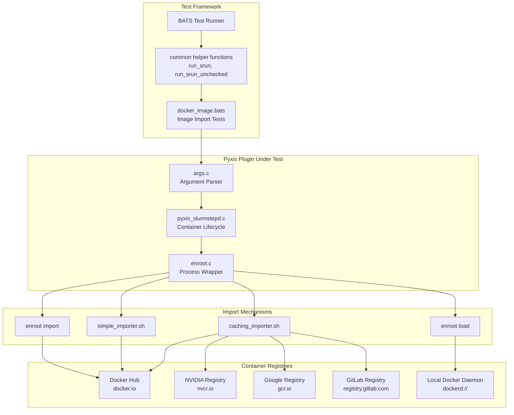
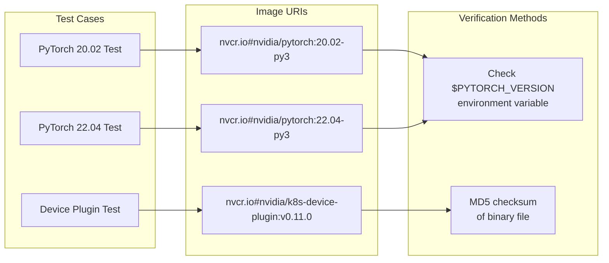
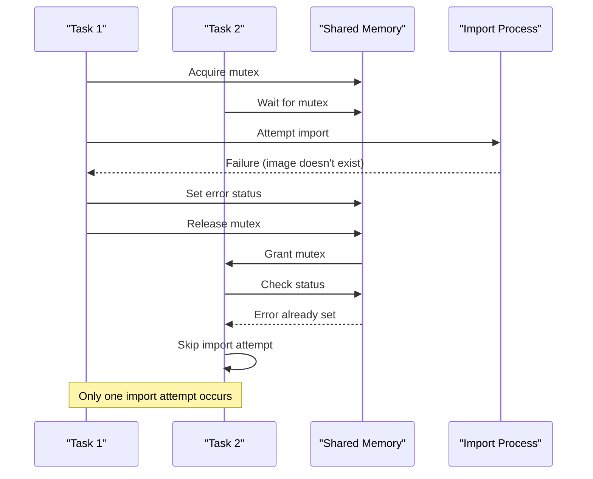
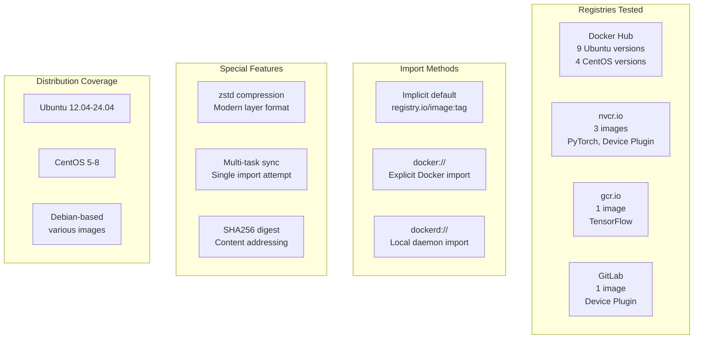

<!-- source: DeepWiki mcp.deepwiki.com · repo NVIDIA/pyxis · page 12.1 Container Image Tests · fetched 2026-10-26 -->

# Container Image Tests

<details>
<summary>Relevant source files</summary>

The following files were used as context for generating this wiki page:

- [tests/docker_image.bats](tests/docker_image.bats)
- [tests/mount_home.bats](tests/mount_home.bats)
- [tests/path.bats](tests/path.bats)

</details>


## Purpose and Scope

This page documents the container image import test suite in Pyxis, specifically the tests that verify the plugin can successfully import container images from various container registries and handle different image formats. These tests exercise the image import functionality described in [Image Import Strategies](#8) and validate that the plugin correctly interfaces with the Enroot runtime for image acquisition.

For tests of specific Pyxis features like entrypoints and environment variables, see [Feature Tests](#12.2). For tests of argument validation and error handling, see [Validation & Error Tests](#12.3).

Sources: [tests/docker_image.bats:1-97]()

## Test Suite Overview

The container image tests are implemented in the BATS (Bash Automated Testing System) framework and located in [tests/docker_image.bats](). The test suite validates image import from multiple sources:

- **Docker Hub**: Public registry with Ubuntu and CentOS base images
- **NVIDIA Container Registry (NVCR)**: GPU-accelerated framework images
- **Google Container Registry (GCR)**: Google Cloud Platform machine learning images
- **GitLab Container Registry**: Third-party container registries
- **Special formats**: Images with zstd-compressed layers and specific compression formats

Each test follows a common pattern: invoke `srun` with `--container-image` pointing to a specific image URI, then verify the container environment by examining files or environment variables inside the running container.

Sources: [tests/docker_image.bats:1-97]()

## Test Architecture



**Test Architecture Diagram**: Shows how BATS tests interact with Pyxis components to exercise image import from various registries.

Sources: [tests/docker_image.bats:1-97]()

## Docker Hub Image Tests

Docker Hub is the default container registry and tests the implicit `docker.io` prefix handling. The test suite validates both Ubuntu and CentOS distributions across multiple major versions.

### Ubuntu Distribution Tests

| Test Name | Image URI | Verification Command | Expected Output |
|-----------|-----------|---------------------|-----------------|
| Docker Hub ubuntu:12.04 | `ubuntu:12.04` | `grep 'Ubuntu precise' /etc/os-release` | Match found |
| Docker Hub ubuntu:14.04 | `ubuntu:14.04` | `grep 'Ubuntu 14.04' /etc/os-release` | Match found |
| Docker Hub ubuntu:16.04 | `ubuntu:16.04` | `grep 'Ubuntu 16.04' /etc/os-release` | Match found |
| Docker Hub ubuntu:18.04 | `ubuntu:18.04` | `grep 'Ubuntu 18.04' /etc/os-release` | Match found |
| Docker Hub ubuntu:20.04 | `ubuntu:20.04` | `grep 'Ubuntu 20.04' /etc/os-release` | Match found |
| Docker Hub ubuntu:22.04 | `ubuntu:22.04` | `grep 'Ubuntu 22.04' /etc/os-release` | Match found |
| Docker Hub ubuntu:24.04 | `ubuntu:24.04` | `grep 'Ubuntu 24.04' /etc/os-release` | Match found |

The Ubuntu 24.04 test includes an additional verification for Enroot compatibility with newer Ubuntu releases:

```bash
run_srun --container-image=ubuntu:24.04 --container-remap-root bash -c \
    'apt-get update && DEBIAN_FRONTEND=noninteractive apt-get install -y --no-install-recommends tzdata'
```

This test validates the fix for [enroot commit f0552fb](https://github.com/NVIDIA/enroot/commit/f0552fb7ce3798d02e8838db2f9402aa2094b348), ensuring package installation works correctly with root remapping on recent Ubuntu versions.

Sources: [tests/docker_image.bats:5-33]()

### CentOS Distribution Tests

| Test Name | Image URI | Verification Command | Expected Output |
|-----------|-----------|---------------------|-----------------|
| Docker Hub centos:5 | `centos:5` | `grep 'CentOS release 5.11 (Final)' /etc/redhat-release` | Match found |
| Docker Hub centos:6 | `centos:6` | `grep 'CentOS release 6.10 (Final)' /etc/redhat-release` | Match found |
| Docker Hub centos:7 | `centos:7` | `grep 'CentOS Linux release 7.' /etc/redhat-release` | Match found |
| Docker Hub centos:8 | `centos:8` | `grep 'CentOS Linux release 8.' /etc/redhat-release` | Match found |

Sources: [tests/docker_image.bats:35-49]()

## NVIDIA Container Registry Tests

NVIDIA Container Registry (NVCR) requires special URI syntax using the `#` separator instead of `/` due to Slurm's command-line parsing constraints. Tests validate framework images that contain environment variables indicating the installed framework version.



**NVCR Test Structure**: Shows the different verification methods for NVCR images.

### PyTorch Version Tests

The PyTorch tests verify that container images from NVCR correctly set framework version environment variables:

```bash
# PyTorch 20.02
run_srun --container-image=nvcr.io#nvidia/pytorch:20.02-py3 sh -c 'echo $PYTORCH_VERSION'
[ "${lines[-1]}" == "1.5.0a0+3bbb36e" ]

# PyTorch 22.04
run_srun --container-image=nvcr.io#nvidia/pytorch:22.04-py3 sh -c 'echo $PYTORCH_VERSION'
[ "${lines[-1]}" == "1.12.0a0+bd13bc6" ]
```

These tests validate:
1. The `nvcr.io#` URI syntax is correctly parsed by `pyxis_args_parse_container_image()`
2. The image is successfully imported via the configured importer mechanism
3. Container environment variables are preserved during execution
4. The expected PyTorch version is installed

Sources: [tests/docker_image.bats:51-59]()

### NVIDIA Device Plugin Test

The device plugin test verifies binary integrity using MD5 checksums:

```bash
run_srun --container-image=nvcr.io#nvidia/k8s-device-plugin:v0.11.0 \
    md5sum /usr/bin/nvidia-device-plugin
[ "${lines[-1]}" == "78d5dfab092f182246d7e1aff420b770  /usr/bin/nvidia-device-plugin" ]
```

This validates that the complete binary file is correctly extracted from the container image without corruption.

Sources: [tests/docker_image.bats:71-74]()

## Google Container Registry Tests

Google Container Registry (GCR) tests validate images from Google Cloud Platform's machine learning repository. The test uses the `gcr.io#` URI syntax and includes a TensorFlow image:

```bash
run_srun --no-container-mount-home \
    --container-image=gcr.io#deeplearning-platform-release/tf-cpu.2-9 \
    /entrypoint.sh python -c 'import tensorflow; print(tensorflow.__version__)'
[[ "${lines[-1]}" == 2.9.* ]]
```

Key aspects tested:
- **Registry syntax**: The `gcr.io#` prefix is correctly parsed
- **Home mount disabled**: `--no-container-mount-home` prevents home directory mounting
- **Custom entrypoint**: The image's `/entrypoint.sh` is explicitly invoked
- **Python environment**: TensorFlow import validates the Python environment is correctly set up
- **Version pattern matching**: The test uses bash pattern matching to verify TensorFlow 2.9.x versions

Sources: [tests/docker_image.bats:61-64]()

## GitLab Container Registry Tests

GitLab's container registry uses a different URL structure with subdomain paths. The test validates images from NVIDIA's GitLab repository:

```bash
run_srun --container-image=registry.gitlab.com#nvidia/kubernetes/device-plugin/k8s-device-plugin:1.0.0-beta4 \
    md5sum /usr/bin/nvidia-device-plugin
[ "${lines[-1]}" == "7d9c8e3e005c4bd2161def017f10f719  /usr/bin/nvidia-device-plugin" ]
```

This test exercises the most complex URI format:
- **Registry**: `registry.gitlab.com`
- **Organization**: `nvidia/kubernetes/device-plugin`
- **Image name**: `k8s-device-plugin`
- **Tag**: `1.0.0-beta4`

The full URI path is parsed by the argument processing system and correctly passed to the Enroot import mechanism.

Sources: [tests/docker_image.bats:66-69]()

## Import Method Tests

Pyxis supports multiple import methods that specify how container images are acquired. Tests validate explicit import method syntax.

### Explicit docker:// Import

The `docker://` prefix forces the use of Enroot's Docker import method, bypassing any configured external importers:

```bash
run_srun --container-image docker://nvidia/cuda:11.8.0-base-ubuntu20.04 \
    grep 'Ubuntu 20.04' /etc/os-release
```

This syntax maps to the `enroot_import()` function in [enroot.c](), which executes:
```
enroot import docker://nvidia/cuda:11.8.0-base-ubuntu20.04
```

Sources: [tests/docker_image.bats:83-85]()

### dockerd:// Import from Local Daemon

The `dockerd://` prefix imports from a local Docker daemon instead of a registry:

```bash
if ! which docker; then
    skip "docker not installed"
fi
run_srun --container-image dockerd://nvidia/cuda:11.8.0-base-ubuntu22.04 \
    grep 'Ubuntu 22.04' /etc/os-release
```

This test:
1. Checks if the `docker` command is available using `which`
2. Skips the test if Docker is not installed
3. Uses the `dockerd://` prefix to pull from the local Docker daemon
4. Validates the imported container contains the expected Ubuntu version

The `dockerd://` method is useful for importing images that have been pre-pulled to local Docker storage, avoiding registry network access.

Sources: [tests/docker_image.bats:87-92]()

## Special Format Tests

### zstd Compressed Layers

Modern container registries may serve images with zstd-compressed layers instead of traditional gzip compression. The test validates Enroot's handling of these newer compression formats:

```bash
run_srun --container-image=rapidsai/devcontainers@sha256:24127712aa9025dc0cc4c784a74f7c20633a0751ce49b0122ca8d80210c65345 \
    grep 'Ubuntu 24.04' /etc/os-release
```

This test uses several important features:
- **SHA256 digest**: The `@sha256:` syntax pins to a specific image digest
- **zstd layers**: The `rapidsai/devcontainers` image uses zstd compression
- **Compatibility verification**: Ensures Enroot correctly decompresses and extracts zstd layers

Sources: [tests/docker_image.bats:94-96]()

## Import Synchronization Tests

The multi-task synchronization test validates that image import is attempted only once, even when multiple tasks request the same non-existent image:

```bash
run_srun_unchecked --ntasks=2 --container-image=thisimagedoesntexist true
[ "${status}" -ne 0 ]
attempts=$(grep -c 'failed to import docker image' <<< "${output}")
[ "${attempts}" -eq 1 ]
```



**Import Synchronization Flow**: Demonstrates how the shared memory coordination prevents redundant import attempts.

This test validates the synchronization mechanism implemented in `pyxis_slurmstepd.c` where:
1. Task 0 (or the first task to acquire the lock) attempts the import
2. The import fails because the image doesn't exist
3. The error status is written to shared memory
4. Other tasks read the error status and skip their own import attempts
5. Only one "failed to import docker image" error message appears in the output

Sources: [tests/docker_image.bats:76-81]()

## Test Execution Patterns

### Helper Function: run_srun

Tests use the `run_srun` helper function defined in [tests/common.bats](), which wraps `srun` invocation with standard arguments:

```bash
run_srun --container-image=ubuntu:20.04 grep 'Ubuntu 20.04' /etc/os-release
```

The helper function:
- Executes `srun` with the specified container arguments
- Captures stdout and stderr
- Validates the exit status is 0 (success)
- Makes output available in the `${lines[@]}` array

### Helper Function: run_srun_unchecked

For tests that expect failure, `run_srun_unchecked` allows non-zero exit codes:

```bash
run_srun_unchecked --ntasks=2 --container-image=thisimagedoesntexist true
[ "${status}" -ne 0 ]
```

This helper is used when:
- Testing error conditions
- Validating error message output
- Checking that failures are handled correctly

## Test Coverage Summary



**Test Coverage Overview**: Summary of registries, methods, and features tested by the image test suite.

## Registry URI Syntax Reference

| Registry | Prefix Syntax | Example |
|----------|---------------|---------|
| Docker Hub | `image:tag` or `docker://image:tag` | `ubuntu:20.04` |
| NVIDIA Registry | `nvcr.io#namespace/image:tag` | `nvcr.io#nvidia/pytorch:22.04-py3` |
| Google Cloud Registry | `gcr.io#project/image:tag` | `gcr.io#deeplearning-platform-release/tf-cpu.2-9` |
| GitLab Registry | `registry.gitlab.com#org/repo/image:tag` | `registry.gitlab.com#nvidia/kubernetes/device-plugin/k8s-device-plugin:1.0.0-beta4` |
| Local Docker Daemon | `dockerd://image:tag` | `dockerd://nvidia/cuda:11.8.0-base-ubuntu22.04` |
| Content Digest | `image@sha256:digest` | `rapidsai/devcontainers@sha256:241277...` |

The `#` separator is used instead of `/` for non-Docker Hub registries because Slurm's command-line parser has special handling for `/` characters in option values. The `pyxis_args_parse_container_image()` function in [args.c]() converts `#` back to `/` before passing the URI to Enroot.

Sources: [tests/docker_image.bats:5-96]()

---

