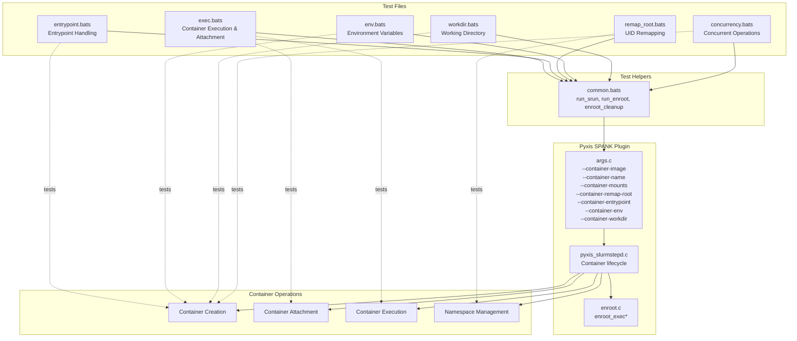
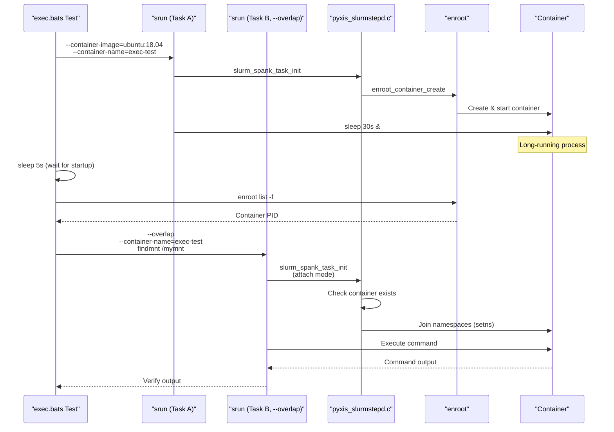
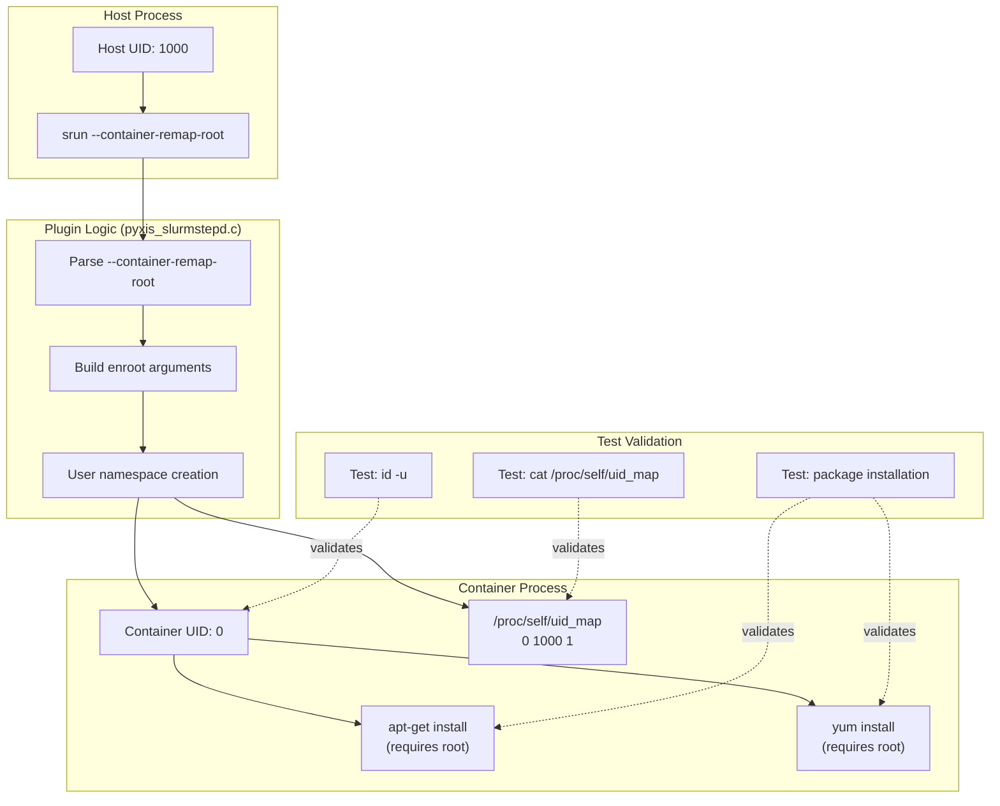
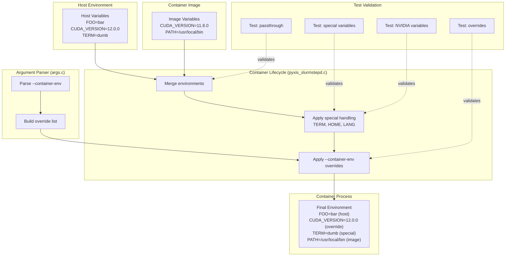
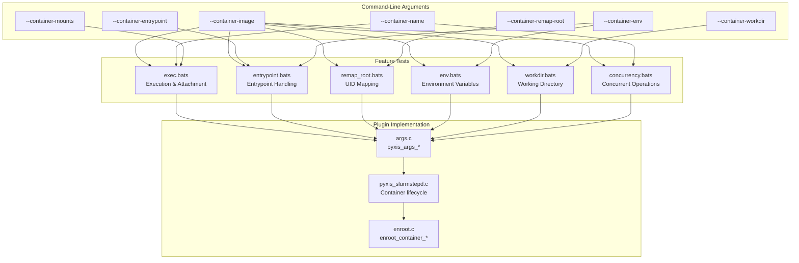

<!-- source: DeepWiki mcp.deepwiki.com · repo NVIDIA/pyxis · page 12.2 Feature Tests · fetched 2026-10-26 -->

# Feature Tests

<details>
<summary>Relevant source files</summary>

The following files were used as context for generating this wiki page:

- [tests/concurrency.bats](tests/concurrency.bats)
- [tests/entrypoint.bats](tests/entrypoint.bats)
- [tests/env.bats](tests/env.bats)
- [tests/exec.bats](tests/exec.bats)
- [tests/remap_root.bats](tests/remap_root.bats)
- [tests/workdir.bats](tests/workdir.bats)

</details>


## Purpose and Scope

This document describes the feature tests for Pyxis, which validate specific plugin capabilities through end-to-end testing. These tests use the BATS (Bash Automated Testing System) framework to verify that container execution, attachment, entrypoints, environment variables, UID remapping, working directories, and concurrent operations function correctly.

For information about container image import testing, see [Container Image Tests](#12.1). For argument validation and error handling tests, see [Validation & Error Tests](#12.3). For an overview of the test framework structure, see [Testing Infrastructure](#12).

## Test Suite Organization

The feature tests are distributed across multiple BATS test files, each focusing on a specific area of functionality:

| Test File | Lines of Code | Primary Focus | Key Test Scenarios |
|-----------|---------------|---------------|-------------------|
| `tests/exec.bats` | 79 | Container execution and attachment | `enroot exec`, attaching to running containers, unnamed containers, directory changes |
| `tests/entrypoint.bats` | 62 | Container entrypoint handling | Entrypoint execution, disabling entrypoints, environment variable interaction, logging |
| `tests/remap_root.bats` | 50 | UID/GID remapping | Root remapping, UID maps, seccomp profiles, package installation |
| `tests/env.bats` | 88 | Environment variables | Variable passthrough, special variables (`$TERM`, `$HOME`, `$LANG`), `--container-env`, NVIDIA GPU variables |
| `tests/workdir.bats` | 28 | Working directory | `--container-workdir`, container image workdir, path validation |
| `tests/concurrency.bats` | 44 | Concurrent operations | Concurrent container creation, concurrent container reuse |

Sources: [tests/exec.bats](), [tests/entrypoint.bats](), [tests/remap_root.bats](), [tests/env.bats](), [tests/workdir.bats](), [tests/concurrency.bats]()

## Feature Test Architecture



Sources: [tests/exec.bats:1-79](), [tests/entrypoint.bats:1-62](), [tests/remap_root.bats:1-50](), [tests/env.bats:1-88](), [tests/workdir.bats:1-28](), [tests/concurrency.bats:1-44]()

## Container Execution Tests

The `exec.bats` file validates container execution and attachment capabilities, particularly the ability to execute commands in running containers and attach to them from multiple tasks.

### Test: enroot exec

This test verifies that Pyxis can execute commands inside a running container using `enroot exec`:

**Test Flow:**
1. Create a named container with `--container-name=exec-test`
2. Start a long-running container in the background
3. Use `enroot list` to find the container PID
4. Execute a command inside the container using `enroot exec`

Sources: [tests/exec.bats:13-23]()

### Test: attach to running container

This test validates attaching to a running container from a separate `srun` invocation:

**Test Steps:**
1. Create a container and mount a tmpfs filesystem at `/mymnt`
2. Run a long-running command in the background
3. Use `--overlap --container-name=exec-test` to attach from another task
4. Verify the mount point is visible in the attached task

Sources: [tests/exec.bats:25-31]()

### Test: attach to running unnamed container

This test verifies that unnamed containers (automatically named `jobid.stepid`) can be attached to:

**Test Logic:**
1. Determine the job ID and step ID from environment variables
2. Calculate the next step's container name as `${job_id}.$((step_id + 1))`
3. Attach to that container using the calculated name

Sources: [tests/exec.bats:33-46]()

### Test: attach after directory change

Validates that attaching to a container after the original task changed directories starts in the root directory:

**Expected Behavior:**
- Original task changes to `/var`
- Attached task starts in `/` (root directory)

Sources: [tests/exec.bats:48-54]()

### Test: attach with --container-mounts

Tests that `--container-mounts` is ignored when attaching to an existing container:

**Validation:**
- Attempts to use `--container-mounts` when attaching
- Verifies the mount does not exist
- Confirms a warning message is logged: "ignoring --container-mounts"

Sources: [tests/exec.bats:56-63]()

### Container Name Flags

Two tests validate the `:exec` and `:no_exec` flags on container names:

| Flag | Behavior | Test |
|------|----------|------|
| `:exec` | Execute in container via `enroot exec` | Must fail if container is not running |
| `:no_exec` | Start new container, don't join existing | Must not see mounts from running container |

Sources: [tests/exec.bats:65-78]()

## Container Execution Test Flow



Sources: [tests/exec.bats:25-31](), [tests/exec.bats:48-54]()

## Entrypoint Tests

The `entrypoint.bats` file validates container entrypoint handling, including execution, disabling, environment variable interaction, and logging.

### Test: docker:dind entrypoint

Validates that the Docker-in-Docker entrypoint sets environment variables:

**Test Cases:**
- With `--container-entrypoint`: Verifies `$DOCKER_HOST` is set
- With `--no-container-entrypoint`: Verifies `$DOCKER_HOST` is empty

Sources: [tests/entrypoint.bats:13-20]()

### Test: manual execution of entrypoint

Tests manual entrypoint execution with the nginx image:

**Test Flow:**
1. Run nginx without entrypoint: IPv6 configuration not applied
2. Run nginx with manual entrypoint invocation: IPv6 configuration applied
3. Verify configuration changes by examining `/etc/nginx/conf.d/default.conf`

Sources: [tests/entrypoint.bats:22-31]()

### Test: entrypoint and container-env interaction

Validates how `--container-env` affects entrypoint behavior:

**Test Scenario (docker:dind-rootless):**
- Entrypoint checks `$DOCKER_TLS_VERIFY` to determine `$DOCKER_HOST`
- Without `--container-env`: `$DOCKER_HOST` is `tcp://docker:2375`
- With `--container-env=DOCKER_TLS_VERIFY`: `$DOCKER_HOST` is `tcp://docker:2376`

Sources: [tests/entrypoint.bats:33-49]()

### Test: entrypoint logging

Tests the `--container-entrypoint-log` flag:

**Expected Behavior:**
- Without flag: CUDA entrypoint output is suppressed
- With `--container-entrypoint-log`: CUDA entrypoint output is visible ("== CUDA ==")

Sources: [tests/entrypoint.bats:51-61]()

## UID Remapping Tests

The `remap_root.bats` file validates the `--container-remap-root` functionality, which maps the user's UID to root (UID 0) inside the container.

### UID Mapping Validation

Tests verify the UID mapping structure created by user namespaces:

| Flag | Inside Container UID | uid_map Structure |
|------|---------------------|-------------------|
| `--container-remap-root` | 0 | `0 <host_uid> 1` |
| `--no-container-remap-root` | `<host_uid>` | `<host_uid> <host_uid> 1` |

The tests parse `/proc/self/uid_map` to validate the mapping.

Sources: [tests/remap_root.bats:5-25]()

### Seccomp Profile Tests

Both remapping modes apply seccomp filters (mode 2):

**Test Method:**
- Read `/proc/self/status` and check for `Seccomp: 2`
- This applies to both `--container-remap-root` and `--no-container-remap-root`

Sources: [tests/remap_root.bats:27-33]()

### Package Installation Tests

Validates that package managers work correctly with UID remapping:

**Ubuntu/Debian (apt-get):**
- Install `file` package
- Install `emacs-nox` package

**AlmaLinux (yum):**
- Install `file` package
- Install `emacs-nox` package

These tests ensure that file ownership, permissions, and capabilities work correctly with remapped UIDs.

Sources: [tests/remap_root.bats:35-49]()

## UID Remapping Architecture



Sources: [tests/remap_root.bats:5-49]()

## Environment Variable Tests

The `env.bats` file validates environment variable passthrough and special handling for specific variables.

### Basic Environment Variable Passthrough

Tests that environment variables from the host are passed into the container:

**Test:**
- Set `FOO=bar` on host
- Verify `$FOO` is `bar` inside container

Sources: [tests/env.bats:5-9]()

### Special Variable Handling

Pyxis handles certain environment variables specially:

| Variable | Special Behavior | Test Case |
|----------|-----------------|-----------|
| `$TERM` | Always passed through | Set to `dumb`, verify in container |
| `$HOME` | Affects mount point when using `--container-mount-home` | Set to `/tmp`, verify mount source |
| `$LANG` | Passed by default for locale support | Set to `en_US.UTF-8`, verify no locale errors |

Sources: [tests/env.bats:11-24]()

### NVIDIA GPU Environment Variables

Tests validate GPU visibility control through environment variables:

**`$NVIDIA_VISIBLE_DEVICES` Test:**
- Without variable: All GPUs visible
- With `NVIDIA_VISIBLE_DEVICES=0`: Only GPU 0 visible
- With `NVIDIA_VISIBLE_DEVICES=all`: All GPUs visible

**`$NVIDIA_DRIVER_CAPABILITIES` Test:**
- Sets `utility,compute` capabilities
- Verifies CUDA libraries are available via `ldconfig`

Sources: [tests/env.bats:26-56]()

### --container-env Override Behavior

Tests the `--container-env` flag's ability to override container-provided variables:

**Test Scenario (CUDA container):**
1. Without `--container-env`: Container's `$CUDA_VERSION` (11.8.0) is preserved
2. With `--container-env CUDA_VERSION`: Host's `$CUDA_VERSION` (12.0.0) overrides
3. Multiple variables can be specified: `--container-env CUDA_VERSION,LD_LIBRARY_PATH`

**Special Case:**
- If the host variable is unset, the container's value is not overridden
- This allows selective override without requiring all variables to be set

Sources: [tests/env.bats:58-82]()

### --container-env Forcing Passthrough

Tests that `--container-env` forces passthrough even for special variables:

**Test Case (`$LANG`):**
- Normally, `$LANG` is passed through for locale support
- With `--no-container-mount-home` and `--container-env LANG`, locale files may be missing
- Test verifies perl warns about missing locale

Sources: [tests/env.bats:84-87]()

## Environment Variable Processing Flow



Sources: [tests/env.bats:5-87]()

## Working Directory Tests

The `workdir.bats` file validates the `--container-workdir` flag and container image workdir handling.

### Test Cases

| Test | Command | Expected Result |
|------|---------|----------------|
| Absolute target | `--container-workdir=/usr/local/bin` | `pwd` returns `/usr/local/bin` |
| Path escape attempt | `--container-workdir=../` | `pwd` returns `/` (root) |
| Non-existent directory | `--container-workdir=/pyxis` | Error: "No such file or directory" |
| Container image workdir | No flag with PyTorch image | `pwd` returns `/workspace` (image default) |

Sources: [tests/workdir.bats:5-27]()

### Working Directory Resolution

The plugin resolves the working directory in the following order:
1. `--container-workdir` (highest priority)
2. Container image's `WORKDIR` directive
3. `/` (root directory, default fallback)

Sources: [tests/workdir.bats:23-27]()

## Concurrency Tests

The `concurrency.bats` file validates that multiple containers can be created and used concurrently without conflicts.

### Test: concurrent container creation

Validates that multiple named containers can be created simultaneously:

**Test Flow:**
1. Launch 5 containers concurrently (indices 0-4)
2. Each uses `--container-name=concurrent-test-$i`
3. Wait for all to complete
4. Verify all exit successfully

Sources: [tests/concurrency.bats:13-24]()

### Test: concurrent container reuse

Tests concurrent attachment to existing containers, addressing a specific enroot issue:

**Test Flow:**
1. Pre-create 5 named containers
2. Launch 50 tasks that randomly attach to one of the 5 containers
3. Use `:no_exec` flag to prevent `enroot exec` mode
4. Random sleep between launches to vary timing
5. Verify all tasks complete successfully

This test addresses [enroot issue #126](https://github.com/NVIDIA/enroot/issues/126) related to concurrent container operations.

Sources: [tests/concurrency.bats:26-43]()

## Feature Coverage Matrix



Sources: [tests/exec.bats](), [tests/entrypoint.bats](), [tests/remap_root.bats](), [tests/env.bats](), [tests/workdir.bats](), [tests/concurrency.bats]()

## Test Helper Functions

All feature tests use common helper functions from `tests/common.bats`:

| Function | Purpose |
|----------|---------|
| `run_srun` | Execute `srun` with standard error checking |
| `run_srun_unchecked` | Execute `srun` without automatic error checking |
| `run_enroot` | Execute `enroot` commands |
| `enroot_cleanup` | Clean up named containers in setup/teardown |

These helpers provide consistent error handling, output capture, and container cleanup across all tests.

Sources: [tests/exec.bats:3](), [tests/entrypoint.bats:3](), [tests/remap_root.bats:3](), [tests/env.bats:3](), [tests/workdir.bats:3](), [tests/concurrency.bats:3]()

## Test Execution Patterns

### Setup and Teardown

Most test files use BATS `setup()` and `teardown()` functions for container cleanup:

```
function setup() {
    enroot_cleanup <container-name> || true
}

function teardown() {
    enroot_cleanup <container-name> || true
}
```

This ensures containers are removed before and after tests, preventing interference between test cases.

Sources: [tests/exec.bats:5-11](), [tests/entrypoint.bats:5-11](), [tests/concurrency.bats:5-11]()

### Background Process Tests

Several tests use background processes with `sleep` commands:

**Pattern:**
1. Start long-running container in background with `&`
2. Use `sleep` to wait for container startup
3. Execute test operations
4. Background process is automatically cleaned up

This pattern is used extensively in `exec.bats` and `concurrency.bats` to test attachment and concurrent operations.

Sources: [tests/exec.bats:15-31](), [tests/concurrency.bats:16-23]()

### Conditional Test Skipping

Tests use the `skip` function to skip tests when prerequisites are not met:

**Examples:**
- Skip GPU tests if `nvidia-smi` is not available
- Skip entrypoint tests if enroot disables entrypoints via `/etc/enroot/entrypoint`
- Skip multi-GPU tests if fewer than 2 GPUs are available

Sources: [tests/env.bats:27-45](), [tests/entrypoint.bats:14-16]()

---

