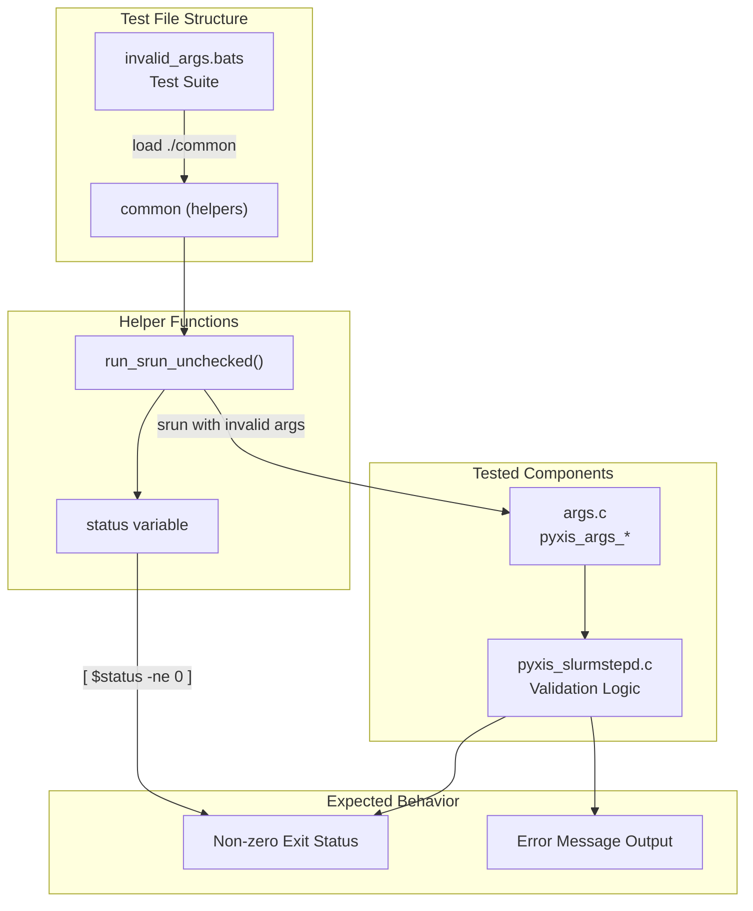
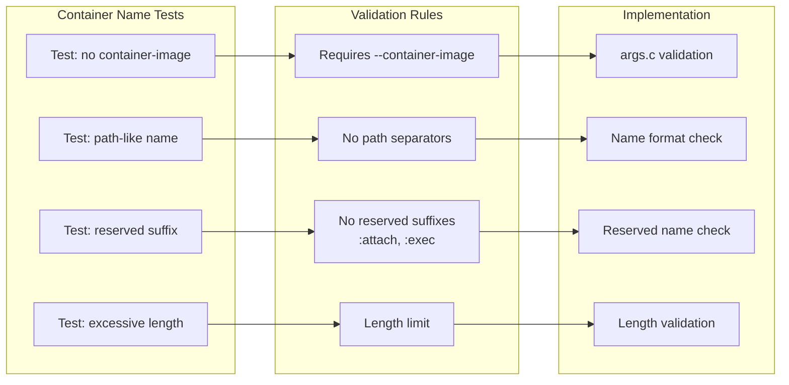
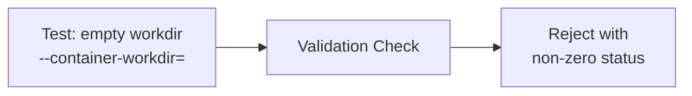
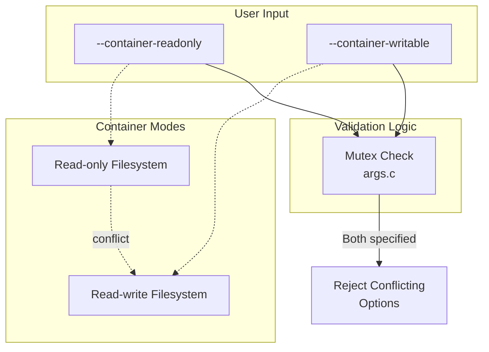
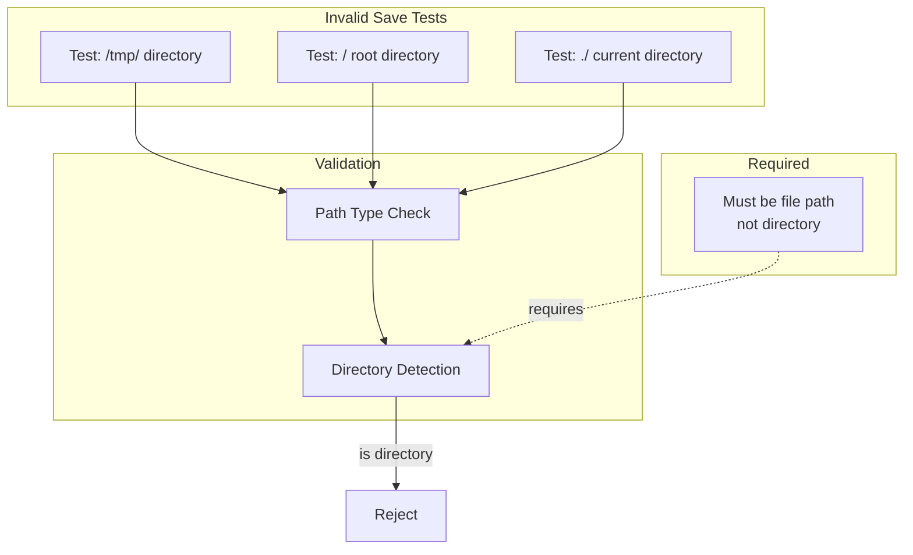
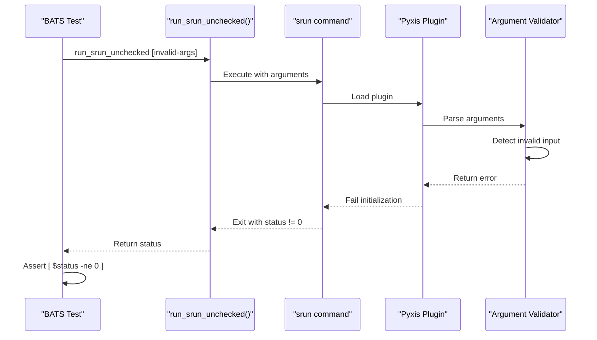
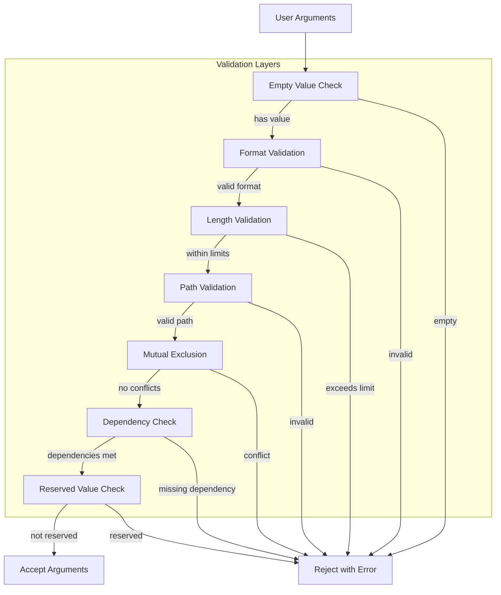

<!-- source: DeepWiki mcp.deepwiki.com · repo NVIDIA/pyxis · page 12.3 Validation & Error Tests · fetched 2026-10-26 -->

# Validation & Error Tests

Relevant source files

The following files were used as context for generating this wiki page:

- [tests/invalid_args.bats](tests/invalid_args.bats)

## Purpose and Scope

This document describes the validation and error handling test suite for Pyxis. These tests verify that the argument parser correctly rejects invalid inputs, malformed arguments, and mutually exclusive option combinations. The test suite ensures that users receive appropriate error messages when providing incorrect command-line arguments, preventing undefined behavior or silent failures.

For information about testing valid container image imports, see page [12.1](#12.1). For testing container features and functionality, see page [12.2](#12.2). For details on the argument parsing implementation being tested, see page [6](#6).

## Test Framework Structure

The validation tests are implemented using the BATS (Bash Automated Testing System) framework. All tests are located in [tests/invalid_args.bats:1-91]() and follow a consistent pattern of invoking `srun` with invalid arguments and verifying that the command fails with a non-zero exit status.

### Test Helper Integration

**Sources:** [tests/invalid_args.bats:1-8]()

The test suite loads common test helpers [tests/invalid_args.bats:3]() and uses `run_srun_unchecked()` to invoke `srun` with invalid arguments. Each test verifies that the exit status is non-zero, indicating that the validation logic correctly detected and rejected the invalid input.

## Test Categories

### Container Image Validation

Container image validation ensures that the `--container-image` argument receives valid input in the correct format.

| Test Case | Argument | Expected Behavior | Line Reference |
|-----------|----------|-------------------|----------------|
| Empty argument | `--container-image=` | Reject - missing value | [5-8]() |
| Excessively long image name | `--container-image=<2048 byte random string>` | Reject - exceeds size limit | [10-14]() |
| Relative directory path | `--container-image=./` | Reject - invalid path format | [16-19]() |
| Invalid file path | `--container-image=/dev/urandom` | Reject - not a container image | [21-24]() |

**Sources:** [tests/invalid_args.bats:5-24]()

The image validation tests cover multiple failure modes:
- Empty values [tests/invalid_args.bats:5-8]()
- Buffer overflow attempts using excessively long strings [tests/invalid_args.bats:10-14]()
- Invalid path formats that don't resolve to squashfs files [tests/invalid_args.bats:16-24]()

### Container Name Validation

Container name validation enforces constraints on the `--container-name` argument.

**Sources:** [tests/invalid_args.bats:26-44]()

| Test Case | Argument | Validation Rule | Line Reference |
|-----------|----------|-----------------|----------------|
| Name without image | `--container-name=args-test` (no image) | Must provide `--container-image` | [26-29]() |
| Path-like name | `--container-name=/tmp/foo` | No path separators allowed | [31-34]() |
| Reserved suffix | `--container-name=:attach` | Reserved for internal use | [36-39]() |
| Excessive length | `--container-name=<300 'a' characters>` | Exceeds maximum length | [41-44]() |

**Sources:** [tests/invalid_args.bats:26-44]()

The test at [tests/invalid_args.bats:26-29]() verifies that `--container-name` cannot be used independently, as it requires an associated container image. Tests at [tests/invalid_args.bats:31-39]() ensure that container names don't conflict with path syntax or reserved suffixes used internally by Pyxis. The length test [tests/invalid_args.bats:41-44]() prevents buffer overflows in container name handling.

### Mount Point Validation

Mount validation tests verify that `--container-mounts` receives properly formatted mount specifications.

| Test Case | Argument | Reason for Rejection | Line Reference |
|-----------|----------|---------------------|----------------|
| Empty mounts | `--container-mounts=` | Missing mount specification | [46-49]() |
| Single colon | `--container-mounts=:` | Invalid mount format | [51-54]() |
| Source without destination | `--container-mounts=/tmp:` | Incomplete mount specification | [56-59]() |

**Sources:** [tests/invalid_args.bats:46-59]()

Mount specifications must follow the format `source:destination[:options]`. The tests verify that:
- Empty mount specifications are rejected [tests/invalid_args.bats:46-49]()
- Both source and destination paths must be provided [tests/invalid_args.bats:51-59]()
- The parser doesn't silently accept malformed mount strings

### Working Directory Validation

The working directory test ensures that `--container-workdir` receives a non-empty value:

**Sources:** [tests/invalid_args.bats:61-64]()

The test at [tests/invalid_args.bats:61-64]() verifies that an empty working directory argument is rejected. This prevents undefined behavior when setting the container's current working directory.

### Mutually Exclusive Arguments

Some arguments are mutually exclusive and cannot be used together.

**Sources:** [tests/invalid_args.bats:66-69]()

The test at [tests/invalid_args.bats:66-69]() verifies that `--container-readonly` and `--container-writable` cannot be specified simultaneously, as they define contradictory container filesystem modes.

### Environment Variable Validation

Environment variable tests ensure that `--container-env` receives properly formatted variable specifications.

| Test Case | Argument | Validation Rule | Line Reference |
|-----------|----------|-----------------|----------------|
| Empty value | `--container-env=` | Must specify at least one variable | [71-74]() |
| Trailing comma | `--container-env FOO,` | Invalid list termination | [76-79]() |

**Sources:** [tests/invalid_args.bats:71-79]()

Environment variable lists must be properly formatted comma-separated values. The tests verify:
- Empty environment specifications are rejected [tests/invalid_args.bats:71-74]()
- Trailing commas are not accepted [tests/invalid_args.bats:76-79]()

### Container Save Validation

The container save validation tests ensure that `--container-save` receives a valid file path, not a directory.

**Sources:** [tests/invalid_args.bats:81-90]()

The tests at [tests/invalid_args.bats:81-90]() verify that directory paths are rejected for `--container-save`. The argument must specify a file path where the container image will be exported, not a directory. Three variations are tested:
- Absolute directory path with trailing slash [tests/invalid_args.bats:82-83]()
- Root directory [tests/invalid_args.bats:85-86]()
- Relative current directory [tests/invalid_args.bats:88-89]()

## Test Execution Pattern

All tests follow a consistent execution and verification pattern:

**Sources:** [tests/invalid_args.bats:6-7,12-13,17-18,22-23,27-28,32-33,37-38,42-43,47-48,52-53,57-58,62-63,67-68,72-73,77-78,82-86,88-89]()

Each test:
1. Calls `run_srun_unchecked()` with specific invalid arguments
2. Captures the exit status in the `status` variable
3. Asserts that `status` is non-zero using `[ "${status}" -ne 0 ]`

This pattern ensures consistent error detection across all validation scenarios.

## Error Detection Strategy

The validation tests employ multiple error detection strategies:

| Strategy | Description | Example Tests |
|----------|-------------|---------------|
| **Empty Value Detection** | Reject arguments with missing required values | Image, mounts, workdir, env [tests/invalid_args.bats:5-8,46-49,61-64,71-74]() |
| **Format Validation** | Verify argument values match expected patterns | Mounts format [tests/invalid_args.bats:51-59]() |
| **Length Constraints** | Enforce maximum length limits | Image name, container name [tests/invalid_args.bats:10-14,41-44]() |
| **Path Validation** | Verify file/directory path validity | Image paths, save paths [tests/invalid_args.bats:16-24,81-90]() |
| **Mutual Exclusion** | Detect conflicting option combinations | Readonly/writable [tests/invalid_args.bats:66-69]() |
| **Dependency Checking** | Verify required argument combinations | Container name requires image [tests/invalid_args.bats:26-29]() |
| **Reserved Value Detection** | Reject reserved or special values | Reserved container name suffixes [tests/invalid_args.bats:36-39]() |

**Sources:** [tests/invalid_args.bats:1-91]()

### Validation Flow

**Sources:** [tests/invalid_args.bats:1-91]()

The validation logic in the argument parser (see page [6](#6)) implements these checks in the order shown. Each validation layer acts as a gatekeeper, rejecting invalid input before it reaches the container lifecycle management code (see page [4](#4)).

## Coverage Summary

The invalid argument test suite provides comprehensive coverage of error cases:

- **10 distinct validation categories** tested
- **15 specific test cases** covering common user errors
- **3 data types validated**: strings, paths, and lists
- **2 relationship checks**: mutual exclusion and dependencies

This test coverage ensures that users receive clear error messages for invalid inputs rather than experiencing silent failures or undefined behavior during container execution.

**Sources:** [tests/invalid_args.bats:1-91]()

---

