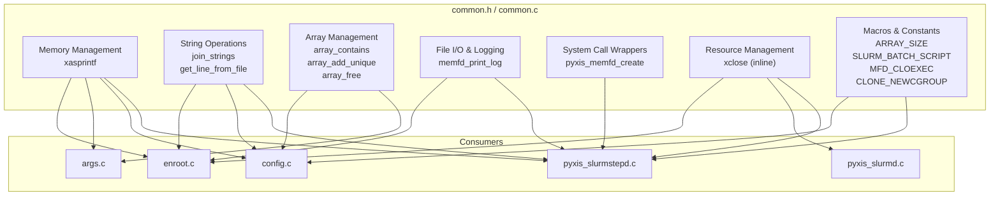
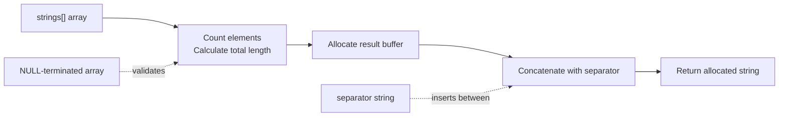
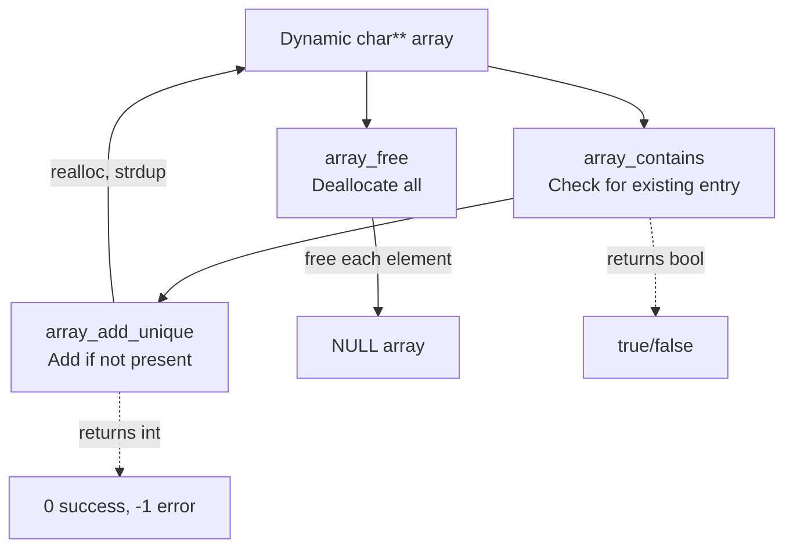
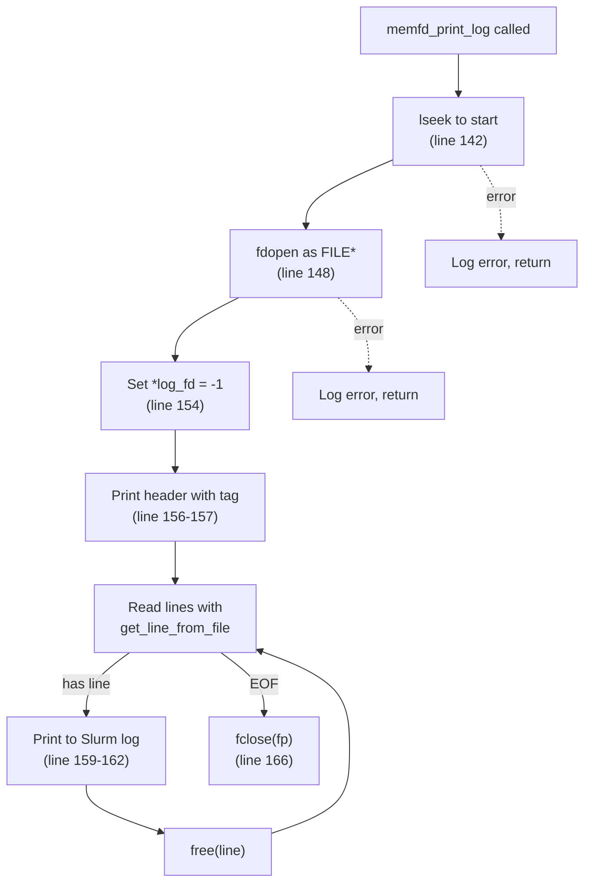
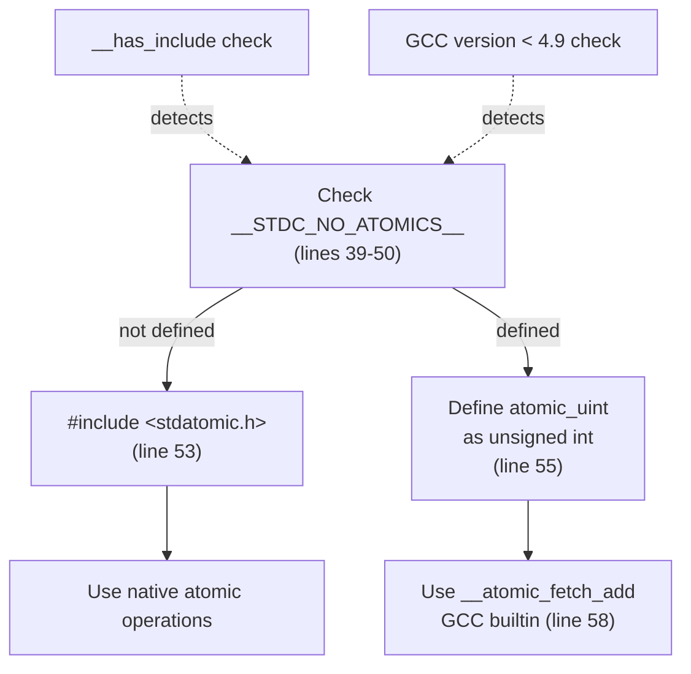
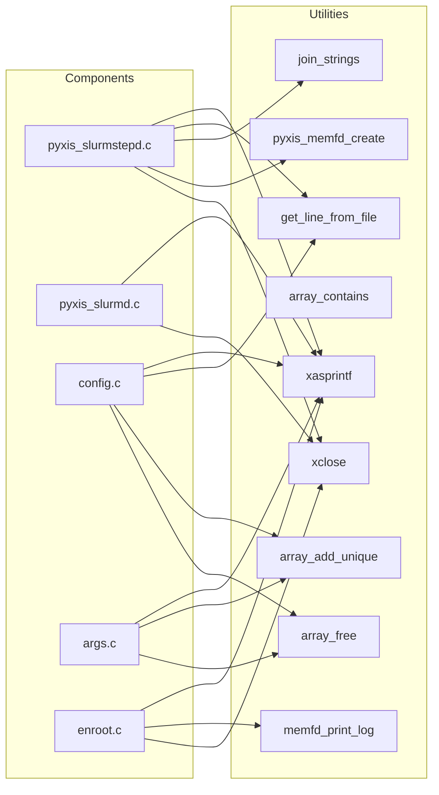

<!-- source: DeepWiki mcp.deepwiki.com · repo NVIDIA/pyxis · page 13 Utility Functions · fetched 2026-10-26 -->

# Utility Functions

<details>
<summary>Relevant source files</summary>

The following files were used as context for generating this wiki page:

- [common.c](common.c)
- [common.h](common.h)

</details>


## Purpose and Scope

This page documents the common utility functions and helper routines defined in [common.c]() and [common.h](). These utilities provide shared functionality used throughout the Pyxis plugin codebase, including memory management, string operations, array manipulation, file I/O, and system call wrappers. 

For information about plugin-specific data structures that use these utilities, see [Data Structures](#14). For configuration and argument parsing logic that depends on these functions, see [Configuration System](#5) and [Argument Parsing](#6).

**Sources:** [common.h:1-80](), [common.c:1-169]()

---

## Overview of Utility Categories

The utility library is organized into several functional categories that provide foundational services to all Pyxis components.

### Utility Function Categories



**Sources:** [common.h:1-80](), [common.c:1-169]()

---

## Memory Management

### xasprintf - Safe Formatted String Allocation

The `xasprintf` function is a wrapper around the standard `vasprintf` that provides safer error handling by ensuring the output pointer is always set to a valid state.

**Function Signature:**
```c
int xasprintf(char **strp, const char *fmt, ...);
```

**Implementation Details:**

| Aspect | Description |
|--------|-------------|
| **Purpose** | Allocate and format a string with variadic arguments |
| **Return Value** | Number of characters written (excluding null terminator), or -1 on error |
| **Error Handling** | On failure, sets `*strp` to `NULL` (standard `asprintf` leaves it undefined) |
| **Memory Management** | Caller must free the allocated string |
| **Location** | [common.c:16-37]() |

The key safety improvement is shown in the error handling logic at [common.c:28-34](), which explicitly sets `*strp = NULL` on failure, preventing undefined behavior.

**Sources:** [common.c:16-37]()

---

## String Operations

### get_line_from_file - Line Reading with Newline Trimming

Reads a single line from a file pointer, automatically handling memory allocation and trimming trailing newlines.

**Function Signature:**
```c
char *get_line_from_file(FILE *fp);
```

**Behavior:**

| Aspect | Details |
|--------|---------|
| **Memory Allocation** | Uses `getline()` for automatic buffer sizing |
| **Newline Handling** | Automatically removes trailing `\n` character |
| **Error Handling** | Returns `NULL` on EOF or error, frees buffer on failure |
| **Return Value** | Allocated string (caller must free), or `NULL` |
| **Location** | [common.c:39-53]() |

The implementation at [common.c:44-47]() handles allocation failure by freeing the line buffer before returning `NULL`. The newline trimming logic is at [common.c:49-51]().

**Sources:** [common.c:39-53]()

### join_strings - Array Concatenation with Separator

Joins an array of strings into a single allocated string, inserting a separator between elements.

**Function Signature:**
```c
char *join_strings(char *const strings[], const char *sep);
```

**Implementation Strategy:**



**Algorithm Details:**

1. **Size Calculation** [common.c:63-66](): Iterates through the array to count elements and calculate total length including separators
2. **Memory Allocation** [common.c:68-71](): Allocates buffer of size `sum(strlen(strings)) + strlen(sep) * (count - 1) + 1`
3. **Concatenation** [common.c:73-77](): Iterates through array, inserting separator before each element except the first

**Sources:** [common.c:55-79]()

---

## Array Management

The array management utilities provide dynamic array operations with automatic memory management and uniqueness constraints.

### Array Management Function Overview



**Sources:** [common.c:81-134]()

### array_contains - Membership Test

Tests whether an array contains a specific string entry.

| Property | Value |
|----------|-------|
| **Signature** | `bool array_contains(char **array, size_t len, const char *entry)` |
| **Search Method** | Linear search using `strcmp` |
| **Return Value** | `true` if found, `false` otherwise |
| **Location** | [common.c:81-91]() |

**Sources:** [common.c:81-91]()

### array_add_unique - Conditional Insertion

Adds an entry to a dynamic array only if it doesn't already exist, automatically managing reallocation.

**Function Signature:**
```c
int array_add_unique(char ***array, size_t *len, const char *entry);
```

**Operation Flow:**

1. **Uniqueness Check** [common.c:99-102](): Calls `array_contains()` to avoid duplicates
2. **String Duplication** [common.c:104-106](): Creates a copy of the entry using `strdup`
3. **Array Expansion** [common.c:108-112](): Uses `realloc` to expand the array by one element
4. **Entry Assignment** [common.c:114-116](): Stores the duplicated string and increments length

**Error Handling:**
- Returns `0` on success (including when entry already exists)
- Returns `-1` on memory allocation failure
- Performs cleanup on failure path [common.c:120-123]()

**Sources:** [common.c:93-124]()

### array_free - Complete Deallocation

Frees all memory associated with a dynamic array of strings.

| Property | Value |
|----------|-------|
| **Signature** | `void array_free(char ***array, size_t *len)` |
| **Behavior** | Frees each string element, then the array itself |
| **State Reset** | Sets array pointer to `NULL` and length to `0` |
| **Location** | [common.c:126-134]() |

The implementation at [common.c:128-129]() iterates through the array to free each individual string before freeing the array pointer itself at [common.c:130]().

**Sources:** [common.c:126-134]()

---

## File I/O and Logging

### memfd_print_log - In-Memory Log Output

Prints the contents of an in-memory file descriptor (created via `memfd_create`) to the Slurm logging system.

**Function Signature:**
```c
void memfd_print_log(int *log_fd, bool error, const char *tag);
```

**Parameters:**

| Parameter | Type | Purpose |
|-----------|------|---------|
| `log_fd` | `int *` | Pointer to file descriptor (set to -1 after processing) |
| `error` | `bool` | If `true`, use `slurm_error()`; if `false`, use `slurm_spank_log()` |
| `tag` | `const char *` | Descriptive tag for the log output |

**Processing Flow:**



**Key Implementation Details:**

1. **Seek to Start** [common.c:142-146](): Rewinds the file descriptor to read from the beginning
2. **Stream Conversion** [common.c:148-152](): Converts the file descriptor to a `FILE*` for line-based reading
3. **FD Ownership Transfer** [common.c:154](): Sets `*log_fd = -1` to transfer ownership to `fclose()`
4. **Line-by-Line Output** [common.c:158-164](): Reads each line and outputs to appropriate Slurm logging function

**Sources:** [common.c:136-168]()

---

## System Call Wrappers

### pyxis_memfd_create - Anonymous File Creation

Wrapper around the `memfd_create` system call for creating anonymous file descriptors in memory.

**Function Signature:**
```c
static inline int pyxis_memfd_create(const char *name, unsigned int flags);
```

**Implementation:**

The function is defined as an inline wrapper at [common.h:62-65]():

```c
static inline int pyxis_memfd_create(const char *name, unsigned int flags)
{
    return syscall(__NR_memfd_create, name, flags);
}
```

**Compatibility Notes:**

- System call number is defined at [common.h:29-33]() for x86_64 architecture
- `MFD_CLOEXEC` flag is defined at [common.h:25-27]() if not available from system headers
- Used for creating in-memory log files for enroot command output

**Sources:** [common.h:25-27](), [common.h:29-33](), [common.h:62-65]()

---

## Resource Management

### xclose - Safe File Descriptor Closure

An inline utility function that safely closes a file descriptor, skipping invalid descriptors.

**Function Signature:**
```c
static inline void xclose(int fd);
```

**Implementation:**

Defined at [common.h:11-16]():

```c
static inline void xclose(int fd)
{
    if (fd < 0)
        return;
    close(fd);
}
```

**Safety Features:**

| Feature | Benefit |
|---------|---------|
| **Negative FD Check** | Prevents errors from closing invalid descriptors |
| **Idempotent** | Safe to call multiple times or with uninitialized values |
| **Inline** | Zero overhead for this simple check |
| **Pattern** | Allows setting `fd = -1` after closing for safe re-closing |

**Sources:** [common.h:11-16]()

---

## Macros and Constants

### Macro Definitions

The utility header provides several important macros used throughout the codebase:

| Macro | Definition | Purpose | Location |
|-------|------------|---------|----------|
| `ARRAY_SIZE(x)` | `sizeof(x) / sizeof(*x)` | Calculate array element count at compile time | [common.h:9]() |
| `SLURM_BATCH_SCRIPT` | `0xfffffffb` | Slurm constant for batch script identification | [common.h:21-23]() |
| `MFD_CLOEXEC` | `0x0001U` | Flag for `memfd_create` (close-on-exec) | [common.h:25-27]() |
| `__NR_memfd_create` | `319` (x86_64) | System call number for memfd_create | [common.h:29-33]() |
| `CLONE_NEWCGROUP` | `0x02000000` | Linux namespace flag for cgroup namespace | [common.h:35-37]() |

**Sources:** [common.h:9](), [common.h:21-23](), [common.h:25-27](), [common.h:29-33](), [common.h:35-37]()

### Atomic Operations Compatibility

The header provides compatibility shims for C11 atomic operations when not available:



**Compatibility Logic:**

1. **Feature Detection** [common.h:40-50](): Checks for `<stdatomic.h>` availability using `__has_include` or GCC version
2. **Fallback Definition** [common.h:55](): Defines `atomic_uint` as plain `unsigned int` if atomics unavailable
3. **Atomic Add Operation** [common.h:57-59](): Defines `atomic_fetch_add` using GCC's `__atomic_fetch_add` builtin

**Usage:** These atomics are used in shared memory synchronization for multi-task container creation (see [Container Creation](#4.2)).

**Sources:** [common.h:39-60]()

---

## Usage Patterns Across Components

The following diagram shows how different Pyxis components depend on specific utility functions:

### Component-to-Utility Mapping



**Sources:** [common.h:1-80](), [common.c:1-169]()

---

## Function Reference Summary

### Complete Function API

| Function | Return Type | Primary Use Case | Error Handling |
|----------|-------------|------------------|----------------|
| `xasprintf` | `int` | Formatted string allocation | Returns -1, sets *strp = NULL |
| `get_line_from_file` | `char *` | Read single line from file | Returns NULL, frees buffer |
| `join_strings` | `char *` | Concatenate string array | Returns NULL on allocation failure |
| `array_contains` | `bool` | Check array membership | Always succeeds (returns bool) |
| `array_add_unique` | `int` | Add unique entry to array | Returns -1 on allocation failure |
| `array_free` | `void` | Deallocate string array | N/A (always succeeds) |
| `memfd_print_log` | `void` | Print in-memory log | Logs errors internally, doesn't fail |
| `pyxis_memfd_create` | `int` | Create anonymous file | Returns -1 on syscall failure |
| `xclose` | `void` | Safe FD closure | Skips invalid FDs, always succeeds |

**Sources:** [common.h:11-77](), [common.c:16-168]()

---

