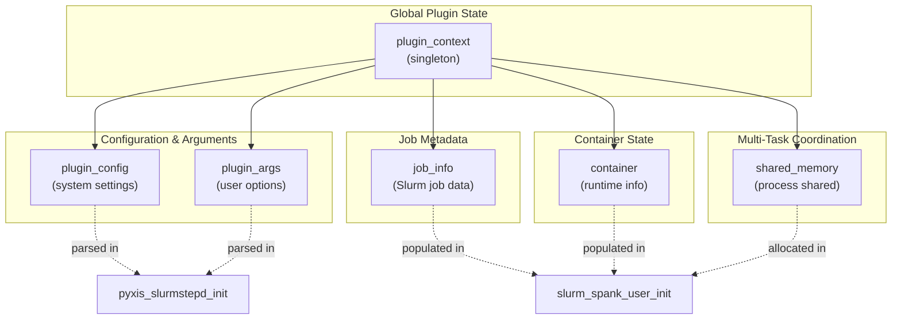
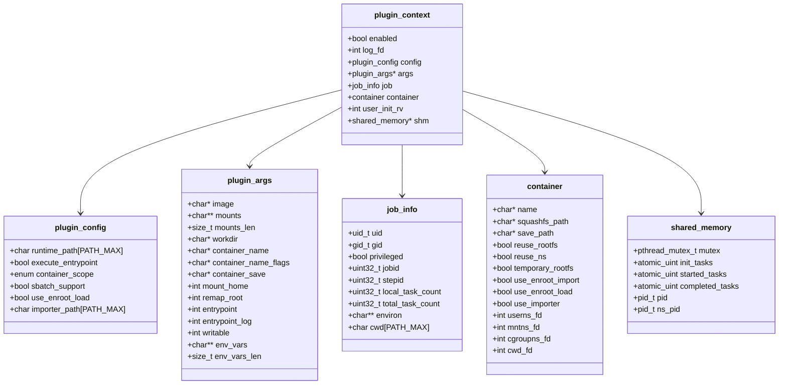
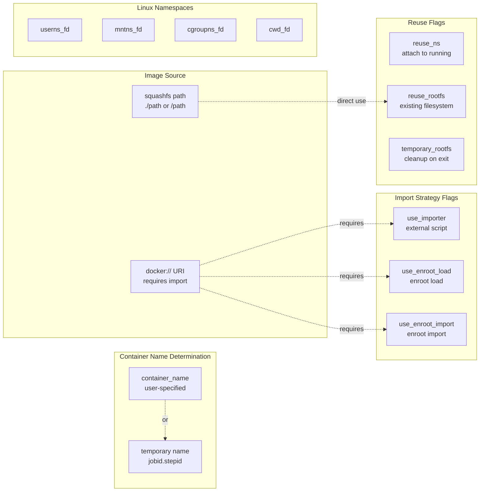
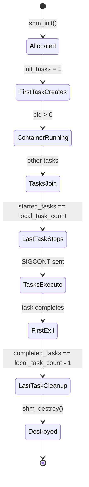
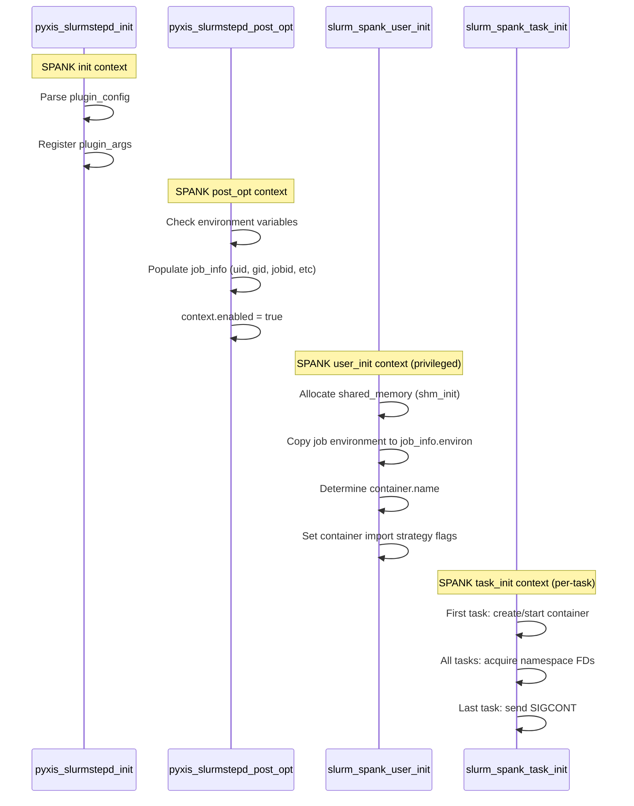
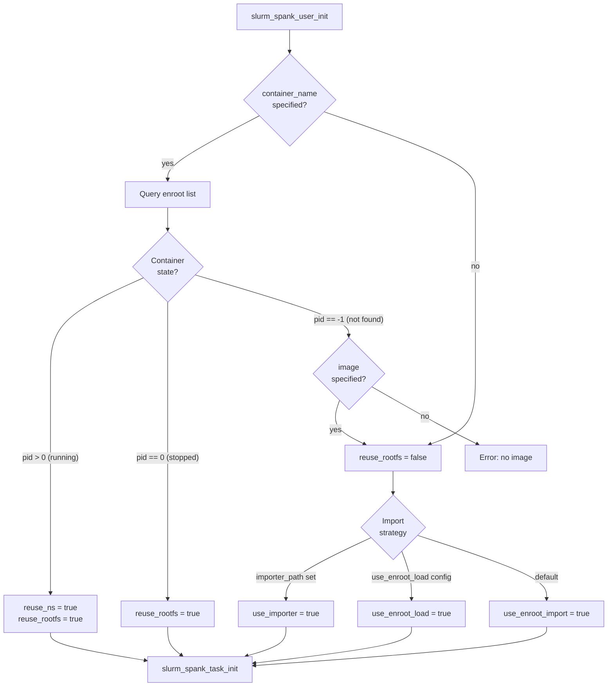

<!-- source: DeepWiki mcp.deepwiki.com · repo NVIDIA/pyxis · page 14 Data Structures · fetched 2026-10-26 -->

# Data Structures

<details>
<summary>Relevant source files</summary>

The following files were used as context for generating this wiki page:

- [args.h](args.h)
- [common.h](common.h)
- [config.h](config.h)
- [pyxis_slurmstepd.c](pyxis_slurmstepd.c)

</details>


## Purpose and Scope

This page documents the key data structures used throughout the Pyxis SPANK plugin. These structures manage configuration, job metadata, container state, inter-task synchronization, and user-provided arguments. 

For information about how these structures are populated and used during plugin execution, see [Container Lifecycle Manager](#4). For details on configuration parsing, see [Configuration System](#5). For argument handling, see [Argument Parsing](#6).

---

## Overview

The Pyxis plugin organizes its state around six primary data structures that work together to manage containerized job execution within Slurm:



**Sources:** [pyxis_slurmstepd.c:74-83](), [config.h:16-23](), [args.h:13-28]()

---

## Primary Data Structures

### plugin_context

The central singleton structure that aggregates all plugin state. A single global instance named `context` exists throughout the plugin's lifetime.



**Sources:** [pyxis_slurmstepd.c:74-83](), [pyxis_slurmstepd.c:90-109]()

| Field | Type | Purpose |
|-------|------|---------|
| `enabled` | `bool` | Whether the plugin is active for this job |
| `log_fd` | `int` | File descriptor for in-memory enroot log (memfd) |
| `config` | `struct plugin_config` | System-level configuration settings |
| `args` | `struct plugin_args*` | Pointer to user-provided arguments |
| `job` | `struct job_info` | Metadata about the Slurm job |
| `container` | `struct container` | Container runtime state |
| `user_init_rv` | `int` | Return value from user_init, deferred for proper error reporting |
| `shm` | `struct shared_memory*` | Pointer to shared memory for multi-task coordination |

The global instance is initialized with default values at [pyxis_slurmstepd.c:90-109]() and persists until `pyxis_slurmstepd_exit()` cleans it up at [pyxis_slurmstepd.c:1513-1545]().

---

### plugin_config

System-level configuration parsed from the SPANK plugin configuration file (`plugstack.conf`).

**Structure Definition:** [config.h:16-23]()

| Field | Type | Default | Purpose |
|-------|------|---------|---------|
| `runtime_path` | `char[PATH_MAX]` | - | Directory for temporary container files (e.g., `/run/pyxis`) |
| `execute_entrypoint` | `bool` | `false` | Whether to execute container entrypoint by default |
| `container_scope` | `enum container_scope` | `SCOPE_GLOBAL` | Whether containers are job-scoped or globally scoped |
| `sbatch_support` | `bool` | - | Enable sbatch script mounting (deprecated) |
| `use_enroot_load` | `bool` | `false` | Use `enroot load` instead of `import` + `create` |
| `importer_path` | `char[PATH_MAX]` | empty | Path to external importer script (e.g., caching_importer.sh) |

**Container Scope Enumeration:** [config.h:11-14]()

```c
enum container_scope {
    SCOPE_JOB,      // Container name includes jobid (pyxis_<jobid>_*)
    SCOPE_GLOBAL,   // Container name without jobid (pyxis_*)
};
```

Configuration is parsed during plugin initialization at [pyxis_slurmstepd.c:116-133]() via `pyxis_config_parse()`.

**Sources:** [config.h:11-23](), [pyxis_slurmstepd.c:120-124]()

---

### plugin_args

User-facing options provided via command-line arguments (e.g., `srun --container-image=...`) or environment variables.

**Structure Definition:** [args.h:13-28]()

| Field | Type | Purpose |
|-------|------|---------|
| `image` | `char*` | Container image URI or path to squashfs file |
| `mounts` | `char**` | Array of mount specifications |
| `mounts_len` | `size_t` | Number of mount entries |
| `workdir` | `char*` | Working directory inside container |
| `container_name` | `char*` | Named container for reuse across jobs |
| `container_name_flags` | `char*` | Flags: "create", "exec", or "no_exec" |
| `container_save` | `char*` | Path to export container to after job completes |
| `mount_home` | `int` | -1=unset, 0=no, 1=yes - mount home directory |
| `remap_root` | `int` | -1=unset, 0=no, 1=yes - remap root user |
| `entrypoint` | `int` | -1=unset, 0=no, 1=yes - execute entrypoint |
| `entrypoint_log` | `int` | -1=unset, 0=no, 1=yes - print entrypoint log |
| `writable` | `int` | -1=unset, 0=no, 1=yes - writable rootfs |
| `env_vars` | `char**` | Array of environment variables to preserve |
| `env_vars_len` | `size_t` | Number of environment variables |

**Tri-State Fields:** The `int` fields use -1 (unset), 0 (explicitly no), 1 (explicitly yes) to allow user overrides while falling back to enroot configuration when unset.

Arguments are registered with SPANK at [pyxis_slurmstepd.c:126-130]() and checked for environment variable fallbacks at [pyxis_slurmstepd.c:265-286]().

**Sources:** [args.h:13-28](), [pyxis_slurmstepd.c:126-130]()

---

### job_info

Metadata about the Slurm job, retrieved via the SPANK API.

**Structure Definition:** [pyxis_slurmstepd.c:53-63]()

| Field | Type | Retrieved From | Purpose |
|-------|------|----------------|---------|
| `uid` | `uid_t` | `S_JOB_UID` | User ID running the job |
| `gid` | `gid_t` | `S_JOB_GID` | Group ID running the job |
| `privileged` | `bool` | `ENROOT_ALLOW_SUPERUSER` env | Whether running as privileged root |
| `jobid` | `uint32_t` | `S_JOB_ID` | Slurm job ID |
| `stepid` | `uint32_t` | `S_JOB_STEPID` | Slurm step ID |
| `local_task_count` | `uint32_t` | `S_JOB_LOCAL_TASK_COUNT` | Tasks on this node |
| `total_task_count` | `uint32_t` | `S_JOB_TOTAL_TASK_COUNT` | Total tasks across all nodes |
| `environ` | `char**` | `S_JOB_ENV` | Job environment variables (copied) |
| `cwd` | `char[PATH_MAX]` | `PWD` env | Job's current working directory |

The structure is populated by `job_get_info()` at [pyxis_slurmstepd.c:135-194]() and `job_get_env()` at [pyxis_slurmstepd.c:196-235](). The environment array is deep-copied to avoid issues with SPANK API pointer lifetime.

**Sources:** [pyxis_slurmstepd.c:53-63](), [pyxis_slurmstepd.c:135-235]()

---

### container

Runtime state for the container, including paths, flags, and namespace file descriptors.

**Structure Definition:** [pyxis_slurmstepd.c:37-51]()



**Sources:** [pyxis_slurmstepd.c:37-51]()

| Field | Type | Purpose |
|-------|------|---------|
| `name` | `char*` | Container name (e.g., "pyxis_12345_mycontainer") |
| `squashfs_path` | `char*` | Path to squashfs image file |
| `save_path` | `char*` | Destination path for container export |
| `reuse_rootfs` | `bool` | Use existing container filesystem |
| `reuse_ns` | `bool` | Attach to running container's namespaces |
| `temporary_rootfs` | `bool` | Remove filesystem on job completion |
| `use_enroot_import` | `bool` | Import image via `enroot import` |
| `use_enroot_load` | `bool` | Import image via `enroot load` |
| `use_importer` | `bool` | Use external importer script |
| `userns_fd` | `int` | File descriptor for user namespace |
| `mntns_fd` | `int` | File descriptor for mount namespace |
| `cgroupns_fd` | `int` | File descriptor for cgroup namespace (-1 if unsupported) |
| `cwd_fd` | `int` | File descriptor for container's working directory |

The container name is constructed at [pyxis_slurmstepd.c:1078-1126]() based on `container_scope` and whether a user-specified name was provided. Namespace file descriptors are acquired at [pyxis_slurmstepd.c:740-781]() by opening `/proc/<pid>/ns/*` files.

**Sources:** [pyxis_slurmstepd.c:37-51](), [pyxis_slurmstepd.c:1078-1126](), [pyxis_slurmstepd.c:740-781]()

---

### shared_memory

Process-shared memory structure for coordinating multiple tasks within a job step. Uses POSIX shared memory (`mmap` with `MAP_SHARED`) and atomic operations for synchronization.

**Structure Definition:** [pyxis_slurmstepd.c:65-72]()



**Sources:** [pyxis_slurmstepd.c:65-72]()

| Field | Type | Purpose |
|-------|------|---------|
| `mutex` | `pthread_mutex_t` | Process-shared mutex with robust attribute |
| `init_tasks` | `atomic_uint` | Counter for tasks entering `slurm_spank_task_init` |
| `started_tasks` | `atomic_uint` | Counter for tasks that acquired namespaces |
| `completed_tasks` | `atomic_uint` | Counter for tasks that finished execution |
| `pid` | `pid_t` | PID of the enroot container process |
| `ns_pid` | `pid_t` | PID to use for acquiring namespace FDs (may differ from `pid` for reuse) |

**Lifecycle:**

1. **Allocation** at [pyxis_slurmstepd.c:972-1012]() via `shm_init()` in `slurm_spank_user_init`
2. **First Task** acquires mutex, creates container, starts it with SIGSTOP at [pyxis_slurmstepd.c:1249-1285]()
3. **Subsequent Tasks** wait on mutex, read `pid` and `ns_pid` from shared memory
4. **Last Task to Start** sends SIGCONT to resume container at [pyxis_slurmstepd.c:1287-1306]()
5. **Last Task to Exit** performs export and cleanup at [pyxis_slurmstepd.c:1491-1511]()
6. **Destruction** at [pyxis_slurmstepd.c:1014-1034]() via `shm_destroy()` in plugin exit

The mutex uses `PTHREAD_MUTEX_ROBUST` to handle cases where a task dies while holding the lock.

**Sources:** [pyxis_slurmstepd.c:65-72](), [pyxis_slurmstepd.c:972-1012](), [pyxis_slurmstepd.c:1014-1034]()

---

## Data Structure Relationships

### Initialization Flow



**Sources:** [pyxis_slurmstepd.c:116-133](), [pyxis_slurmstepd.c:265-286](), [pyxis_slurmstepd.c:1036-1184](), [pyxis_slurmstepd.c:1308-1409]()

### Memory Ownership

| Structure | Allocation | Ownership | Deallocation |
|-----------|------------|-----------|--------------|
| `plugin_context` | Static global | Plugin lifetime | Automatic (static) |
| `plugin_config` | Embedded in context | Plugin lifetime | Automatic (embedded) |
| `plugin_args` | Heap (in args.c) | Plugin lifetime | `pyxis_args_free()` at [pyxis_slurmstepd.c:1540]() |
| `job_info.environ` | Heap (deep copy) | Plugin lifetime | Loop at [pyxis_slurmstepd.c:1522-1526]() |
| `container.name` | Heap | Plugin lifetime | `free()` at [pyxis_slurmstepd.c:1518]() |
| `container.squashfs_path` | Heap | Plugin lifetime | `free()` at [pyxis_slurmstepd.c:1519]() |
| `container.save_path` | Heap | Plugin lifetime | `free()` at [pyxis_slurmstepd.c:1520]() |
| `shared_memory` | `mmap()` shared | User init to exit | `munmap()` at [pyxis_slurmstepd.c:1534-1538]() |

**File Descriptors:**

All file descriptors in the `container` structure are closed at [pyxis_slurmstepd.c:1528-1532]() using the `xclose()` helper defined at [common.h:11-16]().

**Sources:** [pyxis_slurmstepd.c:1513-1545](), [common.h:11-16]()

---

## Structure Usage Patterns

### Container Strategy Determination

The container creation strategy is determined in `slurm_spank_user_init` based on several factors:



**Sources:** [pyxis_slurmstepd.c:1036-1184]()

### Namespace Acquisition

Namespace file descriptors are critical for joining the container's isolated environment:

```c
// Example of namespace FD usage pattern
container_get_namespaces(shm->ns_pid, &context.container);  // Open /proc/<pid>/ns/*
// ...
setns(context.container.userns_fd, CLONE_NEWUSER);          // Join user namespace
setns(context.container.cgroupns_fd, CLONE_NEWCGROUP);      // Join cgroup namespace
setns(context.container.mntns_fd, CLONE_NEWNS);             // Join mount namespace
```

File descriptors remain open until plugin exit, allowing `setns()` calls even after the original container process terminates. This is implemented at [pyxis_slurmstepd.c:1332-1376]() in `slurm_spank_task_init`.

**Sources:** [pyxis_slurmstepd.c:740-781](), [pyxis_slurmstepd.c:1332-1376]()

---

## Advanced Topics

### Atomic Synchronization

The `shared_memory` structure uses C11 atomic operations for lock-free counters:

```c
// atomic_uint fields from shared_memory
atomic_uint init_tasks;      // Incremented under mutex
atomic_uint started_tasks;   // Lock-free increment
atomic_uint completed_tasks; // Lock-free increment

// Usage pattern
if (atomic_fetch_add(&shm->started_tasks, 1) == context.job.local_task_count - 1) {
    // Last task to start
    enroot_container_stop(shm->pid);
}
```

This pattern is used at [pyxis_slurmstepd.c:1293]() for stopping the container and at [pyxis_slurmstepd.c:1500]() for cleanup. The atomic operations are defined in [common.h:39-60]() with fallback for older compilers.

**Sources:** [pyxis_slurmstepd.c:65-72](), [pyxis_slurmstepd.c:1287-1306](), [common.h:39-60]()

### Tri-State Argument Pattern

Several fields in `plugin_args` use a tri-state integer pattern:

| Value | Meaning | Behavior |
|-------|---------|----------|
| `-1` | Unset | Fall back to enroot configuration or plugin default |
| `0` | Explicitly disabled | Override enroot configuration with "no" |
| `1` | Explicitly enabled | Override enroot configuration with "yes" |

Example implementation at [pyxis_slurmstepd.c:407-415]() for `remap_root`:

```c
if (context.args->remap_root == 0) {
    setenv("ENROOT_REMAP_ROOT", "n", 1);
} else if (context.args->remap_root == 1) {
    setenv("ENROOT_REMAP_ROOT", "y", 1);
} else {
    // Don't set ENROOT_REMAP_ROOT; use enroot's default
}
```

This pattern allows user overrides while respecting system-level enroot configuration when the user doesn't specify a preference.

**Sources:** [args.h:13-28](), [pyxis_slurmstepd.c:389-434]()

---

## Summary Table

| Structure | Location | Primary Purpose | Lifetime |
|-----------|----------|-----------------|----------|
| `plugin_context` | [pyxis_slurmstepd.c:74-83]() | Global plugin state aggregator | Plugin load to unload |
| `plugin_config` | [config.h:16-23]() | System configuration from plugstack.conf | Plugin load to unload |
| `plugin_args` | [args.h:13-28]() | User command-line arguments | Plugin init to exit |
| `job_info` | [pyxis_slurmstepd.c:53-63]() | Slurm job metadata | Post-opt to exit |
| `container` | [pyxis_slurmstepd.c:37-51]() | Container runtime state | User init to exit |
| `shared_memory` | [pyxis_slurmstepd.c:65-72]() | Inter-task synchronization | User init to exit |

**Sources:** [pyxis_slurmstepd.c:37-83](), [config.h:16-23](), [args.h:13-28]()

---

