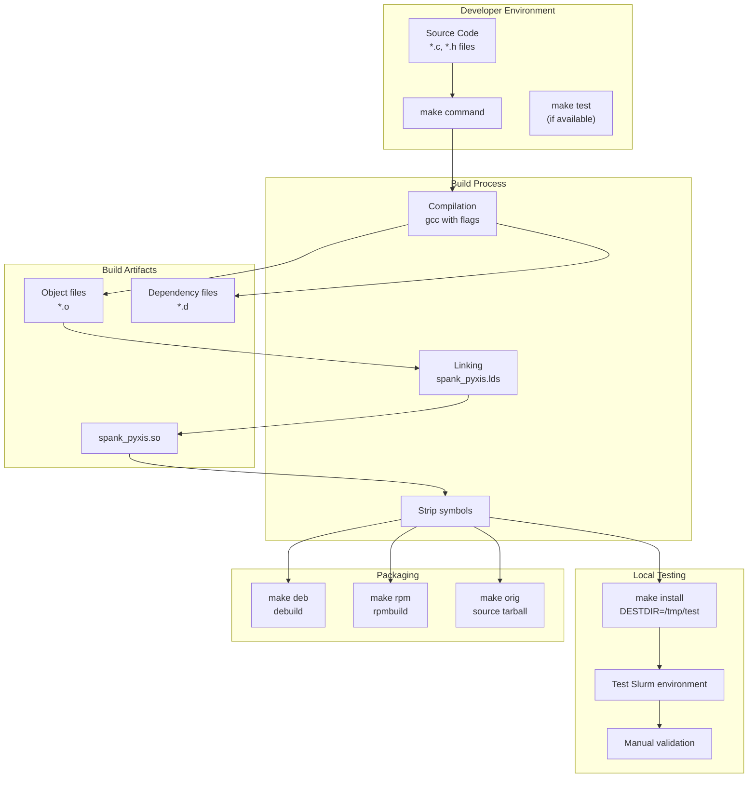
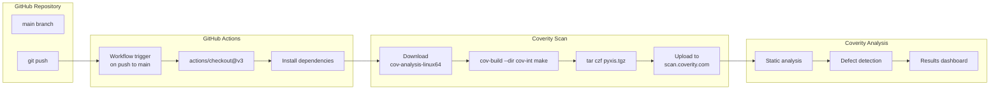
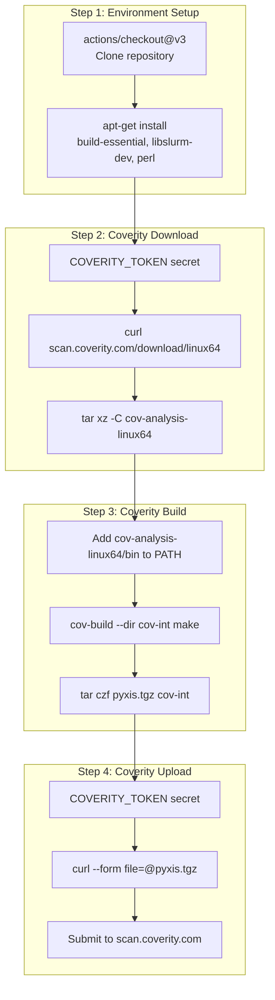
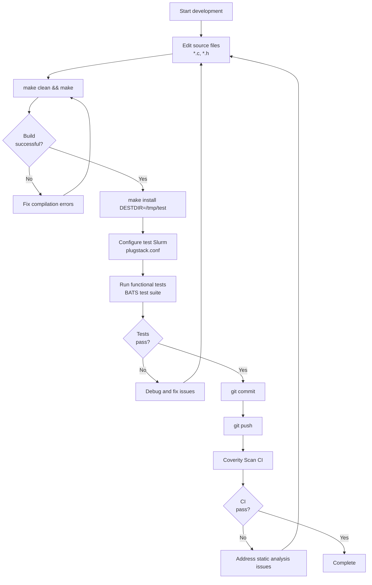

<!-- source: DeepWiki mcp.deepwiki.com · repo NVIDIA/pyxis · page 15 Development & CI · fetched 2026-10-26 -->

# Development & CI

<details>
<summary>Relevant source files</summary>

The following files were used as context for generating this wiki page:

- [.github/workflows/coverity.yml](.github/workflows/coverity.yml)
- [Makefile](Makefile)

</details>


This document describes the development workflow, continuous integration infrastructure, and contribution process for the Pyxis SPANK plugin. It covers setting up a development environment, building the plugin locally, the automated CI/CD pipeline with Coverity Scan, and best practices for contributing code.

For details about the build system itself (compilation flags, dependency management, installation targets), see [Build System](#10). For package creation and distribution, see [Packaging & Distribution](#11).

## Development Environment

### Prerequisites

The Pyxis plugin requires the following development dependencies for building from source:

| Dependency | Purpose | Installation |
|------------|---------|--------------|
| `gcc` | C compiler with C11 support | `apt-get install build-essential` |
| `make` | Build automation | Included in `build-essential` |
| `slurm-devel` / `libslurm-dev` | Slurm SPANK headers | `apt-get install libslurm-dev` (Debian)<br/>`yum install slurm-devel` (RPM) |
| `debuild` (optional) | Debian package building | `apt-get install devscripts` |
| `rpmbuild` (optional) | RPM package building | `yum install rpm-build` |

The compiler must support GNU11 standard as specified in [Makefile:17]().

### Build Configuration

The Makefile supports several configuration variables that can be overridden:

```makefile
prefix      ?= /usr/local
libdir      ?= $(prefix)/lib
datarootdir ?= $(prefix)/share
datadir     ?= $(datarootdir)
```

These control installation paths for the plugin binary and configuration files [Makefile:1-4]().

**Sources:** [Makefile:1-18]()

## Build Targets

### Development Workflow Diagram



**Sources:** [Makefile:14-59]()

### Core Build Targets

The Makefile defines several key targets for development:

| Target | Command | Purpose | Output |
|--------|---------|---------|--------|
| `all` | `make` | Build plugin | `spank_pyxis.so` |
| `install` | `make install` | Install to system | Plugin in `$(PLUGINDIR)`, config in `$(CONFDIR)` |
| `uninstall` | `make uninstall` | Remove from system | Removes installed files |
| `clean` | `make clean` | Remove build artifacts | Cleans `.o`, `.d`, `.so` files |
| `deb` | `make deb` | Build Debian package | `.deb` package |
| `rpm` | `make rpm` | Build RPM package | `.rpm` package |
| `orig` | `make orig` | Create source tarball | `nvslurm-plugin-pyxis_$(PYXIS_VER).orig.tar.xz` |

The `all` target is the default [Makefile:25]().

### Compilation Process

The build system compiles source files with security hardening flags:

```makefile
CPPFLAGS := -D_GNU_SOURCE -D_FORTIFY_SOURCE=2 -DPYXIS_VERSION=\"$(PYXIS_VER)\" $(CPPFLAGS)
CFLAGS := -std=gnu11 -O2 -g -Wall -Wunused-variable -fstack-protector-strong -fpic $(CFLAGS)
LDFLAGS := -Wl,-znoexecstack -Wl,-zrelro -Wl,-znow $(LDFLAGS)
```

[Makefile:16-18]()

Key flags:
- `-D_FORTIFY_SOURCE=2`: Buffer overflow protection
- `-fstack-protector-strong`: Stack canary protection
- `-Wl,-znoexecstack`: Non-executable stack
- `-Wl,-zrelro -Wl,-znow`: Full RELRO for GOT hardening

Source files are compiled to object files with automatic dependency generation [Makefile:27-28]():

```makefile
$(C_OBJS): %.o: %.c
	$(CC) $(CFLAGS) $(CPPFLAGS) -MMD -MF $*.d -c $<
```

The `-MMD -MF` flags generate `.d` dependency files for automatic header dependency tracking [Makefile:23,59]().

**Sources:** [Makefile:16-31]()

### Source Files and Object Files

The build compiles the following source files [Makefile:20]():

```
C_SRCS := common.c args.c pyxis_slurmstepd.c pyxis_slurmd.c pyxis_srun.c pyxis_alloc.c pyxis_dispatch.c config.c enroot.c importer.c
```

These are compiled to corresponding object files and linked using the linker script `spank_pyxis.lds` [Makefile:30-32]():

```makefile
$(PLUGIN): $(C_OBJS)
	$(CC) -shared $(LDFLAGS) -o $@ spank_pyxis.lds $^
	strip --strip-unneeded -R .comment $@
```

The `strip` command removes debugging symbols and comments to reduce binary size.

**Sources:** [Makefile:20-32]()

## Continuous Integration

### CI Architecture



**Sources:** [.github/workflows/coverity.yml:1-44]()

### Coverity Scan Workflow

The project uses Coverity Scan for automated static analysis on every push to the `main` branch. The workflow is defined in [.github/workflows/coverity.yml:1-44]().

#### Workflow Configuration

The CI pipeline is triggered on pushes to the main branch [.github/workflows/coverity.yml:3-5]():

```yaml
on:
  push:
    branches: [ main ]
```

It runs on Ubuntu with read-only content permissions [.github/workflows/coverity.yml:7-12]().

#### Workflow Steps



**Sources:** [.github/workflows/coverity.yml:14-43]()

#### Step 1: Dependencies

The workflow installs required build dependencies [.github/workflows/coverity.yml:17-20]():

```yaml
- name: Dependencies
  run: |
    sudo apt-get update
    sudo apt-get install -y build-essential lsb-release curl ca-certificates libslurm-dev perl
```

This includes:
- `build-essential`: GCC, make, and other build tools
- `libslurm-dev`: Slurm development headers and libraries
- `curl`, `ca-certificates`: For downloading Coverity tools
- `perl`: Required by Coverity analysis tools

#### Step 2: Coverity Download

The Coverity analysis tools are downloaded from the Coverity Scan service [.github/workflows/coverity.yml:22-27]():

```yaml
- name: Coverity download
  env:
    COVERITY_TOKEN: ${{ secrets.COVERITY_TOKEN }}
  run: |
    mkdir -p cov-analysis-linux64
    curl --proto '=https' -fSsL https://scan.coverity.com/download/linux64 --data "token=${COVERITY_TOKEN}&project=NVIDIA%2Fpyxis" | tar xz --strip 1 -C cov-analysis-linux64
```

The `COVERITY_TOKEN` is stored as a GitHub secret for authentication. The downloaded tools are extracted to `cov-analysis-linux64/`.

#### Step 3: Coverity Build

The build is performed using Coverity's instrumentation wrapper [.github/workflows/coverity.yml:29-33]():

```yaml
- name: Coverity build
  run: |
    export PATH="./cov-analysis-linux64/bin:${PATH}"
    cov-build --dir cov-int make
    tar czf pyxis.tgz cov-int
```

The `cov-build` tool:
1. Intercepts compiler invocations during `make`
2. Captures build information in the `cov-int` directory
3. Records compilation units, preprocessor output, and compiler flags

The results are packaged into `pyxis.tgz` for upload.

#### Step 4: Coverity Upload

The build results are submitted to Coverity Scan for analysis [.github/workflows/coverity.yml:35-43]():

```yaml
- name: Coverity upload
  env:
    COVERITY_TOKEN: ${{ secrets.COVERITY_TOKEN }}
  run: |
    curl --form "token=${COVERITY_TOKEN}" \
         --form email=fabecassis@nvidia.com \
         --form file=@pyxis.tgz \
         --form description="Container plugin for Slurm Workload Manager" \
         https://scan.coverity.com/builds?project=NVIDIA%2Fpyxis
```

The upload includes:
- Authentication token
- Contact email for notifications
- Build archive (`pyxis.tgz`)
- Project description

**Sources:** [.github/workflows/coverity.yml:14-43]()

### Static Analysis Coverage

Coverity Scan analyzes the codebase for:

| Analysis Type | Coverage |
|---------------|----------|
| Memory safety | Buffer overflows, null pointer dereferences, use-after-free |
| Resource management | File descriptor leaks, memory leaks |
| Concurrency | Race conditions, deadlocks |
| API usage | Incorrect API usage, error handling |
| Security | Security vulnerabilities, injection attacks |

The analysis runs on every push to `main`, providing continuous feedback on code quality.

**Sources:** [.github/workflows/coverity.yml:1-44]()

## Development Workflow

### Local Development Cycle



**Sources:** [Makefile:14-59](), [.github/workflows/coverity.yml:1-44]()

### Building Locally

To build the plugin during development:

```bash
# Clean previous builds
make clean

# Build plugin
make

# Verify output
ls -lh spank_pyxis.so
```

For testing installation without affecting the system:

```bash
# Install to temporary directory
make install DESTDIR=/tmp/pyxis-test prefix=/usr

# Verify installation
ls -lh /tmp/pyxis-test/usr/lib/slurm/spank_pyxis.so
cat /tmp/pyxis-test/usr/share/pyxis/pyxis.conf
```

The `DESTDIR` variable redirects installation to a test directory [Makefile:34-38]().

### Testing Changes

After building, test the plugin in a Slurm environment:

1. Install the plugin to the Slurm plugin directory
2. Update `/etc/slurm/plugstack.conf` or `/etc/slurm/plugstack.conf.d/pyxis.conf`
3. Restart Slurm daemons (`slurmd`, `slurmstepd`)
4. Run BATS test suite (see [Testing Infrastructure](#12))

### Iterative Development

For rapid iteration:

```bash
# Incremental build (only recompiles changed files)
make

# Full rebuild
make clean && make

# Build and install in one command
make && sudo make install

# Build and create package for testing
make deb  # or make rpm
```

The Makefile's automatic dependency tracking [Makefile:59]() ensures that changes to header files trigger recompilation of dependent source files.

**Sources:** [Makefile:14-59]()

## Contribution Guidelines

### Code Quality Standards

All contributions must adhere to:

1. **Compilation**: Code must compile cleanly with `-Wall -Wunused-variable` [Makefile:17]()
2. **Security**: Follow hardening best practices (stack protection, FORTIFY_SOURCE)
3. **Style**: Follow existing code style and conventions
4. **Testing**: Include or update tests for new features
5. **Static Analysis**: Pass Coverity Scan without introducing new defects

### Pre-commit Checklist

Before committing code:

- [ ] Code compiles without warnings: `make clean && make`
- [ ] Plugin loads correctly in Slurm
- [ ] Functional tests pass (see [Testing Infrastructure](#12))
- [ ] Memory leaks checked (if applicable)
- [ ] Documentation updated (README, comments)
- [ ] Commit message describes the change clearly

### Submitting Changes

1. **Create a branch**: Work on a feature or bugfix branch
2. **Make changes**: Edit source files and test locally
3. **Commit**: Use descriptive commit messages
4. **Push**: Push to your fork or branch
5. **CI validation**: Ensure Coverity Scan passes
6. **Pull request**: Submit PR with description of changes

### CI Failure Handling

If Coverity Scan detects issues:

1. Review the Coverity Scan dashboard for specific defects
2. Address each defect:
   - Fix the issue in code
   - Add justification comment if false positive
   - Suppress with annotation if necessary
3. Push fix and verify CI passes
4. Document any suppressed warnings

**Sources:** [.github/workflows/coverity.yml:1-44](), [Makefile:16-18]()

## Version Management

The Pyxis version is controlled by the `PYXIS_VER` variable [Makefile:9]():

```makefile
PYXIS_VER ?= 0.21.0
```

This version is:
- Compiled into the plugin as `PYXIS_VERSION` macro [Makefile:16]()
- Used in package names for `.deb` and `.rpm` files [Makefile:48,55]()
- Included in source tarballs [Makefile:48]()

To release a new version:

1. Update `PYXIS_VER` in Makefile
2. Update `debian/changelog` with new version and changes
3. Update `pyxis.spec` version field
4. Build packages: `make deb` and `make rpm`
5. Tag the release in git
6. Push changes and tag

**Sources:** [Makefile:9,16,48,55]()

## Build System Architecture Reference

For detailed information about the build system, see:
- [Build System](#10) - Makefile structure, compilation flags, linker scripts
- [Packaging & Distribution](#11) - Debian and RPM package creation

For testing the built plugin, see:
- [Testing Infrastructure](#12) - BATS test framework and test suites

**Sources:** [Makefile:1-59](), [.github/workflows/coverity.yml:1-44]()