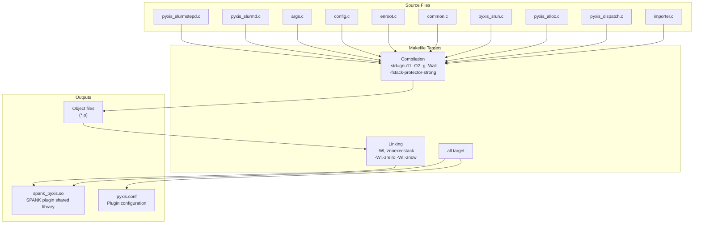
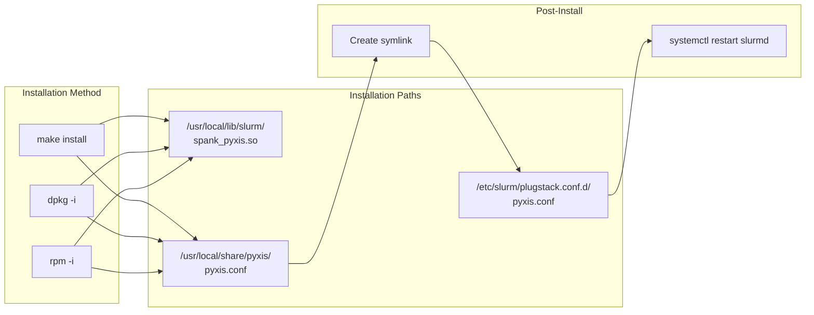
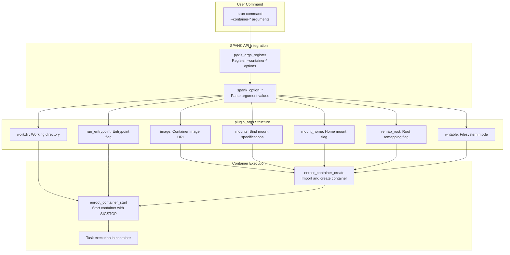

<!-- source: DeepWiki mcp.deepwiki.com · repo NVIDIA/pyxis · page 2 Getting Started · fetched 2026-10-26 -->

# Getting Started

<details>
<summary>Relevant source files</summary>

The following files were used as context for generating this wiki page:

- [Makefile](Makefile)
- [README.md](README.md)
- [pyxis.spec](pyxis.spec)

</details>


This page provides instructions for building, installing, and using Pyxis. It covers compilation from source, package installation via deb or rpm, plugin configuration, and basic usage examples.

For detailed architectural information about how Pyxis integrates with Slurm, see [Architecture](#3). For advanced usage patterns and configuration options, see the wiki pages on [Configuration System](#5) and [Argument Parsing](#6).

## Prerequisites

### Required Components

Pyxis requires the following components to be installed:

| Component | Minimum Version | Purpose |
|-----------|----------------|---------|
| `enroot` or `enroot-hardened` | 3.1.0 | Container runtime that Pyxis wraps |
| `slurm-devel` | Match cluster version | Build-time headers for SPANK API |
| `make` | Any | Build system |
| `gcc` | Any | C compiler |

**Important**: Since Slurm 21.08, Pyxis must be compiled against the exact Slurm release deployed on the cluster. The SPANK plugin API performs version compatibility checks at load time. Compiling against `spank.h` from a different Slurm release will cause the error `Incompatible plugin version`.

Sources: [README.md:19-21](), [pyxis.spec:14]()

### Slurm Version Compatibility

The build system automatically detects the installed Slurm version and encodes it in the package name. For example, compiling against Slurm 23.11 produces packages with `sl2311` in the release string.

Sources: [pyxis.spec:1-7]()

## Building from Source

### Build Process Overview



**Build Process Flow**: The Makefile compiles all C source files to object files with security hardening flags, then links them into a single shared library using a linker script. The plugin is stripped to reduce size.

Sources: [Makefile:20-32]()

### Compilation Steps

The build process uses security-hardened compilation flags defined in the Makefile:

```console
$ make
```

This invokes the default `all` target which:

1. **Compiles C sources** - Each `.c` file is compiled to a `.o` object file with flags:
   - `-std=gnu11` - GNU C11 standard
   - `-O2 -g` - Optimization level 2 with debug symbols
   - `-Wall -Wunused-variable` - Enable warnings
   - `-fstack-protector-strong` - Stack protection
   - `-fpic` - Position independent code (required for shared libraries)
   - `-D_FORTIFY_SOURCE=2` - Runtime buffer overflow detection
   - `-DPYXIS_VERSION="x.y.z"` - Embedded version string

2. **Links shared library** - Object files are linked using `spank_pyxis.lds` linker script with hardening:
   - `-Wl,-znoexecstack` - Non-executable stack
   - `-Wl,-zrelro` - Read-only relocations
   - `-Wl,-znow` - Immediate binding

3. **Strips symbols** - Debug symbols are removed from the final binary to reduce size

Sources: [Makefile:16-32]()

### Build Targets

| Target | Command | Output | Purpose |
|--------|---------|--------|---------|
| `all` | `make` | `spank_pyxis.so` | Build the plugin (default) |
| `install` | `make install` | Installed files | Build and install to `prefix` |
| `clean` | `make clean` | - | Remove build artifacts |
| `orig` | `make orig` | `.tar.xz` archive | Create Debian source tarball |
| `deb` | `make deb` | `.deb` package | Build Debian package |
| `rpm` | `make rpm` | `.rpm` package | Build RPM package |

Sources: [Makefile:14-58]()

### Version Configuration

The plugin version is controlled by the `PYXIS_VER` variable:

```console
$ make PYXIS_VER=0.21.0
```

The version is embedded in the binary via the `-DPYXIS_VERSION` preprocessor define and affects package naming.

Sources: [Makefile:9-16]()

## Installation Methods



**Installation Flow**: All installation methods place the plugin in the Slurm plugin directory and the configuration template in a shared data directory. A symlink enables Slurm to discover the plugin via `plugstack.conf.d`.

Sources: [Makefile:34-42](), [README.md:23-45]()

### Via make install

Direct installation using the Makefile:

```console
$ sudo make install
```

This installs to the following default locations (configurable via `prefix`, `libdir`, `datadir`):

| Variable | Default | Installed Path |
|----------|---------|----------------|
| `prefix` | `/usr/local` | Base installation directory |
| `libdir` | `$(prefix)/lib` | `/usr/local/lib/slurm/spank_pyxis.so` |
| `datadir` | `$(prefix)/share` | `/usr/local/share/pyxis/pyxis.conf` |

The installed `pyxis.conf` file contains a single line referencing the plugin:

```
required /usr/local/lib/slurm/spank_pyxis.so
```

To customize installation paths:

```console
$ sudo make install prefix=/opt/pyxis
```

Sources: [Makefile:1-38]()

### Via Debian Package

Build and install a `.deb` package:

```console
$ make orig      # Create source tarball
$ make deb       # Build package using debuild
$ sudo dpkg -i ../nvslurm-plugin-pyxis_*_amd64.deb
```

The `orig` target creates a source tarball named `nvslurm-plugin-pyxis_$(PYXIS_VER).orig.tar.xz` in the parent directory. The `deb` target uses `debuild -us -uc -G -i -tc` to build an unsigned package.

Default Debian installation paths:
- Plugin: `/usr/lib/slurm/spank_pyxis.so`
- Config: `/usr/share/pyxis/pyxis.conf`

Sources: [Makefile:47-51](), [README.md:30-37]()

### Via RPM Package

Build and install an `.rpm` package:

```console
$ make rpm       # Build package using rpmbuild
$ sudo rpm -i rpm/RPMS/x86_64/nvslurm-plugin-pyxis-*.x86_64.rpm
```

The RPM build process:

1. Creates a source tarball in `rpm/SOURCES/`
2. Runs `rpmbuild` with the spec file [pyxis.spec]()
3. Generates package named `nvslurm-plugin-pyxis-$(PYXIS_VER)-1.sl####.rpm` where `sl####` encodes the Slurm version

The RPM package automatically declares runtime dependencies:
- `enroot >= 3.1.0` or `enroot-hardened >= 3.1.0`
- Dynamic dependency on `libslurm.so` (Slurm libraries)

Default RPM installation paths:
- Plugin: `/usr/lib64/slurm/spank_pyxis.so` (on 64-bit systems)
- Config: `/usr/share/pyxis/pyxis.conf`

Sources: [Makefile:53-57](), [pyxis.spec:1-54](), [README.md:39-45]()

## Plugin Configuration

### Enabling the Plugin in Slurm

After installation, create a symlink to enable the plugin:

```console
$ sudo ln -s /usr/local/share/pyxis/pyxis.conf /etc/slurm/plugstack.conf.d/pyxis.conf
```

Or for package installations:

```console
$ sudo ln -s /usr/share/pyxis/pyxis.conf /etc/slurm/plugstack.conf.d/pyxis.conf
```

The `plugstack.conf.d` directory is a standard Slurm mechanism for plugin discovery. Each file in this directory is concatenated to form the effective `plugstack.conf`.

Sources: [README.md:26-27](), [README.md:35-36](), [README.md:43-44]()

### Restarting Slurm

After configuring the plugin, restart the Slurm daemon:

```console
$ sudo systemctl restart slurmd
```

This causes `slurmd` to reload the SPANK plugin configuration and load Pyxis. The plugin will be available in all subsequently launched `slurmstepd` processes.

**Note**: Only `slurmd` needs to be restarted. The plugin is loaded by `slurmstepd` (spawned by `slurmd`) and does not require restarting `slurmctld` or `slurmdbd`.

Sources: [README.md:27](), [README.md:36](), [README.md:44]()

## Basic Usage

### Command-Line Interface



**Argument Processing Flow**: SPANK options registered by `pyxis_args_register` are parsed when the user invokes `srun`. Values populate the `plugin_args` structure which drives container creation and execution through the enroot wrapper functions.

Sources: [README.md:48-106]()

### Simple Container Execution

Run a command inside a container:

```console
$ srun --container-image=centos grep PRETTY /etc/os-release
pyxis: importing docker image: centos
PRETTY_NAME="CentOS Linux 8"
```

This command:
1. Imports the `centos` image from Docker Hub (default registry)
2. Creates a container with the imported image
3. Executes `grep PRETTY /etc/os-release` inside the container

The prefix `pyxis:` indicates messages from the plugin during container import.

Sources: [README.md:117-118]()

### Comparing Host vs Container Environment

Without container (runs on host):

```console
$ srun grep PRETTY /etc/os-release
PRETTY_NAME="Ubuntu 20.04.2 LTS"
```

With container (runs in CentOS container):

```console
$ srun --container-image=centos grep PRETTY /etc/os-release
PRETTY_NAME="CentOS Linux 8"
```

This demonstrates that the task filesystem is isolated to the container.

Sources: [README.md:112-118]()

### Bind Mounting Host Files

Mount host files into the container using `--container-mounts`:

```console
$ srun --container-image=centos \
       --container-mounts=/etc/os-release:/host/os-release \
       grep PRETTY /host/os-release
PRETTY_NAME="Ubuntu 20.04.2 LTS"
```

The syntax is `SRC:DST[:FLAGS]` where:
- `SRC` - Source path on the host
- `DST` - Destination path in the container
- `FLAGS` - Optional mount flags (e.g., `ro+rprivate`)

Multiple mounts are comma-separated: `SRC1:DST1,SRC2:DST2`

Sources: [README.md:120-122](), [README.md:59-61]()

### Using Registry-Specific Images

Specify full image URIs with registry prefixes:

```console
$ srun --container-image=nvcr.io#nvidia/pytorch:21.12-py3 python -c 'import torch'
pyxis: importing docker image: nvcr.io#nvidia/pytorch:21.12-py3
```

The `#` character separates the registry from the image name in enroot URI format. Supported registries include:
- Docker Hub (default): `ubuntu:20.04`
- NVIDIA GPU Cloud: `nvcr.io#nvidia/pytorch:21.12-py3`
- Google Container Registry: `gcr.io#project/image:tag`
- GitLab Container Registry: `registry.gitlab.com#group/project:tag`

Sources: [README.md:128-137](), [README.md:53-57]()

### Batch Job Usage

Pyxis works with `sbatch` by specifying container options in the script header:

```bash
#!/bin/bash
#SBATCH --container-image nvcr.io\#nvidia/pytorch:21.12-py3

python -c 'import torch ; print(torch.__version__)'
```

**Important**: The `#` character must be escaped as `\#` in sbatch scripts because `#` starts a comment.

Submit the batch job:

```console
$ sbatch --wait -o slurm.out job.sh
$ cat slurm.out
pyxis: importing docker image: nvcr.io#nvidia/pytorch:21.12-py3
1.11.0a0+b6df043
```

Sources: [README.md:125-139]()

## Verification

### Checking Plugin Load Status

Verify the plugin loaded successfully by examining `slurmd` logs:

```console
$ sudo journalctl -u slurmd -n 50 | grep pyxis
slurmd: spank: pyxis: version 0.21.0
```

A successful load message indicates the plugin initialized correctly.

### Testing Container Execution

Run a simple test to verify container functionality:

```console
$ srun --container-image=alpine cat /etc/os-release
pyxis: importing docker image: alpine
NAME="Alpine Linux"
ID=alpine
VERSION_ID=3.18.0
PRETTY_NAME="Alpine Linux v3.18"
```

If this succeeds, Pyxis is properly integrated with Slurm and Enroot.

### Common Issues

| Issue | Cause | Solution |
|-------|-------|----------|
| `Incompatible plugin version` | Slurm version mismatch | Recompile against cluster Slurm version |
| `enroot: not found` | Enroot not installed | Install enroot >= 3.1.0 |
| `pyxis: error` during import | Network/registry issue | Check network connectivity and credentials |
| No `--container-*` options | Plugin not loaded | Verify symlink and restart `slurmd` |

Sources: [README.md:21-22]()

## Next Steps

After successful installation and verification:

- See [Configuration System](#5) for advanced plugin configuration options
- See [Argument Parsing](#6) for detailed information on all `--container-*` arguments
- See [Image Import Strategies](#8) for optimizing image import performance
- See [Container Lifecycle Manager](#4) for understanding container execution internals

Sources: [README.md:141-145]()

---

