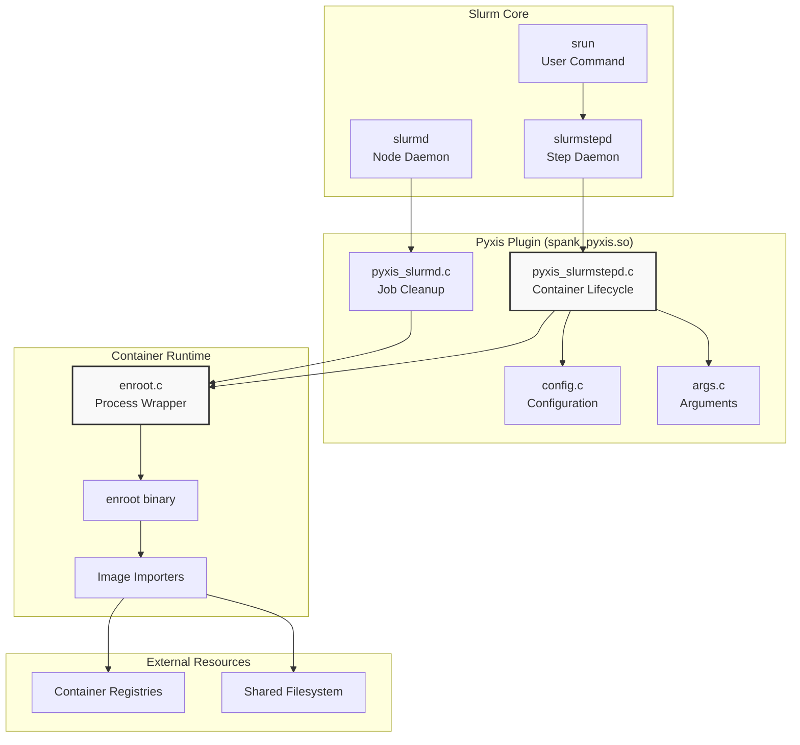
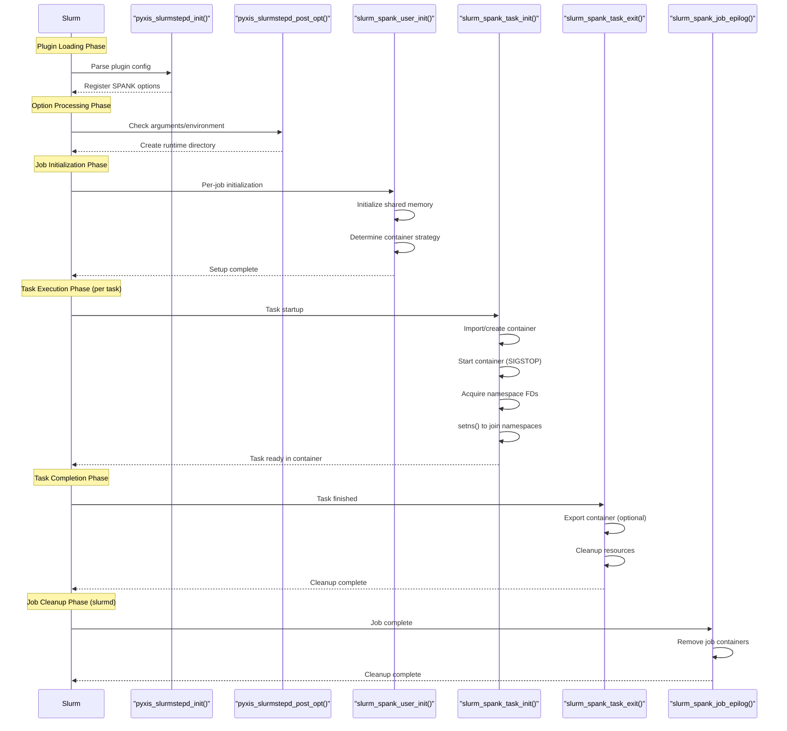
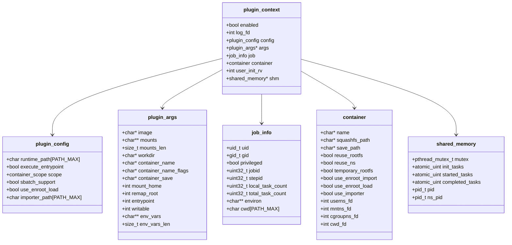
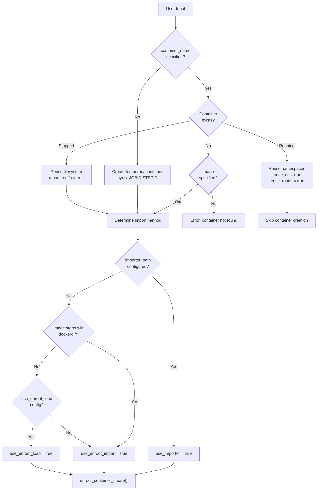
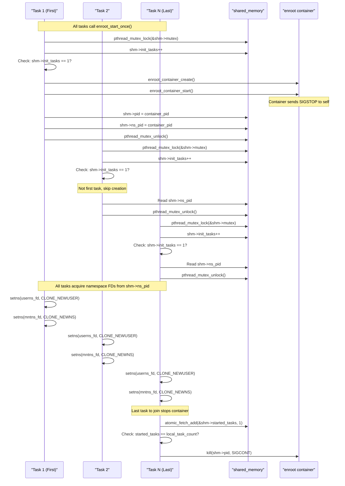
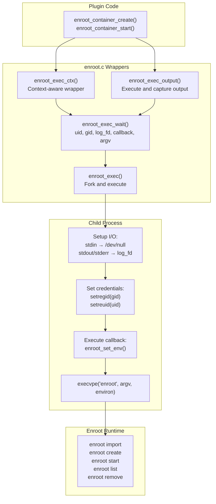
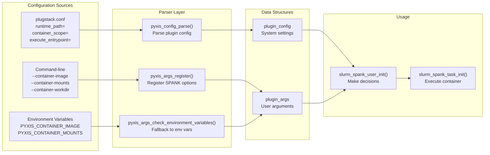
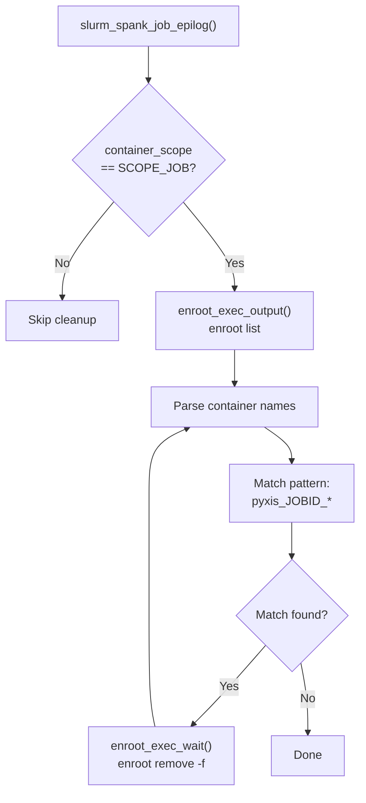

<!-- source: DeepWiki mcp.deepwiki.com · repo NVIDIA/pyxis · page 3 Architecture · fetched 2026-10-26 -->

# Architecture

<details>
<summary>Relevant source files</summary>

The following files were used as context for generating this wiki page:

- [args.c](args.c)
- [config.c](config.c)
- [enroot.c](enroot.c)
- [pyxis_slurmd.c](pyxis_slurmd.c)
- [pyxis_slurmstepd.c](pyxis_slurmstepd.c)

</details>


This document provides a high-level architectural overview of Pyxis, describing how the major components interact with Slurm and with each other to provide container execution capabilities. For details on specific components, see [Component Overview](#3.2) and [SPANK Plugin Integration](#3.1).

## System Overview

Pyxis is implemented as a Slurm SPANK (Simple Plugin Architecture for Node job control) plugin that intercepts job execution to provide containerized environments. The plugin consists of two main execution contexts:

1. **slurmstepd context** - Runs within the `slurmstepd` daemon process on compute nodes, managing container lifecycle for job tasks
2. **slurmd context** - Runs within the `slurmd` daemon for post-job cleanup operations

The plugin delegates actual container operations to the Enroot container runtime, acting as a bridge between Slurm's job management and Enroot's container capabilities.



**Sources:** [pyxis_slurmstepd.c:1-50](), [pyxis_slurmd.c:1-20](), [enroot.c:1-17]()

## Architectural Layers

Pyxis is organized into distinct functional layers that separate concerns and enable maintainability:

| Layer | Components | Responsibilities |
|-------|------------|------------------|
| **Integration Layer** | [pyxis_slurmstepd.c](), [pyxis_slurmd.c]() | SPANK hook implementations, lifecycle orchestration, Slurm API interactions |
| **Configuration Layer** | [config.c](), [args.c]() | Plugin configuration parsing, command-line argument processing, environment variable handling |
| **Container Abstraction Layer** | [enroot.c]() | Process management for enroot commands, I/O redirection, UID/GID handling |
| **Utility Layer** | [common.c](), [common.h]() | Shared utility functions, memory management, string operations, file I/O |
| **External Integration** | [importer.c](), [caching_importer.sh](), [simple_importer.sh]() | Container image import strategies, registry interactions |

This layered architecture allows the plugin to adapt to changes in either Slurm or Enroot with minimal impact on other components.

**Sources:** [pyxis_slurmstepd.c:27-35](), [config.c:1-99](), [args.c:1-42](), [enroot.c:1-177]()

## Plugin Lifecycle and Hook Points

The plugin implements several SPANK hooks that Slurm invokes at specific points in the job lifecycle. The following diagram shows the hook execution order and the primary responsibilities of each:



**Sources:** [pyxis_slurmstepd.c:116-133](), [pyxis_slurmstepd.c:265-286](), [pyxis_slurmstepd.c:1036-1184](), [pyxis_slurmstepd.c:1308-1407](), [pyxis_slurmstepd.c:1409-1508](), [pyxis_slurmd.c:127-176]()

## Core Data Structures

The plugin maintains state through several key data structures that coordinate between different lifecycle phases:



### Structure Responsibilities

| Structure | Defined In | Purpose |
|-----------|-----------|---------|
| `plugin_context` | [pyxis_slurmstepd.c:74-83]() | Global state container for the entire plugin; single static instance shared across all hooks |
| `plugin_config` | [config.h]() | System-level configuration parsed from plugstack.conf; initialized once at plugin load |
| `plugin_args` | [args.h](), [args.c:13-28]() | User-provided arguments from command-line or environment variables; registered as SPANK options |
| `job_info` | [pyxis_slurmstepd.c:53-63]() | Job metadata retrieved from Slurm via SPANK API; includes UID, GID, job IDs, and environment |
| `container` | [pyxis_slurmstepd.c:37-51]() | Container-specific state including name, paths, flags, and namespace file descriptors |
| `shared_memory` | [pyxis_slurmstepd.c:65-72]() | Shared state between multiple tasks in the same job; coordinates single container creation |

**Sources:** [pyxis_slurmstepd.c:37-83](), [pyxis_slurmstepd.c:90-109](), [config.h](), [args.h](), [args.c:13-28]()

## Component Interaction Patterns

### Container Creation Strategy

The plugin determines the appropriate container creation strategy based on user input and configuration. This decision tree is implemented in `slurm_spank_user_init()`:



**Sources:** [pyxis_slurmstepd.c:1128-1155]()

### Multi-Task Synchronization

When a job has multiple tasks on a single node, only one task should create and start the container, while all tasks join the same container namespaces. This is coordinated through shared memory:



**Sources:** [pyxis_slurmstepd.c:1249-1285](), [pyxis_slurmstepd.c:1287-1306](), [pyxis_slurmstepd.c:972-1012](), [pyxis_slurmstepd.c:1324-1407]()

## Enroot Integration Architecture

The plugin communicates with Enroot through process execution wrappers. The `enroot.c` module provides a clean abstraction for invoking enroot commands with appropriate credentials and I/O handling:



### Key Wrapper Functions

| Function | Purpose | Usage Pattern |
|----------|---------|---------------|
| `enroot_exec_ctx()` | Fork and execute enroot command using plugin context | Called from [pyxis_slurmstepd.c:436-439]() with context UID/GID |
| `enroot_exec_wait_ctx()` | Execute and wait for completion | Used for `enroot import`, `enroot create`, `enroot start` |
| `enroot_exec_output_ctx()` | Execute and capture stdout | Used for `enroot list` to query container state |
| `enroot_set_env()` | Callback to prepare environment before exec | Clears unwanted variables, sets ENROOT_* configuration |

**Sources:** [enroot.c:18-176](), [pyxis_slurmstepd.c:436-455](), [pyxis_slurmstepd.c:389-434]()

## Configuration Flow

Configuration data flows from multiple sources and is resolved with specific precedence rules:



**Precedence Rules:**
1. Command-line arguments override environment variables (enforced in [args.c:166-237]())
2. User-provided settings (`plugin_args`) override system defaults (`plugin_config`)
3. For tri-state options (`mount_home`, `remap_root`, `entrypoint`, `writable`), value `-1` means "use enroot default"

**Sources:** [config.c:23-98](), [args.c:42-151](), [args.c:166-237](), [args.c:615-628](), [pyxis_slurmstepd.c:116-133](), [pyxis_slurmstepd.c:265-286]()

## Namespace Acquisition Pattern

The plugin joins container namespaces using a synchronized startup mechanism. This is one of the most critical architectural patterns in the system:

```mermaid
sequenceDiagram
    participant Plugin as "slurm_spank_task_init()"
    participant Container as "Container Process"
    participant Kernel as "/proc/{pid}/ns/*"
    
    Note over Plugin,Container: Container started with special command
    Plugin->>Container: enroot start ... "sh -c 'kill -STOP $$; exit 0'"
    Container->>Container: Shell starts in namespaces
    Container->>Container: Sends SIGSTOP to self
    Note over Container: Process stopped but still alive
    
    Plugin->>Plugin: waitpid(pid, &status, WUNTRACED)
    Note over Plugin: Wait returns when child stops
    
    Plugin->>Plugin: Check WIFSTOPPED(status)
    
    Plugin->>Kernel: open("/proc/{pid}/ns/user", O_RDONLY)
    Kernel-->>Plugin: userns_fd
    
    Plugin->>Kernel: open("/proc/{pid}/ns/mnt", O_RDONLY)
    Kernel-->>Plugin: mntns_fd
    
    Plugin->>Kernel: open("/proc/{pid}/ns/cgroup", O_RDONLY)
    Kernel-->>Plugin: cgroupns_fd
    
    Plugin->>Kernel: open("/proc/{pid}/cwd", O_RDONLY)
    Kernel-->>Plugin: cwd_fd
    
    Note over Plugin: All namespace FDs acquired
    
    Plugin->>Plugin: Store FDs in container structure
    
    Note over Plugin: Join the namespaces
    Plugin->>Kernel: setns(userns_fd, CLONE_NEWUSER)
    Plugin->>Kernel: setns(cgroupns_fd, CLONE_NEWCGROUP)
    Plugin->>Kernel: setns(mntns_fd, CLONE_NEWNS)
    Plugin->>Kernel: fchdir(cwd_fd)
    
    Note over Plugin: Last task sends SIGCONT
    Plugin->>Container: kill(pid, SIGCONT)
    Container->>Container: Resume and exit
```

This pattern allows the plugin to:
1. Ensure the container has completed `unshare()` and `pivot_root()` 
2. Acquire file descriptors to all required namespaces while they're stable
3. Join those namespaces from the plugin's process context (which becomes the task process)
4. Resume the container process to allow it to exit cleanly

**Sources:** [pyxis_slurmstepd.c:893-954](), [pyxis_slurmstepd.c:740-799](), [pyxis_slurmstepd.c:1332-1391](), [pyxis_slurmstepd.c:956-970]()

## Job Cleanup Architecture

After job completion, the `slurm_spank_job_epilog()` hook in the slurmd context removes any temporary containers. The cleanup behavior depends on the `container_scope` configuration:

| Scope | Container Name Pattern | Cleanup Behavior |
|-------|------------------------|------------------|
| `SCOPE_GLOBAL` | `pyxis_JOBID.STEPID` | Per-step containers removed after step completion |
| `SCOPE_JOB` | `pyxis_JOBID_...` | All job containers removed in epilog |

The cleanup process identifies containers by parsing output from `enroot list` and matching the name pattern:



**Sources:** [pyxis_slurmd.c:127-176](), [pyxis_slurmd.c:52-93](), [config.h]()

---

