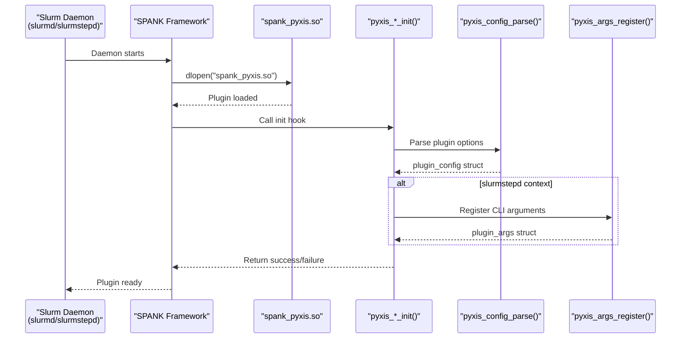
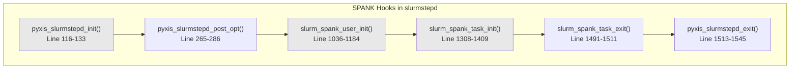
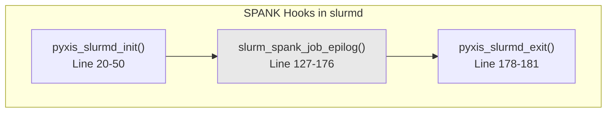
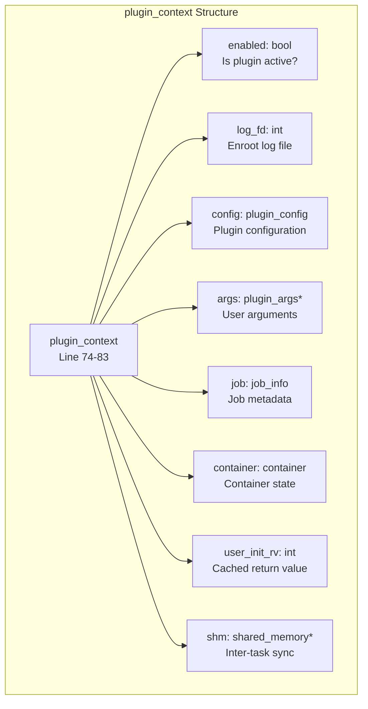
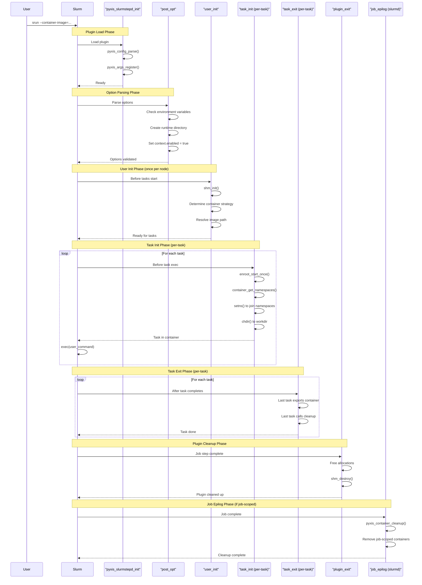
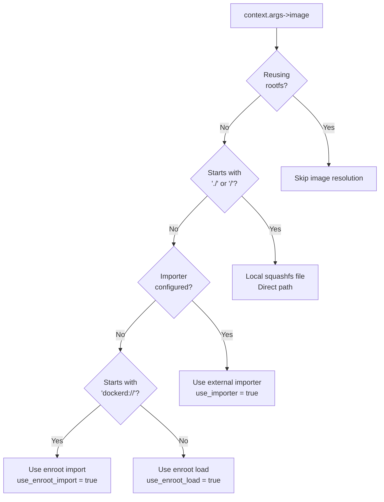

<!-- source: DeepWiki mcp.deepwiki.com · repo NVIDIA/pyxis · page 3.1 SPANK Plugin Integration · fetched 2026-10-26 -->

# SPANK Plugin Integration

<details>
<summary>Relevant source files</summary>

The following files were used as context for generating this wiki page:

- [README.md](README.md)
- [pyxis_slurmd.c](pyxis_slurmd.c)
- [pyxis_slurmstepd.c](pyxis_slurmstepd.c)

</details>


## Purpose and Scope

This document describes how Pyxis integrates with Slurm's SPANK (Slurm Plug-in Architecture for Node jobs) framework. It covers the plugin registration process, SPANK hook functions, lifecycle phases, and the interaction between Slurm daemons and the Pyxis plugin. 

For details on the major components and their interactions, see [Component Overview](#3.2). For the core container lifecycle orchestration, see [Container Lifecycle Manager](#4).

---

## SPANK Framework Overview

SPANK is Slurm's plugin architecture that allows external code to be invoked at specific points during job execution. Pyxis leverages SPANK to inject containerization functionality into the standard Slurm job workflow without modifying Slurm itself.

### Plugin Components

Pyxis consists of two main SPANK plugin components that are loaded by different Slurm daemons:

| Component | Daemon | Purpose | Primary File |
|-----------|--------|---------|--------------|
| Slurmstepd Plugin | `slurmstepd` | Handles container lifecycle during job execution | `pyxis_slurmstepd.c` |
| Slurmd Plugin | `slurmd` | Performs post-job cleanup of containers | `pyxis_slurmd.c` |

Both components are compiled into a single shared library (`spank_pyxis.so`) that is loaded by Slurm based on configuration in `/etc/slurm/plugstack.conf` or `/etc/slurm/plugstack.conf.d/`.

**Sources:** [pyxis_slurmstepd.c:1-1546](), [pyxis_slurmd.c:1-182](), [README.md:3-4]()

---

## Plugin Registration and Loading

### Plugstack Configuration

Pyxis is registered with Slurm through the plugstack configuration mechanism. The plugin is typically loaded via a configuration file that symlinks to the installed plugin configuration:

```
/etc/slurm/plugstack.conf.d/pyxis.conf → /usr/share/pyxis/pyxis.conf
```

The plugin configuration file specifies:
- Plugin path: Location of `spank_pyxis.so`
- Plugin options: Runtime configuration parameters (see [Configuration System](#5))

### Plugin Loading Flow



**Sources:** [README.md:23-45](), [pyxis_slurmstepd.c:116-133](), [pyxis_slurmd.c:20-50]()

---

## SPANK Hook Functions

Pyxis implements several SPANK hook functions that are invoked at specific points in the job lifecycle. Each hook serves a distinct purpose in the containerization workflow.

### Slurmstepd Hooks

These hooks run in the `slurmstepd` daemon context, which manages the execution of job steps.



| Hook Function | Invocation Context | Primary Responsibilities |
|---------------|-------------------|--------------------------|
| `pyxis_slurmstepd_init()` | Plugin load time | Parse configuration, register arguments |
| `pyxis_slurmstepd_post_opt()` | After CLI parsing | Check environment variables, create runtime directories |
| `slurm_spank_user_init()` | Before tasks start, once per node | Initialize shared memory, determine container strategy |
| `slurm_spank_task_init()` | Before each task executes | Create/start container, join namespaces |
| `slurm_spank_task_exit()` | After each task completes | Export container (if configured), cleanup |
| `pyxis_slurmstepd_exit()` | Plugin unload time | Free resources, destroy shared memory |

**Sources:** [pyxis_slurmstepd.c:116-133](), [pyxis_slurmstepd.c:265-286](), [pyxis_slurmstepd.c:1036-1184](), [pyxis_slurmstepd.c:1308-1409](), [pyxis_slurmstepd.c:1491-1511](), [pyxis_slurmstepd.c:1513-1545]()

### Slurmd Hooks

These hooks run in the `slurmd` daemon context, which manages the compute node.



| Hook Function | Invocation Context | Primary Responsibilities |
|---------------|-------------------|--------------------------|
| `pyxis_slurmd_init()` | Slurmd startup | Create runtime directory |
| `slurm_spank_job_epilog()` | After job completes | Remove job-scoped containers |
| `pyxis_slurmd_exit()` | Slurmd shutdown | Cleanup (currently no-op) |

**Sources:** [pyxis_slurmd.c:20-50](), [pyxis_slurmd.c:127-176](), [pyxis_slurmd.c:178-181]()

---

## Plugin Context Management

### Context Structure

The plugin maintains state through a global `plugin_context` structure that persists across hook invocations within the same process.



The context is initialized as a static global variable [pyxis_slurmstepd.c:90-109]() and populated progressively through the hook lifecycle.

### Key Substructures

#### job_info Structure

Stores job metadata obtained from SPANK API [pyxis_slurmstepd.c:53-63]():

- `uid` / `gid`: User and group identifiers
- `privileged`: Whether superuser mode is enabled
- `jobid` / `stepid`: Job and step identifiers
- `local_task_count` / `total_task_count`: Task counts for synchronization
- `environ`: Job environment variables
- `cwd`: Current working directory

#### container Structure

Tracks container state [pyxis_slurmstepd.c:37-51]():

- `name`: Container name (e.g., `pyxis_12345_12345.0`)
- `squashfs_path`: Path to container image file
- `save_path`: Export destination (if specified)
- `reuse_rootfs` / `reuse_ns`: Flags for container reuse
- `temporary_rootfs`: Whether to delete container on exit
- `use_enroot_import` / `use_enroot_load` / `use_importer`: Import strategy flags
- `userns_fd` / `mntns_fd` / `cgroupns_fd` / `cwd_fd`: Namespace file descriptors

#### shared_memory Structure

Provides inter-task synchronization [pyxis_slurmstepd.c:65-72]():

- `mutex`: Process-shared mutex for thread-safe access
- `init_tasks` / `started_tasks` / `completed_tasks`: Atomic counters
- `pid`: Container process PID
- `ns_pid`: Namespace owner process PID

**Sources:** [pyxis_slurmstepd.c:37-109]()

---

## Hook Lifecycle Flow

### Complete Execution Sequence



**Sources:** [pyxis_slurmstepd.c:116-1545](), [pyxis_slurmd.c:127-176]()

---

## Initialization Phase Details

### Plugin Initialization

The `pyxis_slurmstepd_init()` function [pyxis_slurmstepd.c:116-133]() is called when the plugin is first loaded. It performs two critical tasks:

1. **Configuration Parsing**: Calls `pyxis_config_parse()` to parse plugin options from the plugstack configuration file
2. **Argument Registration**: Calls `pyxis_args_register()` to register container-related CLI options with SPANK

```c
// Simplified flow from pyxis_slurmstepd_init
ret = pyxis_config_parse(&context.config, ac, av);
context.args = pyxis_args_register(sp);
```

### Post-Option Processing

The `pyxis_slurmstepd_post_opt()` function [pyxis_slurmstepd.c:265-286]() runs after Slurm has parsed all command-line options:

1. **Environment Variable Fallback**: Checks for `PYXIS_CONTAINER_*` environment variables as defaults
2. **Plugin Enablement Check**: Determines if containerization is requested via `pyxis_args_enabled()`
3. **Job Info Retrieval**: Fetches job metadata through `job_get_info()`
4. **Runtime Directory Creation**: Creates per-user runtime directory via `enroot_create_user_runtime_dir()`

**Sources:** [pyxis_slurmstepd.c:116-133](), [pyxis_slurmstepd.c:265-286](), [pyxis_slurmstepd.c:135-194](), [pyxis_slurmstepd.c:238-263]()

---

## User Initialization Phase

### Shared Memory Setup

The `slurm_spank_user_init()` function [pyxis_slurmstepd.c:1036-1184]() runs once per node before any tasks start. A critical operation is establishing shared memory for inter-task coordination:

```c
// Shared memory initialization
context.shm = shm_init();  // Line 1049
```

The shared memory is created with [pyxis_slurmstepd.c:972-1012]():
- Process-shared mutex with `PTHREAD_PROCESS_SHARED` attribute
- Robust mutex handling with `PTHREAD_MUTEX_ROBUST` for crash recovery
- Atomic counters for task synchronization

### Container Strategy Determination

The function determines whether to create a new container or reuse an existing one:

| Scenario | Condition | Action |
|----------|-----------|--------|
| Reuse namespaces | Existing container running (`pid > 0`) | Set `reuse_ns = true`, use existing namespaces |
| Reuse rootfs | Container exists but not running (`pid == 0`) | Set `reuse_rootfs = true`, start in existing filesystem |
| Create new | No existing container (`pid < 0`) | Import image and create new container |

This logic is implemented in [pyxis_slurmstepd.c:1078-1126]().

### Image Resolution

Based on the `--container-image` argument, the function determines how to obtain the container image:



This logic is implemented in [pyxis_slurmstepd.c:1128-1155]().

### Error Handling Workaround

Due to a Slurm limitation (see bug #7573), errors from `user_init()` are not properly propagated to `srun`. Pyxis works around this by:

1. Caching the return value in `context.user_init_rv` [pyxis_slurmstepd.c:1180]()
2. Always returning success from `user_init()` [pyxis_slurmstepd.c:1183]()
3. Checking the cached value in `task_init()` [pyxis_slurmstepd.c:1316-1317]()

**Sources:** [pyxis_slurmstepd.c:1036-1184](), [pyxis_slurmstepd.c:972-1012](), [pyxis_slurmstepd.c:1078-1155]()

---

## Task Initialization Phase

### Per-Task Execution

The `slurm_spank_task_init()` function [pyxis_slurmstepd.c:1308-1409]() runs for each task in the job. This is where the task joins the container namespaces.

### Container Creation Synchronization

Multiple tasks coordinate container creation through shared memory with `enroot_start_once()` [pyxis_slurmstepd.c:1249-1285]():

```c
// Synchronization logic (simplified)
pthread_mutex_lock(&shm->mutex);
shm->init_tasks += 1;

if (shm->init_tasks == 1) {
    // First task creates/starts container
    if (!container->reuse_rootfs)
        enroot_container_create();
    shm->pid = enroot_container_start();
    
    if (!container->reuse_ns)
        shm->ns_pid = shm->pid;
}
pthread_mutex_unlock(&shm->mutex);
```

Only the first task performs the expensive container creation and start operations. Other tasks wait for the mutex to be released and then use the PIDs stored in shared memory.

### Namespace Joining

After the container is started, each task:

1. **Acquires namespace file descriptors** via `container_get_namespaces()` [pyxis_slurmstepd.c:740-781]()
   - User namespace: `/proc/<pid>/ns/user`
   - Mount namespace: `/proc/<pid>/ns/mnt`
   - Cgroup namespace: `/proc/<pid>/ns/cgroup` (if available)

2. **Imports container environment** via `spank_import_container_env()` [pyxis_slurmstepd.c:590-641]()

3. **Joins namespaces** using `setns()` system calls [pyxis_slurmstepd.c:1357-1376]()
   - User namespace (unless privileged)
   - Cgroup namespace (if available)
   - Mount namespace

4. **Changes directory** to container working directory [pyxis_slurmstepd.c:1379-1391]()

5. **Sets seccomp filter** for unprivileged users [pyxis_slurmstepd.c:1393-1399]()

### Container Stop Synchronization

After all tasks have joined the container, the last task to start stops the helper container process with `enroot_stop_once()` [pyxis_slurmstepd.c:1287-1306]():

```c
// Last task stops container helper
if (atomic_fetch_add(&shm->started_tasks, 1) == context.job.local_task_count - 1) {
    enroot_container_stop(shm->pid);  // Send SIGCONT
}
```

**Sources:** [pyxis_slurmstepd.c:1308-1409](), [pyxis_slurmstepd.c:1249-1306](), [pyxis_slurmstepd.c:740-781](), [pyxis_slurmstepd.c:590-641]()

---

## Task Exit and Cleanup

### Task Exit Hook

The `slurm_spank_task_exit()` function [pyxis_slurmstepd.c:1491-1511]() runs after each task completes. The last task to exit performs cleanup operations:

1. **Container Export** (if configured) via `enroot_export()` [pyxis_slurmstepd.c:1440-1458]()
   - Exports container filesystem to a squashfs file
   - Only runs if `--container-save` was specified

2. **Container Cleanup** via `enroot_cleanup()` [pyxis_slurmstepd.c:1460-1489]()
   - Removes temporary squashfs files
   - Releases importer resources
   - Removes temporary containers

The synchronization uses atomic counters:

```c
// Last task to exit performs cleanup
if (atomic_fetch_add(&shm->completed_tasks, 1) == context.job.local_task_count - 1) {
    enroot_export();
    enroot_cleanup();
}
```

### Plugin Exit Hook

The `pyxis_slurmstepd_exit()` function [pyxis_slurmstepd.c:1513-1545]() runs once when the job step completes:

1. Frees all allocated memory
2. Closes file descriptors
3. Destroys shared memory via `shm_destroy()` [pyxis_slurmstepd.c:1014-1034]()
4. Frees argument structures via `pyxis_args_free()`

**Sources:** [pyxis_slurmstepd.c:1491-1511](), [pyxis_slurmstepd.c:1440-1489](), [pyxis_slurmstepd.c:1513-1545](), [pyxis_slurmstepd.c:1014-1034]()

---

## Job Epilog Cleanup

### Slurmd Job Epilog

The `slurm_spank_job_epilog()` function [pyxis_slurmd.c:127-176]() runs in the `slurmd` daemon after a job completes. This hook is only active when `container_scope` is set to `SCOPE_JOB`.

### Container Removal Logic

The epilog performs cleanup via `pyxis_container_cleanup()` [pyxis_slurmd.c:52-93]():

1. Lists all containers with `enroot list`
2. Identifies containers belonging to the job using pattern matching: `pyxis_<jobid>_*`
3. Removes each matching container with `enroot remove -f`

This ensures job-scoped containers are cleaned up even if the job step cleanup failed or was interrupted.

### Environment Fixup

The epilog process has an unusual environment, which is corrected by `job_epilog_fixup()` [pyxis_slurmd.c:100-125]():

- Opens `/dev/null` for stdin (which is closed)
- Sets a minimal `PATH` environment variable
- Clears `HOME` to avoid user-specific behavior

**Sources:** [pyxis_slurmd.c:52-176](), [pyxis_slurmd.c:100-125]()

---

## SPANK Item Retrieval

Both plugin components extensively use the SPANK API to retrieve job information. Key SPANK items accessed:

| SPANK Item | Type | Purpose | Hook Usage |
|------------|------|---------|------------|
| `S_JOB_UID` | `uid_t` | User ID for container ownership | user_init, job_epilog |
| `S_JOB_GID` | `gid_t` | Group ID for container ownership | user_init, job_epilog |
| `S_JOB_ID` | `uint32_t` | Job identifier for container naming | user_init, job_epilog |
| `S_JOB_STEPID` | `uint32_t` | Step identifier for container naming | user_init |
| `S_JOB_LOCAL_TASK_COUNT` | `uint32_t` | Number of tasks on node (for sync) | user_init |
| `S_JOB_TOTAL_TASK_COUNT` | `uint32_t` | Total tasks in job (for output control) | user_init |
| `S_JOB_ENV` | `char**` | Job environment variables | user_init, task_init |
| `S_JOB_ARGV` | `char**` | Job arguments (for sbatch script) | user_init |

These items are retrieved using `spank_get_item()` [pyxis_slurmstepd.c:141-175]() and `spank_getenv()` [pyxis_slurmstepd.c:178-188]().

**Sources:** [pyxis_slurmstepd.c:135-235](), [pyxis_slurmd.c:151-167]()

---

## Summary

Pyxis integrates with Slurm through a carefully orchestrated series of SPANK hooks that span multiple daemon contexts:

1. **Initialization hooks** parse configuration and register options
2. **User init hook** sets up shared memory and determines container strategy
3. **Task init hooks** synchronize container creation and join namespaces
4. **Task exit hooks** handle container export and cleanup
5. **Job epilog hook** removes job-scoped containers

The plugin uses shared memory for inter-task synchronization, ensuring that only one task performs expensive operations like container creation. File descriptors to container namespaces allow all tasks to efficiently join the same container environment, enabling multi-process and multi-node containerized jobs.

**Sources:** [pyxis_slurmstepd.c:1-1546](), [pyxis_slurmd.c:1-182]()

---

