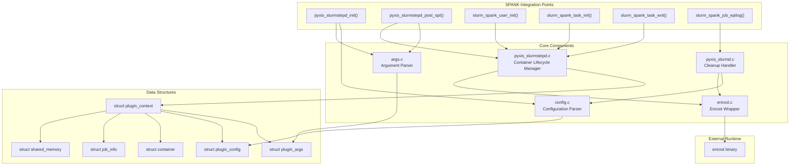
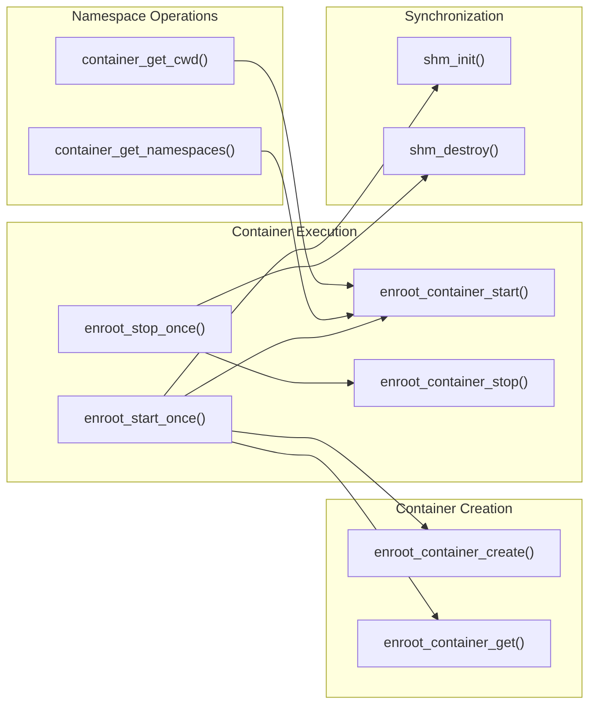
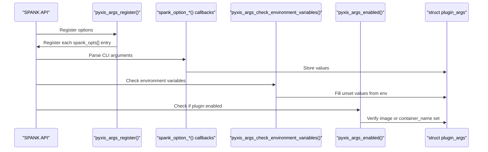
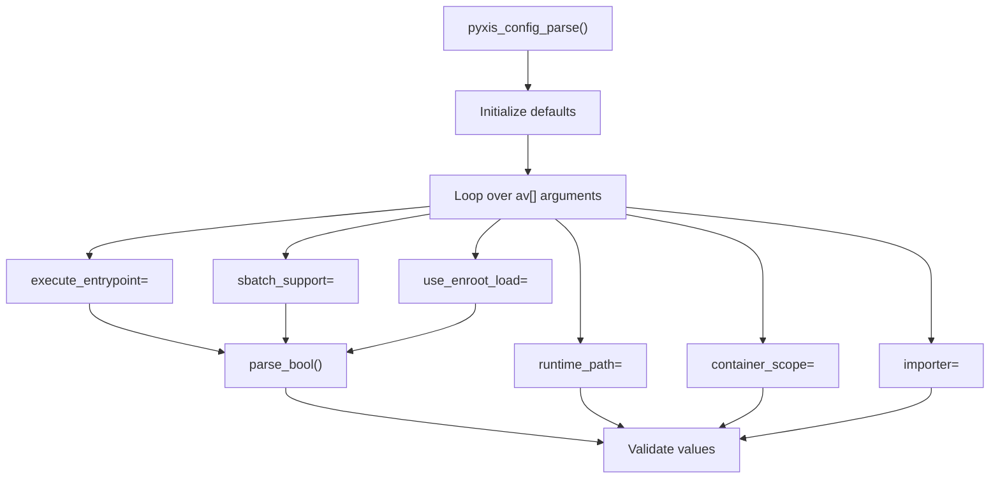
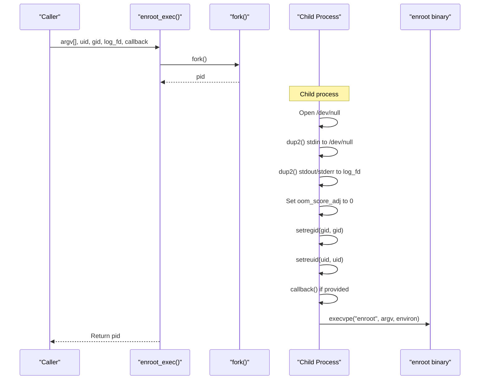
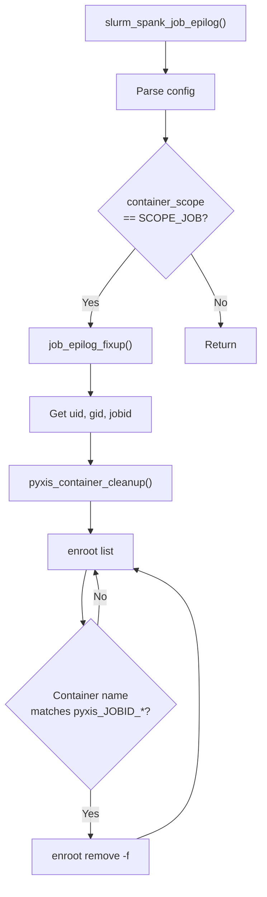
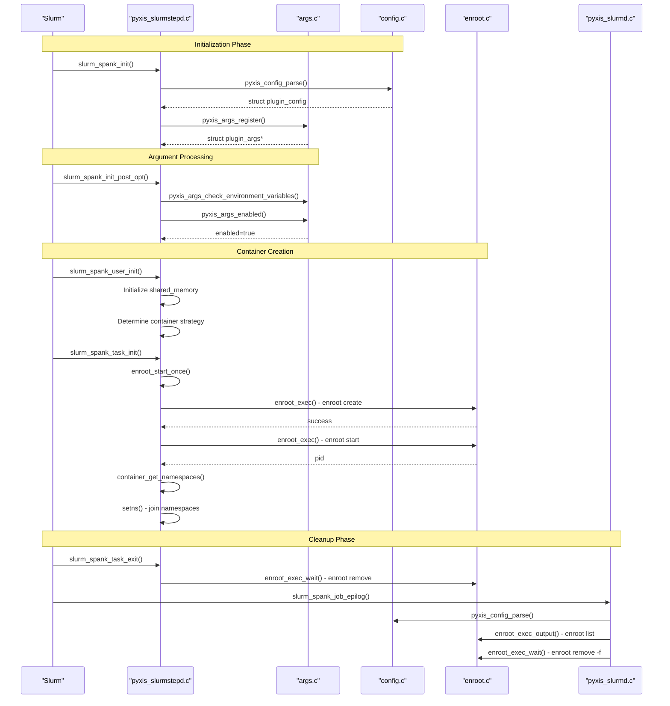

<!-- source: DeepWiki mcp.deepwiki.com · repo NVIDIA/pyxis · page 3.2 Component Overview · fetched 2026-10-26 -->

# Component Overview

Relevant source files

The following files were used as context for generating this wiki page:

- [args.c](args.c)
- [config.c](config.c)
- [enroot.c](enroot.c)
- [pyxis_slurmd.c](pyxis_slurmd.c)
- [pyxis_slurmstepd.c](pyxis_slurmstepd.c)

This page provides an overview of the major components in the Pyxis SPANK plugin and how they interact with each other. For details about how these components integrate with Slurm's SPANK framework, see [SPANK Plugin Integration](#3.1). For in-depth coverage of the container lifecycle, see [Container Lifecycle Manager](#4).

## Purpose and Scope

Pyxis consists of five primary source components that work together to provide containerized job execution in Slurm:

1. **pyxis_slurmstepd.c** - Container lifecycle orchestration during job execution
2. **args.c** - Command-line argument and environment variable processing
3. **config.c** - Plugin configuration parsing
4. **enroot.c** - Process execution wrapper for Enroot commands
5. **pyxis_slurmd.c** - Post-job container cleanup

## Component Architecture

**Sources:** [pyxis_slurmstepd.c:1-150](), [args.c:1-50](), [config.c:1-30](), [enroot.c:1-30](), [pyxis_slurmd.c:1-50]()

## Core Data Structures

The plugin maintains state through several key data structures:

| Structure | File | Purpose |
|-----------|------|---------|
| `struct plugin_context` | pyxis_slurmstepd.c:74-83 | Global plugin state, aggregates all other structures |
| `struct plugin_config` | config.h | Plugin configuration options from plugstack.conf |
| `struct plugin_args` | args.c:13-28 | Parsed command-line arguments and environment variables |
| `struct container` | pyxis_slurmstepd.c:37-51 | Container metadata and namespace file descriptors |
| `struct job_info` | pyxis_slurmstepd.c:53-63 | Job context (UID, GID, job ID, environment) |
| `struct shared_memory` | pyxis_slurmstepd.c:65-72 | Inter-task synchronization via shared memory |

**Sources:** [pyxis_slurmstepd.c:37-83](), [args.c:13-28](), [config.h]()

## Component: pyxis_slurmstepd

The primary component, responsible for the entire container lifecycle during job execution.

### Key Functions

| Function | Line | SPANK Hook | Purpose |
|----------|------|------------|---------|
| `pyxis_slurmstepd_init()` | 116 | `slurm_spank_init` | Parse configuration, register arguments |
| `pyxis_slurmstepd_post_opt()` | 265 | `slurm_spank_init_post_opt` | Check environment variables, create runtime directory |
| `slurm_spank_user_init()` | 1036 | `slurm_spank_user_init` | Per-job initialization, determine container strategy |
| `slurm_spank_task_init()` | 1308 | `slurm_spank_task_init` | Create/start container, join namespaces |
| `slurm_spank_task_exit()` | 1410 | `slurm_spank_task_exit` | Export container, cleanup resources |

### Container Management Functions

**Sources:** [pyxis_slurmstepd.c:116-1600](), [pyxis_slurmstepd.c:643-954](), [pyxis_slurmstepd.c:972-1034]()

## Component: args

Handles parsing and validation of command-line arguments and environment variables.

### Argument Registration

The component defines an array of SPANK options:

| Option | Type | Description |
|--------|------|-------------|
| `--container-image` | Required arg | Container image URI or squashfs path |
| `--container-mounts` | Required arg | Bind mounts (format: SRC:DST:FLAGS) |
| `--container-workdir` | Required arg | Working directory inside container |
| `--container-name` | Required arg | Named container for reuse |
| `--container-save` | Required arg | Export container to squashfs |
| `--container-mount-home` | Flag | Mount user home directory |
| `--container-remap-root` | Flag | Remap to root inside container |
| `--container-entrypoint` | Flag | Execute container entrypoint |
| `--container-writable` | Flag | Make container filesystem writable |
| `--container-env` | Required arg | Environment variables to preserve |

### Argument Processing Flow

### Key Functions

| Function | Line | Purpose |
|----------|------|---------|
| `pyxis_args_register()` | 615 | Register SPANK options with Slurm |
| `pyxis_args_check_environment_variables()` | 166 | Check environment variables for defaults |
| `pyxis_args_enabled()` | 630 | Validate plugin should be activated |
| `spank_option_image()` | 239 | Parse `--container-image` |
| `spank_option_mount()` | 371 | Parse `--container-mounts` |
| `add_mount()` | 263 | Add mount entry with validation |

**Sources:** [args.c:1-667](), [args.c:42-151](), [args.c:166-237]()

## Component: config

Parses plugin configuration from plugstack.conf.

### Configuration Options

| Option | Type | Default | Description |
|--------|------|---------|-------------|
| `runtime_path` | string | `/run/pyxis` | Directory for temporary squashfs files |
| `execute_entrypoint` | bool | `false` | Execute container entrypoint by default |
| `container_scope` | enum | `global` | Container naming scope (`job` or `global`) |
| `sbatch_support` | bool | `true` | Enable sbatch script mounting |
| `use_enroot_load` | bool | `false` | Use `enroot load` instead of `enroot import` |
| `importer` | string | (empty) | External importer script path |

### Parsing Logic

**Sources:** [config.c:23-98](), [config.c:12-21]()

## Component: enroot

Provides process execution wrappers for invoking Enroot commands.

### Execution Functions

| Function | Line | Purpose |
|----------|------|---------|
| `enroot_exec()` | 18 | Fork and execute enroot command |
| `enroot_exec_wait()` | 122 | Execute enroot and wait for completion |
| `enroot_exec_output()` | 139 | Execute enroot and capture output to FILE* |

### Process Execution Flow

### Key Features

- **UID/GID switching**: Executes enroot with job user credentials via `setreuid()`/`setregid()` [enroot.c:73-79]()
- **I/O redirection**: Redirects stdout/stderr to log file or /dev/null [enroot.c:49-61]()
- **Environment setup**: Calls optional callback to set environment before exec [enroot.c:81-85]()
- **OOM score adjustment**: Sets `oom_score_adj` to prevent OOM killer immunity [enroot.c:67-71]()

**Sources:** [enroot.c:18-176]()

## Component: pyxis_slurmd

Handles post-job cleanup in the Slurmd daemon context.

### Key Functions

| Function | Line | SPANK Hook | Purpose |
|----------|------|------------|---------|
| `pyxis_slurmd_init()` | 20 | `slurm_spank_slurmd_init` | Create runtime directory |
| `slurm_spank_job_epilog()` | 127 | `slurm_spank_job_epilog` | Cleanup job containers |
| `pyxis_container_cleanup()` | 52 | (internal) | Remove containers for job |

### Cleanup Logic

### Container Name Matching

The cleanup logic removes containers matching the pattern:
- Named containers: `pyxis_JOBID_*` (with any suffix)
- Temporary containers: `pyxis_JOBID_STEPID`

This is controlled by the `container_scope` configuration option. When set to `SCOPE_JOB`, containers are automatically removed after job completion.

**Sources:** [pyxis_slurmd.c:20-176](), [pyxis_slurmd.c:52-93](), [pyxis_slurmd.c:127-176]()

## Component Interaction During Job Execution

**Sources:** [pyxis_slurmstepd.c:116-1600](), [args.c:615-655](), [config.c:23-98](), [enroot.c:18-176](), [pyxis_slurmd.c:127-176]()

## Component Responsibilities Summary

| Component | Primary Responsibility | Complexity | Dependencies |
|-----------|----------------------|------------|--------------|
| pyxis_slurmstepd.c | Container lifecycle orchestration | High | args, config, enroot |
| args.c | Argument parsing and validation | Medium | config (for structs) |
| config.c | Configuration parsing | Low | None |
| enroot.c | Process execution wrapper | Low | None |
| pyxis_slurmd.c | Post-job cleanup | Low | config, enroot |

The architecture follows a clear separation of concerns:

- **Configuration** (config.c) provides system-level settings
- **Arguments** (args.c) provides user-level options
- **Lifecycle** (pyxis_slurmstepd.c) orchestrates container operations using both configuration and arguments
- **Execution** (enroot.c) provides low-level process management
- **Cleanup** (pyxis_slurmd.c) ensures resources are released after job completion

This modular design allows each component to be tested and maintained independently while working together through well-defined interfaces.

**Sources:** [pyxis_slurmstepd.c:1-100](), [args.c:1-50](), [config.c:1-30](), [enroot.c:1-30](), [pyxis_slurmd.c:1-50]()

---

