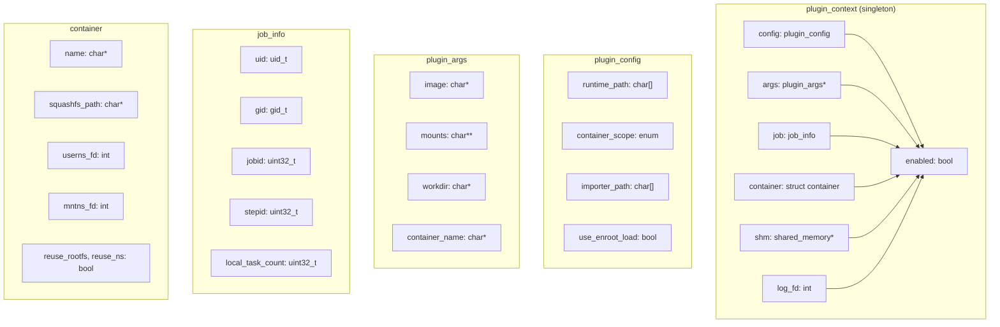
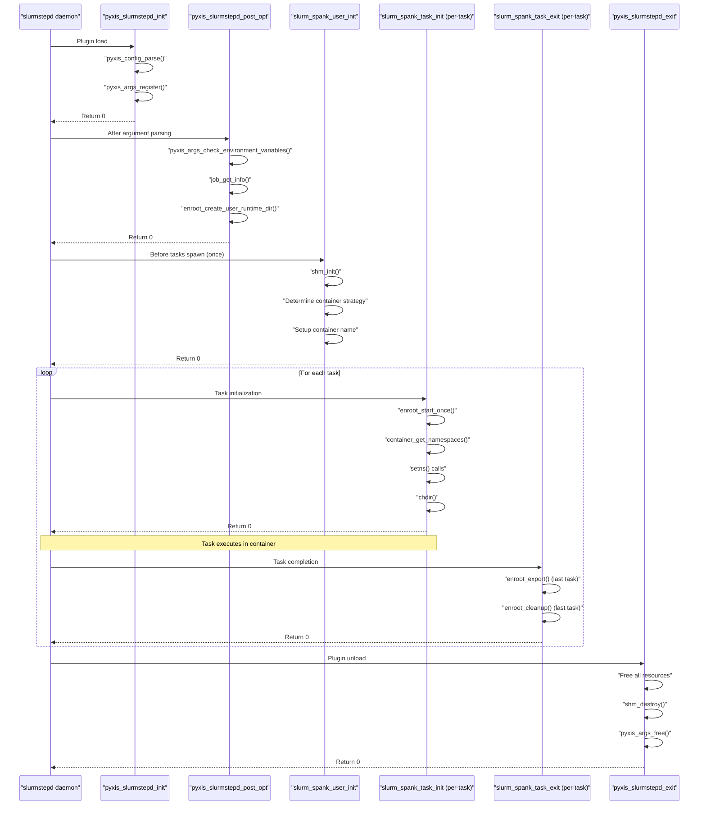
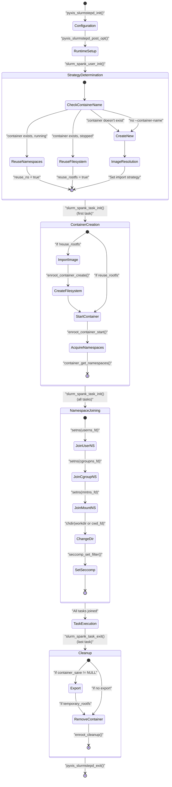
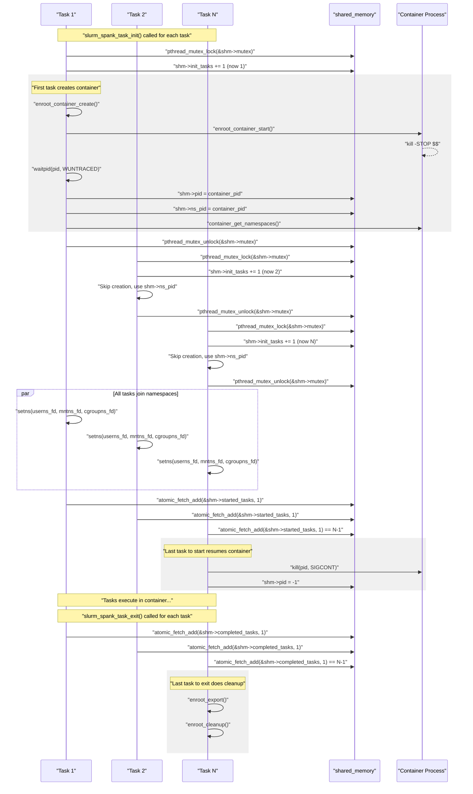
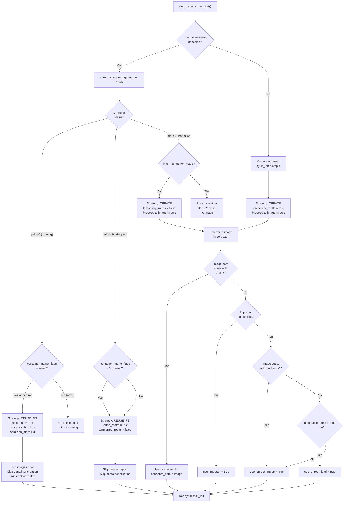
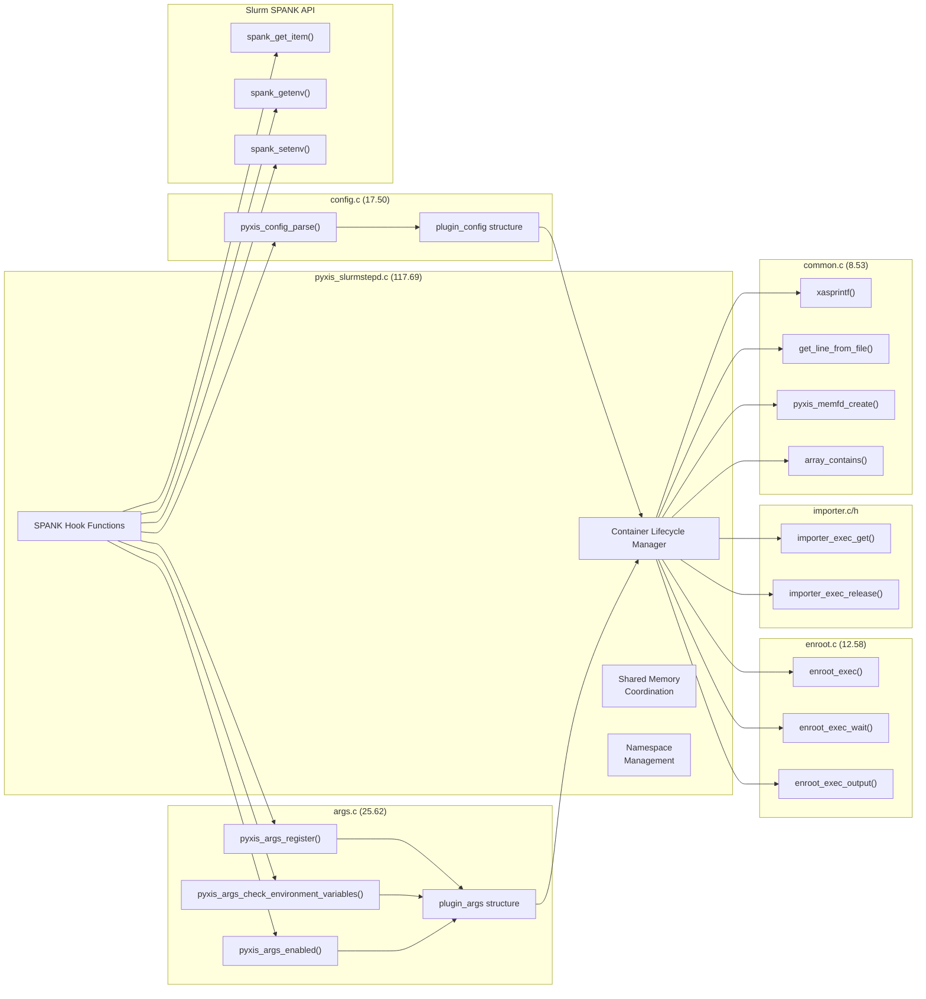
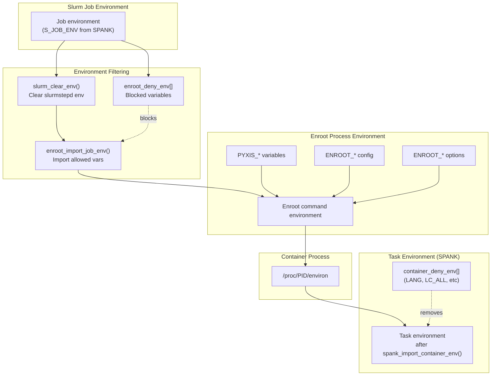

<!-- source: DeepWiki mcp.deepwiki.com · repo NVIDIA/pyxis · page 4 Container Lifecycle Manager · fetched 2026-10-26 -->

# Container Lifecycle Manager

<details>
<summary>Relevant source files</summary>

The following files were used as context for generating this wiki page:

- [pyxis_slurmstepd.c](pyxis_slurmstepd.c)

</details>


## Purpose and Scope

The Container Lifecycle Manager is the core orchestration component of Pyxis, implemented in `pyxis_slurmstepd.c`. This module manages the complete lifecycle of containerized job execution within Slurm's `slurmstepd` daemon, from initial configuration parsing through container creation, namespace management, task execution, and final cleanup.

This page provides an architectural overview of the lifecycle manager and its coordination mechanisms. For specific implementation details, see:
- [Initialization & Setup](#4.1) - configuration parsing and runtime directory setup
- [Container Creation](#4.2) - image import and container creation strategies
- [Namespace Management](#4.3) - Linux namespace acquisition and multi-task coordination
- [Environment & Execution](#4.4) - environment variable handling and task execution
- [Cleanup & Teardown](#4.5) - container export and resource cleanup

For information about the configuration system used by this module, see [Configuration System](#5). For argument parsing, see [Argument Parsing](#6).

**Sources:** [pyxis_slurmstepd.c:1-1546]()

## Core Architecture

The Container Lifecycle Manager operates as a SPANK plugin within Slurm's `slurmstepd` daemon. It maintains a global `plugin_context` structure that tracks the state of container operations across multiple SPANK hook invocations.

### Key Data Structures

The lifecycle manager uses four primary data structures to manage container state:

| Structure | Purpose | Key Fields | Scope |
|-----------|---------|------------|-------|
| `plugin_context` | Global plugin state | `config`, `args`, `job`, `container`, `shm` | Per-job-step, singleton |
| `plugin_config` | Plugin configuration | `runtime_path`, `container_scope`, `importer_path` | Parsed at init |
| `plugin_args` | User arguments | `image`, `mounts`, `workdir`, `entrypoint` | From CLI/env vars |
| `job_info` | Job metadata | `uid`, `gid`, `jobid`, `stepid`, `task_count` | From SPANK API |
| `container` | Container state | `name`, `squashfs_path`, namespace FDs, flags | Runtime state |
| `shared_memory` | Multi-task sync | `mutex`, `init_tasks`, `started_tasks`, `pid` | Shared across tasks |

**Sources:** [pyxis_slurmstepd.c:37-109]()

### Plugin Context Structure



**Sources:** [pyxis_slurmstepd.c:74-109]()

## SPANK Hook Functions

The lifecycle manager implements six SPANK hook functions that are invoked by Slurm at specific points in the job lifecycle:

| Hook Function | When Called | Primary Responsibilities |
|---------------|-------------|--------------------------|
| `pyxis_slurmstepd_init()` | Plugin load | Parse configuration, register arguments |
| `pyxis_slurmstepd_post_opt()` | After CLI parsing | Check environment variables, create runtime directories |
| `slurm_spank_user_init()` | Before task init | Set up shared memory, determine container strategy, handle batch scripts |
| `slurm_spank_task_init()` | Per-task init | Create/start container, acquire namespaces, join namespaces |
| `slurm_spank_task_exit()` | Per-task exit | Export container (last task), cleanup temporary containers |
| `pyxis_slurmstepd_exit()` | Plugin unload | Free resources, destroy shared memory |

**Sources:** [pyxis_slurmstepd.c:116-133](), [pyxis_slurmstepd.c:265-286](), [pyxis_slurmstepd.c:1036-1184](), [pyxis_slurmstepd.c:1308-1409](), [pyxis_slurmstepd.c:1491-1511](), [pyxis_slurmstepd.c:1513-1545]()

### SPANK Hook Invocation Flow



**Sources:** [pyxis_slurmstepd.c:116-133](), [pyxis_slurmstepd.c:265-286](), [pyxis_slurmstepd.c:1036-1184](), [pyxis_slurmstepd.c:1308-1409](), [pyxis_slurmstepd.c:1491-1511](), [pyxis_slurmstepd.c:1513-1545]()

## Container Lifecycle Phases

The container lifecycle consists of five distinct phases, each handled by specific functions within the lifecycle manager:

### Lifecycle Phase Diagram



**Sources:** [pyxis_slurmstepd.c:116-1545]()

## Multi-Task Coordination

When a Slurm job spawns multiple tasks on a single node, all tasks must share the same container. The lifecycle manager uses POSIX shared memory with a mutex to coordinate container creation and ensure only one task creates/starts the container.

### Shared Memory Structure

The `shared_memory` structure provides process-shared synchronization:

```c
struct shared_memory {
    pthread_mutex_t mutex;        // Process-shared, robust mutex
    atomic_uint init_tasks;       // Count of tasks in initialization
    atomic_uint started_tasks;    // Count of tasks that joined namespaces
    atomic_uint completed_tasks;  // Count of tasks that exited
    pid_t pid;                    // Container process PID
    pid_t ns_pid;                 // PID to get namespaces from
};
```

**Sources:** [pyxis_slurmstepd.c:65-72]()

### Multi-Task Synchronization Flow



**Sources:** [pyxis_slurmstepd.c:972-1012](), [pyxis_slurmstepd.c:1249-1285](), [pyxis_slurmstepd.c:1287-1306](), [pyxis_slurmstepd.c:1499-1508]()

### Coordination Functions

| Function | Purpose | Critical Section |
|----------|---------|------------------|
| `shm_init()` | Create shared memory mapping | Initialize process-shared mutex with `PTHREAD_PROCESS_SHARED` and `PTHREAD_MUTEX_ROBUST` |
| `enroot_start_once()` | Ensure single container creation | Mutex-protected, first task creates/starts, others wait and reuse |
| `enroot_stop_once()` | Resume container after all tasks ready | Atomic counter, last task sends `SIGCONT` |
| `enroot_export()` / `enroot_cleanup()` | Single cleanup execution | Atomic counter in `slurm_spank_task_exit()`, last task performs cleanup |
| `shm_destroy()` | Clean up shared memory | Destroy mutex and unmap memory |

**Sources:** [pyxis_slurmstepd.c:972-1012](), [pyxis_slurmstepd.c:1249-1306](), [pyxis_slurmstepd.c:1440-1489](), [pyxis_slurmstepd.c:1014-1034]()

## Container Strategy Selection

The lifecycle manager supports three container strategies, determined in `slurm_spank_user_init()`:

### Strategy Decision Tree



**Sources:** [pyxis_slurmstepd.c:1078-1167]()

## Integration with Other Components

The Container Lifecycle Manager coordinates with multiple other Pyxis components:

### Component Dependencies



**Sources:** [pyxis_slurmstepd.c:28-35]()

### Key Integration Points

| Component | Functions Used | Purpose |
|-----------|----------------|---------|
| **config.c** | `pyxis_config_parse()` | Parse plugin configuration from plugstack.conf |
| **args.c** | `pyxis_args_register()`, `pyxis_args_check_environment_variables()`, `pyxis_args_enabled()` | Register CLI options, check environment fallbacks, validate arguments |
| **enroot.c** | `enroot_exec()`, `enroot_exec_wait()`, `enroot_exec_output()` | Execute enroot commands with proper UID/GID and I/O handling |
| **importer.c** | `importer_exec_get()`, `importer_exec_release()` | Use external importer for image caching |
| **common.c** | `xasprintf()`, `get_line_from_file()`, `pyxis_memfd_create()`, `array_contains()` | Utility functions for string formatting, file I/O, logging |
| **SPANK API** | `spank_get_item()`, `spank_getenv()`, `spank_setenv()` | Query job information, manage environment variables |

**Sources:** [pyxis_slurmstepd.c:116-133](), [pyxis_slurmstepd.c:265-286](), [pyxis_slurmstepd.c:436-449](), [pyxis_slurmstepd.c:692-698](), [pyxis_slurmstepd.c:1469-1476]()

## Container Process Synchronization

The lifecycle manager uses a sophisticated synchronization technique to acquire container namespace file descriptors. The container is started with a shell command that stops itself using `SIGSTOP`, allowing the plugin to acquire namespace handles before the container continues execution.

### SIGSTOP Synchronization Mechanism

```mermaid
sequenceDiagram
    participant Plugin as "pyxis_slurmstepd"
    participant Fork as "fork()"
    participant Enroot as "enroot start"
    participant Shell as "sh -c 'kill -STOP $$'"
    participant Kernel as "Linux Kernel"
    
    Plugin->>Fork: "enroot_exec_ctx()"
    Fork->>Enroot: "exec enroot start ... sh -c 'kill -STOP $$; exit 0'"
    Enroot->>Enroot: "unshare() namespaces"
    Enroot->>Enroot: "pivot_root()"
    Enroot->>Shell: "exec sh -c ..."
    Shell->>Shell: "kill -STOP $$"
    Shell->>Kernel: "SIGSTOP to self"
    
    Note over Shell,Kernel: "Container process stopped"
    
    Plugin->>Plugin: "waitpid(pid, &status, WUNTRACED)"
    Plugin->>Plugin: "Check WIFSTOPPED(status)"
    
    rect rgb(240, 240, 240)
        Note over Plugin: "Container is stopped,<br/>namespaces are stable"
        Plugin->>Plugin: "open(/proc/pid/ns/user)"
        Plugin->>Plugin: "open(/proc/pid/ns/mnt)"
        Plugin->>Plugin: "open(/proc/pid/ns/cgroup)"
        Plugin->>Plugin: "open(/proc/pid/cwd)"
    end
    
    Plugin->>Plugin: "Store FDs in context.container"
    
    Note over Plugin: "Wait for all tasks<br/>to acquire FDs..."
    
    Plugin->>Shell: "kill(pid, SIGCONT)"
    Shell->>Shell: "Resume execution"
    Shell->>Shell: "exit 0"
```

**Sources:** [pyxis_slurmstepd.c:893-954](), [pyxis_slurmstepd.c:909-942](), [pyxis_slurmstepd.c:956-970]()

### Container Start Implementation

The `enroot_container_start()` function creates a temporary configuration file and starts the container with the synchronization shell command:

**Key Steps:**
1. Create temporary enroot configuration with mounts and hooks via `enroot_create_start_config()`
2. Start container: `enroot start --conf <file> <name> sh -c "kill -STOP $$ ; exit 0"`
3. Wait for container to stop with `waitpid(pid, &status, WUNTRACED)`
4. Verify `WIFSTOPPED(status)` is true
5. Acquire namespace file descriptors via `container_get_namespaces()`
6. Return container PID to caller

**Sources:** [pyxis_slurmstepd.c:893-954](), [pyxis_slurmstepd.c:801-891](), [pyxis_slurmstepd.c:740-781]()

## Environment Management

The lifecycle manager carefully manages environment variables to ensure proper isolation between Slurm's environment and the container's environment, while selectively importing required variables.

### Environment Variable Flow



**Sources:** [pyxis_slurmstepd.c:300-434](), [pyxis_slurmstepd.c:590-641]()

### Denied Environment Variables

Two lists control environment variable filtering:

**Denied from Enroot** (`enroot_deny_env[]`):
- `PATH`, `LD_LIBRARY_PATH`, `LD_PRELOAD` - prevent host contamination
- `SLURM_PROCID`, `SLURM_LOCALID`, `SLURM_TASK_PID` - task-specific, set later
- `PMIX_RANK`, `PMI_FD` - PMI coordination, set later
- `ENROOT_*` - all enroot configuration variables

**Denied from Container** (`container_deny_env[]`):
- `LANG`, `LANGUAGE`, `LC_ALL` - locale variables (unless in `--container-env`)

**Sources:** [pyxis_slurmstepd.c:334-359](), [pyxis_slurmstepd.c:583-588]()

## Error Handling and Robustness

The lifecycle manager implements several robustness features:

### Mutex Robustness

The shared memory mutex uses `PTHREAD_MUTEX_ROBUST`, allowing recovery if a task crashes while holding the lock:

```c
// In shm_init()
pthread_mutexattr_setrobust(&mutex_attr, PTHREAD_MUTEX_ROBUST);

// In enroot_start_once()
if (pthread_mutex_lock(&shm->mutex) == EOWNERDEAD) {
    pthread_mutex_consistent(&shm->mutex);
    shm->pid = -1;
    shm->ns_pid = -1;
    goto fail;  // Treat as failure, retry
}
```

**Sources:** [pyxis_slurmstepd.c:992-994](), [pyxis_slurmstepd.c:1254-1259]()

### User Init Error Propagation

Due to a Slurm limitation ([bug #7573](https://bugs.schedmd.com/show_bug.cgi?id=7573)), errors from `slurm_spank_user_init()` are not propagated to `srun`. The lifecycle manager works around this by storing the error code and returning it in `slurm_spank_task_init()`:

**Sources:** [pyxis_slurmstepd.c:1171-1183](), [pyxis_slurmstepd.c:1316-1317]()

### Partial Initialization Cleanup

If container startup fails partway through, the lifecycle manager tracks what resources were allocated and cleans them up appropriately:

| Resource | Cleanup Function | When Cleaned |
|----------|------------------|--------------|
| Temporary squashfs | `unlink()` in `enroot_cleanup()` | If `use_enroot_import` is true |
| Importer resources | `importer_exec_release()` | If `use_importer` is true |
| Container filesystem | `enroot remove -f` | If `temporary_rootfs` is true |
| Shared memory | `shm_destroy()` | In `pyxis_slurmstepd_exit()` |
| Namespace FDs | `xclose()` | In `pyxis_slurmstepd_exit()` |

**Sources:** [pyxis_slurmstepd.c:1460-1489](), [pyxis_slurmstepd.c:1513-1545]()

---

