<!-- source: DeepWiki mcp.deepwiki.com · repo NVIDIA/pyxis · page 4.1 Initialization & Setup · fetched 2026-10-26 -->

# Initialization & Setup

Relevant source files

The following files were used as context for generating this wiki page:

- [args.c](args.c)
- [config.c](config.c)
- [pyxis_slurmstepd.c](pyxis_slurmstepd.c)

This page describes the initialization and setup phases of the Pyxis container lifecycle manager. It covers plugin initialization through SPANK hooks, configuration parsing, command-line argument registration and validation, runtime directory creation, and shared memory setup for multi-task coordination. For details on how containers are created after initialization, see [Container Creation](#4.2). For the overall architecture, see [Architecture](#3).

## Initialization Phases

Pyxis initialization occurs through several SPANK hook functions that are called by Slurm at specific points in the job lifecycle. The initialization follows a three-phase approach:

### Phase 1: Plugin Init (`pyxis_slurmstepd_init`)

The first initialization phase occurs when the `slurmstepd` daemon loads the plugin. This is the earliest opportunity for setup.

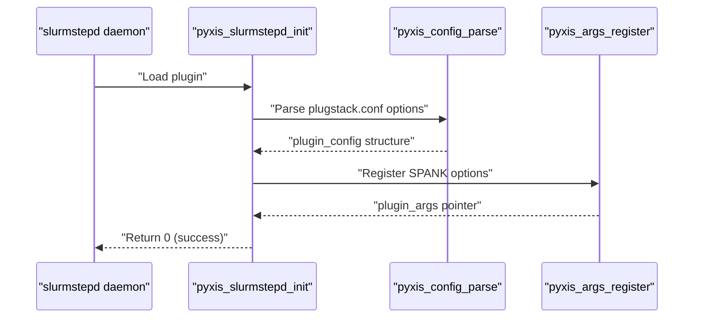

**Sources:** [pyxis_slurmstepd.c:116-133](), [config.c:23-98](), [args.c:615-628]()

The `pyxis_slurmstepd_init` function performs two critical tasks:

| Task | Function Called | Result |
|------|----------------|---------|
| Parse plugin configuration | `pyxis_config_parse()` | Populates `context.config` with runtime_path, execute_entrypoint, container_scope, etc. |
| Register command-line options | `pyxis_args_register()` | Registers all `--container-*` options with SPANK and returns pointer to `pyxis_args` |

### Phase 2: Post-Option Processing (`pyxis_slurmstepd_post_opt`)

After Slurm has processed command-line arguments, this hook checks environment variables for default values and performs initial validation.

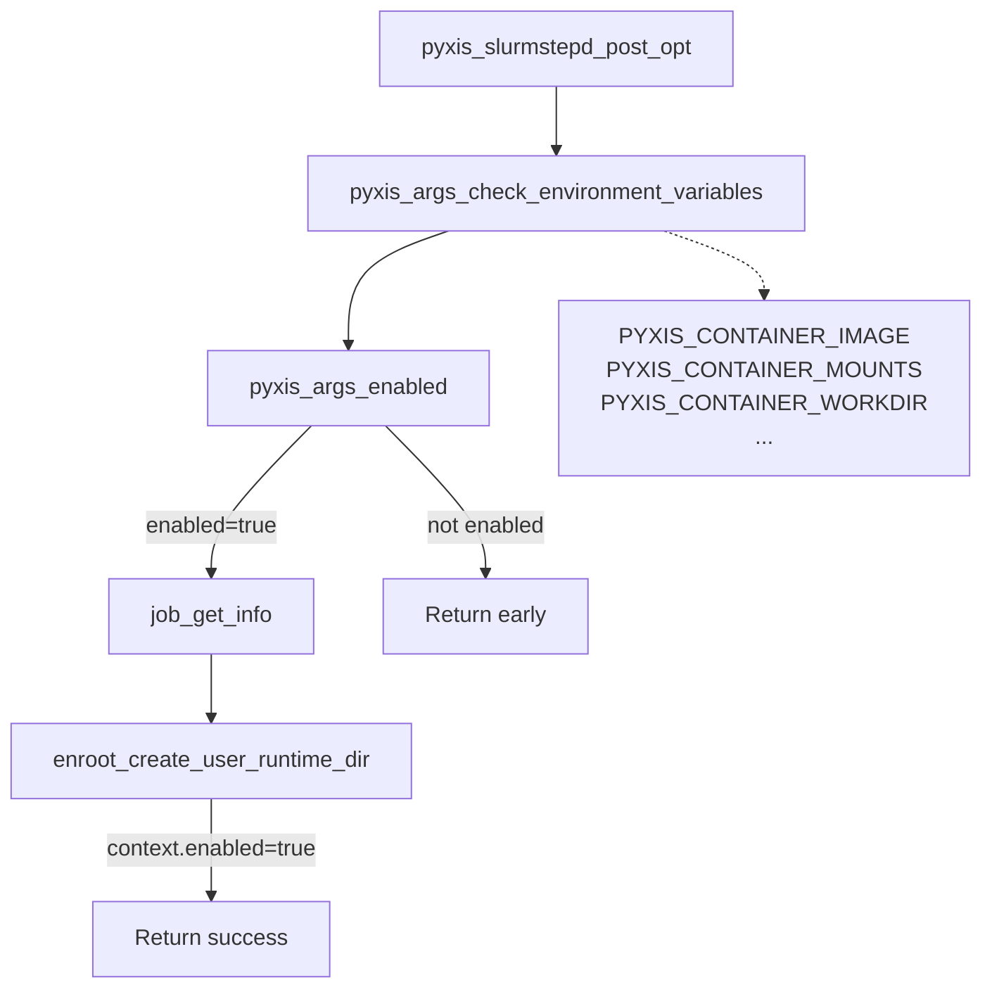

**Sources:** [pyxis_slurmstepd.c:265-286](), [args.c:166-237](), [args.c:630-655]()

This phase performs:

1. **Environment Variable Fallback**: If a `--container-*` option was not provided on the command line, check for corresponding `PYXIS_CONTAINER_*` environment variables [args.c:166-237]()
2. **Validation**: Ensure at least `--container-image` or `--container-name` is set [args.c:630-655]()
3. **Job Information Retrieval**: Extract job UID, GID, job ID, step ID, task counts using SPANK API [pyxis_slurmstepd.c:135-194]()
4. **Runtime Directory Creation**: Create `/run/pyxis/<uid>` directory (as root) with appropriate ownership [pyxis_slurmstepd.c:238-263]()

### Phase 3: User Init (`slurm_spank_user_init`)

The final initialization phase occurs just before tasks are spawned. This is where container strategy is determined and shared memory is initialized.

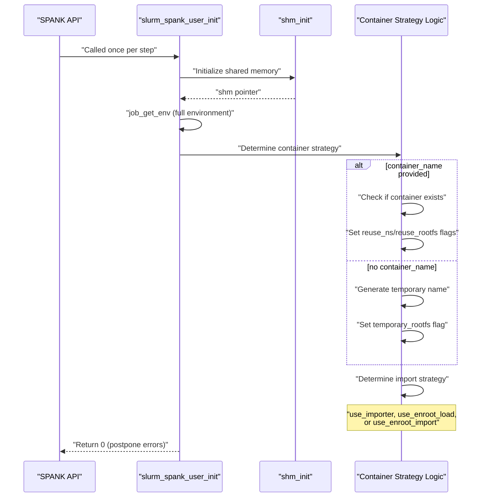

**Sources:** [pyxis_slurmstepd.c:1036-1184]()

## Configuration Parsing

Configuration is parsed from the `plugstack.conf` file and stored in the `plugin_config` structure.

### Configuration Options

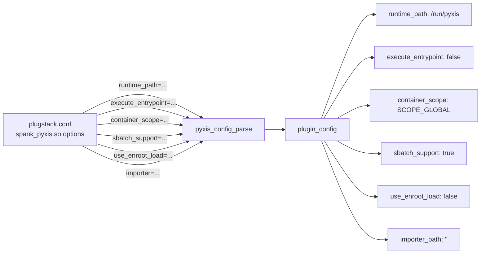

**Sources:** [config.c:23-98](), [config.h]()

The `pyxis_config_parse` function processes configuration options:

| Option | Type | Default | Description |
|--------|------|---------|-------------|
| `runtime_path` | string | `/run/pyxis` | Base directory for temporary squashfs files |
| `execute_entrypoint` | bool | `false` | Whether to execute container entrypoint by default |
| `container_scope` | enum | `SCOPE_GLOBAL` | Container naming scope: `global` or `job` |
| `sbatch_support` | bool | `true` | Enable sbatch script mounting |
| `use_enroot_load` | bool | `false` | Use `enroot load` instead of `enroot import + create` |
| `importer` | string | `""` | Path to external importer script |

The parser uses a simple string-prefix matching approach [config.c:42-95]():
- Each option is checked with `strncmp()`
- Boolean options are parsed with `parse_bool()` [config.c:12-21]()
- String options are copied with bounds checking

## Argument Registration and Validation

The argument system provides user-facing `--container-*` options and validates their usage.

### Argument Registration Flow

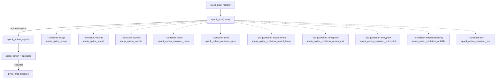

**Sources:** [args.c:615-628](), [args.c:42-151]()

### Argument Data Structure

The `plugin_args` structure [args.c:13-28]() stores parsed arguments:

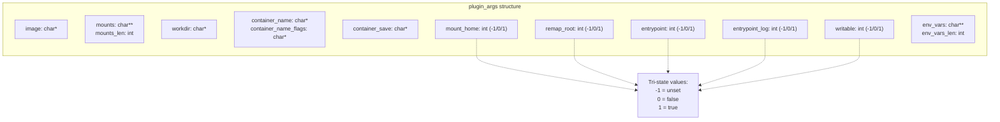

**Sources:** [args.c:13-28](), [args.h]()

### Environment Variable Fallback

If command-line options are not provided, Pyxis checks for environment variables:

| CLI Option | Environment Variable |
|-----------|---------------------|
| `--container-image` | `PYXIS_CONTAINER_IMAGE` |
| `--container-mounts` | `PYXIS_CONTAINER_MOUNTS` |
| `--container-workdir` | `PYXIS_CONTAINER_WORKDIR` |
| `--container-name` | `PYXIS_CONTAINER_NAME` |
| `--container-save` | `PYXIS_CONTAINER_SAVE` |
| `--container-mount-home` | `PYXIS_CONTAINER_MOUNT_HOME` |
| `--container-remap-root` | `PYXIS_CONTAINER_REMAP_ROOT` |
| `--container-entrypoint` | `PYXIS_CONTAINER_ENTRYPOINT` |
| `--container-writable` | `PYXIS_CONTAINER_WRITABLE` / `PYXIS_CONTAINER_READONLY` |
| `--container-env` | `PYXIS_CONTAINER_ENV` |

This fallback mechanism is implemented in `pyxis_args_check_environment_variables()` [args.c:166-237]().

### Validation Logic

The `pyxis_args_enabled()` function [args.c:630-655]() validates that at least one of `--container-image` or `--container-name` is set. If neither is provided, all other container options are ignored and the plugin returns early.

## Context Structure Initialization

The plugin maintains a global `context` structure that holds all state for the current job step.

### Context Structure Layout

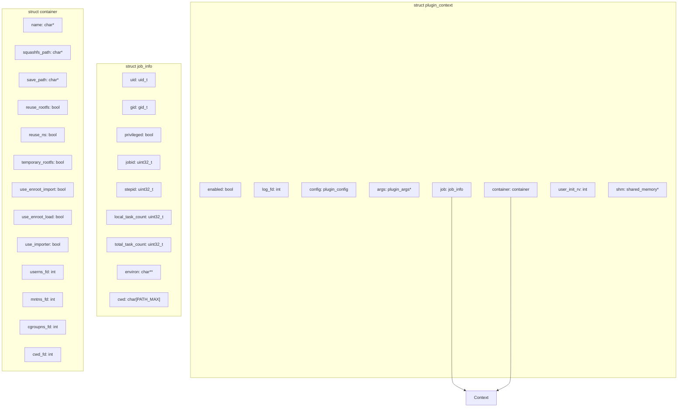

**Sources:** [pyxis_slurmstepd.c:74-83](), [pyxis_slurmstepd.c:37-51](), [pyxis_slurmstepd.c:53-63]()

The global context is statically initialized with default values [pyxis_slurmstepd.c:90-109]():
- `enabled = false` - Set to true in `post_opt` if arguments are valid
- `log_fd = -1` - Will hold file descriptor for enroot log output
- File descriptors initialized to -1
- Boolean flags initialized to false

### Job Information Extraction

Job details are extracted from the SPANK API in `job_get_info()` [pyxis_slurmstepd.c:135-194]():

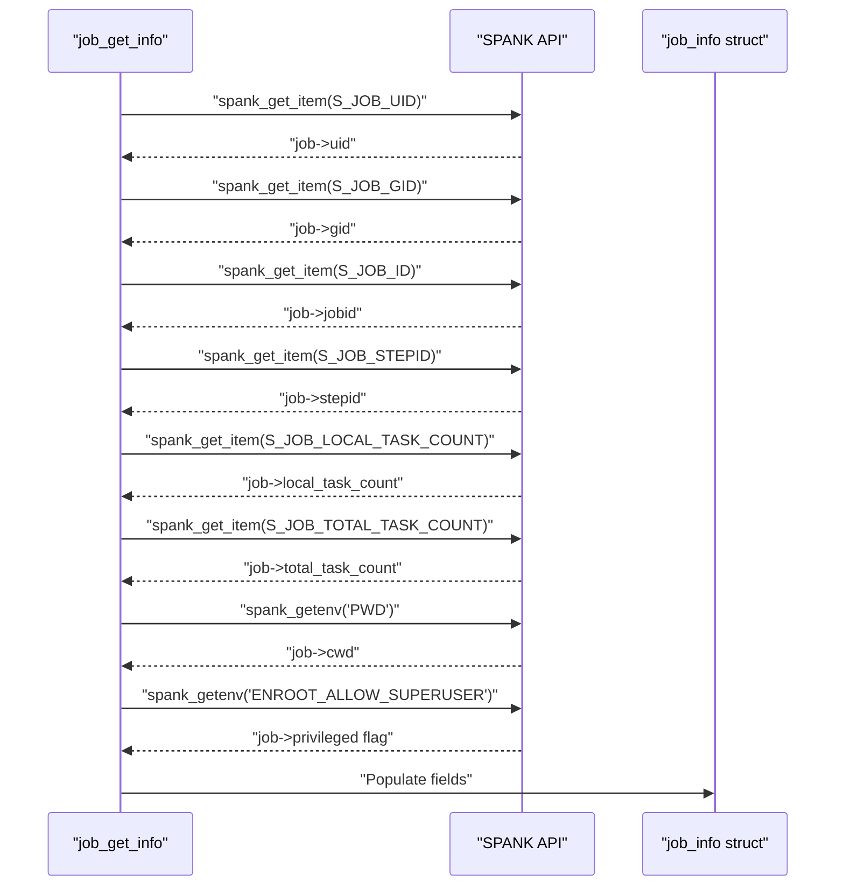

**Sources:** [pyxis_slurmstepd.c:135-194]()

## Runtime Directory Setup

Pyxis creates a per-user runtime directory to store temporary squashfs files during container import.

### Directory Creation Process

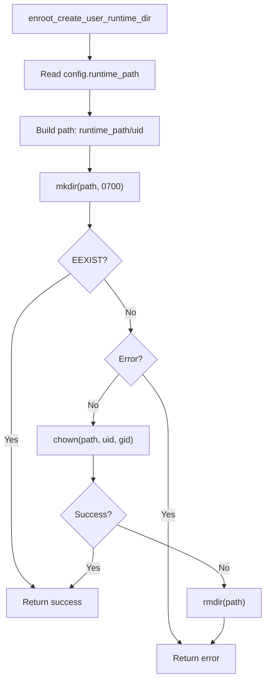

**Sources:** [pyxis_slurmstepd.c:238-263]()

The directory creation is performed as root (since `slurmstepd` runs as root) [pyxis_slurmstepd.c:238-263]():

1. **Path Construction**: `/run/pyxis/<uid>` where `<uid>` is the job user's UID
2. **mkdir**: Create with mode `0700` (user-only access)
3. **Idempotency**: If directory already exists (`EEXIST`), continue successfully
4. **Ownership**: `chown()` the directory to the job user's UID/GID
5. **Cleanup on Error**: If `chown()` fails, remove the directory

## Shared Memory Initialization

Shared memory enables coordination between multiple tasks in a job step.

### Shared Memory Structure

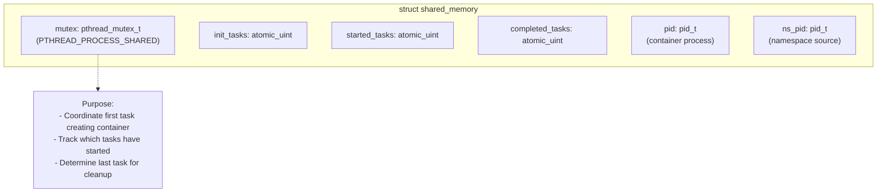

**Sources:** [pyxis_slurmstepd.c:65-72](), [pyxis_slurmstepd.c:972-1012]()

### Initialization Sequence

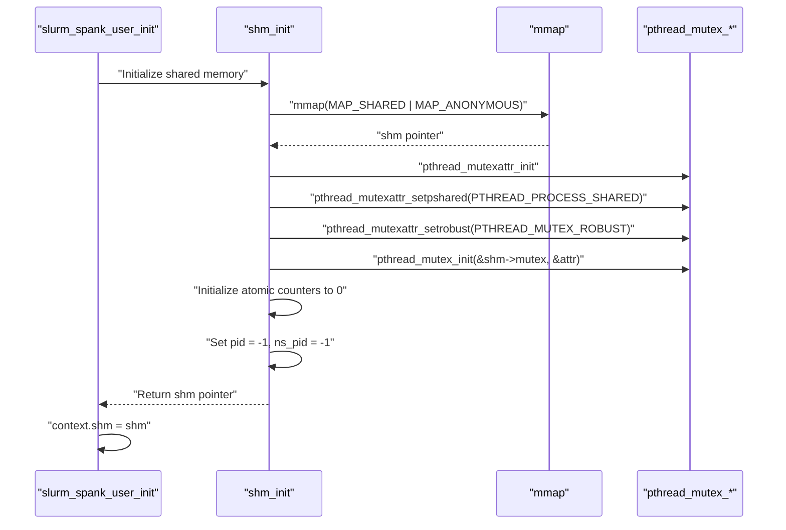

**Sources:** [pyxis_slurmstepd.c:972-1012]()

The shared memory initialization [pyxis_slurmstepd.c:972-1012]():

1. **Anonymous mmap**: Creates shared memory region with `MAP_SHARED | MAP_ANONYMOUS`
2. **Mutex Setup**: Configures pthread mutex for inter-process synchronization:
   - `PTHREAD_PROCESS_SHARED`: Allows mutex to be shared across processes (tasks)
   - `PTHREAD_MUTEX_ROBUST`: Handles case where a task holding the mutex crashes
3. **Atomic Counters**: Initialize to 0 for tracking task progress
4. **PID Fields**: Initialize to -1 (invalid PID) to indicate no container process yet

### Shared Memory Usage Patterns

The shared memory is used in subsequent phases:

| Phase | Counter/Field Used | Purpose |
|-------|-------------------|---------|
| Container Creation | `init_tasks` | First task to increment creates container |
| Namespace Acquisition | `ns_pid` | All tasks read this to join same namespaces |
| Container Stop | `started_tasks` | Last task stops the container process |
| Cleanup | `completed_tasks` | Last task performs export and cleanup |

For details on how shared memory coordinates container creation, see [Container Creation](#4.2). For namespace coordination, see [Namespace Management](#4.3).

## Container Strategy Determination

During `slurm_spank_user_init`, Pyxis determines the container strategy based on the provided arguments.

### Container Name and Scope

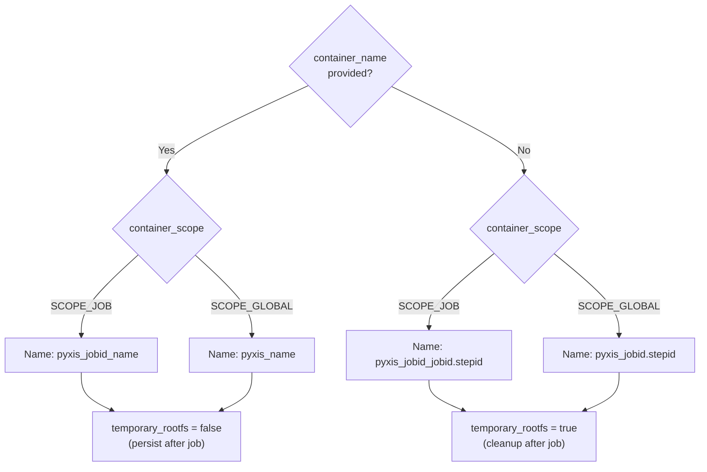

**Sources:** [pyxis_slurmstepd.c:1078-1126]()

The container naming logic [pyxis_slurmstepd.c:1078-1126]():
- **Named containers**: Persist after the job completes and can be reused across jobs
- **Unnamed containers**: Automatically cleaned up when the job step exits
- **Scope**: Affects whether job ID is included in the generated name

### Reuse Detection

If a container name is provided, Pyxis checks if it already exists using `enroot_container_get()`:

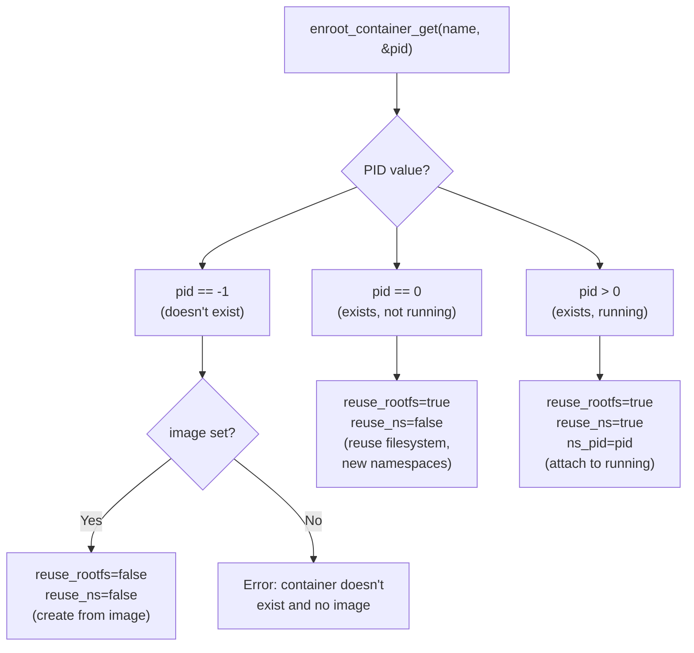

**Sources:** [pyxis_slurmstepd.c:1086-1116]()

### Import Strategy Selection

If the container doesn't already exist, Pyxis determines how to import the image:

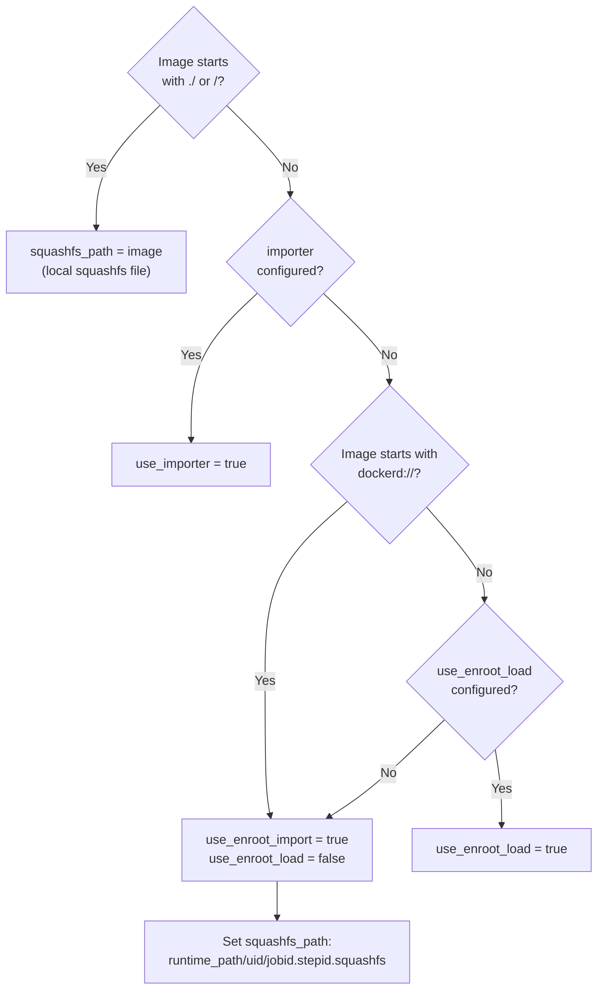

**Sources:** [pyxis_slurmstepd.c:1128-1155]()

The import strategy determines:
- **Local path** (`./` or `/`): Use squashfs file directly, no import needed
- **External importer**: Use configured importer script (see [Image Import Strategies](#8))
- **dockerd:// prefix**: Force use of `enroot import` (imports from local Docker daemon)
- **use_enroot_load**: Use `enroot load` which handles import and create in one step
- **Default**: Use `enroot import` followed by `enroot create` (requires temporary squashfs file)

## Summary

The initialization and setup phase prepares all state necessary for container operations:

1. **Plugin Init**: Parse configuration, register arguments
2. **Post-Option**: Validate arguments, extract job info, create runtime directory
3. **User Init**: Initialize shared memory, determine container strategy

The resulting `plugin_context` structure contains:
- Configuration from `plugstack.conf`
- Parsed command-line arguments
- Job metadata (UID, GID, job/step IDs, task counts)
- Container strategy flags (reuse, import method)
- Shared memory for inter-task coordination

This state is then used in subsequent phases to create the container, join namespaces, and execute tasks. See [Container Creation](#4.2) for the next phase.

---

