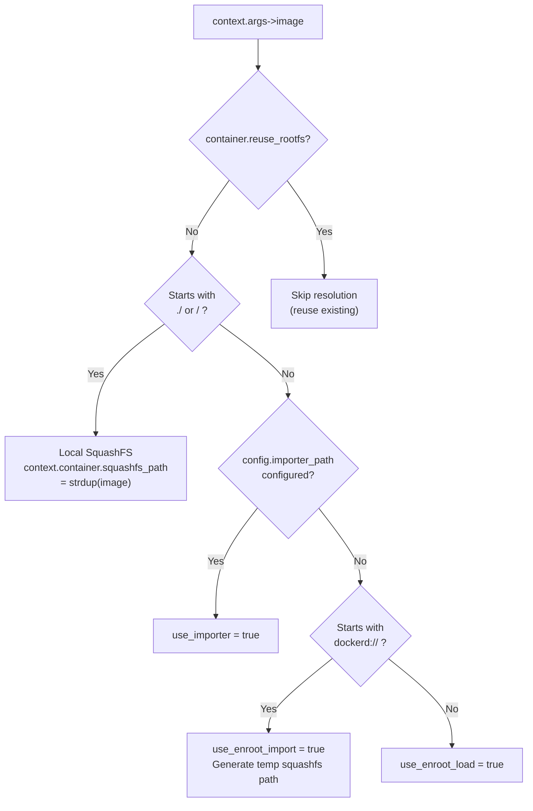
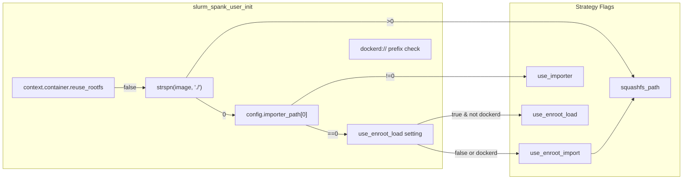
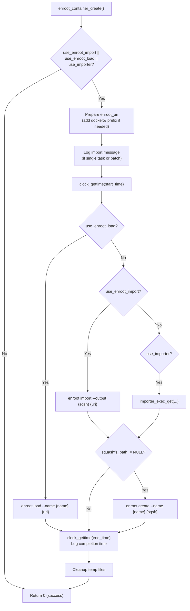
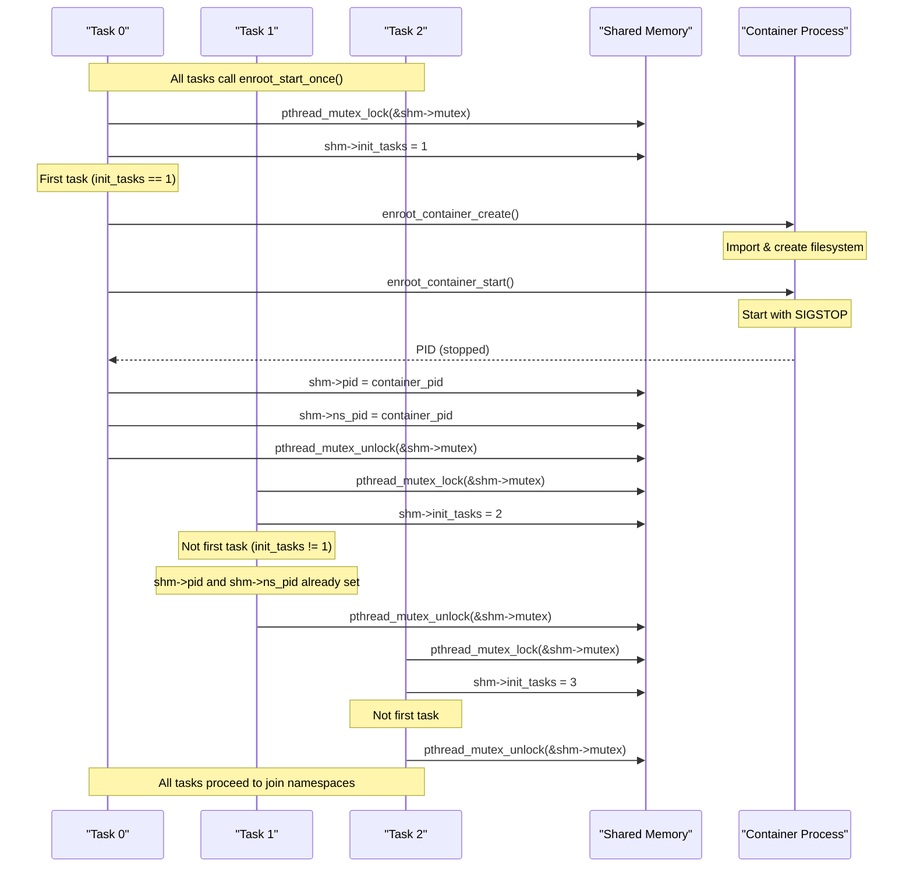

<!-- source: DeepWiki mcp.deepwiki.com · repo NVIDIA/pyxis · page 4.2 Container Creation · fetched 2026-10-26 -->

# Container Creation

<details>
<summary>Relevant source files</summary>

The following files were used as context for generating this wiki page:

- [enroot.c](enroot.c)
- [importers/caching_importer.sh](importers/caching_importer.sh)
- [importers/simple_importer.sh](importers/simple_importer.sh)
- [pyxis_slurmstepd.c](pyxis_slurmstepd.c)

</details>


## Purpose and Scope

This page documents the container creation process in Pyxis, which transforms a container image reference into a running container that tasks can join. This includes image resolution, import strategies, the enroot container creation workflow, and multi-task synchronization mechanisms.

For information about the initialization phase that precedes container creation, see [Initialization & Setup](#4.1). For information about joining container namespaces after creation, see [Namespace Management](#4.3).

## Overview

Container creation in Pyxis is a multi-phase process that occurs during the `slurm_spank_user_init` and `slurm_spank_task_init` hooks. The process determines the image source, imports or locates the image, creates the container filesystem, and starts a container process. When multiple tasks run on the same node, only the first task performs the actual creation, while subsequent tasks synchronize via shared memory.

Sources: [pyxis_slurmstepd.c:1036-1184](), [pyxis_slurmstepd.c:643-738]()

## Image Resolution

The first step in container creation is determining how to obtain the container image. Pyxis supports multiple image sources and resolution strategies.

### Image Source Detection

During `slurm_spank_user_init`, after determining the container name, Pyxis examines the `--container-image` argument to classify the image source:



**Image Source Types:**

| Image Pattern | Strategy | Description |
|--------------|----------|-------------|
| `./image.sqsh` or `/path/to/image.sqsh` | Direct path | Use local SquashFS file directly |
| `ubuntu:20.04` (with importer configured) | External importer | Delegate to custom import script |
| `ubuntu:20.04` (no importer) | Enroot load | Use `enroot load` (creates container in one step) |
| `dockerd://ubuntu:20.04` (no importer) | Enroot import | Use `enroot import` + `enroot create` |

Sources: [pyxis_slurmstepd.c:1128-1155]()

### Strategy Selection Logic



The strategy flags are set in the `container` structure and determine which code path will execute in `enroot_container_create()`.

Sources: [pyxis_slurmstepd.c:1128-1155]()

## Import Strategies

### Direct SquashFS Path

When the image argument is a local file path (starts with `./` or `/`), Pyxis uses it directly without any import operation:

```c
// pyxis_slurmstepd.c:1129-1136
if (strspn(context.args->image, "./") > 0) {
    /* Assume `image` is a path to a squashfs file. */
    if (strnlen(context.args->image, PATH_MAX) >= PATH_MAX)
        goto fail;

    context.container.squashfs_path = strdup(context.args->image);
    if (context.container.squashfs_path == NULL)
        goto fail;
}
```

This path is then passed to `enroot create` to build the container filesystem.

Sources: [pyxis_slurmstepd.c:1129-1136]()

### Enroot Load

When `use_enroot_load` is true, Pyxis uses enroot's native load functionality, which combines import and create into a single operation:

```c
// pyxis_slurmstepd.c:673-680
if (context.container.use_enroot_load) {
    ret = enroot_exec_wait_ctx((char *const[]){ "enroot", "load", 
                                "--name", context.container.name, 
                                enroot_uri, NULL });
    if (ret < 0) {
        slurm_error("pyxis: failed to import docker image");
        enroot_print_log_ctx(true);
        goto fail;
    }
    slurm_spank_log("pyxis: imported docker image: %s", context.args->image);
}
```

This strategy is enabled when:
- `config.use_enroot_load` is true
- The image URI does not have the `dockerd://` prefix

Sources: [pyxis_slurmstepd.c:673-680](), [pyxis_slurmstepd.c:1143-1145]()

### Enroot Import + Create

When `use_enroot_import` is true, Pyxis performs a two-step process:

1. **Import**: Downloads and converts the image to a SquashFS file
2. **Create**: Creates a container filesystem from the SquashFS file

```c
// pyxis_slurmstepd.c:682-689
if (context.container.use_enroot_import) {
    ret = enroot_exec_wait_ctx((char *const[]){ "enroot", "import", 
                                "--output", context.container.squashfs_path, 
                                enroot_uri, NULL });
    if (ret < 0) {
        slurm_error("pyxis: failed to import docker image");
        enroot_print_log_ctx(true);
        goto fail;
    }
    slurm_spank_log("pyxis: imported docker image: %s", context.args->image);
}
```

The temporary SquashFS file is created at:
```
{runtime_path}/{uid}/{jobid}.{stepid}.squashfs
```

This temporary file is automatically deleted after the container is created.

Sources: [pyxis_slurmstepd.c:682-710](), [pyxis_slurmstepd.c:1147-1152]()

### External Importers

When `config.importer_path` is configured, Pyxis delegates image import to an external script. Two reference importers are provided:

#### Caching Importer

The caching importer implements digest-based deduplication to avoid re-downloading the same image across multiple jobs:

```bash
# importers/caching_importer.sh:23-49
readonly digest=$(enroot digest "${image_uri}")
readonly squashfs_path="${cache_dir}/${digest}.sqsh"

if [ ! -e "${squashfs_path}" ]; then
    enroot import --output "${squashfs_temp_path}" "${image_uri}@${digest}"
    setfattr -n user.image_uri -v "${image_uri}" "${squashfs_temp_path}"
    mv -n "${squashfs_temp_path}" "${squashfs_path}"
fi

echo "${squashfs_path}"
```

**Cache Structure:**
```
/tmp/pyxis-cache-{UID}/
├── {digest1}.sqsh (with user.image_uri xattr)
├── {digest2}.sqsh (with user.image_uri xattr)
└── {jobid}.{stepid}.sqsh (temp file during import)
```

Sources: [importers/caching_importer.sh:1-65]()

#### Simple Importer

The simple importer performs a fresh import for each job without caching:

```bash
# importers/simple_importer.sh:21-24
enroot import --output "${squashfs_path}" "${image_uri}" >&2
echo "${squashfs_path}"
```

This creates ephemeral SquashFS files that are deleted by the importer's `release` command.

Sources: [importers/simple_importer.sh:1-40]()

#### Importer Integration

Pyxis invokes the importer via `importer_exec_get()` which:
1. Forks a child process
2. Sets UID/GID to the job's user
3. Executes the importer with environment variables
4. Reads the squashfs path from stdout

```c
// pyxis_slurmstepd.c:690-698
if (context.container.use_importer) {
    ret = importer_exec_get(context.config.importer_path, 
                           context.job.uid, context.job.gid,
                           enroot_set_env, enroot_uri, 
                           &context.container.squashfs_path);
    if (ret < 0) {
        slurm_error("pyxis: failed to import docker image with importer: %s", 
                   context.config.importer_path);
        goto fail;
    }
    slurm_spank_log("pyxis: imported docker image: %s", context.args->image);
}
```

Sources: [pyxis_slurmstepd.c:690-698]()

## Container Creation Workflow

### The enroot_container_create Function

The main container creation logic is in `enroot_container_create()`, which coordinates the import and creation steps:



Sources: [pyxis_slurmstepd.c:643-738]()

### URI Preparation

Before invoking enroot, Pyxis ensures the image URI has the proper format:

```c
// pyxis_slurmstepd.c:651-661
if (strncmp("docker://", context.args->image, sizeof("docker://") - 1) == 0 ||
    strncmp("dockerd://", context.args->image, sizeof("dockerd://") - 1) == 0) {
    enroot_uri = strdup(context.args->image);
    if (enroot_uri == NULL)
        goto fail;
} else {
    /* Assume `image` is an enroot URI for a docker image. */
    ret = xasprintf(&enroot_uri, "docker://%s", context.args->image);
    if (ret < 0)
        goto fail;
}
```

This allows users to specify images as `ubuntu:20.04` which gets converted to `docker://ubuntu:20.04`.

Sources: [pyxis_slurmstepd.c:651-661]()

### Enroot Command Execution

All enroot commands are executed via wrapper functions that handle UID/GID switching and environment setup:

| Function | Purpose | Returns |
|----------|---------|---------|
| `enroot_exec_wait_ctx()` | Execute and wait for completion | Exit status |
| `enroot_exec_ctx()` | Execute without waiting | PID |
| `enroot_exec_output_ctx()` | Execute and capture output | FILE* |

These wrappers call `enroot_exec()` which:
1. Forks a child process
2. Redirects stdin to `/dev/null`
3. Redirects stdout/stderr to a log file or `/dev/null`
4. Sets UID/GID to the job user
5. Calls the environment setup callback (`enroot_set_env()`)
6. Executes the enroot command

Sources: [enroot.c:18-93](), [pyxis_slurmstepd.c:436-449]()

## Multi-Task Synchronization

When multiple tasks run on the same compute node, only one should create the container. The others must wait for creation to complete before proceeding.

### Shared Memory Structure

Pyxis uses POSIX shared memory with atomic operations to coordinate tasks:

```c
// pyxis_slurmstepd.c:65-72
struct shared_memory {
    pthread_mutex_t mutex;
    atomic_uint init_tasks;
    atomic_uint started_tasks;
    atomic_uint completed_tasks;
    pid_t pid;
    pid_t ns_pid;
};
```

| Field | Purpose |
|-------|---------|
| `mutex` | Process-shared mutex for critical sections |
| `init_tasks` | Counter of tasks that have entered initialization |
| `started_tasks` | Counter of tasks that have joined the container |
| `completed_tasks` | Counter of tasks that have exited |
| `pid` | PID of the container process (stopped with SIGSTOP) |
| `ns_pid` | PID whose namespaces should be joined |

The shared memory is allocated during `slurm_spank_user_init()` using `mmap()` with `MAP_SHARED | MAP_ANONYMOUS`:

```c
// pyxis_slurmstepd.c:972-1012
static struct shared_memory *shm_init(void)
{
    struct shared_memory *shm = NULL;
    pthread_mutexattr_t mutex_attr;
    
    shm = mmap(0, sizeof(*shm), PROT_READ | PROT_WRITE, 
               MAP_SHARED | MAP_ANONYMOUS, -1, 0);
    if (shm == MAP_FAILED) {
        shm = NULL;
        goto fail;
    }
    
    pthread_mutexattr_init(&mutex_attr);
    pthread_mutexattr_setpshared(&mutex_attr, PTHREAD_PROCESS_SHARED);
    pthread_mutexattr_setrobust(&mutex_attr, PTHREAD_MUTEX_ROBUST);
    pthread_mutex_init(&shm->mutex, &mutex_attr);
    
    // Initialize counters...
}
```

Sources: [pyxis_slurmstepd.c:65-72](), [pyxis_slurmstepd.c:972-1012]()

### The enroot_start_once Function

Container creation is synchronized via `enroot_start_once()`, which is called from `slurm_spank_task_init()`:



Sources: [pyxis_slurmstepd.c:1249-1285]()

### First Task Responsibilities

```c
// pyxis_slurmstepd.c:1249-1285
static int enroot_start_once(struct container *container, struct shared_memory *shm)
{
    int ret;
    int rv = -1;
    
    if (pthread_mutex_lock(&shm->mutex) == EOWNERDEAD) {
        pthread_mutex_consistent(&shm->mutex);
        shm->pid = -1;
        shm->ns_pid = -1;
        goto fail;
    }
    
    shm->init_tasks += 1;
    
    /* The first task will create and/or start the enroot container */
    if (shm->init_tasks == 1) {
        if (!container->reuse_rootfs) {
            ret = enroot_container_create();
            if (ret < 0)
                goto fail;
        }
        shm->pid = enroot_container_start();
        
        if (!container->reuse_ns)
            shm->ns_pid = shm->pid;
    }
    
    if (shm->pid < 0 || shm->ns_pid < 0)
        goto fail;
    
    rv = 0;
    
fail:
    pthread_mutex_unlock(&shm->mutex);
    return (rv);
}
```

The first task (when `init_tasks == 1`):
1. Creates the container filesystem (if not reusing)
2. Starts the container process
3. Stores the PIDs in shared memory

Subsequent tasks skip the creation/start steps and proceed directly to namespace joining.

Sources: [pyxis_slurmstepd.c:1249-1285]()

### Robust Mutex Handling

The shared memory mutex is configured with `PTHREAD_MUTEX_ROBUST`, allowing recovery if a task crashes while holding the lock:

```c
// pyxis_slurmstepd.c:1254-1259
if (pthread_mutex_lock(&shm->mutex) == EOWNERDEAD) {
    pthread_mutex_consistent(&shm->mutex);
    shm->pid = -1;
    shm->ns_pid = -1;
    goto fail;
}
```

If `EOWNERDEAD` is returned, the mutex owner died without releasing the lock. The code marks the shared state as invalid and fails gracefully.

Sources: [pyxis_slurmstepd.c:1254-1259](), [pyxis_slurmstepd.c:992-993]()

## Container Start Process

After the container filesystem is created, it must be started. This is handled by `enroot_container_start()`, which uses a synchronization technique involving SIGSTOP.

### Start Configuration

Before starting, Pyxis generates a temporary enroot configuration script with custom mounts, hooks, and environment variables:

```c
// pyxis_slurmstepd.c:801-891
static int enroot_create_start_config(char (*path)[PATH_MAX])
{
    int ret;
    int fd = -1;
    FILE *f = NULL;
    char template[] = "/tmp/.enroot_config_XXXXXX";
    
    fd = mkstemp(template);
    if (fd < 0)
        goto fail;
    
    f = fdopen(fd, "a+");
    if (f == NULL)
        goto fail;
    
    // Write mounts() function
    if (context.args->mounts_len > 0) {
        fprintf(f, "mounts() {\n");
        for (int i = 0; i < context.args->mounts_len; ++i) {
            fprintf(f, "\techo \"%s\"\n", context.args->mounts[i]);
        }
        fprintf(f, "}\n");
    }
    
    // Write hooks() function if not executing entrypoint
    // Write environ() function for preserved variables
}
```

This configuration is passed to `enroot start --conf`.

Sources: [pyxis_slurmstepd.c:801-891]()

### SIGSTOP Synchronization

The container is started in a stopped state to allow namespace acquisition:

```c
// pyxis_slurmstepd.c:893-954
static pid_t enroot_container_start(void)
{
    // ... create config ...
    
    pid = enroot_exec_ctx((char *const[]){ "enroot", "start", "--conf", conf_file, 
                          context.container.name, "sh", "-c",
                          "kill -STOP $$ ; exit 0", NULL });
    if (pid < 0) {
        slurm_error("pyxis: failed to start container");
        goto fail;
    }
    
    /* Wait for the child to terminate or stop itself (with WUNTRACED). */
    ret = waitpid(pid, &status, WUNTRACED);
    if (ret < 0) {
        slurm_error("pyxis: container start error: %s", strerror(errno));
        goto fail;
    }
    
    if (!WIFSTOPPED(status)) {
        slurm_error("pyxis: container exited too soon");
        goto fail;
    }
    
    return pid;
}
```

**Why SIGSTOP?**

The container process calls `kill -STOP $$` from inside the container, which:
1. Stops the process after namespaces are set up
2. Allows Pyxis to open namespace file descriptors (`/proc/{pid}/ns/*`)
3. Ensures namespaces remain valid while all tasks join
4. Gets resumed with SIGCONT after the last task joins

This technique requires a shell inside the container but could be replaced with a small static binary.

Sources: [pyxis_slurmstepd.c:893-954]()

### Container Stop

After all tasks have joined the container namespaces, the last task resumes the container process:

```c
// pyxis_slurmstepd.c:1287-1306
static int enroot_stop_once(struct container *container, struct shared_memory *shm)
{
    int ret;
    int rv = -1;
    
    /* Last task to start can stop the container process. */
    if (atomic_fetch_add(&shm->started_tasks, 1) == context.job.local_task_count - 1) {
        ret = enroot_container_stop(shm->pid);
        if (ret < 0)
            goto fail;
        
        shm->pid = -1;
        shm->ns_pid = -1;
    }
    
    rv = 0;
    
fail:
    return (rv);
}
```

The `enroot_container_stop()` function simply sends SIGCONT to the container process, allowing it to exit naturally.

Sources: [pyxis_slurmstepd.c:1287-1306](), [pyxis_slurmstepd.c:956-970]()

## Performance Timing

Pyxis measures and logs the time taken for container creation:

```c
// pyxis_slurmstepd.c:671-714
clock_gettime(CLOCK_MONOTONIC, &start_time);

// ... import and create operations ...

clock_gettime(CLOCK_MONOTONIC, &end_time);
slurm_info("pyxis: completed container setup in %.0f ms", 
           timespec_diff_ms(&start_time, &end_time));
```

This timing includes:
- Image download (if needed)
- SquashFS conversion
- Container filesystem creation

For verbose output or single-task jobs, Pyxis also logs when the import begins, providing visibility into long-running operations.

Sources: [pyxis_slurmstepd.c:671-714](), [pyxis_slurmstepd.c:85-88]()

## Data Structure Summary

The container creation process modifies and depends on these key structures:

### plugin_context.container

```c
// pyxis_slurmstepd.c:37-51
struct container {
    char *name;                  // Container name (e.g., "pyxis_12345_12345.0")
    char *squashfs_path;         // Path to squashfs file
    char *save_path;             // Export destination (if --container-save used)
    bool reuse_rootfs;           // Reuse existing container filesystem
    bool reuse_ns;               // Attach to running container namespaces
    bool temporary_rootfs;       // Delete container filesystem on exit
    bool use_enroot_import;      // Use enroot import strategy
    bool use_enroot_load;        // Use enroot load strategy
    bool use_importer;           // Use external importer
    int userns_fd;               // User namespace file descriptor
    int mntns_fd;                // Mount namespace file descriptor
    int cgroupns_fd;             // Cgroup namespace file descriptor
    int cwd_fd;                  // Container working directory fd
};
```

### plugin_context.shm

```c
// pyxis_slurmstepd.c:65-72
struct shared_memory {
    pthread_mutex_t mutex;       // Process-shared mutex
    atomic_uint init_tasks;      // Tasks that entered initialization
    atomic_uint started_tasks;   // Tasks that joined namespaces
    atomic_uint completed_tasks; // Tasks that exited
    pid_t pid;                   // Container process PID (SIGSTOP'd)
    pid_t ns_pid;                // PID for namespace acquisition
};
```

Sources: [pyxis_slurmstepd.c:37-51](), [pyxis_slurmstepd.c:65-72]()

## Error Handling

Container creation includes several error handling mechanisms:

1. **Import/Create Failures**: All enroot commands check return codes and print logs on failure
2. **Temporary File Cleanup**: SquashFS temp files are deleted even if creation fails
3. **Importer Release**: External importers have their `release` command called in cleanup
4. **Shared Memory Recovery**: Robust mutex allows detection of crashed tasks

Example cleanup for enroot_import:

```c
// pyxis_slurmstepd.c:720-726
if (context.container.use_enroot_import && context.container.squashfs_path != NULL) {
    ret = unlink(context.container.squashfs_path);
    if (ret < 0)
        slurm_info("pyxis: could not remove squashfs %s: %s", 
                   context.container.squashfs_path, strerror(errno));
    free(context.container.squashfs_path);
    context.container.squashfs_path = NULL;
}
```

Sources: [pyxis_slurmstepd.c:720-735]()

---

