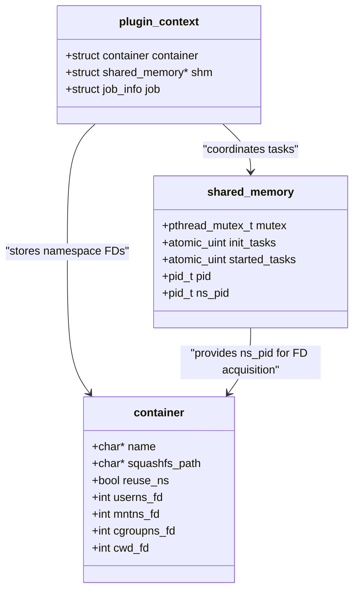
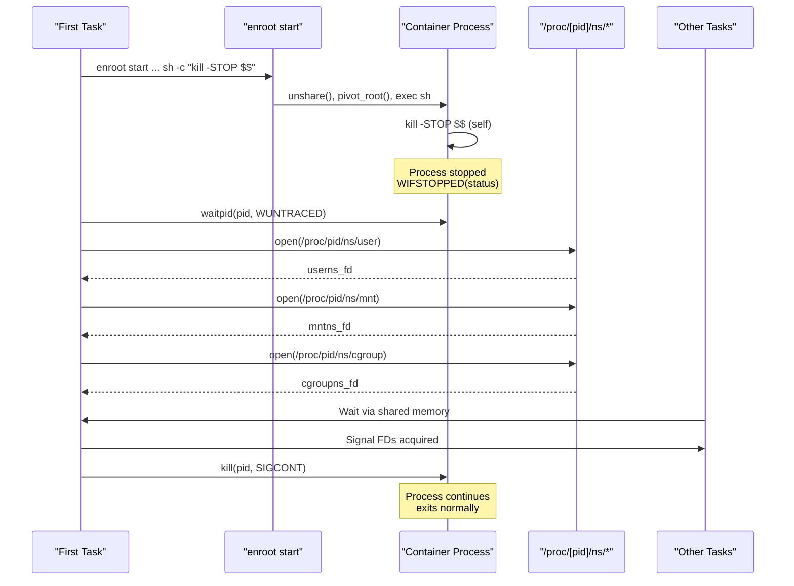
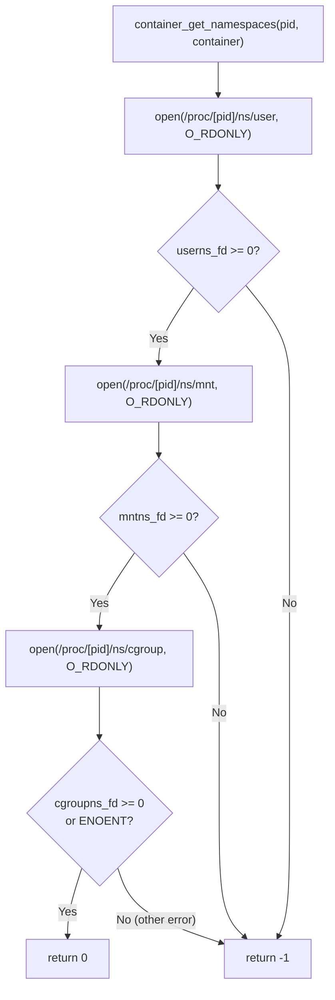
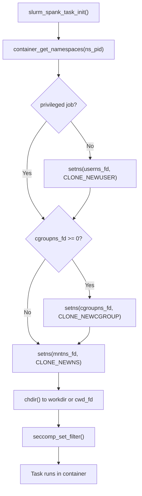
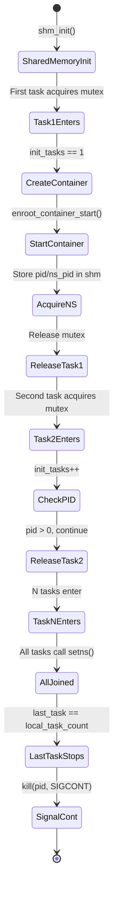
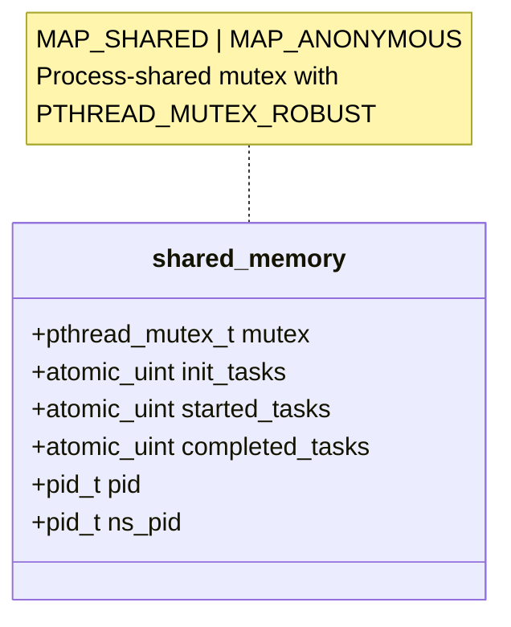
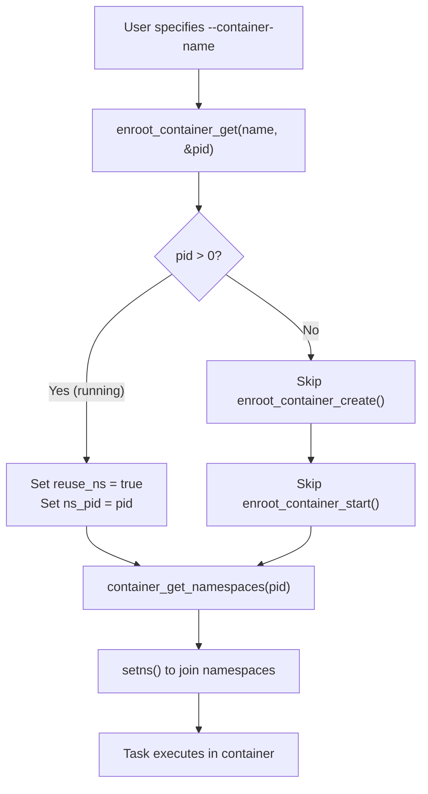
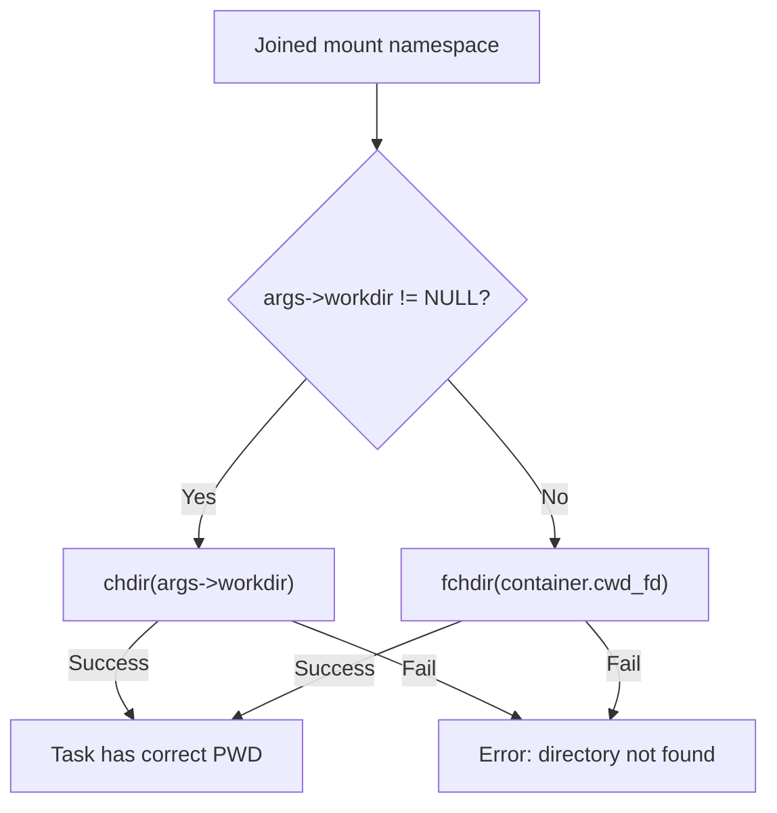

<!-- source: DeepWiki mcp.deepwiki.com · repo NVIDIA/pyxis · page 4.3 Namespace Management · fetched 2026-10-26 -->

# Namespace Management

<details>
<summary>Relevant source files</summary>

The following files were used as context for generating this wiki page:

- [pyxis_slurmstepd.c](pyxis_slurmstepd.c)
- [tests/concurrency.bats](tests/concurrency.bats)
- [tests/exec.bats](tests/exec.bats)
- [tests/remap_root.bats](tests/remap_root.bats)
- [tests/workdir.bats](tests/workdir.bats)

</details>


## Purpose and Scope

This page covers Linux namespace handling in Pyxis, specifically how container namespaces are acquired and joined to execute Slurm tasks inside containers. The namespace management system enables multiple tasks within a Slurm job to share the same container environment by coordinating namespace access through file descriptors and synchronization primitives.

For information about the overall container lifecycle, see [Container Lifecycle Manager](#4). For details on container creation and import strategies, see [Container Creation](#4.2). For environment setup within containers, see [Environment & Execution](#4.4).

## Overview

Namespace management in Pyxis handles three Linux namespace types to isolate container processes:

| Namespace Type | Purpose | Required |
|---------------|---------|----------|
| User namespace (`userns_fd`) | UID/GID remapping | Yes (unless privileged) |
| Mount namespace (`mntns_fd`) | Filesystem isolation | Yes |
| Cgroup namespace (`cgroupns_fd`) | Cgroup hierarchy isolation | Optional (kernel >= 4.6) |

The system uses a two-phase approach: (1) acquiring namespace file descriptors from a running container process, and (2) joining those namespaces using `setns(2)` system calls. This allows all tasks in a job to enter the same container environment.

**Sources**: [pyxis_slurmstepd.c:37-51](), [pyxis_slurmstepd.c:740-781](), [pyxis_slurmstepd.c:1357-1376]()

## Container Namespace Storage



The `container` structure stores file descriptors for each namespace type. These file descriptors reference `/proc/[pid]/ns/*` entries for the container process, allowing tasks to join namespaces even after the original process state changes.

**Sources**: [pyxis_slurmstepd.c:37-51](), [pyxis_slurmstepd.c:65-72](), [pyxis_slurmstepd.c:74-83]()

## Namespace Acquisition Process

### Container Start with SIGSTOP Synchronization

Pyxis uses a synchronization technique where the container process stops itself before namespace acquisition:



This synchronization ensures namespaces are stable during acquisition. The container process must reach a quiescent state after `unshare(2)` and `pivot_root(2)` but before task initialization.

**Sources**: [pyxis_slurmstepd.c:893-954](), [pyxis_slurmstepd.c:909-925](), [pyxis_slurmstepd.c:926-953]()

### Opening Namespace File Descriptors

The `container_get_namespaces()` function opens file descriptors to namespace entries:



The function opens namespace file descriptors in sequence, failing immediately if user or mount namespaces cannot be accessed. Cgroup namespace is optional (returns success on `ENOENT` for older kernels).

All file descriptors use `O_CLOEXEC` to prevent inheritance across `exec()` calls within the container.

**Sources**: [pyxis_slurmstepd.c:740-781]()

## Joining Namespaces with setns()

Once namespace file descriptors are acquired, tasks join the container namespaces in `slurm_spank_task_init()`:

### Namespace Join Sequence



The join order is critical:
1. **User namespace** first (if not privileged) - enables subsequent namespace operations
2. **Cgroup namespace** (if available) - isolates cgroup view
3. **Mount namespace** last - provides container filesystem view

After joining namespaces, the task changes directory to either the specified `workdir` or the container's current working directory, then applies seccomp filters for security.

**Sources**: [pyxis_slurmstepd.c:1357-1402]()

### Code Implementation

| Operation | Code Location | Error Handling |
|-----------|--------------|----------------|
| User namespace join | [pyxis_slurmstepd.c:1357-1361]() | Fatal error, task fails |
| Cgroup namespace join | [pyxis_slurmstepd.c:1364-1370]() | Fatal error if fd valid |
| Mount namespace join | [pyxis_slurmstepd.c:1372-1376]() | Fatal error, task fails |
| Working directory | [pyxis_slurmstepd.c:1379-1391]() | Fatal error if invalid path |
| Seccomp filter | [pyxis_slurmstepd.c:1393-1398]() | Fatal error if privileged |

All `setns()` failures result in task termination with error messages logged through Slurm's logging infrastructure.

**Sources**: [pyxis_slurmstepd.c:1357-1402]()

## Multi-Task Coordination

### Shared Memory Synchronization

Multiple tasks in a Slurm job must coordinate to share a single container. Pyxis uses process-shared memory with mutexes:



The synchronization protocol:
1. **Initialization**: First task creates/starts container, stores `pid` and `ns_pid` in shared memory
2. **Entry coordination**: Each subsequent task increments `init_tasks` counter, reads `ns_pid` for namespace acquisition
3. **Exit coordination**: Last task (when `started_tasks == local_task_count - 1`) sends `SIGCONT` to resume container process

**Sources**: [pyxis_slurmstepd.c:972-1012](), [pyxis_slurmstepd.c:1249-1285](), [pyxis_slurmstepd.c:1287-1306]()

### Shared Memory Structure



| Field | Purpose | Type |
|-------|---------|------|
| `mutex` | Protects container creation/start | `pthread_mutex_t` (process-shared, robust) |
| `init_tasks` | Count of tasks that have initialized | `atomic_uint` |
| `started_tasks` | Count of tasks that have started | `atomic_uint` |
| `completed_tasks` | Count of tasks that have completed | `atomic_uint` |
| `pid` | Container process PID (for SIGCONT) | `pid_t` |
| `ns_pid` | Process PID to acquire namespaces from | `pid_t` |

The mutex uses `PTHREAD_MUTEX_ROBUST` to handle task crashes - if a task dies while holding the mutex, subsequent tasks can recover using `pthread_mutex_consistent()`.

**Sources**: [pyxis_slurmstepd.c:65-72](), [pyxis_slurmstepd.c:972-1012](), [pyxis_slurmstepd.c:1254-1259]()

## Namespace Reuse

### Reusing Existing Container Namespaces

When attaching to a running container (via `--container-name` with `exec` flag), Pyxis reuses existing namespaces without creating a new container:



The `reuse_ns` flag determines whether the first task should start a new container or use an existing one:

| Scenario | `reuse_ns` | `reuse_rootfs` | Behavior |
|----------|-----------|---------------|----------|
| New container | `false` | `false` | Create and start container |
| Reuse filesystem | `false` | `true` | Start container with existing rootfs |
| Attach to running | `true` | `true` | Join existing container's namespaces |

**Sources**: [pyxis_slurmstepd.c:1103-1107](), [pyxis_slurmstepd.c:1272-1273](), [pyxis_slurmstepd.c:1157-1160]()

### Attachment Restrictions

When attaching to running containers (`reuse_ns == true`), certain operations are restricted:

```c
if (context.container.reuse_ns && context.args->mounts_len > 0) {
    slurm_spank_log("pyxis: ignoring --container-mounts when attaching to a running container");
    remove_all_mounts();
}
```

Mount specifications (`--container-mounts`) are ignored because the mount namespace is already established. This prevents conflicts with the existing namespace configuration.

**Sources**: [pyxis_slurmstepd.c:1157-1160](), [tests/exec.bats:56-63]()

## Working Directory Handling

After joining the mount namespace, tasks must set their working directory within the container filesystem:

### Directory Change Logic



The `cwd_fd` is acquired by opening `/proc/[pid]/cwd` for the container process. This file descriptor remains valid even after joining namespaces, allowing the task to change to the container's original working directory.

**Sources**: [pyxis_slurmstepd.c:783-799](), [pyxis_slurmstepd.c:1379-1391]()

## Namespace Management Functions

### Core Function Reference

| Function | Location | Purpose |
|----------|----------|---------|
| `container_get_namespaces()` | [pyxis_slurmstepd.c:740-781]() | Opens namespace FDs from /proc/[pid]/ns/* |
| `container_get_cwd()` | [pyxis_slurmstepd.c:783-799]() | Opens FD to container's working directory |
| `enroot_container_start()` | [pyxis_slurmstepd.c:893-954]() | Starts container with SIGSTOP synchronization |
| `enroot_container_stop()` | [pyxis_slurmstepd.c:956-970]() | Sends SIGCONT to resume container |
| `enroot_start_once()` | [pyxis_slurmstepd.c:1249-1285]() | First-task-only container start |
| `enroot_stop_once()` | [pyxis_slurmstepd.c:1287-1306]() | Last-task-only container stop |
| `shm_init()` | [pyxis_slurmstepd.c:972-1012]() | Creates process-shared memory |
| `shm_destroy()` | [pyxis_slurmstepd.c:1014-1034]() | Destroys shared memory mapping |

### Namespace Join in Task Context

The complete sequence in `slurm_spank_task_init()`:

1. Acquire namespace FDs via `container_get_namespaces()` (lines 1332-1336)
2. Join user namespace with `setns(userns_fd, CLONE_NEWUSER)` (lines 1357-1361)
3. Join cgroup namespace with `setns(cgroupns_fd, CLONE_NEWCGROUP)` (lines 1364-1370)
4. Join mount namespace with `setns(mntns_fd, CLONE_NEWNS)` (lines 1372-1376)
5. Change directory with `chdir()` or `fchdir()` (lines 1379-1391)
6. Apply seccomp filter with `seccomp_set_filter()` (lines 1393-1398)

**Sources**: [pyxis_slurmstepd.c:1308-1402]()

## Test Coverage

### Namespace-Related Tests

The test suite verifies namespace management functionality:

| Test File | Test Case | Verification |
|-----------|-----------|--------------|
| `exec.bats` | "attach to running container" | Namespace reuse with `reuse_ns` flag [tests/exec.bats:25-31]() |
| `exec.bats` | "attach to running unnamed container" | Attaching by auto-generated name [tests/exec.bats:33-46]() |
| `exec.bats` | "--container-name no_exec flag" | Force new namespaces for running container [tests/exec.bats:72-78]() |
| `remap_root.bats` | "--container-remap-root uid map" | User namespace UID mapping verification [tests/remap_root.bats:5-14]() |
| `remap_root.bats` | "seccomp" tests | Seccomp filter applied after namespace join [tests/remap_root.bats:27-33]() |
| `concurrency.bats` | "concurrent container creation" | Shared memory coordination [tests/concurrency.bats:13-24]() |
| `workdir.bats` | All tests | Working directory after mount namespace join [tests/workdir.bats:1-28]() |

### Example: Namespace Reuse Test

```bash
# From tests/exec.bats:25-31
run_srun --container-name=exec-test --container-remap-root \
  bash -c "mount -t tmpfs none /mymnt && sleep 30s" &

sleep 5s
run_srun --overlap --container-name=exec-test findmnt /mymnt
```

This test verifies that a second job can attach to a running container's mount namespace and observe filesystem changes made by the first job.

**Sources**: [tests/exec.bats:1-79](), [tests/remap_root.bats:1-50](), [tests/concurrency.bats:1-44](), [tests/workdir.bats:1-28]()

---

