<!-- source: DeepWiki mcp.deepwiki.com · repo NVIDIA/pyxis · page 4.4 Environment & Execution · fetched 2026-10-26 -->

# Environment & Execution

<details>
<summary>Relevant source files</summary>

The following files were used as context for generating this wiki page:

- [args.c](args.c)
- [pyxis_slurmstepd.c](pyxis_slurmstepd.c)
- [tests/entrypoint.bats](tests/entrypoint.bats)
- [tests/env.bats](tests/env.bats)

</details>


## Purpose and Scope

This page describes how Pyxis manages the execution environment within containers during the task initialization phase. It covers environment variable filtering and propagation, container entrypoint execution, working directory setup, and the final namespace joining operations that enable task execution within the container. For information about container creation and namespace acquisition, see [Container Creation](#4.2) and [Namespace Management](#4.3).

## Environment Variable Management

Pyxis implements a sophisticated environment variable management system that filters variables between Slurm, enroot, and the container. The system operates in three distinct phases: clearing the inherited slurmstepd environment, setting up the environment for enroot commands, and importing the container's environment back into the Slurm job context.

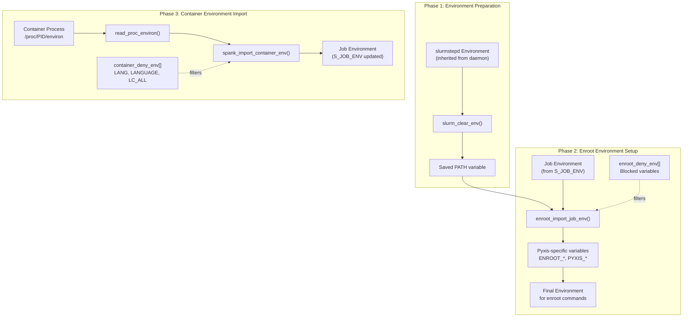

**Sources:** [pyxis_slurmstepd.c:300-434](), [pyxis_slurmstepd.c:524-641]()

### Slurm Environment Clearing

The `slurm_clear_env()` function removes all environment variables inherited from the slurmstepd daemon process, preserving only the `PATH` variable. This prevents environment pollution from the Slurm daemon from affecting container execution.

**Key Implementation Details:**

| Function | Purpose | Location |
|----------|---------|----------|
| `slurm_clear_env()` | Clear all environment except PATH | [pyxis_slurmstepd.c:301-328]() |
| `clearenv()` | System call to clear environment | [pyxis_slurmstepd.c:315]() |

Sources: [pyxis_slurmstepd.c:301-328]()

### Environment Variable Filtering

Pyxis maintains a blocklist of environment variables that should not be passed from the Slurm job to enroot commands. These variables could interfere with enroot's operation or contain task-specific information that shouldn't be visible during container setup.

**Blocked Variables:**

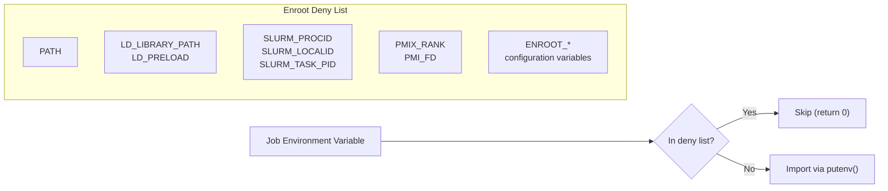

**Blocked Variable Categories:**

| Category | Variables | Reason |
|----------|-----------|--------|
| Library paths | `PATH`, `LD_LIBRARY_PATH`, `LD_PRELOAD` | Prevent host library conflicts |
| Slurm task IDs | `SLURM_PROCID`, `SLURM_LOCALID`, `SLURM_TASK_PID` | Task-specific, not valid during setup |
| PMI variables | `PMIX_RANK`, `PMI_FD` | MPI-specific, task context only |
| Enroot config | `ENROOT_LIBRARY_PATH`, `ENROOT_RUNTIME_PATH`, etc. | Prevent user override of system config |

Sources: [pyxis_slurmstepd.c:333-373]()

### Enroot Environment Setup

The `enroot_set_env()` function prepares the environment for executing enroot commands. It translates Pyxis arguments into enroot environment variables and sets Pyxis-specific variables.

**Environment Variable Mapping:**

| Pyxis Argument | Enroot Variable | Values |
|----------------|-----------------|--------|
| `--container-mount-home` | `ENROOT_MOUNT_HOME` | `y`, `n`, or unset |
| `--container-remap-root` | `ENROOT_REMAP_ROOT` | `y`, `n`, or unset |
| `--container-writable` | `ENROOT_ROOTFS_WRITABLE` | `y`, `n`, or unset |
| N/A | `PYXIS_RUNTIME_PATH` | Plugin runtime path |
| N/A | `PYXIS_VERSION` | Plugin version string |

The function uses tri-state logic (`-1`, `0`, `1`) to distinguish between "user set to false", "user set to true", and "user didn't set, use enroot default".

Sources: [pyxis_slurmstepd.c:389-434](), [args.c:21-26]()

### Container Environment Import

After the container starts, Pyxis reads the container's environment from `/proc/PID/environ` and imports it back into the Slurm job context. This allows the job to inherit environment variables set by the container image's entrypoint.

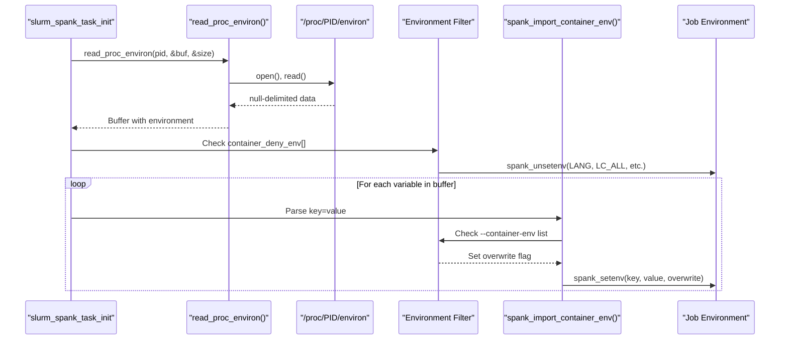

**Container Environment Filtering:**

The system removes locale-related environment variables (`LANG`, `LANGUAGE`, `LC_ALL`) from the job environment before importing the container environment. This prevents locale issues when the container doesn't have the host's locale installed. Users can override this behavior using `--container-env`.

Sources: [pyxis_slurmstepd.c:524-641](), [pyxis_slurmstepd.c:583-588]()

### PyTorch Environment Setup

Pyxis includes special handling for PyTorch distributed training. When `PYTORCH_VERSION` is detected in the environment, Pyxis remaps Slurm variables to PyTorch-expected names.

**PyTorch Variable Remapping:**

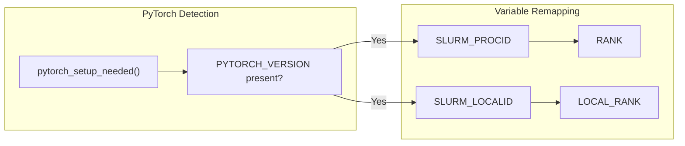

| Slurm Variable | PyTorch Variable | Purpose |
|----------------|------------------|---------|
| `SLURM_PROCID` | `RANK` | Global process rank |
| `SLURM_LOCALID` | `LOCAL_RANK` | Local (node) process rank |

Sources: [pyxis_slurmstepd.c:1206-1247](), [tests/entrypoint.bats:22-31]()

### Container-Env Option

The `--container-env` option allows users to specify environment variables that should override container defaults and be set before the entrypoint runs.

**Processing Flow:**

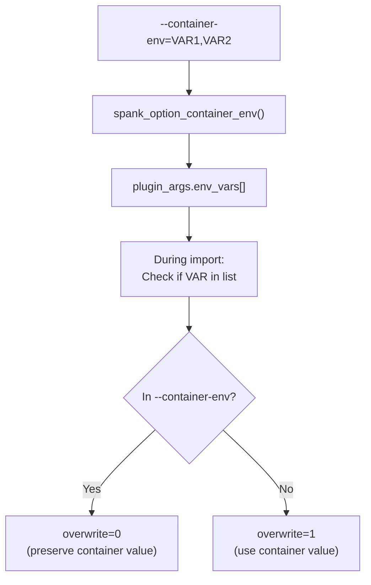

Sources: [args.c:577-613](), [pyxis_slurmstepd.c:602-626](), [tests/env.bats:58-82]()

## Container Entrypoint Handling

Container images often define an entrypoint script that sets up the runtime environment. Pyxis provides control over whether this entrypoint is executed and how its output is handled.

### Entrypoint Execution Decision

The `pyxis_execute_entrypoint()` function determines whether to execute the container's entrypoint based on command-line arguments and plugin configuration.

**Decision Logic:**

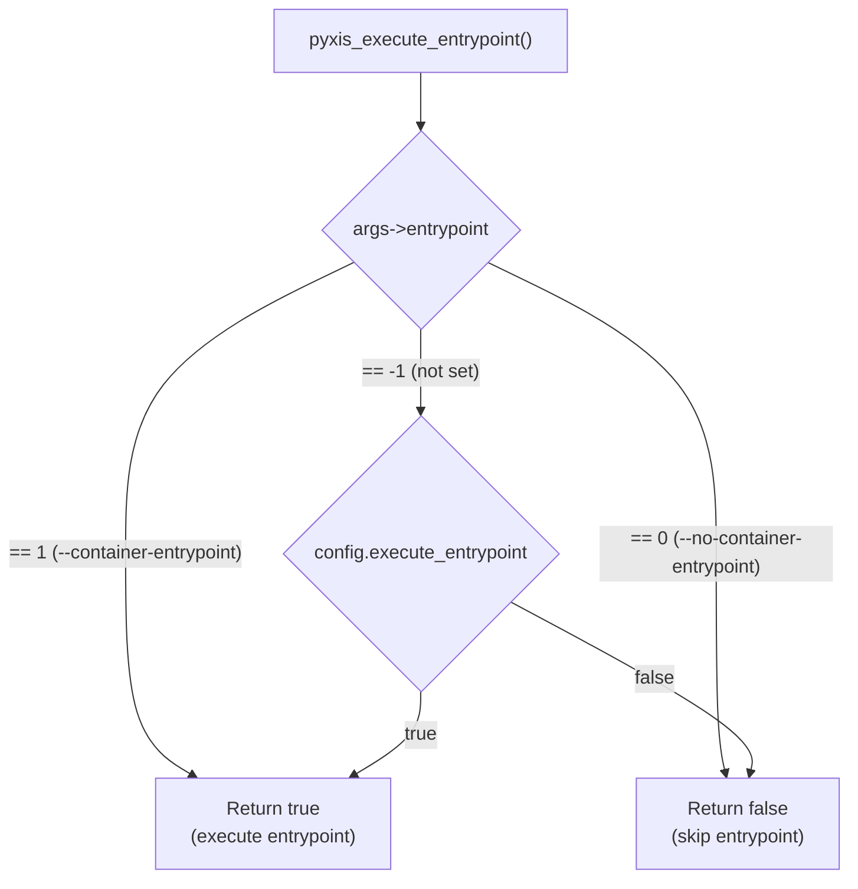

**Configuration Hierarchy:**

| Priority | Source | Values |
|----------|--------|--------|
| 1 (highest) | `--container-entrypoint` | Explicit enable |
| 2 | `--no-container-entrypoint` | Explicit disable |
| 3 (lowest) | `execute_entrypoint` config | Plugin default |

Sources: [pyxis_slurmstepd.c:111-114]()

### Entrypoint Configuration Script

When starting the container, Pyxis generates a temporary bash configuration script that enroot sources. This script controls mount points, entrypoint execution, and environment variable handling.

**Configuration Script Structure:**

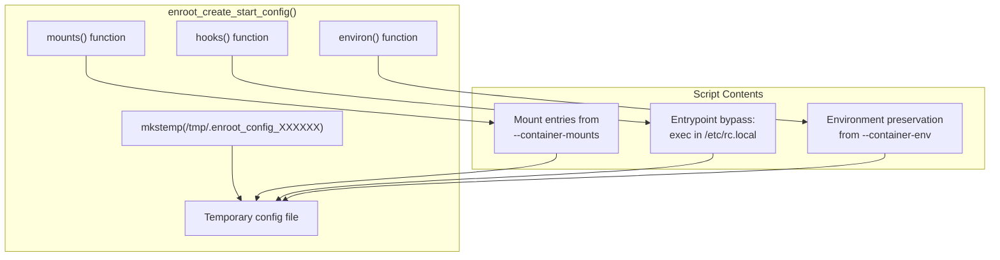

**Script Generation:**

1. **Mount Configuration:** Writes a `mounts()` function that echoes each mount entry from `--container-mounts`
2. **Entrypoint Bypass:** If entrypoint is disabled, writes a `hooks()` function that creates `/etc/rc.local` with `exec "$@"` to bypass the entrypoint
3. **Environment Preservation:** Writes an `environ()` function that exports variables specified in `--container-env`

**Example Generated Script:**

```bash
mounts() {
    echo "/data /data x-create=auto,rbind,ro+rprivate"
    echo "/scratch /scratch x-create=auto,rbind"
}

hooks() {
    # Only generated if --no-container-entrypoint
    echo 'exec "$@"' > ${ENROOT_ROOTFS}/etc/rc.local
}

environ() {
    [ -n "${CUDA_VERSION-}" ] && echo "CUDA_VERSION=${CUDA_VERSION}" || :
}
```

Sources: [pyxis_slurmstepd.c:801-891]()

### Entrypoint Execution Flow

```mermaid
sequenceDiagram
    participant TASK as "slurm_spank_task_init"
    participant START as "enroot_container_start()"
    participant CONFIG as "enroot_create_start_config()"
    participant ENROOT as "enroot start"
    participant CONTAINER as "Container Shell"
    participant RC as "/etc/rc"
    
    TASK->>START: Start container
    START->>CONFIG: Generate config script
    CONFIG-->>START: /tmp/.enroot_config_XXXXXX
    
    START->>ENROOT: enroot start --conf CONFIG
    ENROOT->>CONTAINER: sh -c "kill -STOP $$; exit 0"
    
    Note over CONTAINER: Process stops itself
    
    CONTAINER->>CONTAINER: SIGSTOP
    
    Note over RC: Entrypoint handling
    
    alt Execute entrypoint
        RC->>RC: Source /etc/rc.entrypoint
        RC->>RC: Run image entrypoint
    else Skip entrypoint
        RC->>RC: Source /etc/rc.local
        RC->>RC: exec "$@"
    end
```

Sources: [pyxis_slurmstepd.c:893-954]()

### Entrypoint Logging

The `--container-entrypoint-log` option controls whether entrypoint output is displayed. By default, entrypoint output is suppressed unless explicitly requested.

**Logging Control Flow:**

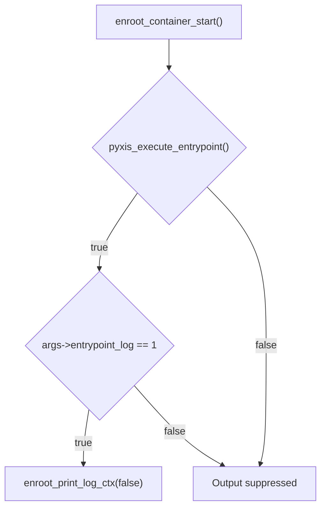

The entrypoint output is captured in an in-memory log file (via `memfd_create`) and conditionally printed after container start.

Sources: [pyxis_slurmstepd.c:948-949](), [tests/entrypoint.bats:51-61]()

## Working Directory Setup

Pyxis sets the task's working directory within the container namespace using either a user-specified path or the container's default working directory.

### Working Directory Resolution

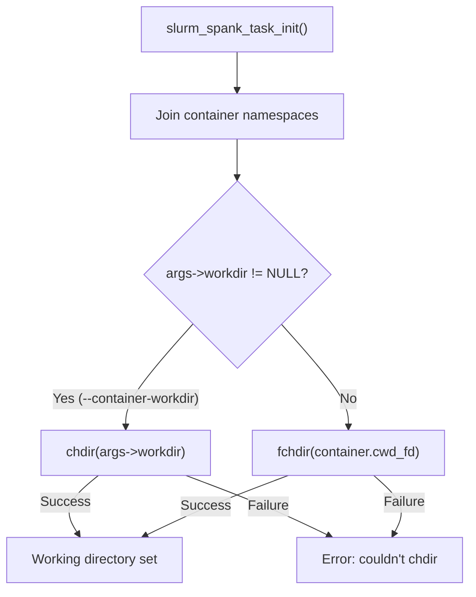

**Working Directory Sources:**

| Priority | Source | Acquired In | Used In |
|----------|--------|-------------|---------|
| 1 | `--container-workdir` | Argument parsing | [pyxis_slurmstepd.c:1379-1384]() |
| 2 | Container's cwd | `container_get_cwd()` | [pyxis_slurmstepd.c:1386-1391]() |

### Container Working Directory Acquisition

The `container_get_cwd()` function opens a file descriptor to the container process's current working directory via `/proc/PID/cwd`. This file descriptor remains valid even after the container process exits, allowing the task to change into this directory later.

**Implementation:**

```c
// Simplified from pyxis_slurmstepd.c:783-799
static int container_get_cwd(pid_t pid, struct container *container)
{
    char path[PATH_MAX];
    snprintf(path, sizeof(path), "/proc/%d/cwd", pid);
    
    container->cwd_fd = open(path, O_RDONLY | O_CLOEXEC);
    if (container->cwd_fd < 0) {
        slurm_error("pyxis: couldn't open cwd fd: %s", strerror(errno));
        return (-1);
    }
    return (0);
}
```

The file descriptor is opened with `O_RDONLY` (since it's a directory) and `O_CLOEXEC` to prevent inheritance by child processes.

Sources: [pyxis_slurmstepd.c:783-799](), [pyxis_slurmstepd.c:1338-1342]()

## Task Execution Phase

The final phase of container setup occurs in `slurm_spank_task_init()`, where each task joins the container's namespaces and prepares for execution. This is the last SPANK hook before the task command is executed.

### Task Initialization Sequence

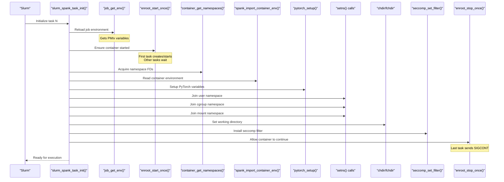

Sources: [pyxis_slurmstepd.c:1308-1409]()

### Namespace Joining

Each task must join the container's namespaces to execute within the containerized environment. The order of namespace joins is important for security and functionality.

**Namespace Join Order:**

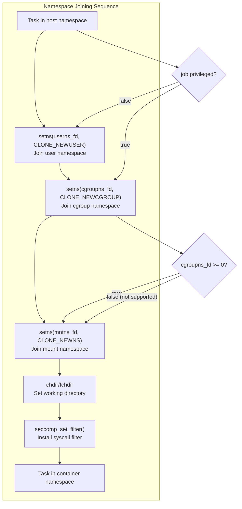

**Namespace Details:**

| Namespace | System Call | Skipped When | Purpose |
|-----------|-------------|--------------|---------|
| User | `setns(userns_fd, CLONE_NEWUSER)` | `job.privileged == true` | UID/GID remapping |
| Cgroup | `setns(cgroupns_fd, CLONE_NEWCGROUP)` | `cgroupns_fd < 0` | Cgroup isolation |
| Mount | `setns(mntns_fd, CLONE_NEWNS)` | Never | Container filesystem |

**Privileged Execution:**

When `ENROOT_ALLOW_SUPERUSER` is set and the job runs as root, Pyxis skips joining the user namespace, allowing true root execution within the container. This is primarily used for debugging and is not recommended for production.

Sources: [pyxis_slurmstepd.c:1356-1376](), [pyxis_slurmstepd.c:182-188]()

### Seccomp Filter Installation

For non-privileged jobs, Pyxis installs a seccomp filter to block dangerous system calls that could escape the container or interfere with Slurm's operation.

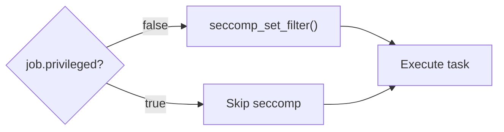

The seccomp filter prevents system calls that could:
- Create new namespaces
- Modify mount points
- Change UID/GID mappings
- Interfere with cgroup management

Sources: [pyxis_slurmstepd.c:1393-1399]()

### Task Synchronization

The final step in task initialization is coordinating with other tasks to ensure the container process can continue execution.

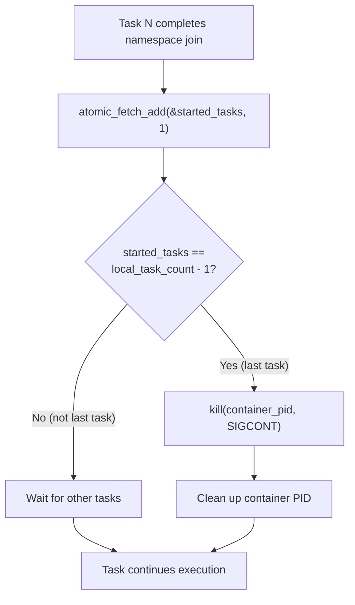

The last task to complete namespace joining sends `SIGCONT` to the container process (which is still stopped from the `kill -STOP $$` in the entrypoint), allowing it to exit cleanly. At this point, all tasks have acquired references to the container's namespaces, so the container process is no longer needed.

Sources: [pyxis_slurmstepd.c:1287-1306](), [pyxis_slurmstepd.c:1401-1403]()

### Task Execution Summary

**Key Data Structures:**

```c
// From pyxis_slurmstepd.c:37-51
struct container {
    char *name;
    char *squashfs_path;
    char *save_path;
    bool reuse_rootfs;
    bool reuse_ns;
    bool temporary_rootfs;
    // Import strategy flags
    bool use_enroot_import;
    bool use_enroot_load;
    bool use_importer;
    // Namespace file descriptors
    int userns_fd;
    int mntns_fd;
    int cgroupns_fd;
    int cwd_fd;
};
```

**Task Initialization Checklist:**

| Step | Function | Purpose | Error Handling |
|------|----------|---------|----------------|
| 1 | `job_get_env()` | Reload environment with PMIx vars | Fail task init |
| 2 | `enroot_start_once()` | Start container (first task) | Fail task init |
| 3 | `container_get_namespaces()` | Open namespace FDs | Fail task init |
| 4 | `container_get_cwd()` | Get container working dir | Fail task init |
| 5 | `spank_import_container_env()` | Import container environment | Fail task init |
| 6 | `pytorch_setup()` | Setup PyTorch variables (if needed) | Fail task init |
| 7 | `setns()` calls | Join namespaces | Fail task init |
| 8 | `chdir()`/`fchdir()` | Set working directory | Fail task init |
| 9 | `seccomp_set_filter()` | Install syscall filter | Fail task init |
| 10 | `enroot_stop_once()` | Release container process | Continue anyway |

Sources: [pyxis_slurmstepd.c:1308-1409](), [pyxis_slurmstepd.c:37-51]()

---

