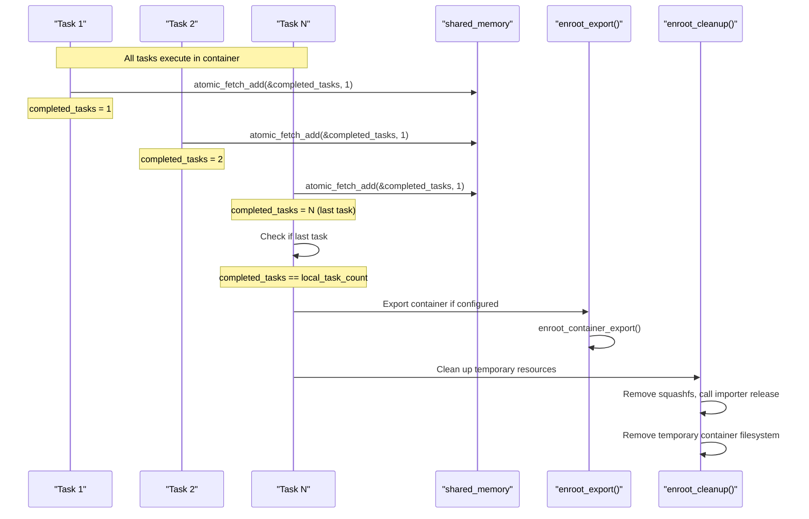
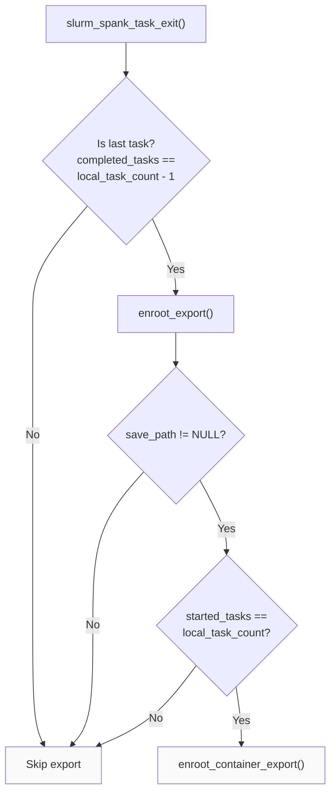
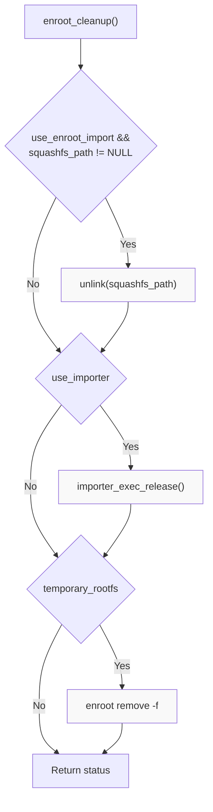
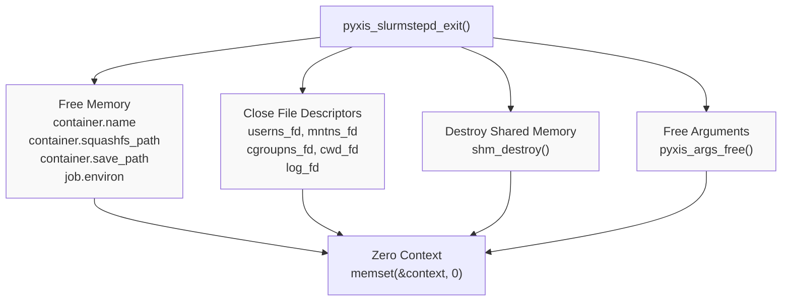
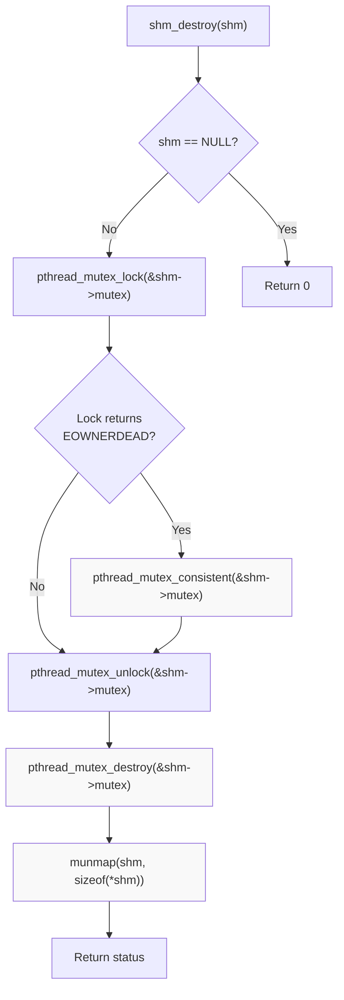
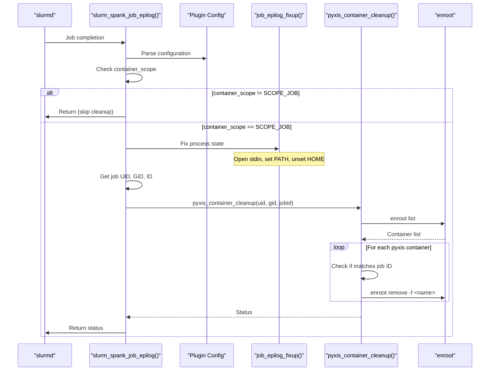

<!-- source: DeepWiki mcp.deepwiki.com · repo NVIDIA/pyxis · page 4.5 Cleanup & Teardown · fetched 2026-10-26 -->

# Cleanup & Teardown

<details>
<summary>Relevant source files</summary>

The following files were used as context for generating this wiki page:

- [pyxis_slurmd.c](pyxis_slurmd.c)
- [pyxis_slurmstepd.c](pyxis_slurmstepd.c)

</details>


This page documents the cleanup and teardown mechanisms in Pyxis, focusing on how resources are released after container execution completes. This includes task-level cleanup, container export operations, temporary resource removal, and job-scoped cleanup.

For information about container creation and initialization, see [Container Creation](#4.2). For namespace setup, see [Namespace Management](#4.3).

## Overview

Pyxis implements a multi-phase cleanup strategy to ensure proper resource release after containerized job execution. Cleanup operations are coordinated across multiple tasks using atomic counters in shared memory, with the last task to exit responsible for performing export and cleanup operations. Additional cleanup occurs during the plugin exit phase and, for job-scoped containers, during the Slurm job epilog.

### Cleanup Phases

| Phase | Hook | Responsibility | Scope |
|-------|------|----------------|-------|
| Task Exit | `slurm_spank_task_exit` | Container export, temporary cleanup | Last local task |
| Plugin Exit | `pyxis_slurmstepd_exit` | Memory/FD cleanup, shared memory destruction | Per step |
| Job Epilog | `slurm_spank_job_epilog` | Remove job-scoped containers | Per job (slurmd) |

Sources: [pyxis_slurmstepd.c:1491-1511](), [pyxis_slurmstepd.c:1513-1545](), [pyxis_slurmd.c:127-176]()

## Task Exit and Last-Task Coordination

### Cleanup Coordination Flow



Sources: [pyxis_slurmstepd.c:1491-1511]()

### Task Exit Implementation

The `slurm_spank_task_exit()` hook is called when each task exits. The last task to complete is responsible for export and cleanup operations:

```c
int slurm_spank_task_exit(spank_t sp, int ac, char **av)
```

**Last Task Detection:**
- Uses `atomic_fetch_add(&context.shm->completed_tasks, 1)` to atomically increment the completion counter
- Compares the returned value (pre-increment) with `context.job.local_task_count - 1`
- If equal, this task is the last to exit and performs cleanup

**Operations Performed by Last Task:**
1. Container export via `enroot_export()` if configured
2. Temporary resource cleanup via `enroot_cleanup()`

Sources: [pyxis_slurmstepd.c:1491-1511]()

## Container Export

Container export saves the modified container filesystem to a specified location, preserving any changes made during job execution. This feature is optional and controlled by the `--container-save` argument.

### Export Decision Logic



Sources: [pyxis_slurmstepd.c:1440-1458](), [pyxis_slurmstepd.c:1411-1438]()

### Export Path Resolution

The export path can be specified as either absolute or relative to the job's working directory:

| Path Type | Example | Resolution |
|-----------|---------|------------|
| Absolute | `/scratch/export.sqsh` | Used as-is |
| Relative | `output.sqsh` | Resolved to `${job.cwd}/output.sqsh` |

**Implementation Details:**
- If `save_path[0] == '/'`, path is absolute
- Otherwise, path is resolved relative to `context.job.cwd`
- Job working directory must be set for relative paths

Sources: [pyxis_slurmstepd.c:1416-1429]()

### Export Command

The actual export is performed by executing the enroot export command:

```
enroot export -f -o <path> <container_name>
```

**Flags:**
- `-f`: Force overwrite of existing file
- `-o`: Output path for exported container

Sources: [pyxis_slurmstepd.c:1431-1435]()

## Temporary Resource Cleanup

The `enroot_cleanup()` function removes temporary resources created during container setup and execution.

### Cleanup Operations



Sources: [pyxis_slurmstepd.c:1460-1489]()

### Cleanup Categories

**1. Temporary Squashfs Files**

When using `enroot import`, a temporary squashfs file is created in the runtime directory:

```
${runtime_path}/${uid}/${jobid}.${stepid}.squashfs
```

This file is removed during cleanup if `container.use_enroot_import` is true and the file still exists.

**2. Importer Resources**

When using an external importer (see [Image Import Strategies](#8)), the importer's `release` operation is called to clean up any cached or temporary resources:

```
${importer_path} release <uri>
```

**3. Temporary Container Filesystems**

Containers created for step-scoped execution (`temporary_rootfs = true`) are removed using:

```
enroot remove -f <container_name>
```

This removes the container filesystem but not any saved exports.

Sources: [pyxis_slurmstepd.c:1466-1486]()

## Plugin Exit Cleanup

The `pyxis_slurmstepd_exit()` hook is called when the slurmstepd process exits, after all tasks have completed. This phase performs final cleanup of plugin-allocated resources.

### Resource Cleanup Categories



Sources: [pyxis_slurmstepd.c:1513-1545]()

### Memory Cleanup

All dynamically allocated memory in the plugin context is freed:

| Field | Description |
|-------|-------------|
| `context.container.name` | Container name string |
| `context.container.squashfs_path` | Path to squashfs file |
| `context.container.save_path` | Export destination path |
| `context.job.environ` | Job environment array |

Each element of `job.environ` is freed individually before freeing the array itself.

Sources: [pyxis_slurmstepd.c:1518-1526]()

### File Descriptor Cleanup

All open file descriptors are closed using the `xclose()` helper macro:

| File Descriptor | Purpose |
|-----------------|---------|
| `userns_fd` | User namespace reference |
| `mntns_fd` | Mount namespace reference |
| `cgroupns_fd` | Cgroup namespace reference |
| `cwd_fd` | Container working directory reference |
| `log_fd` | Enroot command output log |

The `xclose()` macro safely closes the file descriptor and sets it to -1.

Sources: [pyxis_slurmstepd.c:1528-1532]()

### Argument Cleanup

The `pyxis_args_free()` function releases all memory allocated for parsed command-line arguments, including:
- Image URI
- Mount specifications
- Environment variable lists
- Container name and flags

For details on argument structure, see [Argument Parsing](#6).

Sources: [pyxis_slurmstepd.c:1540]()

## Shared Memory Teardown

Shared memory is used to coordinate container creation and cleanup across multiple tasks. The `shm_destroy()` function performs cleanup of the shared memory region.

### Shared Memory Structure

```c
struct shared_memory {
    pthread_mutex_t mutex;
    atomic_uint init_tasks;
    atomic_uint started_tasks;
    atomic_uint completed_tasks;
    pid_t pid;
    pid_t ns_pid;
};
```

Sources: [pyxis_slurmstepd.c:65-72]()

### Destruction Process



Sources: [pyxis_slurmstepd.c:1014-1034]()

### Robust Mutex Handling

The shared memory mutex is configured with `PTHREAD_MUTEX_ROBUST`, which allows detection and recovery from cases where a process holding the mutex terminates abnormally:

1. **Lock Acquisition:** Attempt to lock the mutex
2. **Owner Dead Check:** If lock returns `EOWNERDEAD`, the previous owner died while holding the lock
3. **Make Consistent:** Call `pthread_mutex_consistent()` to mark the mutex as consistent
4. **Unlock:** Release the mutex
5. **Destroy:** Destroy the mutex
6. **Unmap:** Unmap the shared memory region

Sources: [pyxis_slurmstepd.c:1021-1023]()

## Job Epilog Cleanup

For job-scoped containers (configured with `container_scope = job`), additional cleanup is performed by the `pyxis_slurmd` plugin in the Slurm job epilog phase.

### Job Epilog Flow



Sources: [pyxis_slurmd.c:127-176](), [pyxis_slurmd.c:52-93]()

### Container Identification Pattern

The cleanup function identifies pyxis containers for a specific job using the naming pattern:

```
pyxis_<jobid>_<suffix>
```

Where:
- `<jobid>` is the numeric Slurm job ID
- `<suffix>` can be:
  - Empty (anonymous step containers): `pyxis_<jobid>_<jobid>.<stepid>`
  - Named containers: `pyxis_<jobid>_<user_name>`

The pattern matching uses `sscanf()` to extract the job ID:

```c
if (sscanf(name, "pyxis_%u_%*s%n", &id, &n) == 1) {
    if (strlen(name) != n || id != jobid)
        continue;
    // Remove container
}
```

Sources: [pyxis_slurmd.c:70-72]()

### Epilog Process State Fixup

The SPANK epilog process has an unusual initial state that requires correction:

| Issue | Fix |
|-------|-----|
| Empty environment | Set `PATH=/usr/local/bin:/usr/bin:/bin` |
| File descriptor 0 closed | Open `/dev/null` as stdin |
| HOME variable may be set | Unset `HOME` |

These fixes ensure that enroot commands can execute correctly in the epilog context.

Sources: [pyxis_slurmd.c:100-125]()

### Container Removal

Each identified container is removed forcefully:

```
enroot remove -f <container_name>
```

The `-f` flag forces removal even if the container is in use or has issues. Any failures are logged but do not prevent cleanup of other containers.

Sources: [pyxis_slurmd.c:75-80]()

## Cleanup Failure Handling

Throughout the cleanup phases, errors are handled with appropriate logging but generally do not prevent subsequent cleanup operations from proceeding.

### Error Handling Strategy

| Operation | Error Handling |
|-----------|----------------|
| Container export | Log error, continue to cleanup |
| Squashfs removal | Log if unlink fails, continue |
| Importer release | Log failure, continue |
| Container removal | Log failure, return error status |
| Shared memory destroy | Log error, return error status |

This approach ensures that even if one cleanup operation fails, other resources are still released.

Sources: [pyxis_slurmstepd.c:1502-1505](), [pyxis_slurmstepd.c:1471-1475](), [pyxis_slurmstepd.c:1483-1484]()

## Summary

The Pyxis cleanup and teardown process ensures proper resource release through multiple coordinated phases:

1. **Task Exit:** Last task exports container and removes temporary resources
2. **Plugin Exit:** Memory, file descriptors, and shared memory are freed
3. **Job Epilog:** Job-scoped containers are removed from the node

This multi-phase approach handles both normal and abnormal termination scenarios, with robust mutex handling and careful error management to ensure resources are released even when failures occur.

---

