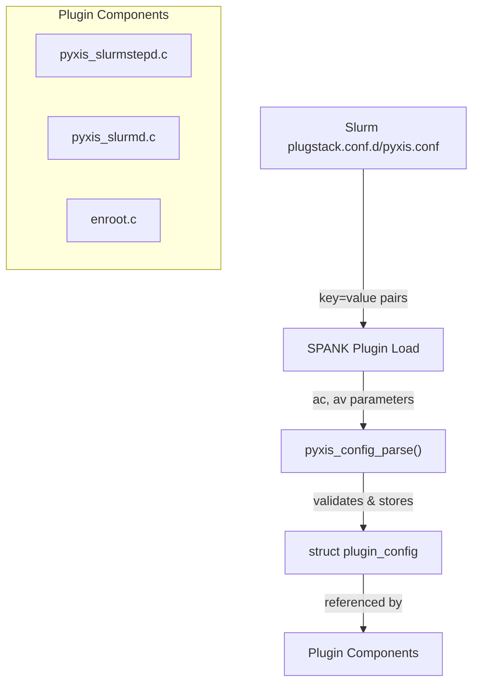
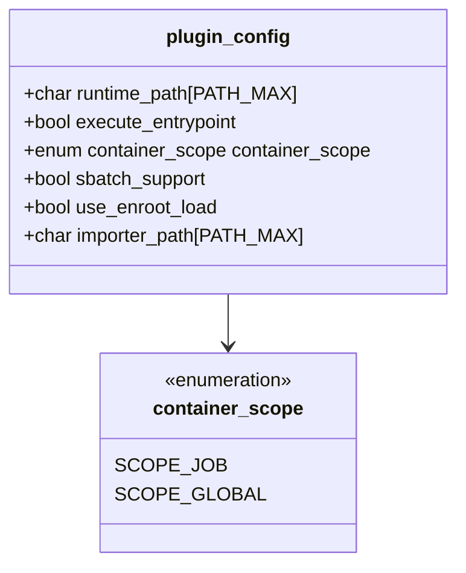
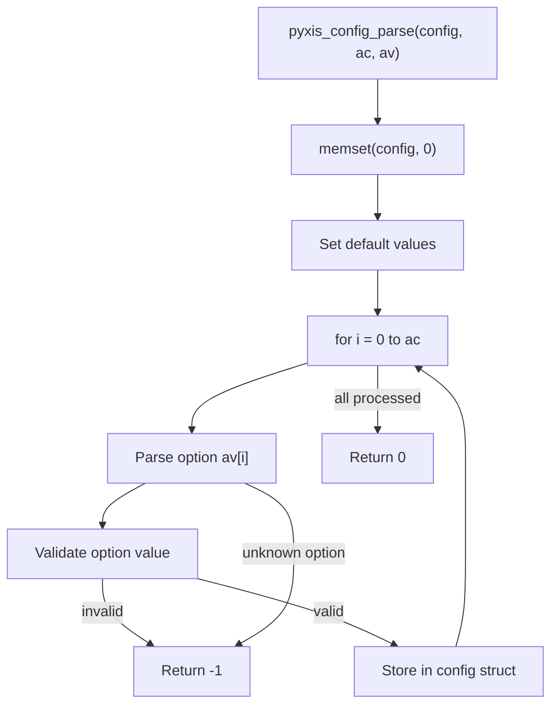
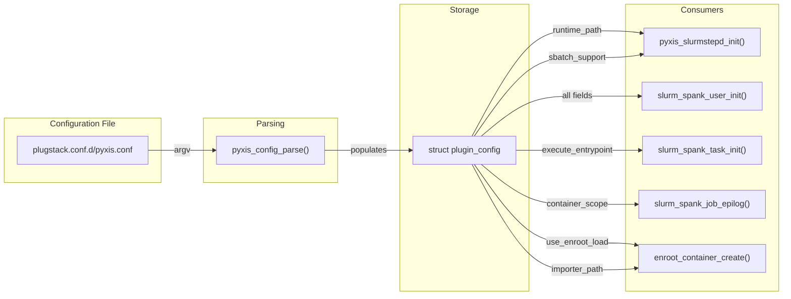

<!-- source: DeepWiki mcp.deepwiki.com · repo NVIDIA/pyxis · page 5 Configuration System · fetched 2026-10-26 -->

# Configuration System

<details>
<summary>Relevant source files</summary>

The following files were used as context for generating this wiki page:

- [config.c](config.c)
- [config.h](config.h)

</details>


## Purpose and Scope

The Configuration System manages plugin-level settings for Pyxis that control runtime behavior, container lifecycle management, and integration with Enroot. Configuration is specified by administrators in Slurm's plugstack configuration file and parsed during plugin initialization.

This page covers the parsing, validation, and storage of plugin configuration options. For user-facing command-line arguments (e.g., `--container-image`), see [Argument Parsing](#6). For how configuration influences container lifecycle behavior, see [Container Lifecycle Manager](#4).

**Sources:** [config.h:1-29](), [config.c:1-98]()

## Configuration Architecture

The configuration system provides a clean separation between administrator-controlled plugin settings and user-controlled job parameters. Configuration is parsed once at plugin load time and remains constant throughout the plugin's lifetime.

### Configuration Flow Diagram



**Sources:** [config.c:23-98](), Diagram 5 from high-level architecture

## Data Structures

### plugin_config Structure

The `plugin_config` structure holds all parsed configuration values. It is defined in [config.h:16-23]() and serves as the central storage for plugin-wide settings.



**Sources:** [config.h:16-23](), [config.h:11-14]()

### Container Scope Enumeration

The `container_scope` enum [config.h:11-14]() defines the lifecycle scope for containers:

| Value | Description |
|-------|-------------|
| `SCOPE_JOB` | Containers are tied to the job lifecycle and removed after job completion |
| `SCOPE_GLOBAL` | Containers persist beyond job completion and must be manually managed |

**Sources:** [config.h:11-14]()

## Configuration Options

### Supported Options Table

| Option | Type | Default | Description |
|--------|------|---------|-------------|
| `runtime_path` | string | `/run/pyxis` | Directory for runtime files (FIFOs, namespace FDs, shared memory) |
| `execute_entrypoint` | boolean | `false` | Whether to execute container entrypoint by default |
| `container_scope` | enum | `global` | Container lifecycle scope: `job` or `global` |
| `sbatch_support` | boolean | `true` | Enable container support for batch jobs via `sbatch` |
| `use_enroot_load` | boolean | `false` | Use `enroot load` for tar archives instead of `enroot import` |
| `importer` | string | (empty) | Path to external importer script for container images |

**Sources:** [config.c:35-40](), [config.c:42-95]()

### Option Details

#### runtime_path

Specifies the base directory where Pyxis creates runtime files during container execution. The directory must be writable by the Slurm daemons.

- **Default:** `/run/pyxis` [config.c:35]()
- **Format:** Absolute path
- **Validation:** Path length must not exceed `PATH_MAX` [config.c:46-49]()
- **Usage:** Job-specific subdirectories are created as `{runtime_path}/{jobid}.{stepid}`

The default uses `/run/pyxis` rather than `/run/user/<uid>` because Slurm may not integrate with PAM/logind [config.c:31-34]().

#### execute_entrypoint

Controls whether the container's entrypoint is executed by default for all jobs.

- **Default:** `false` [config.c:36]()
- **Format:** Boolean (`true`, `false`, `yes`, `no`, `y`, `n`, `1`, `0`)
- **Override:** Users can override with `--container-entrypoint` or `--no-container-entrypoint`

#### container_scope

Determines container lifecycle management and cleanup behavior.

- **Default:** `SCOPE_GLOBAL` [config.c:37]()
- **Valid Values:**
  - `job`: Containers are cleaned up by `pyxis_slurmd.c` during job epilog
  - `global`: Containers persist and require manual cleanup
- **Parsing:** [config.c:58-67]()

#### sbatch_support

Enables or disables container support for batch jobs submitted via `sbatch`.

- **Default:** `true` [config.c:38]()
- **Format:** Boolean
- **Purpose:** Allows administrators to restrict container usage to interactive jobs only

#### use_enroot_load

Controls the method used for importing tar-based container images.

- **Default:** `false` [config.c:39]()
- **Format:** Boolean
- **Behavior:**
  - `false`: Use `enroot import` with dockerd:// prefix
  - `true`: Use `enroot load` for tar archives
- **Parsing:** [config.c:76-83]()

#### importer

Path to an external importer script that handles container image import.

- **Default:** (empty string) [config.c:40]()
- **Format:** Absolute path to executable script
- **Validation:** Path length must not exceed `PATH_MAX` [config.c:87-90]()
- **Usage:** When set, delegates image import to the specified script instead of using Enroot directly
- **Examples:** `caching_importer.sh`, `simple_importer.sh` (see [Image Import Strategies](#8))

**Sources:** [config.c:42-95]()

## Parsing Implementation

### Main Parsing Function

The `pyxis_config_parse()` function [config.c:23-98]() performs configuration parsing:



**Sources:** [config.c:23-98]()

### Function Signature and Parameters

```c
int pyxis_config_parse(struct plugin_config *config, int ac, char **av)
```

- **Parameters:**
  - `config`: Output parameter, receives parsed configuration
  - `ac`: Argument count from Slurm plugstack configuration
  - `av`: Argument vector containing `key=value` strings
- **Returns:** `0` on success, `-1` on error
- **Location:** [config.c:23]()

### Parsing Algorithm

1. **Initialization** [config.c:28](): Zero the config structure with `memset()`
2. **Default Assignment** [config.c:35-40](): Set default values for all fields
3. **Option Loop** [config.c:42](): Iterate through argument vector
4. **Key Matching** [config.c:43-91](): Match option prefixes using `strncmp()`
5. **Value Extraction** [config.c:44,51,59,69,77,85](): Extract value after `=` separator
6. **Validation** [config.c:46-49,52-56,60-67,70-74,78-83,86-90](): Validate value format and range
7. **Storage** [config.c:45,57,61,63,74,83,86](): Store validated value in config structure
8. **Error Handling** [config.c:47,54,65,72,80,88,92](): Log errors via `slurm_error()` and return `-1`

**Sources:** [config.c:23-98]()

## Boolean Parsing

### parse_bool Function

The `parse_bool()` utility function [config.c:12-21]() converts string representations to boolean values.

| Accepted Values | Result |
|-----------------|--------|
| `1`, `true`, `yes`, `y` | Returns `true` |
| `0`, `false`, `no`, `n` | Returns `false` |
| Any other value | Returns `-1` (error) |

**Implementation:** Uses `strcmp()` for exact string matching [config.c:14-18]().

**Sources:** [config.c:12-21]()

## Configuration to Code Entity Mapping



**Sources:** [config.c:23-98](), [config.h:16-23]()

## Error Handling

### Validation Errors

The parser performs several types of validation:

1. **Path Length Validation** [config.c:46-49,87-90]()
   - Ensures paths fit within `PATH_MAX`
   - Uses `snprintf()` return value checking
   - Error message: `"path too long: %s"`

2. **Boolean Validation** [config.c:52-56,70-74,78-83]()
   - Delegates to `parse_bool()` function
   - Checks for `-1` return (invalid boolean)
   - Error message: `"invalid value: %s"`

3. **Enum Validation** [config.c:60-67]()
   - Validates `container_scope` against known values
   - Accepts only `"job"` or `"global"`
   - Error message: `"invalid value: %s"`

4. **Unknown Option Detection** [config.c:92-94]()
   - Catches unrecognized configuration keys
   - Error message: `"unknown configuration option: %s"`

All errors are logged via `slurm_error()` and cause the parser to return `-1`, which typically prevents plugin loading.

**Sources:** [config.c:46-94]()

## Example Configuration

A typical Slurm plugstack configuration file might contain:

```
required /usr/local/lib/slurm/spank_pyxis.so runtime_path=/var/run/pyxis container_scope=job execute_entrypoint=true importer=/usr/local/bin/caching_importer.sh
```

This configuration is parsed as:
- `runtime_path=/var/run/pyxis` → `config->runtime_path = "/var/run/pyxis"`
- `container_scope=job` → `config->container_scope = SCOPE_JOB`
- `execute_entrypoint=true` → `config->execute_entrypoint = true`
- `importer=/usr/local/bin/caching_importer.sh` → `config->importer_path = "/usr/local/bin/caching_importer.sh"`

**Sources:** [config.c:23-98]()

## Integration Points

The `plugin_config` structure is accessed by multiple plugin components:

| Component | Configuration Fields Used | Purpose |
|-----------|---------------------------|---------|
| `pyxis_slurmstepd.c` | `runtime_path`, `execute_entrypoint`, `container_scope`, `sbatch_support`, `use_enroot_load`, `importer_path` | Container creation, execution, and lifecycle management |
| `pyxis_slurmd.c` | `container_scope`, `runtime_path` | Job epilog cleanup decisions |
| `enroot.c` | `use_enroot_load`, `importer_path` | Container image import strategy selection |

**Sources:** [config.h:16-23](), Diagram 1 and 5 from high-level architecture

---

