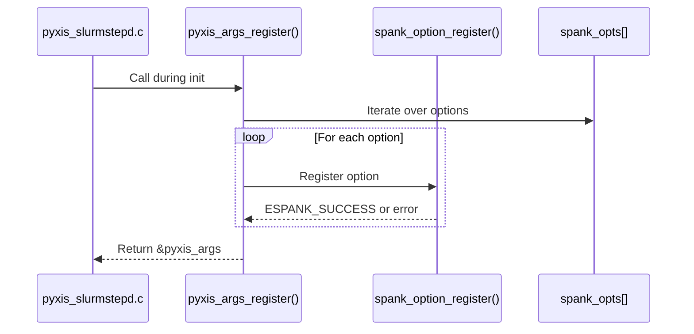
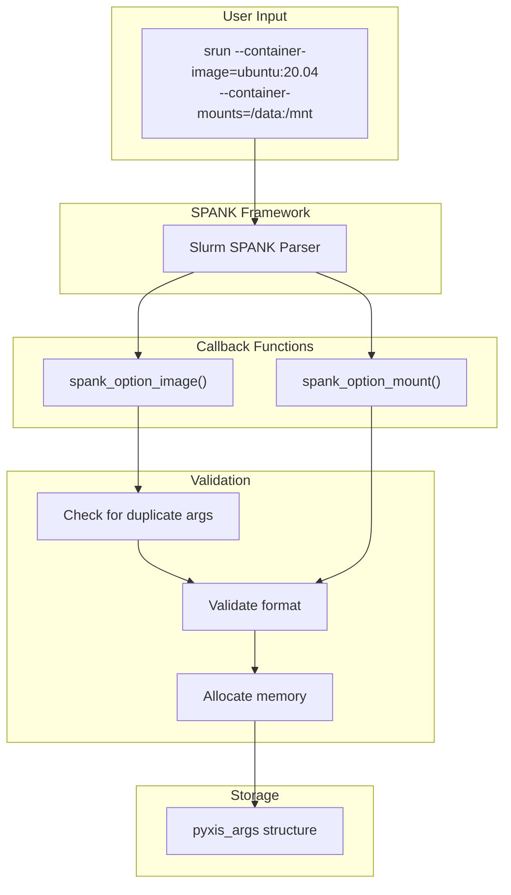
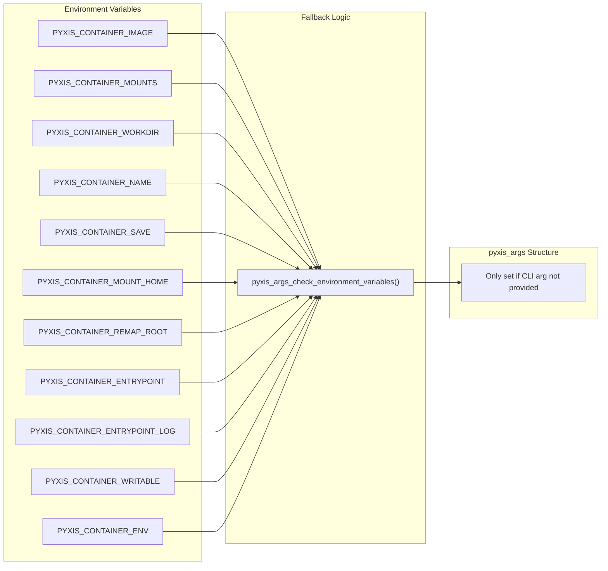
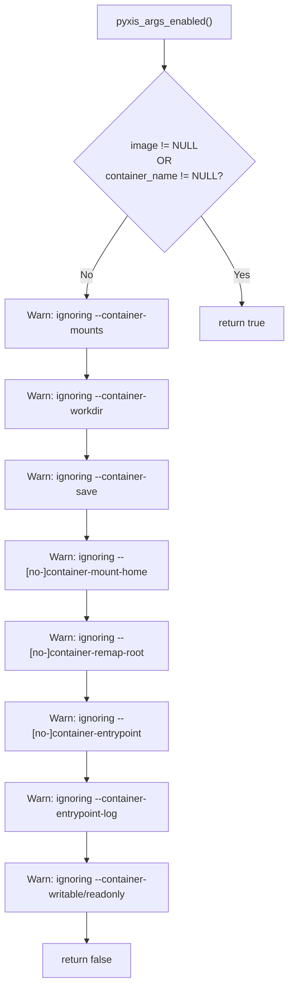
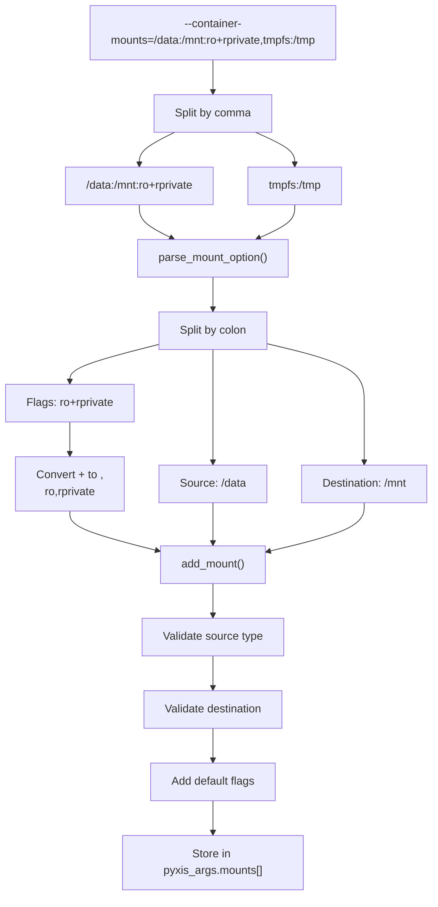
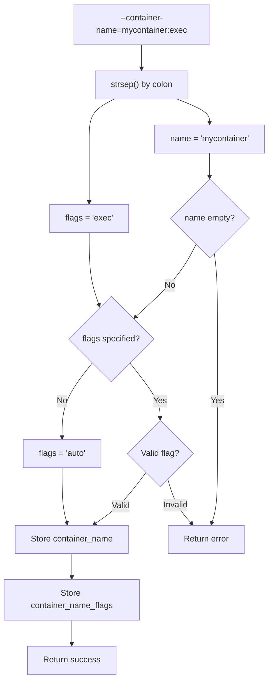
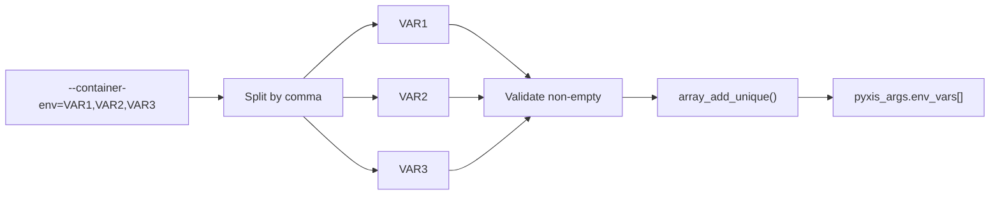
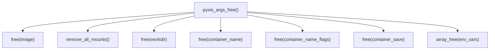
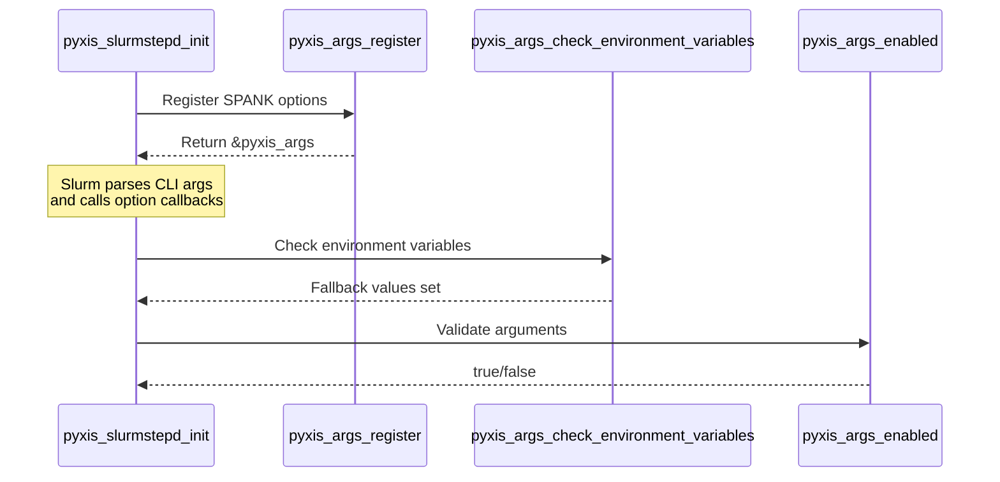

<!-- source: DeepWiki mcp.deepwiki.com · repo NVIDIA/pyxis · page 6 Argument Parsing · fetched 2026-10-26 -->

# Argument Parsing

<details>
<summary>Relevant source files</summary>

The following files were used as context for generating this wiki page:

- [args.c](args.c)
- [args.h](args.h)
- [tests/invalid_args.bats](tests/invalid_args.bats)

</details>


This document describes the argument parsing system implemented in [args.c]() and [args.h](). The argument parser is responsible for registering SPANK options with Slurm, parsing command-line arguments provided by users via `srun` or `sbatch`, and handling environment variable fallbacks. The parsed arguments are stored in a `struct plugin_args` structure that is consumed by the container lifecycle manager.

For information about how these parsed arguments are used to create containers, see [Container Lifecycle Manager](#4). For information about plugin-level configuration (as opposed to user-level arguments), see [Configuration System](#5).

## Overview

The argument parsing system provides a two-phase approach to configuration:

1. **Command-line arguments**: User-specified options via `--container-*` flags
2. **Environment variables**: Fallback values via `PYXIS_CONTAINER_*` variables

Command-line arguments always take precedence over environment variables. The parser performs validation to ensure arguments are well-formed and mutually compatible before they are used by the container lifecycle manager.

Sources: [args.c:1-668](), [args.h:1-42]()

## Data Structures

### plugin_args Structure

The `struct plugin_args` structure holds all parsed user arguments that control container behavior:

| Field | Type | Description |
|-------|------|-------------|
| `image` | `char*` | Container image URI or path to squashfs file |
| `mounts` | `char**` | Array of mount specifications |
| `mounts_len` | `size_t` | Number of mount entries |
| `workdir` | `char*` | Working directory inside container |
| `container_name` | `char*` | Named container identifier |
| `container_name_flags` | `char*` | Behavior flags for named containers |
| `container_save` | `char*` | Path to save container state |
| `mount_home` | `int` | Mount home directory flag (-1=unset, 0=no, 1=yes) |
| `remap_root` | `int` | Remap to root flag (-1=unset, 0=no, 1=yes) |
| `entrypoint` | `int` | Execute entrypoint flag (-1=unset, 0=no, 1=yes) |
| `entrypoint_log` | `int` | Log entrypoint output flag (-1=unset, 0=no, 1=yes) |
| `writable` | `int` | Writable filesystem flag (-1=unset, 0=no, 1=yes) |
| `env_vars` | `char**` | Array of environment variable names to preserve |
| `env_vars_len` | `size_t` | Number of environment variables |

The static instance `pyxis_args` is initialized at [args.c:13-28]() and accessed throughout the argument parsing process.

Sources: [args.h:13-28](), [args.c:13-28]()

### spank_option Array

The `spank_opts[]` array at [args.c:42-151]() defines all available SPANK options with their metadata:

```mermaid
graph TD
    subgraph "SPANK Option Registration"
        OPTS["spank_opts[] array"]
        
        IMG["--container-image<br/>spank_option_image()"]
        MNT["--container-mounts<br/>spank_option_mount()"]
        WRK["--container-workdir<br/>spank_option_workdir()"]
        NAME["--container-name<br/>spank_option_container_name()"]
        SAVE["--container-save<br/>spank_option_container_save()"]
        
        HOME["--[no-]container-mount-home<br/>spank_option_container_mount_home()"]
        REMAP["--[no-]container-remap-root<br/>spank_option_container_remap_root()"]
        ENTRY["--[no-]container-entrypoint<br/>spank_option_container_entrypoint()"]
        ENTLOG["--container-entrypoint-log<br/>spank_option_container_entrypoint_log()"]
        WRIT["--container-writable/--container-readonly<br/>spank_option_container_writable()"]
        ENV["--container-env<br/>spank_option_container_env()"]
        
        OPTS --> IMG
        OPTS --> MNT
        OPTS --> WRK
        OPTS --> NAME
        OPTS --> SAVE
        OPTS --> HOME
        OPTS --> REMAP
        OPTS --> ENTRY
        OPTS --> ENTLOG
        OPTS --> WRIT
        OPTS --> ENV
    end
    
    subgraph "Argument Storage"
        ARGS["pyxis_args structure"]
    end
    
    IMG --> ARGS
    MNT --> ARGS
    WRK --> ARGS
    NAME --> ARGS
    SAVE --> ARGS
    HOME --> ARGS
    REMAP --> ARGS
    ENTRY --> ARGS
    ENTLOG --> ARGS
    WRIT --> ARGS
    ENV --> ARGS
```



Sources: [args.c:42-151](), [args.c:30-40]()

## Argument Registration and Parsing Flow

### Registration Phase

The `pyxis_args_register()` function is called during plugin initialization to register all SPANK options:



The registration process:
1. Iterates through `spank_opts[]` array
2. Calls `spank_option_register()` for each option
3. Returns pointer to `pyxis_args` structure on success
4. Returns NULL on registration failure

Sources: [args.c:615-628]()

### Parsing Phase

When a user provides arguments, Slurm invokes the registered callback functions:



Each callback function follows a consistent pattern:
1. Check for empty/NULL arguments
2. Detect duplicate specifications
3. Validate argument format
4. Allocate memory and store value

Sources: [args.c:239-261](), [args.c:371-402]()

## Environment Variable Fallback

The `pyxis_args_check_environment_variables()` function provides fallback values from environment variables when command-line arguments are not provided:



The fallback mechanism:
1. Checks if command-line argument was already provided
2. Reads environment variable using `get_env_var()`
3. Only sets value if CLI argument is unset
4. Uses same validation logic as CLI arguments

For example, [args.c:172-174]() checks `PYXIS_CONTAINER_IMAGE`:
```c
env_val = get_env_var(sp, "PYXIS_CONTAINER_IMAGE", buf, sizeof(buf));
if (env_val != NULL && pyxis_args.image == NULL)
    spank_option_image(0, env_val, 0);
```

The `get_env_var()` helper at [args.c:153-164]() uses different methods depending on context:
- **Remote context**: Uses `spank_getenv()` to read from Slurm's environment
- **Local context**: Uses standard `getenv()`

Sources: [args.c:166-237](), [args.c:153-164]()

## Argument Validation

### Mutual Exclusion Detection

Several arguments have negative forms that are mutually exclusive with their positive counterparts:

| Positive Flag | Negative Flag | Validation Function |
|---------------|---------------|---------------------|
| `--container-mount-home` | `--no-container-mount-home` | `spank_option_container_mount_home()` |
| `--container-remap-root` | `--no-container-remap-root` | `spank_option_container_remap_root()` |
| `--container-entrypoint` | `--no-container-entrypoint` | `spank_option_container_entrypoint()` |
| `--container-writable` | `--container-readonly` | `spank_option_container_writable()` |

Each validation function checks if both forms were specified, as shown at [args.c:524-527]():
```c
if (pyxis_args.mount_home != -1 && pyxis_args.mount_home != val) {
    slurm_error("pyxis: both --container-mount-home and --no-container-mount-home were specified");
    return (-1);
}
```

Sources: [args.c:522-532](), [args.c:534-544](), [args.c:546-556](), [args.c:565-575]()

### Completeness Validation

The `pyxis_args_enabled()` function validates that required arguments are present:



The function requires either `--container-image` or `--container-name` to be specified. If neither is present, it logs warnings for any other container-related arguments and returns `false` to indicate containerization is disabled.

Sources: [args.c:630-655]()

## Mount Specification Parsing

The mount parsing system handles complex mount specifications with the format `SRC:DST:FLAGS`.

### Mount Syntax

Mount specifications support several patterns:

| Source Type | Example | Default Flags |
|-------------|---------|---------------|
| Relative path | `./data:/mnt` | `x-create=auto,rbind` |
| Absolute path | `/data:/mnt` | `x-create=auto,rbind` |
| `tmpfs` | `tmpfs:/tmp` | `x-create=dir` |
| `umount` | `umount:/tmp` | `x-detach` |

Flags are separated by `+` in the user input (e.g., `ro+rprivate`) and converted to `,` for enroot compatibility.

### Mount Parsing Flow



The parsing process:
1. `spank_option_mount()` at [args.c:371-402]() splits by comma
2. `parse_mount_option()` at [args.c:314-369]() splits each entry by colon
3. Flags are converted from `+` to `,` at [args.c:353-355]()
4. `add_mount()` at [args.c:263-307]() validates and stores the entry

Source validation at [args.c:270-281]():
- Relative/absolute paths: Use `x-create=auto,rbind`
- `tmpfs`: Use `x-create=dir`
- `umount`: Use `x-detach`
- Others: Reject with error

Destination validation at [args.c:283-286]() ensures the target is a relative or absolute path.

Sources: [args.c:263-307](), [args.c:314-369](), [args.c:371-402]()

## Container Name Parsing

The `--container-name` argument supports optional behavior flags separated by colon: `NAME:FLAG`.

### Container Name Flags

| Flag | Behavior |
|------|----------|
| `auto` | Default: Create if doesn't exist, exec if exists |
| `create` | Always create new container, fail if exists |
| `exec` | Only use existing container, fail if doesn't exist |
| `no_exec` | Create but don't execute in container |

### Parsing Logic

The `spank_option_container_name()` function at [args.c:428-491]() parses the container name:



The function:
1. Splits input by colon at [args.c:455]()
2. Validates name is non-empty at [args.c:457-460]()
3. Defaults flags to "auto" at [args.c:462-463]()
4. Validates flag value at [args.c:465-469]()
5. Stores both name and flags separately

Sources: [args.c:428-491]()

## Environment Variable Preservation

The `--container-env` argument specifies environment variables to preserve from the host and set before the container entrypoint runs:



The `spank_option_container_env()` function at [args.c:577-613]():
1. Splits input by comma
2. Validates each variable name is non-empty
3. Adds to `pyxis_args.env_vars[]` using `array_add_unique()`

The `array_add_unique()` function ensures no duplicate variable names are stored.

Sources: [args.c:577-613]()

## Memory Management

The `pyxis_args_free()` function releases all dynamically allocated memory:



The cleanup functions:
- `pyxis_args_free()` at [args.c:657-666]() frees all allocated memory
- `remove_all_mounts()` at [args.c:309-312]() uses `array_free()` for mount array
- `array_free()` frees both the array elements and the array itself

Sources: [args.c:657-666](), [args.c:309-312]()

## Integration Points

### Plugin Initialization

The argument parser is initialized early in the plugin lifecycle:



The sequence:
1. `pyxis_args_register()` called during SPANK initialization
2. Slurm parses command-line arguments
3. `pyxis_args_check_environment_variables()` fills in missing values
4. `pyxis_args_enabled()` validates completeness

### Container Lifecycle Usage

The parsed arguments drive container creation in the lifecycle manager:

| Argument Field | Used By | Purpose |
|----------------|---------|---------|
| `image` | Container creation | Specifies image to import/load |
| `mounts` | Enroot start | Bind mounts passed to enroot |
| `workdir` | Enroot start | Working directory in container |
| `container_name` | Container creation | Named container identifier |
| `container_save` | Container export | Path to save container state |
| `mount_home` | Enroot start | Home directory mount flag |
| `remap_root` | Enroot start | UID remapping flag |
| `entrypoint` | Environment setup | Execute entrypoint script |
| `writable` | Enroot start | Filesystem writability |
| `env_vars` | Environment setup | Variables to preserve from host |

Sources: Referenced throughout container lifecycle manager (see [Container Lifecycle Manager](#4))

## Validation Tests

The [tests/invalid_args.bats]() file provides comprehensive validation testing:

| Test Category | Examples |
|---------------|----------|
| Empty arguments | `--container-image=` |
| Invalid paths | `--container-image=./`, `/dev/urandom` |
| Invalid names | Empty names, paths as names, very long names |
| Invalid mounts | Empty mount specs, malformed mount syntax |
| Mutual exclusion | Both `--container-writable` and `--container-readonly` |
| Missing dependencies | `--container-name` without `--container-image` |
| Invalid formats | Trailing commas in `--container-env` |

Each test verifies that the parser correctly rejects invalid input and returns a non-zero exit code.

Sources: [tests/invalid_args.bats:1-91]()

## Error Handling

All parsing functions follow consistent error handling patterns:

1. **Argument validation**: Check for NULL or empty arguments
2. **Duplicate detection**: Verify argument not already set (unless identical)
3. **Format validation**: Ensure argument follows expected syntax
4. **Memory allocation**: Check all `strdup()` and allocation calls
5. **Error reporting**: Use `slurm_error()` with descriptive messages
6. **Return values**: Return -1 on error, 0 on success

Example from [args.c:241-244]():
```c
if (optarg == NULL || *optarg == '\0') {
    slurm_error("pyxis: --container-image: argument required");
    return (-1);
}
```

Sources: Throughout [args.c]()

---

