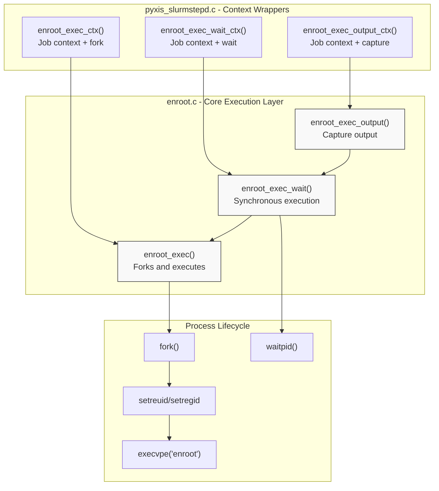
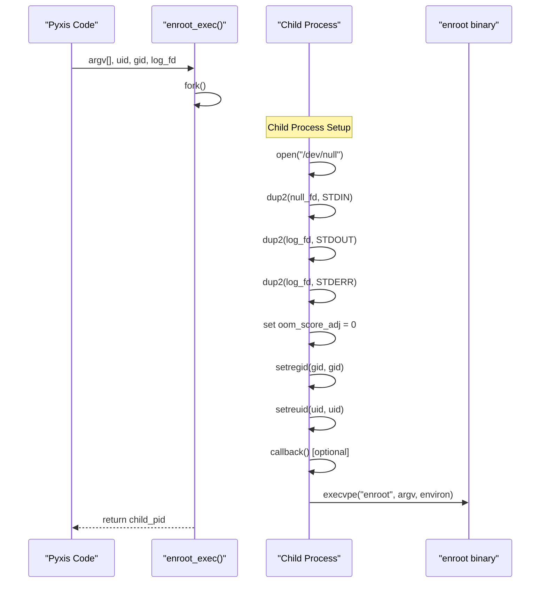
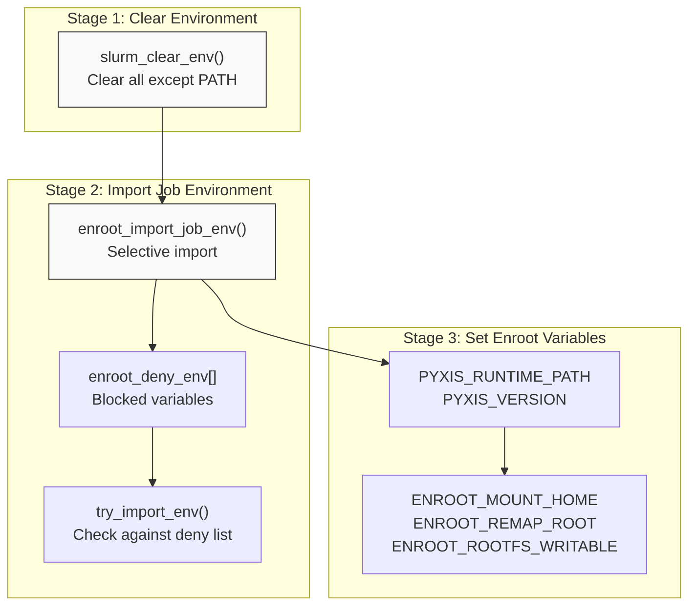
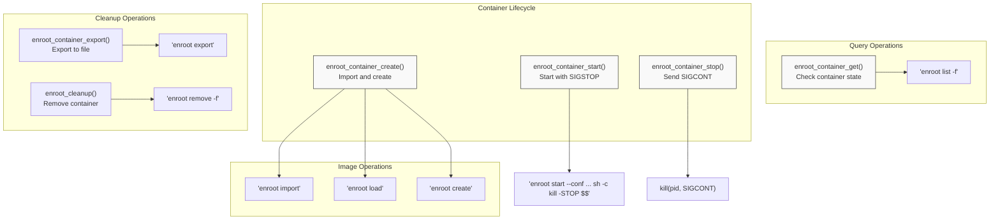
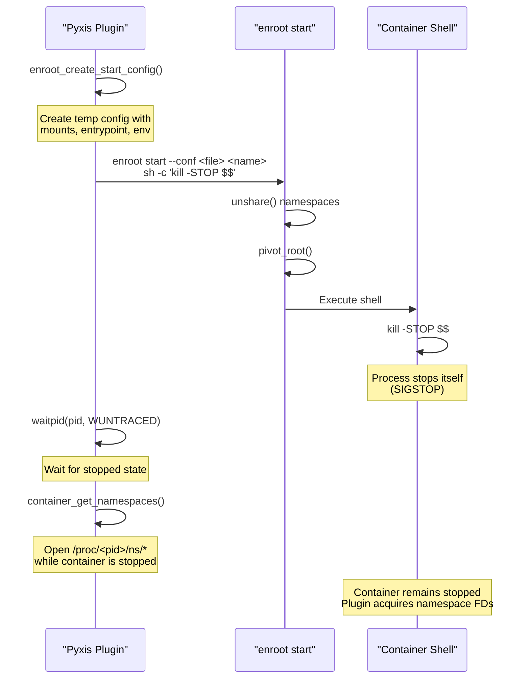
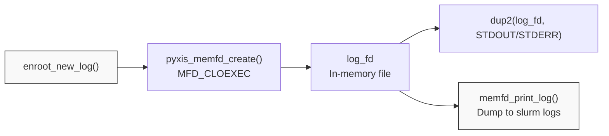

<!-- source: DeepWiki mcp.deepwiki.com · repo NVIDIA/pyxis · page 7 Enroot Integration · fetched 2026-10-26 -->

# Enroot Integration

<details>
<summary>Relevant source files</summary>

The following files were used as context for generating this wiki page:

- [enroot.c](enroot.c)
- [pyxis_slurmstepd.c](pyxis_slurmstepd.c)

</details>


This document describes how Pyxis integrates with the Enroot container runtime. Enroot is the underlying technology that Pyxis uses to create and manage container filesystems and namespaces. This page covers the process execution wrappers, environment management, and container operation interfaces that form the integration layer between Pyxis and Enroot.

For information about container lifecycle orchestration and namespace management, see [Container Lifecycle Manager](#4). For image import mechanisms, see [Image Import Strategies](#8).

## Purpose and Scope

The Enroot integration layer provides a set of process execution primitives that allow Pyxis to invoke Enroot commands with proper:
- User ID and Group ID context switching
- Standard I/O redirection and logging
- Environment variable management
- Error handling and status reporting

The integration is implemented across two primary modules: `enroot.c` provides low-level process execution wrappers, while `pyxis_slurmstepd.c` provides context-aware wrappers that use job-specific configuration.

## Process Execution Model

### Core Execution Functions

The integration layer provides three fundamental execution patterns for running Enroot commands:



**Figure 1: Process Execution Functions and Call Hierarchy**

Sources: [enroot.c:18-176](), [pyxis_slurmstepd.c:436-449]()

| Function | Purpose | Return Value | Blocking |
|----------|---------|--------------|----------|
| `enroot_exec()` | Fork and execute enroot command | PID of child process | No |
| `enroot_exec_wait()` | Execute and wait for completion | 0 on success, -1 on error | Yes |
| `enroot_exec_output()` | Execute and capture stdout/stderr | FILE* to output | Yes |

Sources: [enroot.c:18-176]()

### Fork and Execution Sequence



**Figure 2: Process Fork and Execution Flow**

Sources: [enroot.c:18-93]()

The `enroot_exec()` function performs the following steps in the child process:

1. **I/O Redirection** [enroot.c:41-61](): Redirects stdin to `/dev/null` and stdout/stderr to either a log file descriptor or `/dev/null`
2. **OOM Score Adjustment** [enroot.c:67-71](): Sets `oom_score_adj` to 0 to allow OOM killing (inherited value is often -1000 from slurmstepd)
3. **Credential Switching** [enroot.c:73-79](): Changes to the target user and group using `setregid()` and `setreuid()`
4. **Environment Setup** [enroot.c:81-85](): Optionally invokes a callback function to configure environment
5. **Execution** [enroot.c:87](): Executes the enroot binary via `execvpe()`

Sources: [enroot.c:40-90]()

## Environment Variable Management

### Environment Configuration Pipeline

Enroot requires a carefully controlled environment to operate correctly within the Slurm job context. The integration layer implements a multi-stage environment management system:



**Figure 3: Environment Variable Configuration Pipeline**

Sources: [pyxis_slurmstepd.c:300-434]()

### Environment Variable Deny List

The following environment variables are explicitly blocked from being passed from the Slurm job to Enroot to prevent conflicts or security issues:

| Variable Category | Variables | Reason for Blocking |
|-------------------|-----------|---------------------|
| System Paths | `PATH`, `LD_LIBRARY_PATH`, `LD_PRELOAD` | Container should use its own paths |
| Slurm Task IDs | `SLURM_PROCID`, `SLURM_LOCALID`, `SLURM_TASK_PID` | Task-specific, set by Slurm |
| MPI/PMI | `PMIX_RANK`, `PMI_FD` | Process-specific communication |
| Enroot Config | `ENROOT_LIBRARY_PATH`, `ENROOT_SYSCONF_PATH`, etc. | Controlled by Pyxis |

Sources: [pyxis_slurmstepd.c:334-360]()

### Context-Aware Environment Setup

The `enroot_set_env()` function [pyxis_slurmstepd.c:389-434]() serves as the callback for process execution, configuring the environment based on job arguments:

```mermaid
graph LR
    clear["Clear Environment<br/>(save PATH)"]
    import["Import Job Vars<br/>(with deny list)"]
    mount_home{"--container-mount-home?"}
    remap_root{"--container-remap-root?"}
    writable{"--container-writable?"}
    pyxis_vars["Set PYXIS_* vars"]
    
    clear --> import
    import --> mount_home
    mount_home -->|0| set_home_n["ENROOT_MOUNT_HOME=n"]
    mount_home -->|1| set_home_y["ENROOT_MOUNT_HOME=y"]
    mount_home -->|-1| use_default["Use enroot default"]
    
    set_home_n --> remap_root
    set_home_y --> remap_root
    use_default --> remap_root
    
    remap_root -->|0| set_remap_n["ENROOT_REMAP_ROOT=n"]
    remap_root -->|1| set_remap_y["ENROOT_REMAP_ROOT=y"]
    remap_root -->|-1| use_default2["Use enroot default"]
    
    set_remap_n --> writable
    set_remap_y --> writable
    use_default2 --> writable
    
    writable -->|0| set_write_n["ENROOT_ROOTFS_WRITABLE=n"]
    writable -->|1| set_write_y["ENROOT_ROOTFS_WRITABLE=y"]
    writable -->|-1| use_default3["Use enroot default"]
    
    set_write_n --> pyxis_vars
    set_write_y --> pyxis_vars
    use_default3 --> pyxis_vars
```



**Figure 4: Environment Configuration Decision Tree**

Sources: [pyxis_slurmstepd.c:389-434]()

## Container Operations

### Operation Interface Functions

Pyxis uses the Enroot integration layer to perform the following container operations:



**Figure 5: Container Operation Functions and Enroot Commands**

Sources: [pyxis_slurmstepd.c:463-522](), [pyxis_slurmstepd.c:643-738](), [pyxis_slurmstepd.c:893-954](), [pyxis_slurmstepd.c:956-970](), [pyxis_slurmstepd.c:1411-1438](), [pyxis_slurmstepd.c:1460-1489]()

### Container State Query

The `enroot_container_get()` function [pyxis_slurmstepd.c:463-522]() queries the state of a named container by parsing the output of `enroot list -f`:

1. Executes `enroot list -f` using `enroot_exec_output_ctx()`
2. Skips the header line
3. Parses each line for container name and PID
4. Returns status via output parameter:
   - `*pid == -1`: Container does not exist
   - `*pid == 0`: Container exists but is not running
   - `*pid > 0`: Container exists and is running

Sources: [pyxis_slurmstepd.c:463-522]()

### Container Creation

The `enroot_container_create()` function [pyxis_slurmstepd.c:643-738]() handles three import strategies:

| Strategy | Condition | Commands Used |
|----------|-----------|---------------|
| `use_enroot_load` | No importer configured, not `dockerd://` prefix | `enroot load --name <name> <uri>` |
| `use_enroot_import` | No importer configured, `dockerd://` prefix | `enroot import -o <path> <uri>` + `enroot create --name <name> <path>` |
| `use_importer` | Importer path configured | External importer + `enroot create --name <name> <path>` |

The function also measures and logs the time taken for container setup using `clock_gettime(CLOCK_MONOTONIC)`.

Sources: [pyxis_slurmstepd.c:643-738]()

### Container Start with Synchronization

The `enroot_container_start()` function [pyxis_slurmstepd.c:893-954]() implements a sophisticated synchronization mechanism:



**Figure 6: Container Start and Synchronization Protocol**

Sources: [pyxis_slurmstepd.c:893-954]()

The SIGSTOP synchronization technique allows Pyxis to:
1. Wait for the container to complete namespace setup (unshare, pivot_root)
2. Acquire file descriptors to the container's namespaces while it's stopped
3. Later use these FDs with `setns()` to join the namespaces from other tasks

Sources: [pyxis_slurmstepd.c:909-942]()

### Start Configuration Generation

The `enroot_create_start_config()` function [pyxis_slurmstepd.c:801-891]() generates a temporary Bash configuration script that Enroot sources during container start. The script can define:

| Hook Function | Purpose | When Generated |
|---------------|---------|----------------|
| `mounts()` | Prints mount specifications | If `--container-mounts` specified |
| `hooks()` | Overrides entrypoint with `exec "$@"` | If `--no-container-entrypoint` used |
| `environ()` | Preserves selected environment variables | If `--container-env` specified |

Sources: [pyxis_slurmstepd.c:801-891]()

## I/O Handling and Logging

### In-Memory Log Files

Pyxis uses `memfd_create()` to create in-memory files for capturing Enroot output:



**Figure 7: In-Memory Logging System**

Sources: [pyxis_slurmstepd.c:288-298](), [pyxis_slurmstepd.c:451-455]()

The `enroot_new_log()` function [pyxis_slurmstepd.c:288-298]() creates a new memory-backed file descriptor that is passed to `enroot_exec()`. This avoids writing temporary files to disk and provides efficient log capture.

After execution, `enroot_print_log_ctx()` [pyxis_slurmstepd.c:451-455]() can dump the log contents to Slurm's logging system, either as errors or informational messages depending on the exit status.

Sources: [pyxis_slurmstepd.c:288-298](), [pyxis_slurmstepd.c:451-455]()

### Output Capture

The `enroot_exec_output()` function [enroot.c:139-176]() provides a mechanism to capture and parse Enroot command output:

1. Creates an in-memory log file using `pyxis_memfd_create()`
2. Executes the command with `enroot_exec_wait()`, redirecting output to the log
3. Rewinds the log file with `lseek()`
4. Returns a `FILE*` opened on the log file descriptor for parsing

This is used by `enroot_container_get()` to parse the output of `enroot list -f`.

Sources: [enroot.c:139-176](), [pyxis_slurmstepd.c:476-520]()

## Context-Aware Wrapper Functions

The context-aware wrappers in `pyxis_slurmstepd.c` provide convenient interfaces that automatically use the current job context:

```mermaid
graph TB
    subgraph "Context-Aware Wrappers"
        enroot_exec_ctx["enroot_exec_ctx(argv)"]
        enroot_exec_wait_ctx["enroot_exec_wait_ctx(argv)"]
        enroot_exec_output_ctx["enroot_exec_output_ctx(argv)"]
        enroot_print_log_ctx["enroot_print_log_ctx(error)"]
    end
    
    subgraph "Job Context (context structure)"
        job_uid["context.job.uid"]
        job_gid["context.job.gid"]
        log_fd["context.log_fd"]
    end
    
    subgraph "Core Functions"
        enroot_exec["enroot_exec()"]
        enroot_exec_wait["enroot_exec_wait()"]
        enroot_exec_output["enroot_exec_output()"]
        memfd_print_log["memfd_print_log()"]
    end
    
    enroot_exec_ctx --> job_uid
    enroot_exec_ctx --> job_gid
    enroot_exec_ctx --> log_fd
    enroot_exec_ctx --> enroot_new_log
    enroot_exec_ctx --> enroot_set_env
    enroot_exec_ctx --> enroot_exec
    
    enroot_exec_wait_ctx --> job_uid
    enroot_exec_wait_ctx --> job_gid
    enroot_exec_wait_ctx --> enroot_new_log
    enroot_exec_wait_ctx --> enroot_set_env
    enroot_exec_wait_ctx --> enroot_exec_wait
    
    enroot_exec_output_ctx --> job_uid
    enroot_exec_output_ctx --> job_gid
    enroot_exec_output_ctx --> enroot_set_env
    enroot_exec_output_ctx --> enroot_exec_output
    
    enroot_print_log_ctx --> log_fd
    enroot_print_log_ctx --> memfd_print_log
    
    style enroot_exec_ctx fill:#f9f9f9,stroke:#333
    style enroot_exec_wait_ctx fill:#f9f9f9,stroke:#333
    style enroot_exec_output_ctx fill:#f9f9f9,stroke:#333
    style enroot_print_log_ctx fill:#f9f9f9,stroke:#333
```



**Figure 8: Context-Aware Wrapper Functions**

Sources: [pyxis_slurmstepd.c:436-455]()

These wrappers eliminate the need to repeatedly pass job-specific parameters:

| Wrapper Function | Automatically Provides | Base Function |
|------------------|------------------------|---------------|
| `enroot_exec_ctx()` | `uid`, `gid`, new log fd, `enroot_set_env` | `enroot_exec()` |
| `enroot_exec_wait_ctx()` | `uid`, `gid`, new log fd, `enroot_set_env` | `enroot_exec_wait()` |
| `enroot_exec_output_ctx()` | `uid`, `gid`, `enroot_set_env` | `enroot_exec_output()` |
| `enroot_print_log_ctx()` | Current `log_fd` | `memfd_print_log()` |

Sources: [pyxis_slurmstepd.c:436-455]()

## Error Handling

The integration layer implements consistent error handling across all operations:

### Child Process Errors

The `child_wait()` helper function [enroot.c:95-120]() handles child process termination:

- **Signal Termination**: If the child is terminated by a signal, logs error with signal number
- **Non-Zero Exit**: If the child exits with non-zero status, logs error with exit code
- **Wait Errors**: If `waitpid()` fails (except EINTR which is retried), logs error

Sources: [enroot.c:95-120]()

### Log Printing on Error

The `enroot_print_log_ctx()` function [pyxis_slurmstepd.c:451-455]() is called after enroot operations to print diagnostic information:

```c
enroot_print_log_ctx(true);  // Print as error
enroot_print_log_ctx(false); // Print as info
```

This is used throughout the container lifecycle to provide visibility into Enroot failures.

Sources: [pyxis_slurmstepd.c:451-455](), [pyxis_slurmstepd.c:677](), [pyxis_slurmstepd.c:686](), [pyxis_slurmstepd.c:707](), [pyxis_slurmstepd.c:947-949]()

## Integration with Container Lifecycle

The Enroot integration functions are used throughout the container lifecycle:

| Lifecycle Phase | Enroot Operations | Functions Used |
|-----------------|-------------------|----------------|
| **User Init** | Query existing containers | `enroot_container_get()` → `enroot_exec_output_ctx()` |
| **Task Init** | Create container (if needed) | `enroot_container_create()` → `enroot_exec_wait_ctx()` |
| **Task Init** | Start container | `enroot_container_start()` → `enroot_exec_ctx()` |
| **Task Init** | Stop container process | `enroot_container_stop()` → `kill(SIGCONT)` |
| **Task Exit** | Export container | `enroot_container_export()` → `enroot_exec_wait_ctx()` |
| **Task Exit** | Remove container | `enroot_cleanup()` → `enroot_exec_wait_ctx()` |

Sources: [pyxis_slurmstepd.c:1036-1184](), [pyxis_slurmstepd.c:1308-1409](), [pyxis_slurmstepd.c:1491-1511]()

For detailed information about the overall container lifecycle, see [Container Lifecycle Manager](#4). For cleanup operations in the job epilog, see [Container Cleanup](#9).

---

