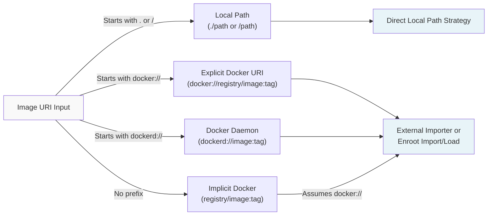
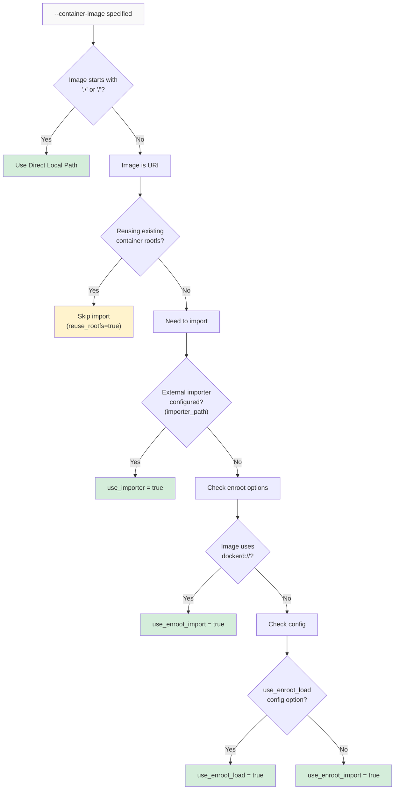
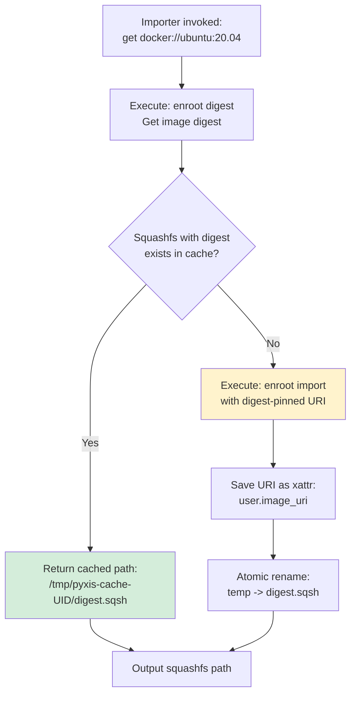
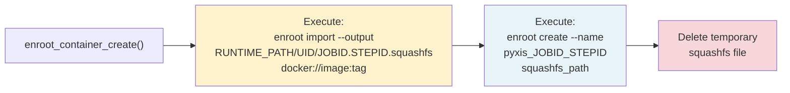
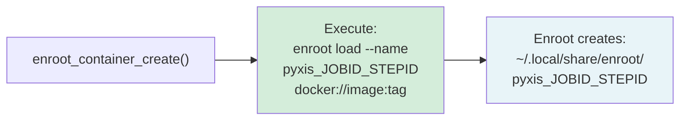
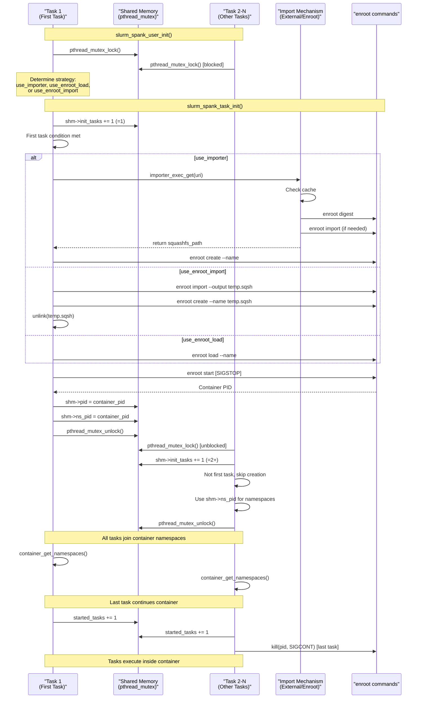

<!-- source: DeepWiki mcp.deepwiki.com · repo NVIDIA/pyxis · page 8 Image Import Strategies · fetched 2026-10-26 -->

# Image Import Strategies

<details>
<summary>Relevant source files</summary>

The following files were used as context for generating this wiki page:

- [importers/caching_importer.sh](importers/caching_importer.sh)
- [importers/simple_importer.sh](importers/simple_importer.sh)
- [pyxis_slurmstepd.c](pyxis_slurmstepd.c)
- [tests/docker_image.bats](tests/docker_image.bats)
- [tests/mount_home.bats](tests/mount_home.bats)
- [tests/path.bats](tests/path.bats)

</details>


This document describes the mechanisms by which Pyxis imports container images for use with Enroot. It covers the different import strategies available, how they are selected, and the image URI formats supported.

For information about the overall container lifecycle, see [Container Lifecycle Manager](#4). For configuration options that control import behavior, see [Configuration System](#5).

## Overview

Pyxis supports multiple strategies for obtaining container images, each with different performance characteristics and use cases. The selection of strategy depends on the image URI format, plugin configuration, and whether an external importer script is configured.

The four primary strategies are:

| Strategy | Description | Use Case | Performance |
|----------|-------------|----------|-------------|
| **Direct Local Path** | Use an existing squashfs file | Pre-built images on shared storage | Instant (no download) |
| **External Importer** | Custom script with optional caching | Shared cache across jobs | Fast (if cached) |
| **Enroot Import** | Enroot downloads and converts image | Simple setup, per-job import | Moderate |
| **Enroot Load** | Enroot manages persistent rootfs | Reusable container filesystems | Moderate (first use) |

Sources: [pyxis_slurmstepd.c:643-738](), [importers/caching_importer.sh](), [importers/simple_importer.sh]()

## Image URI Formats

Pyxis accepts several URI formats for specifying container images. The format determines which import strategy will be used.

### Supported URI Formats



**URI Format Detection Logic:**
- Lines [pyxis_slurmstepd.c:1129-1136](): Checks if image starts with `./` or `/`
- Lines [pyxis_slurmstepd.c:651-661](): Prepends `docker://` if not already prefixed

**Registry Examples from Tests:**
- Docker Hub: `ubuntu:20.04` (implicit docker://)
- NVCR: `nvcr.io#nvidia/pytorch:20.02-py3` (# replaces /)
- GCR: `gcr.io#deeplearning-platform-release/tf-cpu.2-9`
- GitLab: `registry.gitlab.com#nvidia/kubernetes/device-plugin/...`
- Explicit: `docker://nvidia/cuda:11.8.0-base-ubuntu20.04`
- Docker daemon: `dockerd://nvidia/cuda:11.8.0-base-ubuntu22.04`

Sources: [pyxis_slurmstepd.c:1128-1154](), [pyxis_slurmstepd.c:650-662](), [tests/docker_image.bats:5-96]()

## Strategy Selection Logic

The selection of import strategy follows a decision tree based on configuration and image URI format.



**Key Decision Points:**
1. **Local path check** [pyxis_slurmstepd.c:1129](): `strspn(context.args->image, "./") > 0`
2. **Importer path check** [pyxis_slurmstepd.c:1139](): `context.config.importer_path[0] != '\0'`
3. **dockerd:// check** [pyxis_slurmstepd.c:1144](): `strncmp("dockerd://", context.args->image, ...)`
4. **use_enroot_load check** [pyxis_slurmstepd.c:1143](): `context.config.use_enroot_load`

Sources: [pyxis_slurmstepd.c:1128-1154](), [pyxis_slurmstepd.c:37-51]()

## Direct Local Path Strategy

When the image parameter is a local filesystem path (starting with `./` or `/`), Pyxis uses the file directly as a squashfs image without any import operation.

### Implementation

The `container.squashfs_path` is set directly to the provided path without modification:

```
User provides: --container-image=./my-image.sqsh
Result: container.squashfs_path = "./my-image.sqsh"
```

**Code Path:**
1. Check at [pyxis_slurmstepd.c:1129](): Path detection
2. Assignment at [pyxis_slurmstepd.c:1134-1135](): Direct copy of path
3. Usage at [pyxis_slurmstepd.c:704](): `enroot create --name ... squashfs_path`

### Characteristics

- **No download or conversion** required
- **Assumes pre-built squashfs** format compatible with Enroot
- **Path length validation**: Maximum `PATH_MAX` (typically 4096 bytes)
- **User responsibility** to ensure file exists and is accessible
- **Typical use case**: Pre-built images on shared NFS/Lustre storage

Sources: [pyxis_slurmstepd.c:1129-1136](), [pyxis_slurmstepd.c:701-710]()

## External Importer Strategy

External importers are shell scripts that Pyxis invokes to obtain squashfs images. They provide flexibility for implementing custom caching, access control, or image transformation logic.

### Importer Interface

External importers must implement a specific command-line interface:

| Command | Arguments | Purpose | Output |
|---------|-----------|---------|--------|
| `get` | `URI` | Download/locate image | Path to squashfs file on stdout |
| `release` | (none) | Cleanup after job | None |

The importer is invoked with the user's UID/GID and a clean environment populated from the job.

### Caching Importer

The caching importer (`caching_importer.sh`) provides digest-based deduplication across jobs.



**Key Implementation Details:**

1. **Cache Directory** [caching_importer.sh:7](): `/tmp/pyxis-cache-${SLURM_JOB_UID}`
   - Per-user isolation
   - Persists across jobs
   - User must manage cleanup

2. **Digest Calculation** [caching_importer.sh:24](): 
   ```bash
   digest=$(enroot digest "${image_uri}")
   ```
   - Queries registry for content digest
   - Ensures immutable reference

3. **Atomic Creation** [caching_importer.sh:45]():
   ```bash
   mv -n "${squashfs_temp_path}" "${squashfs_path}"
   ```
   - `-n` flag prevents overwriting
   - Handles concurrent access safely

4. **Extended Attributes** [caching_importer.sh:41-43]():
   - Stores original URI for reference
   - Optional feature (requires `setfattr`)

5. **Compression** [caching_importer.sh:11]():
   - Uses zstd level 3 for persistent images
   - Reduces storage footprint

Sources: [importers/caching_importer.sh:1-65]()

### Simple Importer

The simple importer (`simple_importer.sh`) imports images per-job without caching.

**Characteristics:**
- **Per-job import**: Downloads image for each job step
- **Automatic cleanup**: Removes squashfs in release phase
- **Path format** [simple_importer.sh:8](): `${PYXIS_RUNTIME_PATH}/${UID}/${JOBID}.${STEPID}.squashfs`
- **No compression**: Uses Enroot defaults for faster creation
- **Use case**: When storage is not a constraint or images are rarely reused

**Implementation:**
```bash
# Get phase
enroot import --output "${squashfs_path}" "${image_uri}" >&2
echo "${squashfs_path}"

# Release phase  
rm -f "${squashfs_path}"
```

Sources: [importers/simple_importer.sh:1-40]()

### Importer Execution

Pyxis invokes external importers through the `importer_exec_get()` and `importer_exec_release()` functions defined in [importer.c]().

**Execution Context:**
- Runs with job user's UID/GID
- Inherits environment from `enroot_set_env()`
- stderr redirected to Slurm logs
- stdout captured for squashfs path

**Code Flow:**
1. **Get** [pyxis_slurmstepd.c:692-698](): Import phase
   ```c
   ret = importer_exec_get(context.config.importer_path, 
                           context.job.uid, context.job.gid,
                           enroot_set_env, enroot_uri, 
                           &context.container.squashfs_path);
   ```

2. **Release** [pyxis_slurmstepd.c:728-733](): Cleanup phase
   ```c
   ret = importer_exec_release(context.config.importer_path,
                               context.job.uid, context.job.gid,
                               enroot_set_env);
   ```

Sources: [pyxis_slurmstepd.c:690-735](), [importer.c]()

## Enroot Import Strategy

The enroot import strategy uses Enroot's `import` command to download and convert container images into squashfs files.

### Implementation



**Execution Details:**

1. **Squashfs Path** [pyxis_slurmstepd.c:1148-1151]():
   ```c
   xasprintf(&context.container.squashfs_path, 
             "%s/%u/%u.%u.squashfs",
             context.config.runtime_path, 
             context.job.uid, 
             context.job.jobid, 
             context.job.stepid);
   ```

2. **Import Command** [pyxis_slurmstepd.c:683-689]():
   ```c
   enroot_exec_wait_ctx((char *const[]){ 
       "enroot", "import", 
       "--output", context.container.squashfs_path, 
       enroot_uri, 
       NULL 
   });
   ```

3. **Create Command** [pyxis_slurmstepd.c:704]():
   ```c
   enroot_exec_wait_ctx((char *const[]){ 
       "enroot", "create", 
       "--name", context.container.name, 
       context.container.squashfs_path, 
       NULL 
   });
   ```

4. **Cleanup** [pyxis_slurmstepd.c:720-726]():
   - Squashfs file deleted after container creation
   - Temporary file removed if import fails

### Characteristics

- **Per-job import**: Each job step downloads independently
- **No persistent cache**: Squashfs is ephemeral
- **Two-stage process**: Import then create
- **Faster creation**: No compression on temporary squashfs (Enroot defaults)
- **Higher network usage**: Downloads image every time
- **Automatic cleanup**: Squashfs removed after container creation

### When Used

Set automatically when:
- No external importer configured: `importer_path[0] == '\0'`
- Not using enroot load: `use_enroot_load == false`
- Image is not `dockerd://` URI

Sources: [pyxis_slurmstepd.c:682-726](), [pyxis_slurmstepd.c:1143-1152]()

## Enroot Load Strategy

The enroot load strategy uses Enroot's `load` command to download images and manage persistent container rootfs directories.

### Implementation



**Execution:**

1. **Load Command** [pyxis_slurmstepd.c:674-680]():
   ```c
   enroot_exec_wait_ctx((char *const[]){ 
       "enroot", "load", 
       "--name", context.container.name, 
       enroot_uri, 
       NULL 
   });
   ```

2. **Container Name**: Same format as other strategies
   - Per-step: `pyxis_JOBID.STEPID`
   - Per-job: `pyxis_JOBID_JOBID.STEPID`

### Characteristics

- **Persistent rootfs**: Stored in `~/.local/share/enroot/`
- **Single operation**: No separate create step needed
- **Enroot-managed cache**: Enroot handles deduplication internally
- **No squashfs intermediate**: Direct rootfs directory
- **Reusable**: Can be started multiple times
- **Must be cleaned up**: Not automatically removed (see [Container Cleanup](#9))

### When Used

Enabled when:
- Configuration option: `use_enroot_load = true`
- Image is not `dockerd://` URI [pyxis_slurmstepd.c:1143-1144]()
- No external importer configured

**dockerd:// Exception**: Always uses import strategy even if `use_enroot_load` is true, because `enroot load` doesn't support local Docker daemon access.

Sources: [pyxis_slurmstepd.c:673-681](), [pyxis_slurmstepd.c:1143-1145]()

## Import Execution Flow

The complete import and container creation flow showing synchronization between multiple tasks.



**Key Synchronization Points:**

1. **Shared Memory Initialization** [pyxis_slurmstepd.c:972-1012]():
   - Process-shared pthread mutex
   - Atomic counters for coordination
   - PIDs for container and namespace processes

2. **First Task Import** [pyxis_slurmstepd.c:1249-1285]():
   ```c
   shm->init_tasks += 1;
   if (shm->init_tasks == 1) {
       // Only first task imports
       if (!container->reuse_rootfs)
           enroot_container_create();
       shm->pid = enroot_container_start();
   }
   ```

3. **Wait for Import** [pyxis_slurmstepd.c:1276-1277]():
   - Other tasks wait on mutex
   - All tasks use same `shm->ns_pid` for namespaces

4. **Container Stop** [pyxis_slurmstepd.c:1287-1306]():
   - Last task to start sends SIGCONT
   - Prevents container from exiting during setup

### Performance Characteristics

| Strategy | First Use | Subsequent Use | Storage | Network |
|----------|-----------|----------------|---------|---------|
| **Direct Path** | Instant | Instant | External | None |
| **Caching Importer** | Minutes | Instant | Cache directory | First use only |
| **Simple Importer** | Minutes | Minutes | Temporary | Every use |
| **Enroot Import** | Minutes | Minutes | Temporary | Every use |
| **Enroot Load** | Minutes | Fast | Persistent rootfs | First use only |

**Import Time Factors:**
- Image size (typically 500MB-5GB)
- Registry bandwidth
- Compression level
- Number of layers

**Synchronization Overhead:**
- Single import per node regardless of task count
- Test at [tests/docker_image.bats:76-81](): Verifies only one import attempt

Sources: [pyxis_slurmstepd.c:972-1012](), [pyxis_slurmstepd.c:1249-1285](), [pyxis_slurmstepd.c:643-738]()

## Environment and Configuration

### Environment Variables

Import operations inherit select environment variables from the job:

**Enroot-specific variables** [pyxis_slurmstepd.c:334-360]():
- Denied: `ENROOT_LIBRARY_PATH`, `ENROOT_RUNTIME_PATH`, etc.
- Reason: Plugin controls these paths

**Import-relevant variables**:
- `ENROOT_SQUASH_OPTIONS`: Compression settings (used by caching importer)
- `PYXIS_RUNTIME_PATH`: Runtime directory (available to importers)
- `PYXIS_VERSION`: Plugin version (available to importers)

### Configuration Options

| Option | Type | Purpose | Default |
|--------|------|---------|---------|
| `importer_path` | string | Path to external importer script | (none) |
| `use_enroot_load` | boolean | Prefer enroot load over import | false |
| `runtime_path` | string | Directory for temporary files | `/run/pyxis` |

**Configuration Parsing** [config.c:pyxis_config_parse]():
- Read from plugin configuration file
- Override via `plugstack.conf` options

### Importer Selection Priority

1. **Highest**: External importer (if configured)
2. **Medium**: Enroot load (if `use_enroot_load=true` and not dockerd://)
3. **Lowest**: Enroot import (default fallback)

Sources: [pyxis_slurmstepd.c:389-434](), [pyxis_slurmstepd.c:1139-1153](), [config.c]()

## Error Handling

### Import Failures

When image import fails, Pyxis reports errors through Slurm's logging:

**Detection** [pyxis_slurmstepd.c:675-688]():
```c
ret = enroot_exec_wait_ctx(...);
if (ret < 0) {
    slurm_error("pyxis: failed to import docker image");
    enroot_print_log_ctx(true);
    goto fail;
}
```

**Error Log Output** [pyxis_slurmstepd.c:451-455]():
- Prints enroot command output
- Includes stderr from import process
- Visible in job output and slurmstepd logs

### Common Failure Modes

| Error | Cause | Solution |
|-------|-------|----------|
| "failed to import docker image" | Network, registry, or auth issue | Check registry access, credentials |
| "couldn't get list of containers" | Enroot failure | Verify enroot installation |
| "container exited too soon" | Image has no shell | Use `--no-container-entrypoint` |
| Digest retrieval failure | Invalid image reference | Check image name and tag |
| Cache write failure | Disk full or permissions | Check cache directory space/permissions |

### Atomic Operations

**Caching Importer** [caching_importer.sh:45]():
- Uses `mv -n` for atomic cache writes
- Prevents corruption from concurrent jobs
- First writer wins, others reuse

**Cleanup Safety**:
- Release always called after get [pyxis_slurmstepd.c:728-733]()
- Idempotent: Safe to call multiple times
- Temporary files removed even on failure

Sources: [pyxis_slurmstepd.c:673-738](), [pyxis_slurmstepd.c:1324-1329](), [importers/caching_importer.sh:45]()

## Testing

The test suite validates all import strategies across multiple registries and image formats.

### Registry Coverage

**Test File: tests/docker_image.bats**

| Registry | Test Cases | Lines |
|----------|------------|-------|
| Docker Hub | ubuntu, centos (multiple versions) | [5-49]() |
| nvcr.io | NVIDIA containers (PyTorch, device plugin) | [51-74]() |
| gcr.io | TensorFlow images | [61-64]() |
| gitlab.com | GitLab registry images | [66-69]() |

**Format Tests:**
- Explicit `docker://` prefix [tests/docker_image.bats:83-85]()
- Local Docker daemon `dockerd://` [tests/docker_image.bats:87-92]()
- Zstd-compressed layers [tests/docker_image.bats:94-96]()

### Import Behavior Tests

**Single Import Verification** [tests/docker_image.bats:76-81]():
```bash
run_srun_unchecked --ntasks=2 --container-image=thisimagedoesntexist true
attempts=$(grep -c 'failed to import docker image' <<< "${output}")
[ "${attempts}" -eq 1 ]
```
Validates that multiple tasks trigger only one import attempt.

### Local Path Tests

**mount_home.bats** and **path.bats**:
- Test pre-existing container filesystems
- Verify path resolution inside containers
- Exercise direct local path strategy

Sources: [tests/docker_image.bats:1-97](), [tests/mount_home.bats:1-20](), [tests/path.bats:1-21]()

---

