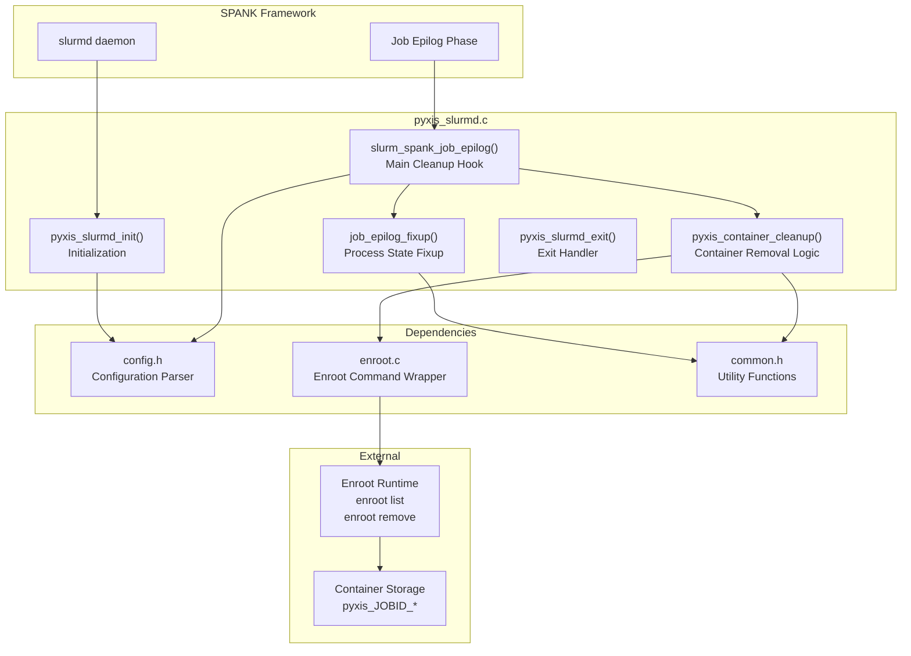
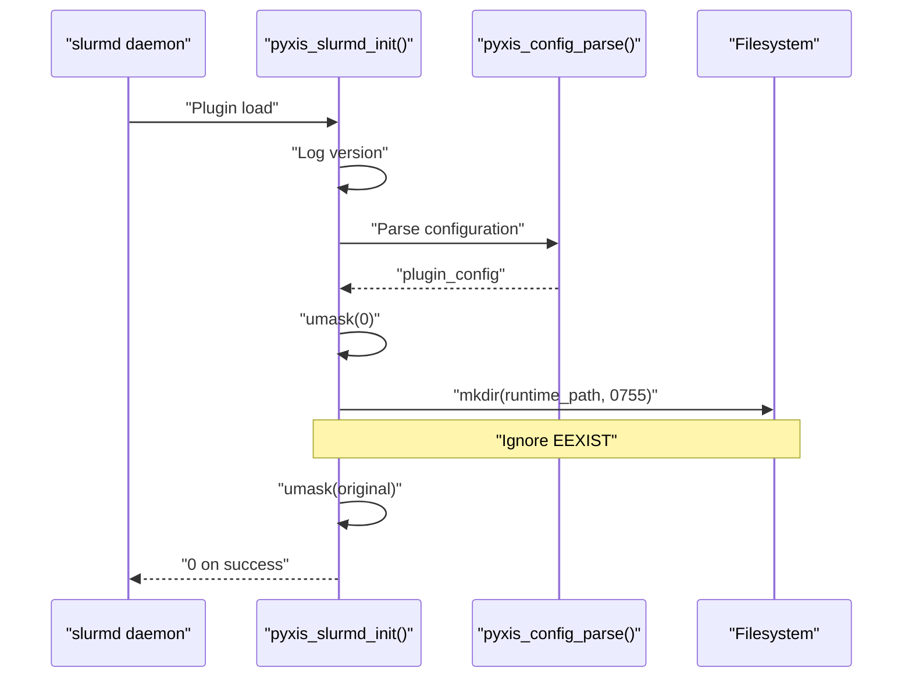
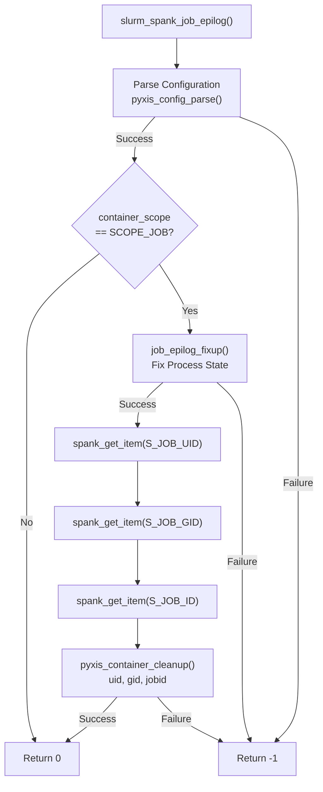
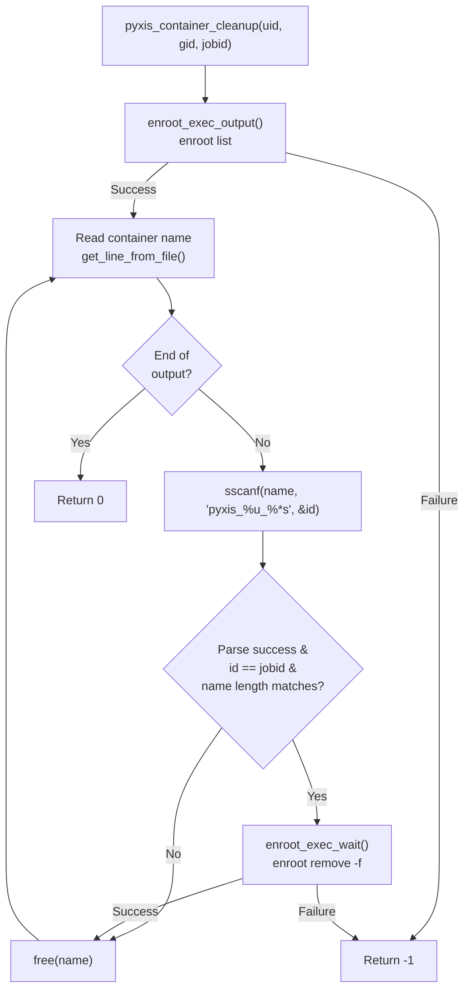
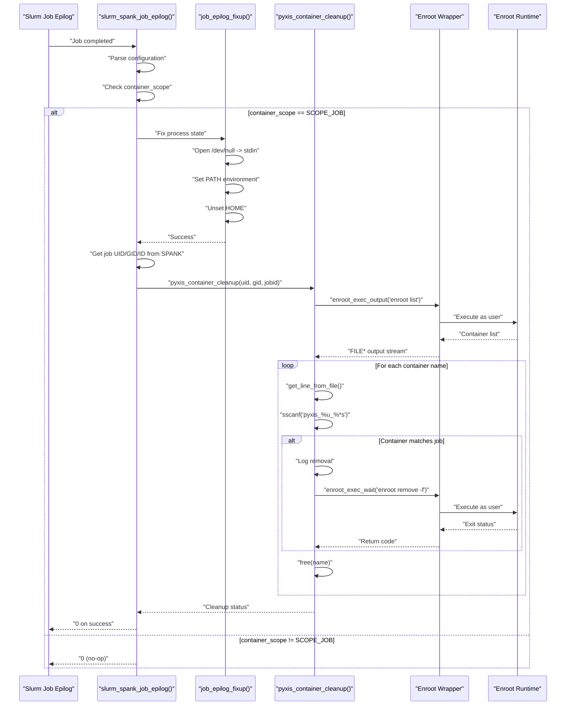

<!-- source: DeepWiki mcp.deepwiki.com · repo NVIDIA/pyxis · page 9 Container Cleanup · fetched 2026-10-26 -->

# Container Cleanup

<details>
<summary>Relevant source files</summary>

The following files were used as context for generating this wiki page:

- [pyxis_slurmd.c](pyxis_slurmd.c)

</details>


## Purpose and Scope

This document describes the container cleanup functionality implemented in `pyxis_slurmd.c`, which handles the removal of job-scoped containers after job completion. This component runs in the Slurm daemon (slurmd) context during the job epilog phase and is responsible for identifying and removing all containers associated with a completed job.

This cleanup process is distinct from the task-level cleanup performed during container execution (see [Container Lifecycle Manager](#4) for task-level cleanup). The job epilog cleanup operates at the job level and only activates when `container_scope=job` is configured.

## Overview

The cleanup subsystem executes during Slurm's job epilog phase to remove any containers that were created with job-level scope. The system uses a naming convention to identify containers belonging to specific jobs and invokes Enroot commands to remove them. This ensures that container resources are properly released after job completion, preventing accumulation of stale containers on compute nodes.

**Sources:** [pyxis_slurmd.c:1-182]()

## Component Architecture

The following diagram illustrates the structure and relationships of the cleanup subsystem components:



**Sources:** [pyxis_slurmd.c:20-181]()

## Initialization

The `pyxis_slurmd_init()` function initializes the slurmd plugin component during daemon startup. This function performs minimal setup tasks:

| Task | Description | Error Handling |
|------|-------------|----------------|
| Configuration Parsing | Parses plugin configuration via `pyxis_config_parse()` | Returns -1 on failure |
| Runtime Directory Creation | Creates the runtime path directory with mode 0755 | Ignores EEXIST errors |
| Version Logging | Logs the Pyxis version via `slurm_info()` | N/A |

The initialization temporarily modifies the umask to 0 to ensure proper directory permissions regardless of the inherited umask value, then restores the original umask.



**Sources:** [pyxis_slurmd.c:20-50]()

## Job Epilog Cleanup Process

The `slurm_spank_job_epilog()` function implements the main cleanup hook invoked by SPANK after job completion. This hook is only executed on compute nodes where the job ran.

### Execution Flow

The following diagram shows the complete cleanup execution flow:



**Sources:** [pyxis_slurmd.c:127-176]()

### Configuration Check

The cleanup process first checks if `container_scope` is set to `SCOPE_JOB`. If not, the function returns immediately without performing any cleanup, as job-scoped cleanup is only necessary when containers are created with job scope.

**Sources:** [pyxis_slurmd.c:142-143]()

### Process State Fixup

The `job_epilog_fixup()` function addresses quirks in the SPANK epilog process environment:

| Issue | Fix Applied |
|-------|-------------|
| Empty environment | Sets `PATH=/usr/local/bin:/usr/bin:/bin` |
| Missing HOME variable | Unsets `HOME` if present |
| Closed stdin (fd 0) | Opens `/dev/null` and duplicates to STDIN_FILENO |

These fixups ensure that subsequent operations (particularly Enroot command execution) have a functional environment.

**Sources:** [pyxis_slurmd.c:100-125]()

## Container Cleanup Logic

The `pyxis_container_cleanup()` function implements the core cleanup logic. This function lists all containers owned by the job user and removes those matching the job's naming pattern.

### Container Identification Algorithm



**Sources:** [pyxis_slurmd.c:52-93]()

### Container Name Pattern

Containers are identified using the following pattern matching logic:

```
Pattern: pyxis_<jobid>_<suffix>
```

The `sscanf()` call at [pyxis_slurmd.c:70]() parses this pattern:
- `%u` captures the numeric job ID
- `%*s` skips the suffix (which may be empty for unnamed containers or contain a user-specified name)
- `%n` captures the number of characters parsed

The validation ensures:
1. The pattern matches (sscanf returns 1)
2. The parsed job ID matches the current job ID
3. The entire string was consumed (parsed length equals string length)

This prevents false positives from container names that merely contain the pattern as a substring.

**Sources:** [pyxis_slurmd.c:68-72]()

### Removal Process

For each matched container, the cleanup function:

1. Logs the removal with `slurm_verbose()`
2. Invokes `enroot remove -f` via `enroot_exec_wait()`
3. The `-f` flag forces removal even if the container is in an inconsistent state
4. Checks the return code and logs errors if removal fails

The function continues attempting to remove subsequent containers even if one removal fails, but returns an error status if any removal fails.

**Sources:** [pyxis_slurmd.c:74-80]()

## Integration with Enroot

The cleanup process relies on two Enroot commands executed through the wrapper functions:

| Function | Command | Purpose | Return Type |
|----------|---------|---------|-------------|
| `enroot_exec_output()` | `enroot list` | List all containers owned by uid | `FILE*` for output stream |
| `enroot_exec_wait()` | `enroot remove -f <name>` | Force remove a container | `int` exit status |

Both functions execute Enroot with the job user's UID and GID, ensuring proper permissions for accessing user-owned containers.

**Sources:** [pyxis_slurmd.c:61-62](), [pyxis_slurmd.c:75-76]()

## Sequence Diagram: Complete Cleanup Flow



**Sources:** [pyxis_slurmd.c:127-176](), [pyxis_slurmd.c:52-93](), [pyxis_slurmd.c:100-125]()

## Error Handling

The cleanup subsystem implements defensive error handling:

| Error Condition | Handling Strategy | Impact |
|-----------------|-------------------|--------|
| Configuration parse failure | Log error, return -1 | Job epilog fails |
| Runtime directory creation failure | Log error, return -1 (except EEXIST) | Initialization fails |
| Process fixup failure | Log error, return -1 | Cleanup skipped |
| SPANK item retrieval failure | Log error with spank_strerror(), return -1 | Cleanup skipped |
| Enroot list failure | Log error, return -1 | No containers removed |
| Individual container removal failure | Log error, continue with others, return -1 | Partial cleanup |

The system is designed to be conservative: any error during cleanup results in a non-zero return code, but the cleanup process attempts to remove as many containers as possible even when individual removals fail.

**Sources:** [pyxis_slurmd.c:30-33](), [pyxis_slurmd.c:40-42](), [pyxis_slurmd.c:64-65](), [pyxis_slurmd.c:77-79](), [pyxis_slurmd.c:146-167]()

## Exit Handler

The `pyxis_slurmd_exit()` function is a placeholder exit handler that currently performs no operations. It exists to satisfy the SPANK plugin API requirements.

**Sources:** [pyxis_slurmd.c:178-181]()

## Key Data Structures

The cleanup subsystem interacts with the following key structures:

| Structure | Defined In | Used For |
|-----------|------------|----------|
| `plugin_config` | config.h | Configuration settings including `container_scope` |
| `spank_t` | slurm/spank.h | SPANK context for retrieving job information |
| `uid_t`, `gid_t` | Standard C | User/group identifiers for Enroot execution |
| `uint32_t` | Standard C | Job ID for container identification |

**Sources:** [pyxis_slurmd.c:14-18](), [pyxis_slurmd.c:129-133]()

## Relationship to Other Components

The cleanup subsystem complements other Pyxis components:

- **Container Lifecycle Manager** ([pyxis_slurmstepd.c](#4)): Handles in-task cleanup; slurmd cleanup occurs after all tasks complete
- **Configuration System** ([config.c](#5)): Provides the `container_scope` setting that determines if cleanup runs
- **Enroot Integration** ([enroot.c](#7)): Provides command execution wrappers used for listing and removing containers

The separation between slurmstepd and slurmd cleanup ensures proper resource management at both the task level and job level.

---

