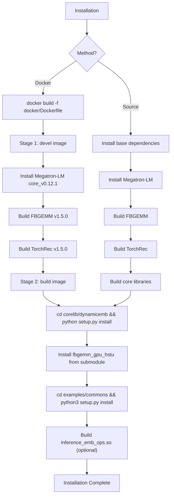
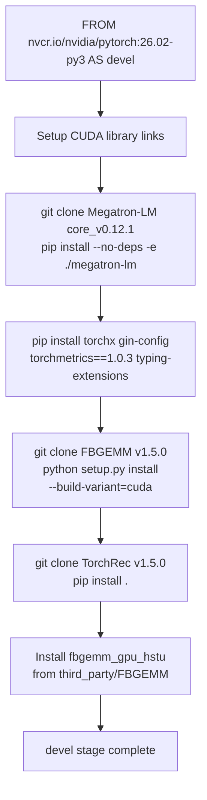
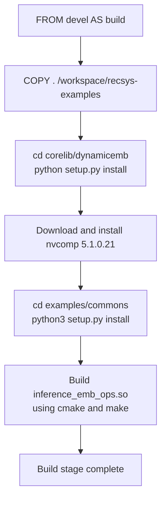

<!-- source: DeepWiki mcp.deepwiki.com · repo NVIDIA/recsys-examples · page 2 Getting Started · fetched 2026-10-26 -->

# Getting Started

<details>
<summary>Relevant source files</summary>

The following files were used as context for generating this wiki page:

- [.github/workflows/blossom-ci.yml](.github/workflows/blossom-ci.yml)
- [CONTRIBUTING.md](CONTRIBUTING.md)
- [HOW_TO_BUILD_AND_RUN_DEMO.md](HOW_TO_BUILD_AND_RUN_DEMO.md)
- [corelib/dynamicemb/CMakeLists.txt](corelib/dynamicemb/CMakeLists.txt)
- [corelib/dynamicemb/dynamicemb/incremental_dump.py](corelib/dynamicemb/dynamicemb/incremental_dump.py)
- [corelib/dynamicemb/dynamicemb/planner/__init__.py](corelib/dynamicemb/dynamicemb/planner/__init__.py)
- [corelib/dynamicemb/example/run_example.sh](corelib/dynamicemb/example/run_example.sh)
- [corelib/dynamicemb/src/table_operation/expand_table_ids_torch_binding.cu](corelib/dynamicemb/src/table_operation/expand_table_ids_torch_binding.cu)
- [docker/Dockerfile](docker/Dockerfile)
- [examples/hstu/modules/exportable_embedding.py](examples/hstu/modules/exportable_embedding.py)
- [examples/hstu/training/benchmark/README.md](examples/hstu/training/benchmark/README.md)
- [jenkins/L0_Test.groovy](jenkins/L0_Test.groovy)
- [pyproject.toml](pyproject.toml)

</details>


This document provides instructions for building and installing the NVIDIA RecSys Examples repository, which contains two core libraries (`dynamicemb` and `hstu`) and example applications. The system supports both Docker-based and source-based installation, optimized for NVIDIA GPUs (SM 7.5 to SM 9.0).

For component documentation, see Dynamic Embeddings (DynamicEmb) [page 3] and HSTU System [page 4]. For training workflows, see Training and Deployment [page 5].

## Prerequisites

The system requires specific versions of CUDA, PyTorch, and supporting frameworks:

| Component | Version | Notes |
|-----------|---------|-------|
| CUDA | 12.x | 12.6 or 13.x depending on base image ([docker/Dockerfile:1-33]()) |
| PyTorch | 2.6.0+ | Base container version `nvcr.io/nvidia/pytorch:26.02-py3` ([docker/Dockerfile:1]()) |
| GPU Architecture | SM 7.5+ | T4 (SM75), A100 (SM80), H100 (SM90) ([docker/Dockerfile:48](), [docker/Dockerfile:83]()) |
| Python | 3.x | From base container |
| Git | Recent | With `--recursive` support for submodules |
| Docker | 20.10+ | For containerized builds |

Sources: [docker/Dockerfile:1-36](), [docker/Dockerfile:48](), [docker/Dockerfile:83]()

## Installation Methods

Two installation methods are supported:

| Method | Use Case | Base Image | Build Time |
|--------|----------|------------|------------|
| Docker (Recommended) | Production, quick start | `nvcr.io/nvidia/pytorch:26.02-py3` | ~30-45 minutes |
| Source Build | Development, custom configs | User-provided PyTorch 2.6.0+ | ~15-30 minutes |

**Installation Decision Flow**



Sources: [docker/Dockerfile:1-91](), [HOW_TO_BUILD_AND_RUN_DEMO.md:1-13]()

## Docker-based Setup (Recommended)

The Docker build uses a multi-stage process defined in [docker/Dockerfile:1-91]().

### Standard Build

```bash
# Build for x86_64
docker build -f docker/Dockerfile --platform linux/amd64 -t recsys-examples:latest .

# Build for ARM64 (NVIDIA Grace)
docker build -f docker/Dockerfile --platform linux/arm64 -t recsys-examples:latest .
```

### Build Arguments

The Dockerfile supports several build-time arguments:

| Argument | Default | Purpose |
|----------|---------|---------|
| `BASE_IMAGE` | `nvcr.io/nvidia/pytorch:26.02-py3` | Base container image ([docker/Dockerfile:1]()) |
| `TARGETPLATFORM` | Auto-detected | `linux/amd64` or `linux/arm64` ([docker/Dockerfile:5]()) |
| `TRITONSERVER_BUILD` | `0` | Set to `1` for Triton integration ([docker/Dockerfile:7]()) |

Sources: [docker/Dockerfile:1-12]()

### Docker Build Stages

**Stage 1: Development Image (`devel`)**



Sources: [docker/Dockerfile:4-67]()

**Stage 2: Build Image (`build`)**



Sources: [docker/Dockerfile:69-91]()

### CUDA Architecture Selection

The build process compiles CUDA kernels for specific GPU architectures. Architecture support is configured via `TORCH_CUDA_ARCH_LIST` in [docker/Dockerfile:48]() and [docker/Dockerfile:83]():

| CUDA Arch | GPU Family | Support |
|-----------|------------|---------|
| 7.5 | T4 | Training + Inference |
| 8.0 | A100 | Training + Inference |
| 8.6 | A10, A30 | Training + Inference |
| 9.0 | H100 | Training + Inference |

Sources: [docker/Dockerfile:48](), [docker/Dockerfile:65](), [docker/Dockerfile:83]()

## Source-based Setup

For development or custom configurations, build components individually.

### Step 1: Install Framework Dependencies

Install Megatron-LM for core model parallelism:

```bash
git clone -b core_v0.12.1 https://github.com/NVIDIA/Megatron-LM.git megatron-lm
pip install --no-deps -e ./megatron-lm
```

Install standard Python packages:
```bash
pip install torchx gin-config torchmetrics==1.0.3 typing-extensions iopath pyvers cloudpickle triton==3.6.0 nvidia-cutlass-dsl==4.3.0
```

Sources: [docker/Dockerfile:39-42]()

### Step 2: Build FBGEMM and TorchRec

```bash
# Build FBGEMM with CUDA support
git clone --recursive -b v1.5.0 https://github.com/pytorch/FBGEMM.git fbgemm
cd fbgemm/fbgemm_gpu
python setup.py install --build-target=default --build-variant=cuda -DTORCH_CUDA_ARCH_LIST="7.5 8.0 9.0"
cd ../..

# Install TorchRec
pip install --no-deps tensordict orjson
git clone --recursive -b release/V1.5.0 https://github.com/pytorch/torchrec.git torchrec
cd torchrec && pip install --no-deps .
```

Sources: [docker/Dockerfile:44-54]()

### Step 3: Build Core Libraries

**DynamicEmb:**
The `dynamicemb` library provides GPU-accelerated dynamic embedding tables.

```bash
cd corelib/dynamicemb
python setup.py install
```

**HSTU Kernels:**
Install the specialized HSTU kernels from the provided submodule:

```bash
cd third_party/FBGEMM/fbgemm_gpu/experimental/hstu
HSTU_ARCH_LIST="8.0 9.0" pip install --no-build-isolation .
```

Sources: [docker/Dockerfile:57-66](), [docker/Dockerfile:75-76]()

### Step 4: Build Inference Operators

For inference workloads, build the `inference_emb_ops.so` library:

```bash
cd corelib/dynamicemb
mkdir -p torch_binding_build && cd torch_binding_build
cmake ..
make -j
```

This generates `corelib/dynamicemb/torch_binding_build/inference_emb_ops.so` which is required by `ExportableEmbedding` ([examples/hstu/modules/exportable_embedding.py:43-53]()).

Sources: [HOW_TO_BUILD_AND_RUN_DEMO.md:3-17](), [docker/Dockerfile:87-89]()

## Running First Examples

### DynamicEmb Example

Run the integrated example for `dynamicemb` which covers training, caching, and persistence:

```bash
cd corelib/dynamicemb/example
NGPU=1 ./run_example.sh
```

The script `run_example.sh` executes several phases:
1. **Training**: `example.py --train` ([corelib/dynamicemb/example/run_example.sh:3]())
2. **Caching**: `example.py --train --caching --prefetch_pipeline` ([corelib/dynamicemb/example/run_example.sh:4]())
3. **Persistence**: `example.py --load --dump` ([corelib/dynamicemb/example/run_example.sh:5]())
4. **Incremental Dump**: `example.py --incremental_dump` ([corelib/dynamicemb/example/run_example.sh:6]())

### HSTU Inference Demo

Verify the inference stack by running the export demo:

```bash
export PYTHONPATH=$PWD/corelib/dynamicemb:$PYTHONPATH
python examples/hstu/inference/test_export_demo.py
```

This demo loads the custom operators, builds an inference module, and runs a `torch.export` smoke test ([HOW_TO_BUILD_AND_RUN_DEMO.md:27-44]()).

## Development and Testing

### Unit Testing
Run linting and tests before contributing:

```bash
# Run linting
pre-commit run -a

# Run tests
# (Refer to Jenkins/Blossom CI configurations for full test suites)
```

Sources: [CONTRIBUTING.md:88-92](), [.github/workflows/blossom-ci.yml:1-29]()

### Environment Verification
If you encounter issues, run the environment reporting script:

```bash
bash recsys-examples/print_env.sh
```

Sources: [CONTRIBUTING.md:8-9]()

---

