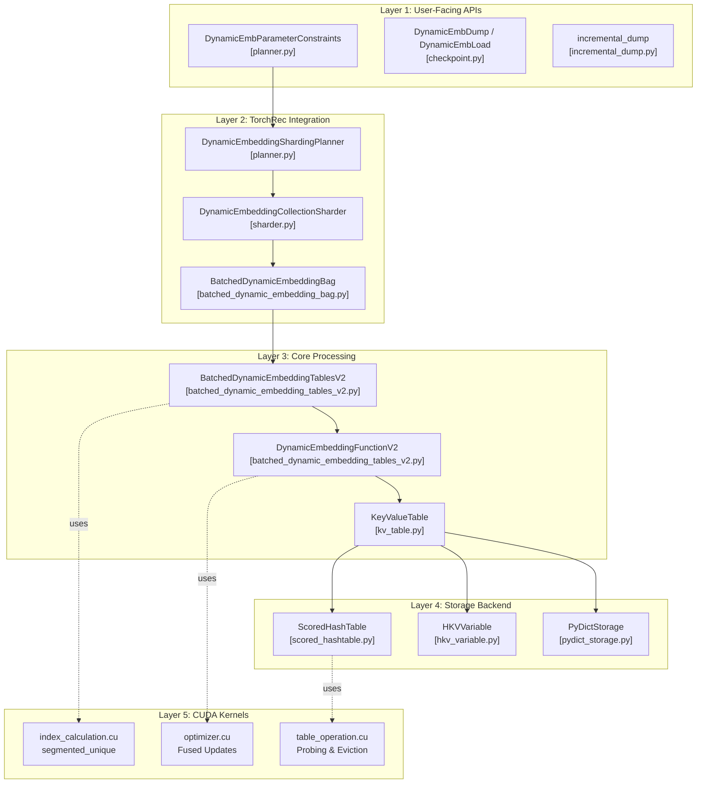
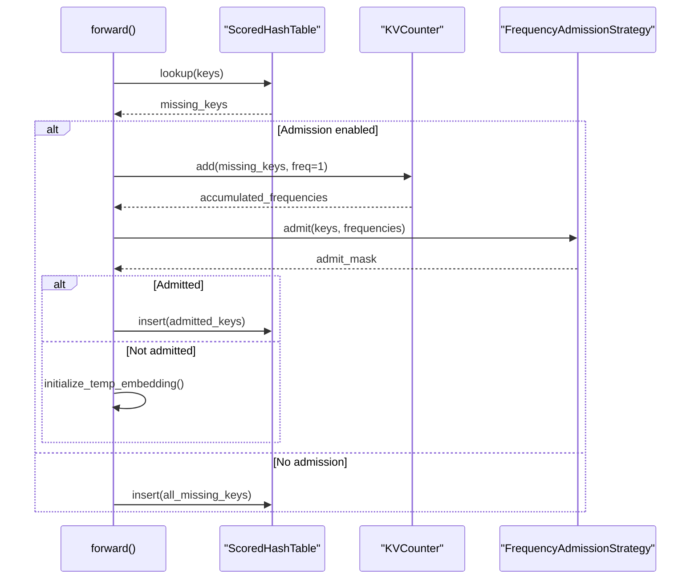

<!-- source: DeepWiki mcp.deepwiki.com · repo NVIDIA/recsys-examples · page 3 Dynamic Embeddings (DynamicEmb) · fetched 2026-10-26 -->

# Dynamic Embeddings (DynamicEmb)

Relevant source files

The following files were used as context for generating this wiki page:

- [.gitignore](.gitignore)
- [corelib/dynamicemb/DynamicEmb_APIs.md](corelib/dynamicemb/DynamicEmb_APIs.md)
- [corelib/dynamicemb/README.md](corelib/dynamicemb/README.md)
- [corelib/dynamicemb/dynamicemb/embedding_admission.py](corelib/dynamicemb/dynamicemb/embedding_admission.py)
- [examples/hstu/ops/fused_hstu_op.py](examples/hstu/ops/fused_hstu_op.py)

## Purpose and Scope

This document provides an overview of the **DynamicEmb** system, a GPU-accelerated embedding table implementation that extends TorchRec with dynamic capacity management, eviction policies, and hierarchical storage. DynamicEmb addresses the challenge of handling sparse features with unbounded or very large cardinality by maintaining only active embeddings in memory and automatically evicting stale entries.

**Scope:** This page covers the high-level architecture, core concepts, and integration patterns. For detailed information on specific components, see:
- Core implementation and lifecycle: [Core Architecture and BatchedDynamicEmbeddingTablesV2](#3.1)
- Configuration options: [Configuration System](#3.2)
- Storage backends: [Storage Backends: Hash Tables and HKV](#3.3)
- CUDA kernels: [CUDA Kernels and Index Operations](#3.4)
- Optimizer implementations: [Optimizers and Gradient Updates](#3.5)
- Checkpointing: [State Persistence: Dump and Load](#3.6)
- Distributed sharding: [TorchRec Integration and Sharding](#3.7)
- Performance: [Benchmarks and Performance](#3.8)

---

## Overview and Problem Statement

**Problem:** Traditional embedding tables allocate memory for a fixed number of embeddings (e.g., `num_embeddings × embedding_dim`). For sparse features with large or unbounded vocabulary (user IDs, item IDs, session tokens), this leads to:
1. **Memory waste** for cold/inactive keys that never appear during training.
2. **Capacity constraints** requiring users to estimate vocabulary size in advance.
3. **No built-in eviction** for stale embeddings that occupy memory indefinitely.

**Solution:** DynamicEmb implements a hash table-based storage system where:
- Embeddings are allocated **on-demand** when keys are first encountered [corelib/dynamicemb/README.md:23-23]().
- **Eviction policies** remove low-score embeddings when capacity is reached [corelib/dynamicemb/DynamicEmb_APIs.md:273-280]().
- **Caching layers** optimize hot embeddings in GPU memory with cold storage in CPU memory [corelib/dynamicemb/README.md:3-5]().
- **TorchRec integration** enables distributed sharding and training [corelib/dynamicemb/README.md:25-26]().

**Key Features:**
- **Dynamic capacity:** Tables grow up to `max_capacity` with automatic alignment to `DEMB_TABLE_ALIGN_SIZE` [corelib/dynamicemb/README.md:95-95]().
- **Score-based eviction:** LFU, timestamp, or custom scoring strategies [corelib/dynamicemb/DynamicEmb_APIs.md:273-312]().
- **Two-tier caching:** GPU cache for hot keys + CPU overflow storage [corelib/dynamicemb/DynamicEmb_APIs.md:346-360]().
- **Admission control:** Filter rare keys before inserting into tables [corelib/dynamicemb/dynamicemb/embedding_admission.py:107-119]().
- **Fused optimizers:** SGD, Adam, AdaGrad with fused updates to reduce memory traffic [corelib/dynamicemb/README.md:34-34]().
- **Incremental dumps:** Export only recently-active embeddings for online serving [corelib/dynamicemb/DynamicEmb_APIs.md:477-513]().

Sources: [corelib/dynamicemb/README.md:1-38](), [corelib/dynamicemb/DynamicEmb_APIs.md:1-25]()

---

## System Architecture

DynamicEmb implements a layered architecture that separates concerns from user-facing APIs down to GPU kernels.

### High-Level System Map

The following diagram maps high-level concepts to the specific code entities that implement them.

**Layer Responsibilities:**

| Layer | Components | Purpose |
|-------|------------|---------|
| **User APIs** | `DynamicEmbParameterConstraints`, `DynamicEmbDump/Load` | Configuration and checkpointing [corelib/dynamicemb/DynamicEmb_APIs.md:25-50]() |
| **TorchRec** | `DynamicEmbeddingShardingPlanner`, `DynamicEmbeddingCollectionSharder` | Distributed training integration [corelib/dynamicemb/DynamicEmb_APIs.md:88-149]() |
| **Core** | `BatchedDynamicEmbeddingTablesV2`, `DynamicEmbeddingFunctionV2` | Batched operations and autograd integration [corelib/dynamicemb/README.md:96-98]() |
| **Storage** | `ScoredHashTable`, `HKVVariable`, `PyDictStorage` | Hash table backends with eviction policies [corelib/dynamicemb/dynamicemb/embedding_admission.py:21-26]() |
| **Kernels** | `index_calculation.cu`, `optimizer.cu` | High-performance GPU operations [corelib/dynamicemb/README.md:96-96]() |

Sources: [corelib/dynamicemb/DynamicEmb_APIs.md:23-158](), [corelib/dynamicemb/README.md:1-103]()

---

## Core Concepts

### Score Strategies and Eviction

Each key-embedding pair has a **score** representing its importance. When a bucket is full, the lowest-score entry is evicted. DynamicEmb supports several strategies defined in `DynamicEmbScoreStrategy` [corelib/dynamicemb/DynamicEmb_APIs.md:273-280]().

| Strategy | Description | Score Value | Usage |
|----------|-------------|-------------|-------|
| `TIMESTAMP` | Device nanosecond timer | `uint64_t` timestamp | Default, automatic recency tracking |
| `STEP` | Forward pass counter | `int64_t` step | Consistent scores per batch |
| `CUSTOMIZED` | User-managed | User-provided `uint64_t` | Custom eviction logic |

Sources: [corelib/dynamicemb/DynamicEmb_APIs.md:273-312]()

### Admission Control

**Purpose:** Prevent rare keys from consuming memory by filtering them before insertion. This is managed by the `AdmissionStrategy` interface [corelib/dynamicemb/dynamicemb/embedding_admission.py:107-109]().

**Built-in Implementation:**
- `KVCounter`: Per-table counter configuration [corelib/dynamicemb/dynamicemb/embedding_admission.py:35-51]().
- `MultiTableKVCounter`: Fused multi-table counter backed by a single `ScoredHashTable` [corelib/dynamicemb/dynamicemb/embedding_admission.py:54-81]().
- `FrequencyAdmissionStrategy`: Admits keys whose frequency meets or exceeds a threshold [corelib/dynamicemb/dynamicemb/embedding_admission.py:107-130]().

Sources: [corelib/dynamicemb/dynamicemb/embedding_admission.py:35-181]()

---

## Checkpointing and Online Updates

### Full Checkpoint: DynamicEmbDump/Load

Save/restore complete tables including optimizer states across the process group [corelib/dynamicemb/DynamicEmb_APIs.md:438-475]().

### Incremental Dump: Export Active Embeddings

The `incremental_dump` function allows exporting only recently-used embeddings based on a score threshold, which is critical for online serving updates [corelib/dynamicemb/DynamicEmb_APIs.md:477-513]().

| Function | Purpose |
|----------|---------|
| `get_score` | Returns the current global score (timestamp/step) for all tables [corelib/dynamicemb/DynamicEmb_APIs.md:523-538](). |
| `set_score` | Manually sets the global score for specific tables [corelib/dynamicemb/DynamicEmb_APIs.md:540-553](). |
| `incremental_dump` | Exports keys/values whose score is greater than a given threshold [corelib/dynamicemb/DynamicEmb_APIs.md:477-490](). |

Sources: [corelib/dynamicemb/DynamicEmb_APIs.md:438-562]()

---

## Related Pages

For detailed information on specific aspects of DynamicEmb:

- **[Core Architecture and BatchedDynamicEmbeddingTablesV2](#3.1):** Lifecycle and data flow.
- **[Configuration System](#3.2):** Guide to `DynamicEmbTableOptions`.
- **[Storage Backends: Hash Tables and HKV](#3.3):** CUDA-optimized storage layers.
- **[CUDA Kernels and Index Operations](#3.4):** Deduplication and index calculation.
- **[Optimizers and Gradient Updates](#3.5):** Fused SGD, Adam, and AdaGrad.
- **[State Persistence: Dump and Load](#3.6):** Checkpointing and incremental updates.
- **[TorchRec Integration and Sharding](#3.7):** Sharding planners and sharder implementations.
- **[Benchmarks and Performance](#3.8):** Performance analysis.

---

