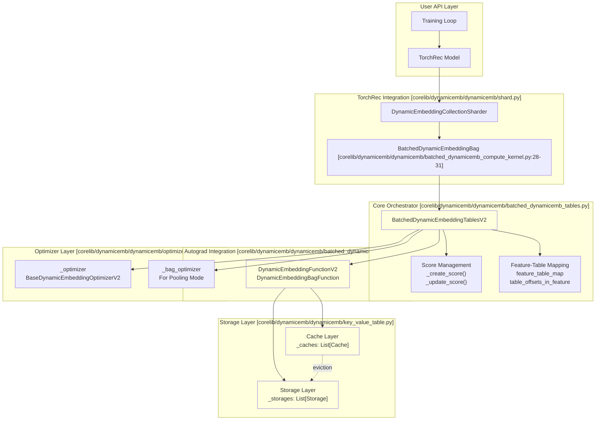
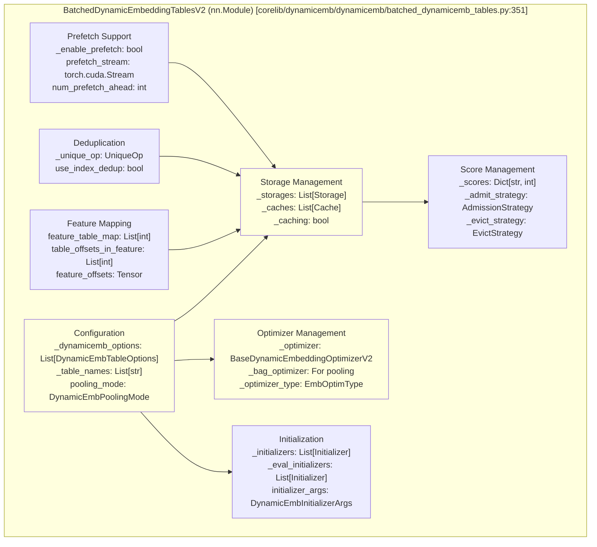
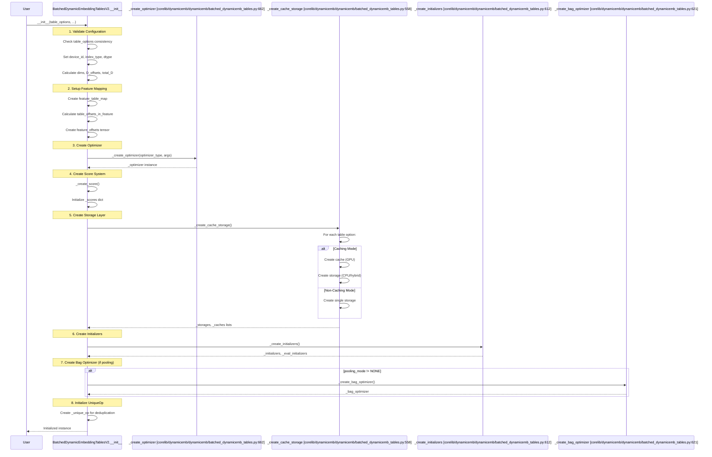
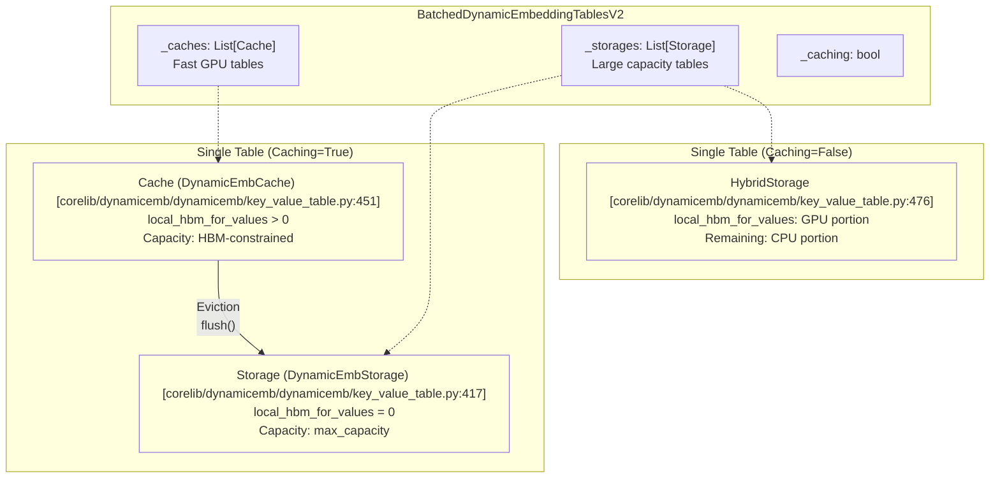
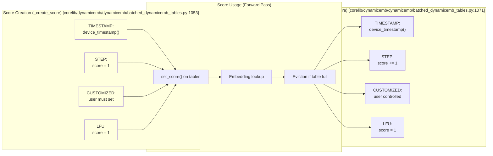
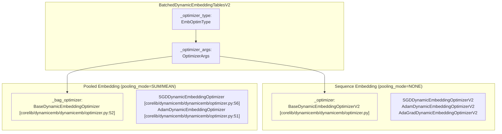

<!-- source: DeepWiki mcp.deepwiki.com · repo NVIDIA/recsys-examples · page 3.1 Core Architecture and BatchedDynamicEmbeddingTablesV2 · fetched 2026-10-26 -->

# Core Architecture and BatchedDynamicEmbeddingTablesV2

<details>
<summary>Relevant source files</summary>

The following files were used as context for generating this wiki page:

- [corelib/dynamicemb/dynamicemb/__init__.py](corelib/dynamicemb/dynamicemb/__init__.py)
- [corelib/dynamicemb/dynamicemb/batched_dynamicemb_compute_kernel.py](corelib/dynamicemb/dynamicemb/batched_dynamicemb_compute_kernel.py)
- [corelib/dynamicemb/dynamicemb/batched_dynamicemb_tables.py](corelib/dynamicemb/dynamicemb/batched_dynamicemb_tables.py)
- [corelib/dynamicemb/dynamicemb/key_value_table.py](corelib/dynamicemb/dynamicemb/key_value_table.py)
- [corelib/dynamicemb/dynamicemb/types.py](corelib/dynamicemb/dynamicemb/types.py)
- [corelib/dynamicemb/test/test_batched_dynamic_embedding_tables_v2.py](corelib/dynamicemb/test/test_batched_dynamic_embedding_tables_v2.py)
- [corelib/dynamicemb/test/unit_tests/test_alignment.py](corelib/dynamicemb/test/unit_tests/test_alignment.py)

</details>


## Purpose and Scope

This document provides a comprehensive guide to the core architecture of the DynamicEmb system, focusing on the `BatchedDynamicEmbeddingTablesV2` class and its role in managing dynamic embedding tables. This class serves as the central orchestrator for batch operations, storage management, and gradient computation in the DynamicEmb system.

**Scope:**
- Architecture and lifecycle of `BatchedDynamicEmbeddingTablesV2`
- Storage layer design (cache and storage backends)
- Data flow during forward/backward passes
- Score management and eviction strategies
- Integration with optimizer and autograd systems

**Related Pages:**
- For configuration options and parameter constraints, see [Configuration System](3.2)
- For detailed storage backend implementations, see [Storage Backends: Hash Tables and HKV](3.3)
- For CUDA kernel operations and deduplication, see [CUDA Kernels and Index Operations](3.4)
- For optimizer integration details, see [Optimizers and Gradient Updates](3.5)
- For checkpointing and state persistence, see [State Persistence: Dump and Load](3.6)

---

## System Position and Role

`BatchedDynamicEmbeddingTablesV2` occupies a central position in the DynamicEmb architecture, serving as the primary interface between user code and the underlying storage systems.

### Natural Language to Code Entity Space: System Overview

The following diagram maps high-level system components to their specific class and function implementations within the repository.

Title: RecSys Examples Dynamic Embedding System Map

**Sources:** [corelib/dynamicemb/dynamicemb/batched_dynamicemb_tables.py:351-405](), [corelib/dynamicemb/dynamicemb/batched_dynamicemb_compute_kernel.py:28-31]()

---

## Class Architecture Overview

### Core Class Structure

The `BatchedDynamicEmbeddingTablesV2` class is a `torch.nn.Module` that manages multiple dynamic embedding tables as a batched operation. It supports both sequence embeddings (`pooling_mode=NONE`) and pooled embeddings (`pooling_mode=SUM/MEAN`).

Title: BatchedDynamicEmbeddingTablesV2 Component Map


**Key Components:**

| Component | Purpose | Key Attributes |
|-----------|---------|----------------|
| Configuration | Stores table options and pooling mode | `_dynamicemb_options` [corelib/dynamicemb/dynamicemb/batched_dynamicemb_tables.py:364](), `pooling_mode` [corelib/dynamicemb/dynamicemb/batched_dynamicemb_tables.py:372]() |
| Storage Management | Manages cache and storage backends | `_storages` [corelib/dynamicemb/dynamicemb/batched_dynamicemb_tables.py:533](), `_caches` [corelib/dynamicemb/dynamicemb/batched_dynamicemb_tables.py:532]() |
| Optimizer Management | Handles gradient updates | `_optimizer` [corelib/dynamicemb/dynamicemb/batched_dynamicemb_tables.py:530](), `_bag_optimizer` [corelib/dynamicemb/dynamicemb/batched_dynamicemb_tables.py:531]() |
| Score Management | Tracks scores for eviction | `_scores` [corelib/dynamicemb/dynamicemb/batched_dynamicemb_tables.py:527](), `_admit_strategy` [corelib/dynamicemb/dynamicemb/batched_dynamicemb_tables.py:528]() |
| Feature Mapping | Maps logical features to physical tables | `feature_table_map` [corelib/dynamicemb/dynamicemb/batched_dynamicemb_tables.py:370](), `feature_offsets` [corelib/dynamicemb/dynamicemb/batched_dynamicemb_tables.py:483]() |
| Deduplication | Reduces redundant lookups | `_unique_op` [corelib/dynamicemb/dynamicemb/batched_dynamicemb_tables.py:553](), `use_index_dedup` [corelib/dynamicemb/dynamicemb/batched_dynamicemb_tables.py:382]() |

**Sources:** [corelib/dynamicemb/dynamicemb/batched_dynamicemb_tables.py:351-557]()

---

## Initialization Lifecycle

### Initialization Sequence

Title: BDETV2 Initialization Flow


**Sources:** [corelib/dynamicemb/dynamicemb/batched_dynamicemb_tables.py:361-557](), [corelib/dynamicemb/dynamicemb/batched_dynamicemb_tables.py:558-611](), [corelib/dynamicemb/dynamicemb/batched_dynamicemb_tables.py:662-788]()

### Key Initialization Steps

**1. Configuration Validation** [corelib/dynamicemb/dynamicemb/batched_dynamicemb_tables.py:406-451]()
- All tables must match in grouped keys (training mode, caching, etc.).
- Verifies `stochastic_rounding`, `gradient_clipping`, and `optimizer_type` consistency across the batch.

**2. Dimension and Offset Calculation** [corelib/dynamicemb/dynamicemb/batched_dynamicemb_tables.py:440-485]()
- `dims`: List of embedding dimensions per table.
- `feature_dims`: Dimensions mapped by `feature_table_map`.
- `D_offsets`: Cumulative offsets for concatenated embeddings.
- `total_D`: Total embedding dimension across all features.

**3. Feature-to-Table Mapping** [corelib/dynamicemb/dynamicemb/batched_dynamicemb_tables.py:456-485]()
- `feature_table_map`: Maps logical features to physical tables.
- `table_offsets_in_feature`: Indices where each table's features begin.
- `feature_offsets`: GPU tensor for fast lookup during forward/backward.

**Sources:** [corelib/dynamicemb/dynamicemb/batched_dynamicemb_tables.py:361-557]()

---

## Storage Layer Architecture

### Cache and Storage Design

The DynamicEmb system implements a two-tier storage architecture when caching is enabled: a fast GPU-based cache and a larger CPU/hybrid storage backend.

Title: Storage Tiering and Cache Relationship


**Sources:** [corelib/dynamicemb/dynamicemb/batched_dynamicemb_tables.py:558-611](), [corelib/dynamicemb/dynamicemb/key_value_table.py:417-511]()

### Cache Creation Logic

**Caching Mode** [corelib/dynamicemb/dynamicemb/batched_dynamicemb_tables.py:577-606]()

When `caching=True` and `training=True`:
1. **Cache (GPU)**: Created as a `DynamicEmbCache` [corelib/dynamicemb/dynamicemb/key_value_table.py:451](), size constrained by `local_hbm_for_values`.
2. **Storage (CPU/Hybrid)**: Created as a `DynamicEmbStorage` [corelib/dynamicemb/dynamicemb/key_value_table.py:417]() with `local_hbm_for_values=0`.

**Non-Caching Mode** [corelib/dynamicemb/dynamicemb/batched_dynamicemb_tables.py:604-606]()

When `caching=False` or `training=False`:
- Single `HybridStorage` [corelib/dynamicemb/dynamicemb/key_value_table.py:476]() using both GPU and CPU memory.
- Memory split determined by `local_hbm_for_values`.

**Sources:** [corelib/dynamicemb/dynamicemb/batched_dynamicemb_tables.py:558-611]()

---

## Forward Pass Data Flow

### Complete Forward Pass Pipeline

Title: BDETV2 Forward Pass Pipeline
```mermaid
graph TB
    subgraph "Input Processing"
        Input["forward(<br/>indices: Tensor,<br/>offsets: Tensor,<br/>per_sample_weights: Tensor)"]
        TypeCheck["Type Conversion<br/>indices.to(index_type)"]
        ScoreSetup["Score Setup<br/>set_score() for each table"]
    end
    
    subgraph "Mode Selection"
        ModeCheck{pooling_mode<br/>== NONE?}
    end
    
    subgraph "Sequence Embedding Path (pooling_mode=NONE)"
        SeqAutograd["DynamicEmbeddingFunction.apply() [corelib/dynamicemb/dynamicemb/batched_dynamicemb_function.py]"]
        
        SeqForward["Forward:<br/>1. Deduplication<br/>2. Cache lookup<br/>3. Storage lookup<br/>4. Initialize missing keys"]
    end
    
    subgraph "Pooled Embedding Path (pooling_mode=SUM/MEAN)"
        BagAutograd["DynamicEmbeddingBagFunction.apply()"]
        
        BagForward["Forward:<br/>1. Lookup embeddings<br/>2. Pool per sample<br/>3. Apply pooling mode"]
    end
    
    subgraph "Score Update"
        UpdateScore["_update_score()<br/>if training or caching"]
    end
    
    subgraph "Output"
        Output["Return: List[Tensor]<br/>Embeddings per feature"]
    end
    
    Input --> TypeCheck
    TypeCheck --> ScoreSetup
    ScoreSetup --> ModeCheck
    
    ModeCheck -->|Yes| SeqAutograd
    ModeCheck -->|No| BagAutograd
    
    SeqAutograd --> SeqForward
    BagAutograd --> BagForward
    
    SeqForward --> UpdateScore
    BagForward --> UpdateScore
    
    UpdateScore --> Output
    
    style SeqAutograd fill:none
    style BagAutograd fill:none
    style UpdateScore fill:none
```

**Sources:** [corelib/dynamicemb/dynamicemb/batched_dynamicemb_tables.py:861-958]()

### Forward Method Implementation

**Sequence Embedding Path** [corelib/dynamicemb/dynamicemb/batched_dynamicemb_tables.py:892-930]()

For `pooling_mode=NONE`, the module invokes `DynamicEmbeddingFunction.apply` [corelib/dynamicemb/dynamicemb/batched_dynamicemb_function.py:27](). This function handles the complex logic of cache-storage coordination, key initialization, and insertion.

**Pooled Embedding Path** [corelib/dynamicemb/dynamicemb/batched_dynamicemb_tables.py:931-952]()

For `pooling_mode=SUM` or `MEAN`, uses `DynamicEmbeddingBagFunction` which integrates pooling into the forward pass and uses the `_bag_optimizer` for gradient updates.

**Sources:** [corelib/dynamicemb/dynamicemb/batched_dynamicemb_tables.py:861-958]()

---

## Score Management System

### Score Lifecycle

Scores determine which embeddings are evicted when tables reach capacity. Lower scores indicate higher eviction priority.

Title: Score Strategy and Update Cycle


**Score Strategy Implementations** [corelib/dynamicemb/dynamicemb/batched_dynamicemb_tables.py:1053-1115]()

| Strategy | Creation | Update | Use Case |
|----------|----------|--------|----------|
| TIMESTAMP | `device_timestamp()` | `device_timestamp()` | LRU eviction with nanosecond precision |
| STEP | `score = 1` | `score += 1` | LRU with step-based monotonic scores |
| CUSTOMIZED | User must call `set_score()` | User controlled | Custom eviction policies |
| LFU | `score = 1` | `score = 1` | Least frequently used eviction |

**Sources:** [corelib/dynamicemb/dynamicemb/batched_dynamicemb_tables.py:1023-1092]()

---

## Optimizer Integration

### Optimizer Architecture

DynamicEmb supports two separate optimizer paths depending on whether pooling is used.

Title: Optimizer Dispatch Logic


**Optimizer State Dimensions** [corelib/dynamicemb/dynamicemb/optimizer.py:57]()

The optimizer states are stored alongside embeddings in the value dimension. The total dimension is calculated via `get_optimizer_state_dim`.

| Optimizer | State Dimension Calculation |
|-----------|----------------------------|
| SGD | 0 (no additional state) |
| AdaGrad | `embedding_dim` (one state per parameter) |
| Adam | `embedding_dim * 2` (momentum + velocity) |
| RowWiseAdaGrad | `16 // dtype_bytes` (row-wise accumulator) |

**Sources:** [corelib/dynamicemb/dynamicemb/batched_dynamicemb_tables.py:621-788](), [corelib/dynamicemb/dynamicemb/optimizer.py:51-58]()

---

## State Management and Persistence

### Persistence Operations

Title: Checkpoint and Persistence Flow

```mermaid
graph TB
    subgraph "Dump Process [corelib/dynamicemb/dynamicemb/batched_dynamicemb_tables.py:1117]"
        DumpCall["dump(save_dir, optim=True)"]
        Flush["flush()<br/>Move cache to storage"]
        DumpLoop["For each table:<br/>storage.dump()"]
        DumpFiles["Keys, Values, Scores,<br/>Opt States"]
    end
    
    subgraph "Load Process [corelib/dynamicemb/dynamicemb/batched_dynamicemb_tables.py:1210]"
        LoadCall["load(save_dir, optim=True)"]
        FindFiles["get_loading_files()<br/>Discover checkpoint files"]
        LoadLoop["For each table:<br/>storage.load()"]
        LoadData["Restore embeddings,<br/>opt states, scores"]
    end
    
    subgraph "Incremental Dump [corelib/dynamicemb/dynamicemb/batched_dynamicemb_tables.py:1268]"
        IncrCall["incremental_dump(<br/>named_thresholds)"]
        FlushCache["Flush cache if present"]
        ExportMatched["storage.incremental_dump()"]
    end
    
    DumpCall --> Flush
    Flush --> DumpLoop
    
    LoadCall --> FindFiles
    FindFiles --> LoadLoop
    
    IncrCall --> FlushCache
    FlushCache --> ExportMatched
    
    style Flush fill:none
    style FlushCache fill:none
```


**File Naming Convention** [corelib/dynamicemb/dynamicemb/batched_dynamicemb_tables.py:74-89]()

- **Keys**: `{table_name}_emb_keys.rank_{rank}.world_size_{world_size}`
- **Values**: `{table_name}_emb_values.rank_{rank}.world_size_{world_size}`
- **Scores**: `{table_name}_emb_scores.rank_{rank}.world_size_{world_size}`
- **Opt States**: `{table_name}_opt_values.rank_{rank}.world_size_{world_size}`

**Sources:** [corelib/dynamicemb/dynamicemb/batched_dynamicemb_tables.py:74-141](), [corelib/dynamicemb/dynamicemb/batched_dynamicemb_tables.py:1117-1305]()

---

## Memory Management and Capacity

The system calculates and prints memory consumption during initialization in `_print_memory_consume` [corelib/dynamicemb/dynamicemb/batched_dynamicemb_tables.py:260]().

**Capacity Planning Logic:**
1. **Max Capacity**: Total capacity per rank (power of 2) [corelib/dynamicemb/dynamicemb/dynamicemb_config.py:533]().
2. **Local HBM**: GPU memory allocation for values.
3. **Bucket Capacity**: Keys per bucket (affects eviction granularity).

**Formula:**
```python
total_memory_per_table = max_capacity * (emb_dim + opt_state_dim) * dtype_bytes
hbm_memory = min(local_hbm_for_values, total_memory_per_table)
dram_memory = total_memory_per_table - hbm_memory
```

**Sources:** [corelib/dynamicemb/dynamicemb/batched_dynamicemb_tables.py:260-349](), [corelib/dynamicemb/dynamicemb/dynamicemb_config.py:533-551]()

---

