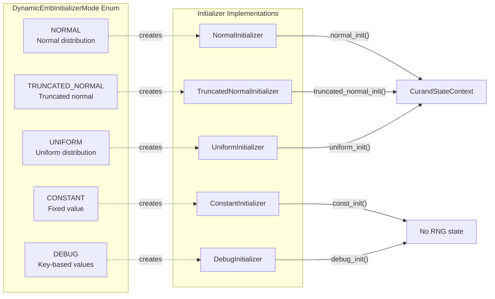
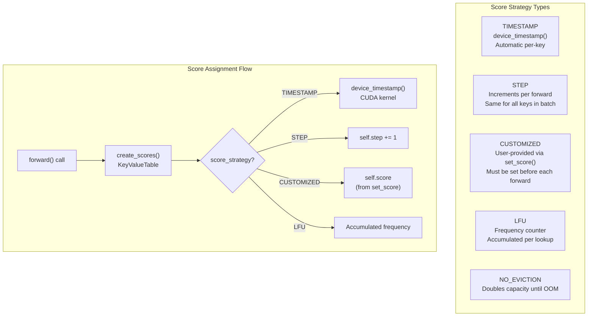

<!-- source: DeepWiki mcp.deepwiki.com · repo NVIDIA/recsys-examples · page 3.2 Configuration System · fetched 2026-10-26 -->

# Configuration System

<details>
<summary>Relevant source files</summary>

The following files were used as context for generating this wiki page:

- [corelib/dynamicemb/DynamicEmb_APIs.md](corelib/dynamicemb/DynamicEmb_APIs.md)
- [corelib/dynamicemb/dynamicemb/dynamicemb_config.py](corelib/dynamicemb/dynamicemb/dynamicemb_config.py)
- [corelib/dynamicemb/dynamicemb/embedding_admission.py](corelib/dynamicemb/dynamicemb/embedding_admission.py)
- [corelib/dynamicemb/dynamicemb/initializer.py](corelib/dynamicemb/dynamicemb/initializer.py)
- [corelib/dynamicemb/dynamicemb/planner/planner.py](corelib/dynamicemb/dynamicemb/planner/planner.py)

</details>


## Purpose and Scope

This document describes the configuration system for Dynamic Embeddings (DynamicEmb), which controls how embedding tables are created, initialized, and managed at runtime. The configuration system encompasses table capacity settings, initialization strategies, eviction policies, admission control, and various operational modes.

For information about how these configurations are used during the table lifecycle, see [Core Architecture and BatchedDynamicEmbeddingTablesV2](3.1). For TorchRec integration details, see [TorchRec Integration and Sharding](3.7).

---

## Configuration Architecture Overview

The configuration system is organized into a hierarchy of dataclasses and enumerations that control different aspects of dynamic embedding behavior.

```mermaid
graph TB
    subgraph "User-Facing Configuration"
        PC["DynamicEmbParameterConstraints<br/>(TorchRec Integration)"]
        DETO["DynamicEmbTableOptions<br/>(Main Configuration)"]
    end
    
    subgraph "Initialization Configuration"
        InitMode["DynamicEmbInitializerMode<br/>UNIFORM/NORMAL/CONSTANT/etc"]
        InitArgs["DynamicEmbInitializerArgs<br/>mean, std_dev, lower, upper, value"]
    end
    
    subgraph "Score and Eviction"
        ScoreStrat["DynamicEmbScoreStrategy<br/>TIMESTAMP/STEP/CUSTOMIZED/LFU"]
        EvictStrat["DynamicEmbEvictStrategy<br/>LRU/LFU/EPOCH_LRU/etc"]
    end
    
    subgraph "Admission Control"
        AdmitStrat["AdmissionStrategy Interface<br/>admit(), initialize_non_admitted_embeddings()"]
        Counter["Counter Interface<br/>add(), erase(), dump(), load()"]
        FreqAdmit["FrequencyAdmissionStrategy<br/>threshold-based admission"]
        KVCounter["KVCounter<br/>key-frequency storage"]
    end
    
    subgraph "Mode Enumerations"
        CheckMode["DynamicEmbCheckMode<br/>ERROR/WARNING/IGNORE"]
        PoolMode["DynamicEmbPoolingMode<br/>SUM/MEAN/NONE"]
    end
    
    subgraph "Context Options"
        CtxOpts["_ContextOptions<br/>Inferred Parameters"]
    end
    
    PC -->|"contains"| DETO
    DETO -->|"inherits"| CtxOpts
    DETO -->|"uses"| InitArgs
    DETO -->|"uses"| ScoreStrat
    DETO -->|"uses"| EvictStrat
    DETO -->|"uses"| CheckMode
    DETO -->|"uses"| AdmitStrat
    DETO -->|"uses"| Counter
    
    InitArgs -->|"specifies"| InitMode
    AdmitStrat <-.implements.- FreqAdmit
    Counter <-.implements.- KVCounter
    
    FreqAdmit -->|"uses for non-admitted"| InitArgs
```

**Configuration Hierarchy**: The system centers around `DynamicEmbTableOptions`, which inherits runtime-inferred parameters from `_ContextOptions` and composes initialization, scoring, eviction, and admission control configurations. `DynamicEmbParameterConstraints` wraps this for TorchRec integration [corelib/dynamicemb/dynamicemb/planner/planner.py:62-79]().

**Sources**: [corelib/dynamicemb/dynamicemb/dynamicemb_config.py:207-358](), [corelib/dynamicemb/DynamicEmb_APIs.md:23-46](), [corelib/dynamicemb/dynamicemb/planner/planner.py:62-79]()

---

## DynamicEmbTableOptions

`DynamicEmbTableOptions` is the primary configuration class that controls all aspects of a dynamic embedding table's behavior. It is defined as a dataclass in [corelib/dynamicemb/dynamicemb/dynamicemb_config.py:149-358]().

### Key Configuration Parameters

| Parameter | Type | Default | Description |
|-----------|------|---------|-------------|
| `training` | `bool` | `True` | Enables optimizer state storage alongside embeddings |
| `caching` | `bool` | `False` | Creates separate GPU/CPU tables with GPU as cache |
| `init_capacity` | `Optional[int]` | `None` | Initial table capacity (rounded to power of 2) |
| `max_capacity` | `Optional[int]` | `None` | Maximum table capacity after sharding |
| `max_load_factor` | `float` | `0.5` | Load factor threshold before rehashing |
| `bucket_capacity` | `int` | `128` | Number of slots per hash bucket |
| `score_strategy` | `DynamicEmbScoreStrategy` | `TIMESTAMP` | How scores are assigned to key-value pairs |
| `evict_strategy` | `DynamicEmbEvictStrategy` | `LRU` | Policy for evicting entries when full |
| `safe_check_mode` | `DynamicEmbCheckMode` | `IGNORE` | Level of insertion failure checking |
| `global_hbm_for_values` | `int` | `0` | Total GPU memory (bytes) for embeddings + optimizer states |
| `local_hbm_for_values` | `int` | `0` | GPU memory per rank (bytes) |
| `admit_strategy` | `Optional[AdmissionStrategy]` | `None` | Controls which keys enter the table |
| `admission_counter` | `Optional[Counter]` | `None` | Tracks admission statistics |
| `external_storage` | `Optional[Storage]` | `None` | Custom parameter server implementation |
| `index_type` | `Optional[torch.dtype]` | `None` | Data type for sparse feature indices |
| `embedding_dtype` | `Optional[torch.dtype]` | `None` | Data type for embedding values |
| `dim` | `Optional[int]` | `None` | Embedding dimension |

### Configuration Grouping

Tables with identical configuration keys are grouped together for efficient batched operations. The grouping key is computed by `get_grouped_key()` at [corelib/dynamicemb/dynamicemb/dynamicemb_config.py:345-353]():

```python
def get_grouped_key(self):
    grouped_key = {}
    grouped_key["training"] = self.training
    grouped_key["caching"] = self.caching
    grouped_key["external_storage"] = self.external_storage
    grouped_key["index_type"] = self.index_type
    grouped_key["score_strategy"] = self.score_strategy
    grouped_key["admit_strategy"] = self.admit_strategy
    return grouped_key
```

**Sources**: [corelib/dynamicemb/dynamicemb/dynamicemb_config.py:149-358](), [corelib/dynamicemb/DynamicEmb_APIs.md:314-422]()

---

## Initialization System

The initialization system controls how embedding vectors are populated when new keys are encountered.

### DynamicEmbInitializerMode



**Initialization Flow**: Factory function `create_initializer_from_args()` at [corelib/dynamicemb/dynamicemb/initializer.py:112-131]() creates the appropriate initializer based on mode. Random initializers maintain `CurandStateContext` for GPU random number generation [corelib/dynamicemb/dynamicemb/initializer.py:35]().

### DynamicEmbInitializerArgs

The `DynamicEmbInitializerArgs` dataclass specifies parameters for each initialization mode [corelib/dynamicemb/dynamicemb/types.py]():

| Field | Type | Default | Used By |
|-------|------|---------|---------|
| `mode` | `DynamicEmbInitializerMode` | (required) | All modes |
| `mean` | `float` | `0.0` | NORMAL, TRUNCATED_NORMAL |
| `std_dev` | `float` | `1.0` | NORMAL, TRUNCATED_NORMAL |
| `lower` | `float` | `None` | UNIFORM, TRUNCATED_NORMAL |
| `upper` | `float` | `None` | UNIFORM, TRUNCATED_NORMAL |
| `value` | `float` | `0.0` | CONSTANT |

**Sources**: [corelib/dynamicemb/dynamicemb/initializer.py:1-131](), [corelib/dynamicemb/dynamicemb/dynamicemb_config.py:295-305](), [corelib/dynamicemb/DynamicEmb_APIs.md:205-271]()

---

## Score Strategies

Scores determine which key-value pairs are evicted when the table reaches capacity. The `DynamicEmbScoreStrategy` enum at [corelib/dynamicemb/dynamicemb/dynamicemb_config.py:113-146]() defines how scores are assigned.



**Score Management**:
- **TIMESTAMP**: Set to device global nanosecond timer [corelib/dynamicemb/dynamicemb/dynamicemb_config.py:123-126]().
- **STEP**: Incremented for every forward pass [corelib/dynamicemb/dynamicemb/dynamicemb_config.py:127-130]().
- **CUSTOMIZED**: Users must provide scores via `set_score` [corelib/dynamicemb/dynamicemb/dynamicemb_config.py:131-133]().
- **LFU**: Least used key in the bucket is evicted [corelib/dynamicemb/dynamicemb/dynamicemb_config.py:134-135]().

**Sources**: [corelib/dynamicemb/dynamicemb/dynamicemb_config.py:113-146](), [corelib/dynamicemb/DynamicEmb_APIs.md:273-311]()

---

## Admission Control

Admission control filters which keys are stored in the embedding table, reducing memory usage for rare features.

```mermaid
graph TB
    subgraph "Admission Strategy Interface"
        AS["AdmissionStrategy<br/>(Abstract Base)"]
        AdmitMethod["admit(keys, frequencies)<br/>returns: mask tensor"]
        InitMethod["initialize_non_admitted_embeddings()<br/>returns: bool"]
    end
    
    subgraph "Frequency-Based Admission"
        FreqAdmit["FrequencyAdmissionStrategy"]
        Threshold["threshold: int<br/>Min frequency for admission"]
        NonAdmitInit["initializer_args: Optional<br/>For non-admitted keys"]
        
        FreqAdmit --> Threshold
        FreqAdmit --> NonAdmitInit
    end
    
    subgraph "Counter Interface"
        Counter["Counter<br/>(Abstract Base)"]
        AddMethod["add(keys, table_ids, frequencies)<br/>returns: accumulated_frequencies"]
    end
    
    subgraph "MultiTableKVCounter Implementation"
        MTKVC["MultiTableKVCounter"]
        ScoreTable["ScoredHashTable<br/>with ACCUMULATE policy"]
        
        MTKVC --> ScoreTable
    end
    
    AS <-.implements.- FreqAdmit
    Counter <-.implements.- MTKVC
```

### FrequencyAdmissionStrategy

Defined at [corelib/dynamicemb/dynamicemb/embedding_admission.py:107-181](), this strategy admits keys only when their accumulated frequency meets or exceeds a threshold. It also allows initializing embeddings for non-admitted keys via `initialize_non_admitted_embeddings()` [corelib/dynamicemb/dynamicemb/embedding_admission.py:161-180]().

### MultiTableKVCounter

Implemented at [corelib/dynamicemb/dynamicemb/embedding_admission.py:54-105](), it manages a fused multi-table `ScoredHashTable` with an `ACCUMULATE` policy [corelib/dynamicemb/dynamicemb/embedding_admission.py:72]().

**Sources**: [corelib/dynamicemb/dynamicemb/embedding_admission.py:35-181](), [corelib/dynamicemb/dynamicemb/dynamicemb_config.py:30-34]()

---

## Mode Enumerations

### DynamicEmbCheckMode

Controls behavior when hash table bucket overflow occurs [corelib/dynamicemb/dynamicemb/dynamicemb_config.py:61-95]():

| Mode | Value | Behavior |
|------|-------|----------|
| `ERROR` | `0` | Throw runtime error and crash [corelib/dynamicemb/dynamicemb/dynamicemb_config.py:80-83]() |
| `WARNING` | `1` | Warning and set embedding to 0.0 [corelib/dynamicemb/dynamicemb/dynamicemb_config.py:84-87]() |
| `IGNORE` | `2` | Silently set embedding to 0.0 [corelib/dynamicemb/dynamicemb/dynamicemb_config.py:88-90]() |

### DynamicEmbPoolingMode

Controls aggregation of multiple embeddings per feature [corelib/dynamicemb/dynamicemb/dynamicemb_config.py:98-101]():
- `SUM`: Sum embeddings.
- `MEAN`: Average embeddings.
- `NONE`: Sequence embeddings (no pooling).

**Sources**: [corelib/dynamicemb/dynamicemb/dynamicemb_config.py:61-101](), [corelib/dynamicemb/DynamicEmb_APIs.md:12-15]()

---

## Configuration and Planning

`DynamicEmbeddingShardingPlanner` wraps TorchRec's planner and uses `_prepare_dynemb_table_options` to fill per-rank options [corelib/dynamicemb/dynamicemb/planner/planner.py:88-120]().

### Capacity and Bucket Alignment
The planner adjusts `bucket_capacity` and `max_capacity` to ensure alignment with world size and hash table bucket layouts [corelib/dynamicemb/dynamicemb/planner/planner.py:174-181]().

### Sharding Routing
Supported `dist_type` values for row-wise sharding [corelib/dynamicemb/DynamicEmb_APIs.md:94-101]():
- `continuous`
- `roundrobin`
- `hash_roundrobin`: Hashes raw keys before rank assignment to mitigate hot-key skew.

**Sources**: [corelib/dynamicemb/dynamicemb/planner/planner.py:1-200](), [corelib/dynamicemb/DynamicEmb_APIs.md:88-120]()

---

