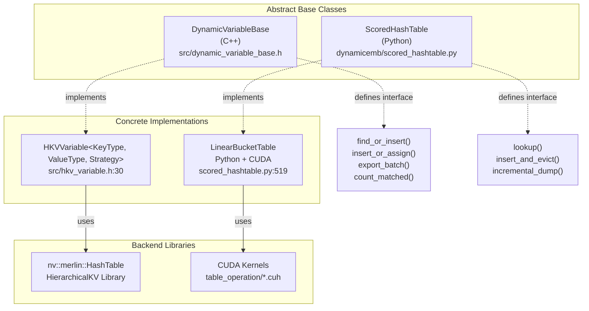

<!-- source: DeepWiki mcp.deepwiki.com · repo NVIDIA/recsys-examples · page 3.3 Storage Backends: Hash Tables and HKV · fetched 2026-10-26 -->

# Storage Backends: Hash Tables and HKV

<details>
<summary>Relevant source files</summary>

The following files were used as context for generating this wiki page:

- [corelib/dynamicemb/benchmark/benchmark_embedding_collection.py](corelib/dynamicemb/benchmark/benchmark_embedding_collection.py)
- [corelib/dynamicemb/dynamicemb/scored_hashtable.py](corelib/dynamicemb/dynamicemb/scored_hashtable.py)
- [corelib/dynamicemb/src/table_operation/bucketize.cu](corelib/dynamicemb/src/table_operation/bucketize.cu)
- [corelib/dynamicemb/src/table_operation/count_matched.cu](corelib/dynamicemb/src/table_operation/count_matched.cu)
- [corelib/dynamicemb/src/table_operation/export_batch.cu](corelib/dynamicemb/src/table_operation/export_batch.cu)
- [corelib/dynamicemb/src/table_operation/kernels.cuh](corelib/dynamicemb/src/table_operation/kernels.cuh)
- [corelib/dynamicemb/src/table_operation/table.cu](corelib/dynamicemb/src/table_operation/table.cu)
- [corelib/dynamicemb/src/table_operation/table.cuh](corelib/dynamicemb/src/table_operation/table.cuh)
- [corelib/dynamicemb/src/table_operation/types.cuh](corelib/dynamicemb/src/table_operation/types.cuh)
- [corelib/dynamicemb/src/torch_utils.cu](corelib/dynamicemb/src/torch_utils.cu)
- [corelib/dynamicemb/src/torch_utils.h](corelib/dynamicemb/src/torch_utils.h)
- [corelib/dynamicemb/test/unit_tests/table_operation/test_table_dump_load.py](corelib/dynamicemb/test/unit_tests/table_operation/test_table_dump_load.py)
- [corelib/dynamicemb/test/unit_tests/table_operation/test_table_operation.py](corelib/dynamicemb/test/unit_tests/table_operation/test_table_operation.py)
- [corelib/dynamicemb/test/unit_tests/test_hybrid_storage_export.py](corelib/dynamicemb/test/unit_tests/test_hybrid_storage_export.py)

</details>


## Purpose and Scope

This document describes the storage backend layer of the DynamicEmb system, which provides GPU-accelerated hash table implementations for storing dynamic embedding vectors. The storage backend abstracts key-value storage with support for scoring, eviction policies, and distributed operations. Two implementations are provided: `LinearBucketTable` (Python-level with CUDA kernels) and `HKVVariable` (using NVIDIA Merlin's HierarchicalKV library).

For information about the core `BatchedDynamicEmbeddingTablesV2` class that uses these storage backends, see [Core Architecture and BatchedDynamicEmbeddingTablesV2](3.1). For configuration of eviction strategies and admission control, see [Configuration System](3.2). For CUDA index processing kernels, see [CUDA Kernels and Index Operations](3.4).

---

## Storage Backend Architecture

### Storage Backend Interface Hierarchy



**Sources:** [corelib/dynamicemb/dynamicemb/scored_hashtable.py:73-233](), [corelib/dynamicemb/src/table_operation/table.cuh:67-139]()

The storage backend provides two parallel interface hierarchies:
- **C++ Interface**: `DynamicVariableBase` defines the core storage operations used by the C++ autograd layer.
- **Python Interface**: `ScoredHashTable` defines higher-level operations including scoring, eviction, and persistence [corelib/dynamicemb/dynamicemb/scored_hashtable.py:73-233]().

Both interfaces support:
- **Key-value storage** with integer keys and floating-point value vectors.
- **Score management** for eviction policies (LRU, LFU, custom) [corelib/dynamicemb/dynamicemb/scored_hashtable.py:44-60]().
- **Atomic operations** for concurrent access [corelib/dynamicemb/src/table_operation/types.cuh:159-169]().
- **Batch operations** for GPU efficiency [corelib/dynamicemb/src/table_operation/kernels.cuh:83-89]().
- **Eviction strategies** when capacity is exceeded [corelib/dynamicemb/src/table_operation/kernels.cuh:273-285]().

---

## LinearBucketTable Implementation

### Architecture Overview

`LinearBucketTable` is a Python-managed hash table with custom CUDA kernels for all operations. It uses **linear probing** within fixed-size buckets to handle hash collisions.

```mermaid
graph TB
    subgraph "Python Layer"
        LBT["LinearBucketTable<br/>scored_hashtable.py:519"]
        Config["Configuration<br/>capacity<br/>bucket_capacity<br/>score_specs"]
    end
    
    subgraph "Storage Layout"
        TableStorage["table_storage_<br/>torch.Tensor (uint8)"]
        Keys["keys_<br/>(num_buckets, bucket_capacity)<br/>torch.int64"]
        Digests["digests_<br/>(num_buckets, bucket_capacity)<br/>torch.uint8"]
        Scores["scores_list<br/>(num_buckets, bucket_capacity)<br/>torch.uint64"]
    end
    
    subgraph "CUDA Kernels"
        Lookup["table_lookup_kernel<br/>table_operation/kernels.cuh:83"]
        Insert["table_insert_kernel<br/>kernels.cuh:141"]
        InsertEvict["table_insert_and_evict_kernel<br/>kernels.cuh:273"]
        Export["table_export_batch_kernel<br/>kernels.cuh:510"]
    end
    
    LBT -->|initializes| Config
    Config -->|allocates| TableStorage
    TableStorage -->|partitions via<br/>table_partition()| Keys
    TableStorage -->|partitions via<br/>table_partition()| Digests
    TableStorage -->|partitions via<br/>table_partition()| Scores
    
    LBT -->|lookup()| Lookup
    LBT -->|insert()| Insert
    LBT -->|insert_and_evict()| InsertEvict
    LBT -->|dump()/incremental_dump()| Export
```

**Sources:** [corelib/dynamicemb/dynamicemb/scored_hashtable.py:519-611](), [corelib/dynamicemb/src/table_operation/table.cu:22-65](), [corelib/dynamicemb/src/table_operation/kernels.cuh:83-559]()

### Bucket Structure

The `LinearBucketTable` stores data in a single contiguous tensor partitioned into fields using `table_partition` [corelib/dynamicemb/src/table_operation/table.cu:22-65]().

| Field | Type | Size per Slot | Purpose |
|-------|------|---------------|---------|
| **Keys** | `torch.int64` or `torch.uint64` | 8 bytes | Embedding keys (with reserved values for empty/locked/reclaimed) |
| **Digests** | `torch.uint8` | 1 byte | 8-bit hash digest for fast comparison |
| **Scores** | `torch.uint64` | 8 bytes | Eviction score (timestamp, frequency, etc.) |

**Memory Layout** (per bucket):
The memory is laid out such that keys, digests, and scores for a bucket are contiguous, allowing for vectorized access [corelib/dynamicemb/src/table_operation/table.cu:51-63]().

**Sources:** [corelib/dynamicemb/src/table_operation/types.cuh:38-40](), [corelib/dynamicemb/src/table_operation/table.cu:51-63]()

### Reserved Key Values

The system uses specific bit patterns for atomic state management in `LinearBucket` [corelib/dynamicemb/src/table_operation/types.cuh:116-120]():

| Constant | Value | Description |
|----------|-------|-------------|
| `EmptyKey` | `0xFFFFFFFFFFFFFFFF` | Slot has never been used |
| `LockedKey` | `0xFFFFFFFFFFFFFFFD` | Slot being modified |
| `ReclaimKey` | `0xFFFFFFFFFFFFFFFE` | Slot was deleted |

**Sources:** [corelib/dynamicemb/src/table_operation/types.cuh:116-120]()

---

### Core Operations

#### Lookup Operation

The `table_lookup_kernel` performs a parallel search across the table. It calculates the bucket ID using `hashcode % table_cap` and then invokes `bucket.probe` [corelib/dynamicemb/src/table_operation/kernels.cuh:108-127]().

**Probe Algorithm** (Linear Probing with Digest Filtering):
1. Compute hash and extract 8-bit digest [corelib/dynamicemb/src/table_operation/types.cuh:122-130]().
2. Use `VectorComparator` to perform vectorized comparison of digests (16 bytes at a time) using `__vcmpeq4` [corelib/dynamicemb/src/table_operation/types.cuh:183-204]().
3. If digests match, perform an atomic load of the key to verify [corelib/dynamicemb/src/table_operation/types.cuh:147-150]().

**Sources:** [corelib/dynamicemb/src/table_operation/kernels.cuh:83-171](), [corelib/dynamicemb/src/table_operation/types.cuh:183-204]()

#### Insert and Evict Operation

The `table_insert_and_evict_kernel` handles collision resolution by evicting the entry with the lowest score in the bucket [corelib/dynamicemb/src/table_operation/kernels.cuh:273-434]().

**Eviction Workflow:**
1. Probes for the key; if found, it updates the score (`InsertResult::Assign`) [corelib/dynamicemb/src/table_operation/kernels.cuh:185-189]().
2. If not found and an empty slot exists, it locks and inserts (`InsertResult::Insert`) [corelib/dynamicemb/src/table_operation/kernels.cuh:192-198]().
3. If the bucket is full, it performs a reduction to find the minimum score in the bucket [corelib/dynamicemb/src/table_operation/kernels.cuh:357-366]().
4. It locks the minimum-score slot and replaces it (`InsertResult::Evict`) [corelib/dynamicemb/src/table_operation/kernels.cuh:385-400]().

**Sources:** [corelib/dynamicemb/src/table_operation/kernels.cuh:173-200](), [corelib/dynamicemb/src/table_operation/kernels.cuh:357-400]()

#### Export and Incremental Dump

The `table_export_batch` function allows exporting table contents, filtered by an optional `ScoreType` threshold [corelib/dynamicemb/src/table_operation/export_batch.cu:87-111]().

**Algorithm:**
1. `table_count_matched` is called first to determine how many entries satisfy the threshold [corelib/dynamicemb/src/table_operation/table.cu:135-140]().
2. `table_export_batch_kernel` iterates through buckets, using `ExportPredFunctor` to filter keys [corelib/dynamicemb/src/table_operation/export_batch.cu:62-82]().
3. It uses a warp-level ballot to compact the results into the output buffers [corelib/dynamicemb/src/table_operation/kernels.cuh:538-550]().

**Sources:** [corelib/dynamicemb/src/table_operation/export_batch.cu:23-111](), [corelib/dynamicemb/src/table_operation/kernels.cuh:45-56]()

---

## HKVVariable Implementation

### Architecture Overview

`HKVVariable` provides an interface to NVIDIA Merlin's HierarchicalKV. It supports hierarchical storage (HBM + SSD/DDR) and advanced eviction strategies like LRU and LFU.

**Key Features:**
- **Hierarchical Storage**: Moves cold data to host memory or SSD to support embedding tables larger than GPU HBM.
- **Generator Integration**: When a key is inserted, it can be initialized using `NormalEmbeddingGenerator`, `UniformEmbeddingGenerator`, or `ConstEmbeddingGenerator` [corelib/dynamicemb/src/table_operation/kernels.cuh:2300-2340]().
- **Safety Checks**: Includes a `check_safe_pointers` mechanism to ensure all insertions succeeded within memory limits.

**Sources:** [corelib/dynamicemb/benchmark/benchmark_embedding_collection.py:128-141](), [corelib/dynamicemb/test/unit_tests/test_hybrid_storage_export.py:155-189]()

---

## Score Management and Policies

Scores are used to determine which entries to evict or export. The `ScorePolicy` defines how scores are updated during access [corelib/dynamicemb/src/table_operation/table.cuh:55-63]().

### Score Policy Types

| Policy | Enum Value | Description |
|--------|------------|-------------|
| `CONST` | `ScorePolicyType::Const` | Score is read-only during lookup [corelib/dynamicemb/src/table_operation/kernels.cuh:131-132](). |
| `ASSIGN` | `ScorePolicyType::Assign` | Overwrites the score with a new input value [corelib/dynamicemb/src/table_operation/table.cuh:58](). |
| `ACCUMULATE` | `ScorePolicyType::Accumulate` | Adds the input value to the existing score [corelib/dynamicemb/src/table_operation/table.cuh:59](). |
| `GLOBAL_TIMER` | `ScorePolicyType::GlobalTimer` | Updates score with the current device timestamp [corelib/dynamicemb/src/table_operation/table.cuh:60](). |

**Sources:** [corelib/dynamicemb/src/table_operation/table.cuh:55-63](), [corelib/dynamicemb/src/table_operation/kernels.cuh:131-142]()

### Global Timer Implementation

The `device_timestamp` function uses a CUDA kernel to read the `%globaltimer` register [corelib/dynamicemb/src/torch_utils.cu:22-26](). This provides a high-resolution timestamp used for LRU (Least Recently Used) eviction strategies.

**Sources:** [corelib/dynamicemb/src/torch_utils.cu:22-48](), [corelib/dynamicemb/src/torch_utils.h:86]()

---

## Comparison: LinearBucketTable vs HKVVariable

| Feature | LinearBucketTable | HKVVariable |
|---------|-------------------|-------------|
| **Implementation** | Custom CUDA kernels | NVIDIA Merlin HKV |
| **Collision Policy** | Linear Probing in Buckets | Hierarchical Hashing |
| **Eviction** | Lowest score in bucket | Global LRU/LFU/Custom |
| **Storage Tiers** | GPU HBM Only | HBM, DDR, SSD |
| **Persistence** | `dump`/`load` [dynamicemb/scored_hashtable.py:179-207]() | HKV Native |

**Sources:** [corelib/dynamicemb/dynamicemb/scored_hashtable.py:519-611](), [corelib/dynamicemb/benchmark/benchmark_embedding_collection.py:128-141]()

---

