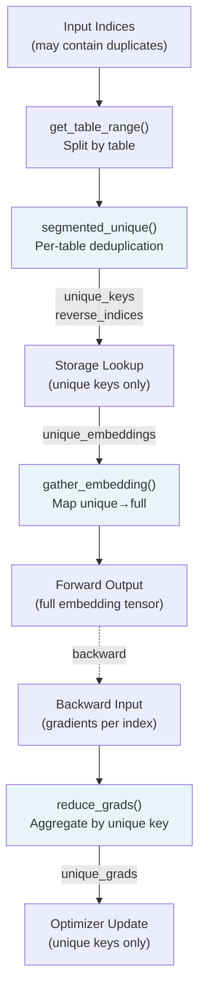
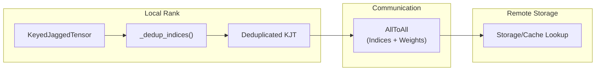

<!-- source: DeepWiki mcp.deepwiki.com · repo NVIDIA/recsys-examples · page 3.4 CUDA Kernels and Index Operations · fetched 2026-10-26 -->

# CUDA Kernels and Index Operations

Relevant source files

The following files were used as context for generating this wiki page:

- [corelib/dynamicemb/dynamicemb/batched_dynamicemb_function.py](corelib/dynamicemb/dynamicemb/batched_dynamicemb_function.py)
- [corelib/dynamicemb/dynamicemb/shard/embedding.py](corelib/dynamicemb/dynamicemb/shard/embedding.py)
- [corelib/dynamicemb/src/dynamic_emb_op.cu](corelib/dynamicemb/src/dynamic_emb_op.cu)
- [corelib/dynamicemb/src/index_calculation.cu](corelib/dynamicemb/src/index_calculation.cu)
- [corelib/dynamicemb/src/initializer.cu](corelib/dynamicemb/src/initializer.cu)
- [corelib/dynamicemb/src/initializer.cuh](corelib/dynamicemb/src/initializer.cuh)
- [corelib/dynamicemb/src/lookup_backward.cu](corelib/dynamicemb/src/lookup_backward.cu)
- [corelib/dynamicemb/src/lookup_backward.h](corelib/dynamicemb/src/lookup_backward.h)
- [corelib/dynamicemb/src/lookup_forward.cu](corelib/dynamicemb/src/lookup_forward.cu)
- [corelib/dynamicemb/src/lookup_forward.h](corelib/dynamicemb/src/lookup_forward.h)
- [corelib/dynamicemb/src/unique_op.cu](corelib/dynamicemb/src/unique_op.cu)
- [corelib/dynamicemb/src/unique_op.h](corelib/dynamicemb/src/unique_op.h)
- [corelib/dynamicemb/test/test_unique_op.py](corelib/dynamicemb/test/test_unique_op.py)
- [corelib/dynamicemb/test/unit_tests/test_sequence_embedding_fw.py](corelib/dynamicemb/test/unit_tests/test_sequence_embedding_fw.py)

## Purpose and Scope

This page documents the CUDA kernel implementations and index manipulation operations that enable efficient embedding lookups and gradient updates in the DynamicEmb system. These operations form the computational core of the forward and backward passes, handling deduplication, index mapping, and data movement between unique and full index spaces.

For information about the storage backends that these kernels interact with, see [Storage Backends: Hash Tables and HKV](3.3). For details on how these operations integrate with TorchRec's distributed sharding, see [TorchRec Integration and Sharding](3.7).

**Key Topics Covered:**
- `segmented_unique` operation for per-table deduplication.
- `DynamicEmbeddingFunctionV2` autograd function.
- CUDA kernels for sorting, flagging, and index transformation.
- `gather_embedding` and `reduce_grads` operations.
- Integration with distributed training workflows.

---

## Overview: Index Operations in the Training Pipeline

The DynamicEmb system performs several critical index transformations during each training iteration to minimize redundant storage lookups and optimize memory bandwidth.

### Index Transformation Flow

**Sources:** [corelib/dynamicemb/dynamicemb/batched_dynamicemb_function.py:48-141](), [corelib/dynamicemb/src/index_calculation.cu:93-127]()

---

## Segmented Unique Operation

The `segmented_unique` function [corelib/dynamicemb/dynamicemb/batched_dynamicemb_function.py:48-141]() is the cornerstone of DynamicEmb's deduplication strategy. Unlike standard `torch.unique`, it performs **per-table** deduplication, preserving table boundaries while eliminating duplicate indices within each table's segment.

### Algorithm and Kernel Pipeline

The underlying implementation uses a compound hashing approach on `(key, table_id)` pairs with a single shared hash table for memory efficiency [corelib/dynamicemb/src/unique_op.h:28-34]().

| Stage | Operation | Output |
|-------|-----------|--------|
| **1. Table ID Expansion** | `expand_table_ids_cuda` generates table IDs for every input key | `table_ids` tensor |
| **2. Hash Table Init** | `segmented_init_kernel` clears the hash table and per-table counters | Empty hash table |
| **3. Insert and Count** | `segmented_insert_kernel` uses atomic operations to find/insert unique keys | `reverse_indices`, `table_counters` |
| **4. Offset Scan** | `cub::DeviceScan::ExclusiveSum` converts counts to global offsets | `table_offsets` |
| **5. Compact Results** | `segmented_compact_kernel` moves unique keys to a contiguous output buffer | `unique_keys` |

**Sources:** [corelib/dynamicemb/src/unique_op.cu:158-205](), [corelib/dynamicemb/src/unique_op.h:63-65]()

### CUDA Implementation Details

#### expand_table_ids_cuda
[corelib/dynamicemb/src/unique_op.h:90-92]()
Generates a `table_id` for each element based on the jagged tensor offsets. This prepares the input for the segmented unique kernel by associating every raw key with its specific embedding table.

#### segmented_unique_cuda
[corelib/dynamicemb/src/unique_op.cu:260-310]()
The core C++ entry point. It calculates the necessary hash table capacity (typically $2 \times \text{num\_keys}$) and launches the initialization, insertion, and compaction kernels. It supports frequency counting for LFU eviction strategies by passing an `input_frequencies` tensor [corelib/dynamicemb/src/unique_op.h:63-65]().

---

## Autograd Integration: DynamicEmbeddingFunctionV2

The `DynamicEmbeddingFunctionV2` (integrated via `BatchedDynamicEmbeddingFunctionV2` in practice) bridges PyTorch's autograd system with high-level embedding operations.

### Forward Pass Logic
1. **Deduplication**: Calls `segmented_unique` to get unique keys and `reverse_indices` [corelib/dynamicemb/dynamicemb/batched_dynamicemb_function.py:48-73]().
2. **Lookup**: Executes storage or cache lookups for unique keys.
3. **Gather**: Uses `gather_embedding` to map unique embeddings back to the full input space [corelib/dynamicemb/src/dynamic_emb_op.cu:79-104]().

### Backward Pass Logic
1. **Reduce**: Uses `reduce_grads` to aggregate gradients from the full index space back to the unique key space [corelib/dynamicemb/src/dynamic_emb_op.cu:159-170]().
2. **Update**: Applies unique gradients to the storage via the optimizer.

**Sources:** [corelib/dynamicemb/dynamicemb/batched_dynamicemb_function.py:33-45](), [corelib/dynamicemb/src/dynamic_emb_op.cu:79-104]()

---

## Index Manipulation Kernels

### Batched Operations

#### gather_embedding
[corelib/dynamicemb/src/dynamic_emb_op.cu:79-104]()
Performs a fused scatter operation. It takes a source embedding buffer (unique space) and an index tensor (inverse mapping) to populate a destination buffer (full space). It uses `dyn_emb::scatter_fused` to handle the data movement efficiently across GPU SMs.

#### gather_embedding_pooled
[corelib/dynamicemb/src/dynamic_emb_op.cu:106-133]()
Extends the gather operation to support pooling (e.g., SUM, MEAN). It utilizes `dyn_emb::scatter_combine` and supports multi-dimensional pooling via `D_offsets`.

#### reduce_grads
[corelib/dynamicemb/src/dynamic_emb_op.cu:159-170]()
A complex kernel that aggregates gradients. It handles:
- **Uniform-dim pooling**: Gradients are reduced using `reverse_indices`.
- **Multi-dim pooling**: Uses `D_offsets` to handle varying embedding dimensions per feature.
- **Scaling**: Fuses MEAN scaling directly into the reduction kernel to avoid extra passes.

**Sources:** [corelib/dynamicemb/src/dynamic_emb_op.cu:79-170](), [corelib/dynamicemb/src/lookup_forward.cu:77-105]()

### Index Calculation Utilities

#### get_table_range
[corelib/dynamicemb/src/index_calculation.cu:93-127]()
Computes per-table index boundaries from feature-level offsets. It converts the jagged structure of feature-batch offsets into a coarse-grained table range used for segmenting operations.

#### flagged_compact
[corelib/dynamicemb/src/index_calculation.cu:129-181]()
A utility using `cub::DeviceSelect::Flagged` to filter multiple input tensors simultaneously based on a boolean flag array. This is used extensively during eviction and admission to separate admitted/evicted keys and values.

#### compute_dedup_lengths_cuda
[corelib/dynamicemb/src/unique_op.h:111-113]()
Generates new lengths and offsets for `KeyedJaggedTensor` structures after deduplication. It ensures that unique keys are distributed evenly across buckets to maintain compatibility with TorchRec's jagged data structures.

---

## Integration with Distributed Training

In distributed scenarios, the `ShardedDynamicEmbeddingCollection` utilizes these kernels to handle input before communication.

### Distributed Deduplication Flow

The `_dedup_indices` method [corelib/dynamicemb/dynamicemb/shard/embedding.py:174-210]() leverages `segmented_unique_cuda` to minimize the volume of indices sent over the network during `AllToAll` operations. When LFU is enabled, it also propagates frequency counts as KJT weights to inform the remote storage's admission and eviction logic [corelib/dynamicemb/dynamicemb/shard/embedding.py:56-70]().

**Sources:** [corelib/dynamicemb/dynamicemb/shard/embedding.py:56-210](), [corelib/dynamicemb/src/unique_op.h:111-113]()

---

## Initializer Kernels

The system provides CUDA-accelerated initialization for new keys inserted into the dynamic embedding table.

| Initializer | Function | Logic |
|-------------|----------|-------|
| **Normal** | `normal_init` | Uses `curand_normal_double` with specified mean/std [corelib/dynamicemb/src/initializer.cu:133-143](). |
| **Uniform** | `uniform_init` | Uses `curand_uniform_double` within `[lower, upper]` [corelib/dynamicemb/src/initializer.cu:156-165](). |
| **Truncated Normal** | `truncated_normal_init` | Fused kernel using `normcdf` and `erfinv` for truncation [corelib/dynamicemb/src/initializer.cu:145-154](). |
| **Constant** | `const_init` | Sets all values to a specific float [corelib/dynamicemb/src/initializer.cu:167-171](). |

These initializers use a `CurandStateContext` [corelib/dynamicemb/src/initializer.cu:30-61]() to manage GPU random states across multiple workers, ensuring high-throughput initialization during high-miss-rate training phases.

**Sources:** [corelib/dynamicemb/src/initializer.cu:30-171](), [corelib/dynamicemb/src/initializer.cuh:40-156]()

---

