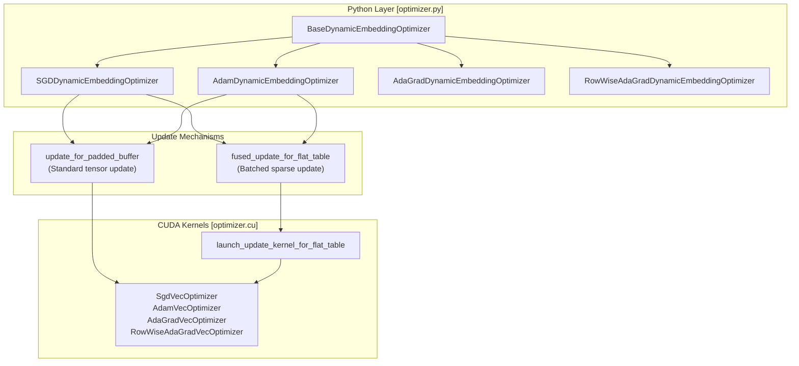
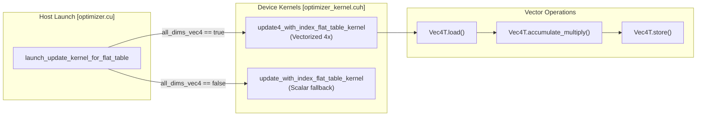

<!-- source: DeepWiki mcp.deepwiki.com · repo NVIDIA/recsys-examples · page 3.5 Optimizers and Gradient Updates · fetched 2026-10-26 -->

# Optimizers and Gradient Updates

Relevant source files

The following files were used as context for generating this wiki page:

- [corelib/dynamicemb/dynamicemb/batched_dynamicemb_function.py](corelib/dynamicemb/dynamicemb/batched_dynamicemb_function.py)
- [corelib/dynamicemb/dynamicemb/optimizer.py](corelib/dynamicemb/dynamicemb/optimizer.py)
- [corelib/dynamicemb/src/dynamic_emb_op.cu](corelib/dynamicemb/src/dynamic_emb_op.cu)
- [corelib/dynamicemb/src/optimizer.cu](corelib/dynamicemb/src/optimizer.cu)
- [corelib/dynamicemb/src/optimizer.h](corelib/dynamicemb/src/optimizer.h)
- [corelib/dynamicemb/src/optimizer_kernel.cuh](corelib/dynamicemb/src/optimizer_kernel.cuh)

This page documents the optimizer implementations for Dynamic Embeddings, including SGD, Adam, AdaGrad, and RowWiseAdaGrad. The system provides optimized update mechanisms for large-scale recommendation models, featuring fused CUDA kernels and memory-efficient optimizer state management.

## Architecture Overview

The optimizer system is designed to handle sparse updates for dynamic embedding tables. It supports both a standard interface for standalone tables and a fused interface for batched operations. All optimizers are CUDA-accelerated with vectorized operations for high performance.

**Diagram: Optimizer System Architecture**

**Sources:** [corelib/dynamicemb/dynamicemb/optimizer.py:119-125](), [corelib/dynamicemb/src/optimizer.cu:34-39](), [corelib/dynamicemb/src/optimizer_kernel.cuh:28-32]()

## Configuration

All optimizers are configured via the `OptimizerArgs` dataclass, which contains hyperparameters and training settings.

**Table: OptimizerArgs Fields**

| Field | Type | Default | Description |
|-------|------|---------|-------------|
| `learning_rate` | float | 0.01 | Learning rate for gradient updates |
| `stochastic_rounding` | bool | True | Enable stochastic rounding |
| `gradient_clipping` | bool | False | Enable gradient clipping |
| `max_gradient` | float | 1.0 | Maximum gradient value (if clipping enabled) |
| `eps` | float | 1.0e-8 | Epsilon for numerical stability (Adam, AdaGrad) |
| `beta1` | float | 0.9 | Adam first moment decay rate |
| `beta2` | float | 0.999 | Adam second moment decay rate |
| `weight_decay` | float | 0.0 | L2 regularization weight |
| `initial_accumulator_value` | float | 0.0 | Initial value for AdaGrad accumulators |

**Sources:** [corelib/dynamicemb/dynamicemb/optimizer.py:77-102]()

## Optimizer Algorithms

The system implements four primary optimizer algorithms. Each implementation provides specialized CUDA templates in `optimizer_kernel.cuh`.

### SGD (Stochastic Gradient Descent)
Performs basic gradient descent: `weight = weight - learning_rate * gradient`.
*   **Python Class:** `SGDDynamicEmbeddingOptimizer` [corelib/dynamicemb/dynamicemb/optimizer.py:192-198]()
*   **CUDA Template:** `SgdVecOptimizer` [corelib/dynamicemb/src/optimizer_kernel.cuh:35-72]()

### Adam
Maintains exponential moving averages of gradients (`m`) and squared gradients (`v`) with bias correction.
*   **Python Class:** `AdamDynamicEmbeddingOptimizer` [corelib/dynamicemb/dynamicemb/optimizer.py:244-250]()
*   **CUDA Template:** `AdamVecOptimizer` [corelib/dynamicemb/src/optimizer_kernel.cuh:75-198]()
*   **State Layout:** `[weight (dim) | m (dim) | v (dim)]`

### AdaGrad
Accumulates squared gradients to provide element-wise adaptive learning rates.
*   **Python Class:** `AdaGradDynamicEmbeddingOptimizer` [corelib/dynamicemb/dynamicemb/optimizer.py:321-327]()
*   **CUDA Template:** `AdaGradVecOptimizer` [corelib/dynamicemb/src/optimizer_kernel.cuh:200-272]()
*   **State Layout:** `[weight (dim) | G (dim)]`

### RowWise AdaGrad
Computes a single accumulator per embedding row (averaged across dimensions), significantly reducing memory overhead.
*   **Python Class:** `RowWiseAdaGradDynamicEmbeddingOptimizer` [corelib/dynamicemb/dynamicemb/optimizer.py:382-388]()
*   **CUDA Template:** `RowWiseAdaGradVecOptimizer` [corelib/dynamicemb/src/optimizer_kernel.cuh:296-401]()
*   **State Layout:** `[weight (dim) | G (aligned_scalar)]`

## Memory Layout and State Dimensions

Optimizer states are stored inline with embedding values in the hash table. The total width of a table entry is determined by the embedding dimension and the optimizer type.

**Table: Optimizer State Widths**

| Optimizer | State Elements per Row | Function |
|-----------|------------------------|----------|
| SGD | 0 | `get_optimizer_state_dim` |
| Adam | `dim * 2` | `get_optimizer_state_dim` |
| AdaGrad | `dim` | `get_optimizer_state_dim` |
| RowWise AdaGrad | `16 / sizeof(dtype)` | `get_optimizer_state_dim` |

**Sources:** [corelib/dynamicemb/dynamicemb/optimizer.py:36-58](), [corelib/dynamicemb/dynamicemb/optimizer.py:60-73]()

## CUDA Kernel Implementation

The CUDA backend uses vectorized operations (`Vec4T`) to maximize memory throughput. The system selects between a vectorized kernel and a scalar fallback based on the `all_dims_vec4` flag.

**Diagram: CUDA Update Flow**

**Key Implementation Details:**
*   **Vectorization:** `update4` methods use `Vec4T<T>` to process 4 elements per thread, improving instruction-level parallelism [corelib/dynamicemb/src/optimizer_kernel.cuh:38-55]().
*   **Grid Sizing:** The grid size is dynamically calculated based on the number of streaming multiprocessors (SMs) and the number of embeddings being updated (`ev_nums`) [corelib/dynamicemb/src/optimizer.cu:42-55]().
*   **RowWise Reduction:** RowWise AdaGrad uses warp-level primitives (`__shfl_xor_sync`) to compute the sum of squared gradients across a row efficiently [corelib/dynamicemb/src/optimizer_kernel.cuh:274-281]().

**Sources:** [corelib/dynamicemb/src/optimizer.cu:40-75](), [corelib/dynamicemb/src/optimizer_kernel.cuh:38-55](), [corelib/dynamicemb/src/optimizer_kernel.cuh:274-281]()

## Gradient Reduction and Updates

In the autograd backward pass, gradients are first reduced (deduplicated) before the optimizer update is applied.

1.  **Segmented Unique:** `segmented_unique` deduplicates input keys within each table segment [corelib/dynamicemb/dynamicemb/batched_dynamicemb_function.py:48-73]().
2.  **Gradient Reduction:** `reduce_grads` aggregates gradients for duplicate keys using the `reverse_indices` generated during lookup [corelib/dynamicemb/src/dynamic_emb_op.cu:159-165]().
3.  **Optimizer Step:** The `BaseDynamicEmbeddingOptimizer` subclasses call into CUDA extensions (e.g., `adam_update_for_flat_table`) to apply the reduced gradients to the embedding storage [corelib/dynamicemb/dynamicemb/optimizer.py:272-284]().

**Sources:** [corelib/dynamicemb/dynamicemb/batched_dynamicemb_function.py:48-141](), [corelib/dynamicemb/src/dynamic_emb_op.cu:159-170](), [corelib/dynamicemb/dynamicemb/optimizer.py:272-284]()

---

