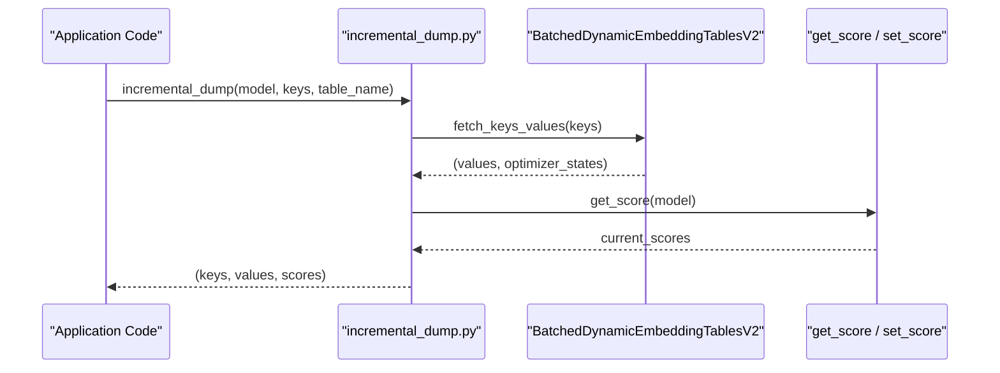

<!-- source: DeepWiki mcp.deepwiki.com · repo NVIDIA/recsys-examples · page 3.6 State Persistence: Dump and Load · fetched 2026-10-26 -->

# State Persistence: Dump and Load

<details>
<summary>Relevant source files</summary>

The following files were used as context for generating this wiki page:

- [CONTRIBUTING.md](CONTRIBUTING.md)
- [corelib/dynamicemb/dynamicemb/construct_twin_module.py](corelib/dynamicemb/dynamicemb/construct_twin_module.py)
- [corelib/dynamicemb/dynamicemb/dump_load.py](corelib/dynamicemb/dynamicemb/dump_load.py)
- [corelib/dynamicemb/dynamicemb/incremental_dump.py](corelib/dynamicemb/dynamicemb/incremental_dump.py)
- [corelib/dynamicemb/dynamicemb/input_dist.py](corelib/dynamicemb/dynamicemb/input_dist.py)
- [corelib/dynamicemb/dynamicemb/planner/__init__.py](corelib/dynamicemb/dynamicemb/planner/__init__.py)
- [corelib/dynamicemb/dynamicemb/shard/__init__.py](corelib/dynamicemb/dynamicemb/shard/__init__.py)
- [corelib/dynamicemb/example/README.md](corelib/dynamicemb/example/README.md)
- [corelib/dynamicemb/example/example.py](corelib/dynamicemb/example/example.py)
- [corelib/dynamicemb/example/run_example.sh](corelib/dynamicemb/example/run_example.sh)
- [corelib/dynamicemb/src/sparse_block_bucketize_features.cu](corelib/dynamicemb/src/sparse_block_bucketize_features.cu)
- [corelib/dynamicemb/test/unit_tests/incremental_dump/test_distributed_dynamicemb.py](corelib/dynamicemb/test/unit_tests/incremental_dump/test_distributed_dynamicemb.py)
- [corelib/dynamicemb/test/unit_tests/test_embedding_dump_load.py](corelib/dynamicemb/test/unit_tests/test_embedding_dump_load.py)
- [corelib/dynamicemb/test/unit_tests/test_embedding_dump_load.sh](corelib/dynamicemb/test/unit_tests/test_embedding_dump_load.sh)
- [corelib/dynamicemb/test/unit_tests/test_pooled_embedding_bw.py](corelib/dynamicemb/test/unit_tests/test_pooled_embedding_bw.py)
- [corelib/dynamicemb/test/unit_tests/test_pooled_embedding_fw.py](corelib/dynamicemb/test/unit_tests/test_pooled_embedding_fw.py)
- [corelib/dynamicemb/test/unit_tests/test_twin_module.py](corelib/dynamicemb/test/unit_tests/test_twin_module.py)

</details>


## Purpose and Scope

This document covers the state persistence system in DynamicEmb, which enables checkpointing and restoration of dynamic embedding tables. The system supports:

- Full checkpointing of embedding weights, scores, and optimizer states.
- Distributed persistence across multiple GPUs with row-wise sharding.
- World size changes (dump with $N$ GPUs, load with $M$ GPUs).
- Incremental updates for online model synchronization.
- Selective persistence of optimizer states and admission counters.
- Integration with TorchRec's sharding infrastructure.

For distributed training architecture and process groups, see [5.1](). For optimizer state management, see [3.5](). For overall checkpointing strategies including non-embedding model components, see [5.2]().

---

## Overview

The DynamicEmb persistence system operates at two levels:

1.  **High-Level API** (`DynamicEmbDump` / `DynamicEmbLoad`): Traverses PyTorch models to find `ShardedEmbeddingCollection` and `ShardedEmbeddingBagCollection` modules, then persists all dynamic embedding tables within them [corelib/dynamicemb/dynamicemb/dump_load.py:112-139]().
2.  **Incremental API** (`incremental_dump`): Provides a mechanism to dump specific keys and their associated values/scores, primarily for online serving or synchronization [corelib/dynamicemb/example/example.py:28-28]().
3.  **Low-Level API** (`BatchedDynamicEmbeddingTablesV2.dump()` / `.load()`): Handles the actual serialization of hash table contents to binary files.

The system stores embeddings as binary key-value pairs, with separate files for keys, values (embeddings), scores (for eviction), and optimizer states. Each rank dumps its local shard of the distributed hash table, enabling parallel I/O.

**Key Characteristics:**

| Feature | Support |
| :--- | :--- |
| Distributed Sharding | Row-wise sharding only (TW/TWRW planned) [corelib/dynamicemb/dynamicemb/dump_load.py:97-97]() |
| World Size Changes | Supported via modulo redistribution [corelib/dynamicemb/test/unit_tests/test_embedding_dump_load.sh:72-98]() |
| Optimizer States | Optional (SGD, Adam, AdaGrad, RowWiseAdaGrad) [corelib/dynamicemb/test/unit_tests/test_embedding_dump_load.py:65-76]() |
| Admission Counters | Optional (`KVCounter` persistence) [corelib/dynamicemb/dynamicemb/dump_load.py:131-132]() |
| Score Strategies | TIMESTAMP, STEP, LFU [corelib/dynamicemb/test/unit_tests/test_embedding_dump_load.py:78-87]() |
| File Format | Binary (keys: int64, values: float) [corelib/dynamicemb/dynamicemb/dump_load.py:117-119]() |

Sources: [corelib/dynamicemb/dynamicemb/dump_load.py:97-139](), [corelib/dynamicemb/test/unit_tests/test_embedding_dump_load.py:65-87]()

---

## System Architecture

### Persistence Data Flow
This diagram bridges the natural language concepts of "Checkpointing" to the code entities responsible for the data flow.

```mermaid
graph TB
    subgraph "User_Entry_Points"
        [DumpAPI] --> "DynamicEmbDump"
        [LoadAPI] --> "DynamicEmbLoad"
        [IncAPI] --> "incremental_dump"
    end
    
    subgraph "Discovery_Logic"
        "DynamicEmbDump" --> "find_sharded_modules"
        "DynamicEmbDump" --> "get_dynamic_emb_module"
    end
    
    subgraph "TorchRec_Entities"
        "find_sharded_modules" -- "Locates" --> "ShardedEmbeddingCollection"
        "find_sharded_modules" -- "Locates" --> "ShardedEmbeddingBagCollection"
    end
    
    subgraph "Core_Persistence_Implementation"
        "get_dynamic_emb_module" -- "Extracts" --> "BatchedDynamicEmbeddingTablesV2"
        "BatchedDynamicEmbeddingTablesV2" -- "Executes" --> "BDET_dump[dump]"
        "BatchedDynamicEmbeddingTablesV2" -- "Executes" --> "BDET_load[load]"
    end
    
    subgraph "Storage_Backend"
        "BDET_dump" --> "DynamicEmbStorage"
        "BDET_dump" --> "HybridStorage"
    end

    subgraph "Filesystem_Output"
        "DynamicEmbStorage" -- ".key" --> "KeyBinary"
        "DynamicEmbStorage" -- ".emb" --> "ValueBinary"
        "DynamicEmbStorage" -- ".score" --> "ScoreBinary"
        "DynamicEmbStorage" -- ".opt" --> "OptimizerBinary"
    end
```
Sources: [corelib/dynamicemb/dynamicemb/dump_load.py:31-94](), [corelib/dynamicemb/test/unit_tests/test_embedding_dump_load.py:95-106]()

---

## High-Level API

### DynamicEmbDump
The `DynamicEmbDump` function orchestrates the distributed dumping of embedding weights and optimizer states to the filesystem [corelib/dynamicemb/dynamicemb/dump_load.py:103-111]().

**Behavior:**
1.  **Synchronization**: Calls `torch.cuda.synchronize()` and `dist.barrier()` to ensure all ranks are ready [corelib/dynamicemb/dynamicemb/dump_load.py:141-164]().
2.  **Discovery**: Uses `find_sharded_modules` to locate `ShardedEmbeddingCollection` or `ShardedEmbeddingBagCollection` [corelib/dynamicemb/dynamicemb/dump_load.py:167-167]().
3.  **Module Extraction**: For each collection, it calls `get_dynamic_emb_module` to find the underlying `BatchedDynamicEmbeddingTablesV2` [corelib/dynamicemb/dynamicemb/dump_load.py:185-185]().
4.  **Serialization**: Triggers the `dump` method on the discovered modules, creating subdirectories for each collection path [corelib/dynamicemb/dynamicemb/dump_load.py:188-191]().

Sources: [corelib/dynamicemb/dynamicemb/dump_load.py:103-191]()

### DynamicEmbLoad
The `DynamicEmbLoad` function restores the state from a previously dumped directory [corelib/dynamicemb/dynamicemb/dump_load.py:199-224]().

**World Size Changes:**
A critical feature is the ability to load a checkpoint with a different number of GPUs than used during the dump.
- **Modulo Redistribution**: The system reads keys and redistributes them to ranks based on the new world size [corelib/dynamicemb/test/unit_tests/test_embedding_dump_load.sh:72-98]().
- **Automatic Filtering**: Each rank filters the loaded data to only include keys it owns under the current sharding plan.

Sources: [corelib/dynamicemb/dynamicemb/dump_load.py:199-276](), [corelib/dynamicemb/test/unit_tests/test_embedding_dump_load.sh:72-98]()

---

## Incremental Updates

For online training and serving scenarios, `incremental_dump` allows for partial state updates without a full checkpoint [corelib/dynamicemb/example/example.py:28-28]().

### Online Update Flow
This diagram shows how specific keys are extracted for external synchronization.


Sources: [corelib/dynamicemb/dynamicemb/incremental_dump.py:153-168](), [corelib/dynamicemb/example/example.py:28-28]()

**Key Functions:**
- `get_score(model)`: Retrieves the current scores (e.g., TIMESTAMP, STEP) for all dynamic tables in the model [corelib/dynamicemb/dynamicemb/incremental_dump.py:153-168]().
- `set_score(model, table_score)`: Manually updates scores for specific tables or the entire model [corelib/dynamicemb/dynamicemb/incremental_dump.py:47-60]().

---

## Storage Layout

Each dynamic embedding table is persisted as a set of binary files within a directory structure that mirrors the model's module hierarchy [corelib/dynamicemb/dynamicemb/dump_load.py:113-116]().

| File Extension | Content Description | Data Type |
| :--- | :--- | :--- |
| `.key` | Global indices for the embeddings | `int64` |
| `.emb` | Flattened embedding vectors | `float` (variable precision) |
| `.score` | Eviction/Admission scores | `uint64` |
| `.opt` | Optimizer states (e.g., momentum, variance) | `float` |
| `.counter` | Admission strategy frequency counts | `int64` (keys) + `int32` (counts) |

Sources: [corelib/dynamicemb/dynamicemb/dump_load.py:117-132]()

---

## Distributed Persistence Implementation

The persistence logic must handle `DistributedModelParallel` (DMP) wrappers and various storage configurations.

### Storage Type Verification
The system distinguishes between `DynamicEmbStorage` (single-tier) and `HybridStorage` (two-tier HBM/DDR) during persistence [corelib/dynamicemb/test/unit_tests/test_embedding_dump_load.py:89-102]().

```python
# From test_embedding_dump_load.py:95-102
# With caching: expect DynamicEmbStorage (backing store under cache).
# No cache and global_hbm_budget_scale < 1: expect HybridStorage.
for _, _, sharded_module in find_sharded_modules(model, ""):
    for emb in get_dynamic_emb_module(sharded_module):
        storage = emb.tables
        assert isinstance(storage, (DynamicEmbStorage, HybridStorage))
```

### Module Traversal
The `check_emb_collection_modules` function performs a recursive search to find `BatchedDynamicEmbeddingTablesV2` instances, even when wrapped in private TorchRec attributes like `_lookups`, `_emb_modules`, or `_emb_module` [corelib/dynamicemb/dynamicemb/dump_load.py:53-88]().

Sources: [corelib/dynamicemb/dynamicemb/dump_load.py:53-88](), [corelib/dynamicemb/test/unit_tests/test_embedding_dump_load.py:89-124]()

---

## Summary Table: Persistence Capabilities

| Capability | Implementation Detail |
| :--- | :--- |
| **Atomic Checkpoints** | Handled by `DynamicEmbDump` with global barriers [corelib/dynamicemb/dynamicemb/dump_load.py:164-164]() |
| **Optimizer Support** | Adam, SGD, AdaGrad, RowWiseAdaGrad [corelib/dynamicemb/test/unit_tests/test_embedding_dump_load.py:65-73]() |
| **Admission Control** | Persists `KVCounter` state if `counter=True` [corelib/dynamicemb/dynamicemb/dump_load.py:131-132]() |
| **Input Distribution** | Supports `roundrobin`, `hash_roundrobin`, and `continuous` [corelib/dynamicemb/example/example.py:201-207]() |
| **Storage Modes** | Full HBM or Two-tier Hybrid (HBM + DDR) [corelib/dynamicemb/test/unit_tests/test_embedding_dump_load.py:114-124]() |

Sources: [corelib/dynamicemb/dynamicemb/dump_load.py:103-164](), [corelib/dynamicemb/test/unit_tests/test_embedding_dump_load.py:65-124](), [corelib/dynamicemb/example/example.py:201-207]()

---

