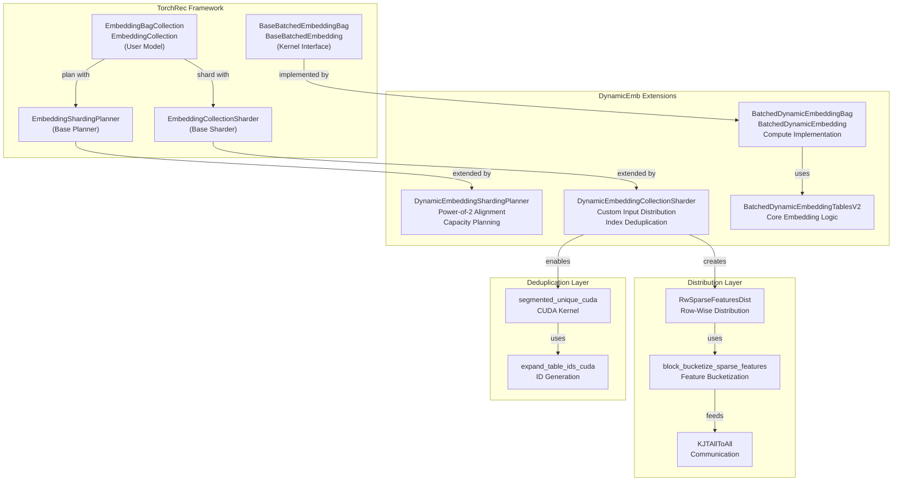
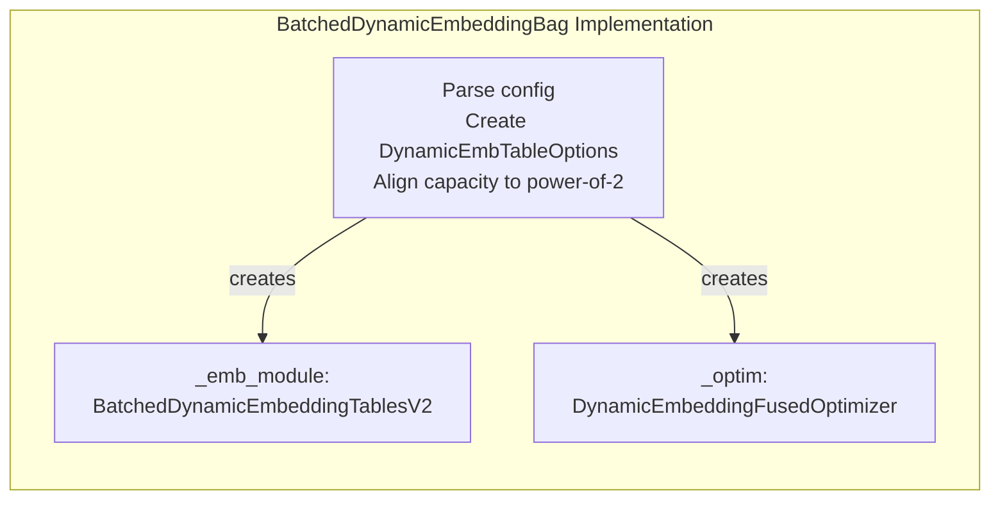
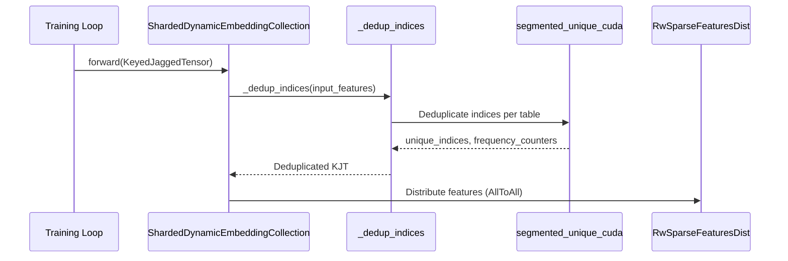

<!-- source: DeepWiki mcp.deepwiki.com · repo NVIDIA/recsys-examples · page 3.7 TorchRec Integration and Sharding · fetched 2026-10-26 -->

# TorchRec Integration and Sharding

Relevant source files

The following files were used as context for generating this wiki page:

- [corelib/dynamicemb/dynamicemb/dump_load.py](corelib/dynamicemb/dynamicemb/dump_load.py)
- [corelib/dynamicemb/dynamicemb/planner/rw_sharding.py](corelib/dynamicemb/dynamicemb/planner/rw_sharding.py)
- [corelib/dynamicemb/dynamicemb/shard/embedding.py](corelib/dynamicemb/dynamicemb/shard/embedding.py)
- [corelib/dynamicemb/example/example.py](corelib/dynamicemb/example/example.py)
- [corelib/dynamicemb/setup.py](corelib/dynamicemb/setup.py)
- [corelib/dynamicemb/src/index_calculation.cu](corelib/dynamicemb/src/index_calculation.cu)
- [corelib/dynamicemb/src/index_calculation.h](corelib/dynamicemb/src/index_calculation.h)
- [corelib/dynamicemb/src/unique_op.cu](corelib/dynamicemb/src/unique_op.cu)
- [corelib/dynamicemb/src/unique_op.h](corelib/dynamicemb/src/unique_op.h)
- [corelib/dynamicemb/test/test_unique_op.py](corelib/dynamicemb/test/test_unique_op.py)
- [corelib/dynamicemb/test/unit_tests/test_embedding_dump_load.py](corelib/dynamicemb/test/unit_tests/test_embedding_dump_load.py)
- [corelib/dynamicemb/test/unit_tests/test_hash_roundrobin_kuairand.py](corelib/dynamicemb/test/unit_tests/test_hash_roundrobin_kuairand.py)
- [corelib/dynamicemb/test/unit_tests/test_sequence_embedding_fw.py](corelib/dynamicemb/test/unit_tests/test_sequence_embedding_fw.py)

## Purpose and Scope

This document explains how DynamicEmb integrates with TorchRec's distributed embedding framework. It covers the implementation of custom compute kernels, sharding planners, and input distribution logic required to support dynamic capacity management and GPU-accelerated storage.

Key integration points include:
- **Compute Kernels**: Implementation of TorchRec's `BaseBatchedEmbeddingBag` and `BaseBatchedEmbedding` interfaces.
- **Sharding Planning**: Extension of TorchRec's `EmbeddingShardingPlanner` for capacity alignment and power-of-2 constraints.
- **Input Distribution**: Row-wise feature distribution and bucketization for AllToAll communication.
- **Index Deduplication**: CUDA-accelerated unique operations for reducing embedding lookups and tracking frequencies for admission strategies.

---

## Integration Architecture Overview

DynamicEmb extends TorchRec's sharding framework by implementing custom compute kernels, planners, and sharders that support dynamic capacity management and GPU-accelerated storage.

### Component Hierarchy

**Sources:**
- [corelib/dynamicemb/dynamicemb/shard/embedding.py:73-122]()
- [corelib/dynamicemb/dynamicemb/planner/rw_sharding.py:83-105]()
- [corelib/dynamicemb/dynamicemb/batched_dynamicemb_compute_kernel.py:288-300]()

---

## Compute Kernels

### BatchedDynamicEmbeddingBag and BatchedDynamicEmbedding

DynamicEmb provides compute kernel implementations that integrate with TorchRec's distributed embedding interface. These kernels are selected via the `CUSTOMIZED_KERNEL` compute kernel type.

| Compute Kernel | Base Class | Pooling | Implementation File |
|----------------|-----------|---------|---------------------|
| `BatchedDynamicEmbeddingBag` | `BaseBatchedEmbeddingBag` | Yes (SUM/MEAN) | [corelib/dynamicemb/dynamicemb/batched_dynamicemb_compute_kernel.py:288-288]() |
| `BatchedDynamicEmbedding` | `BaseBatchedEmbedding` | No | [corelib/dynamicemb/dynamicemb/batched_dynamicemb_compute_kernel.py:412-412]() |

### Initialization and Configuration Mapping

The compute kernel constructor performs critical transformations to map TorchRec configurations to DynamicEmb options.

1. **Capacity Alignment**: Aligns `num_embeddings` per rank to power-of-2 using `_get_dynamicemb_options_per_table` [corelib/dynamicemb/dynamicemb/batched_dynamicemb_compute_kernel.py:240-285]().
2. **Optimizer Mapping**: Converts TorchRec `EmbOptimType` to DynamicEmb `OptimizerType` [corelib/dynamicemb/dynamicemb/batched_dynamicemb_compute_kernel.py:63-100]().
3. **Core Initialization**: Creates the underlying `BatchedDynamicEmbeddingTablesV2` instance [corelib/dynamicemb/dynamicemb/batched_dynamicemb_compute_kernel.py:321-334]().

**Sources:**
- [corelib/dynamicemb/dynamicemb/batched_dynamicemb_compute_kernel.py:302-335]()
- [corelib/dynamicemb/dynamicemb/batched_dynamicemb_compute_kernel.py:240-285]()

---

## Sharding Planning

### DynamicEmbeddingShardingPlanner

`DynamicEmbeddingShardingPlanner` extends TorchRec's planner to support DynamicEmb-specific constraints, specifically handling memory reservation and capacity alignment.

- **Power-of-2 Alignment**: Ensures each rank's hash table capacity is a power-of-2 to optimize CUDA kernel indexing [corelib/dynamicemb/dynamicemb/planner/planner.py:145-163]().
- **HBM Reservation**: Uses `_reserve_storage_for_dyn_emb` to allocate a portion of the GPU memory budget specifically for dynamic embedding values [corelib/dynamicemb/dynamicemb/planner/planner.py:166-177]().

### Planning Datastructures

| Class | Purpose | Source |
|-------|---------|--------|
| `DynamicEmbParameterConstraints` | Extends `ParameterConstraints` with `use_dynamicemb` flag and `dynamicemb_options`. | [corelib/dynamicemb/dynamicemb/planner/planner.py:64-81]() |
| `DynamicEmbParameterSharding` | Extends `ParameterSharding` to include DynamicEmb-specific options in the final plan. | [corelib/dynamicemb/dynamicemb/planner/planner.py:84-106]() |

**Sources:**
- [corelib/dynamicemb/dynamicemb/planner/planner.py:109-135]()
- [corelib/dynamicemb/dynamicemb/planner/planner.py:210-250]()

---

## Sharding Execution

### DynamicEmbeddingCollectionSharder

The `DynamicEmbeddingCollectionSharder` is responsible for instantiating `ShardedDynamicEmbeddingCollection`. It checks the sharding plan to determine if a table should use the dynamic embedding backend.

- **Deduplication Control**: Controlled via `use_index_dedup` parameter [corelib/dynamicemb/dynamicemb/shard/embedding.py:132-132]().
- **Score Strategy Propagation**: Propagates the `score_strategy` (e.g., LFU, LRU) from the plan to the sharded module [corelib/dynamicemb/dynamicemb/shard/embedding.py:86-91]().

### Input Distribution Flow

The `input_dist` method in `ShardedDynamicEmbeddingCollection` orchestrates feature distribution. If deduplication is enabled, it calls `_dedup_indices` before performing communication.

**Sources:**
- [corelib/dynamicemb/dynamicemb/shard/embedding.py:174-248]()
- [corelib/dynamicemb/dynamicemb/shard/embedding.py:348-399]()

---

## CUDA Kernels for Sharding

### Segmented Unique and Table ID Expansion

Deduplication relies on two primary CUDA kernels to handle multi-table inputs efficiently.

- **`expand_table_ids_cuda`**: Generates table IDs for every element in a jagged tensor based on feature offsets and table mapping [corelib/dynamicemb/src/unique_op.h:90-92]().
- **`segmented_unique_cuda`**: Performs the actual deduplication. It supports compound hashing on `(key, table_id)` pairs, allowing a single shared hash table to process multiple embedding tables simultaneously [corelib/dynamicemb/src/unique_op.h:63-65]().

### Index Bucketization

`RwSparseFeaturesDist` uses specialized bucketization logic to prepare data for `AllToAll` communication.

- **`dist_type`**: Supports `continuous`, `roundrobin`, and `hash_roundrobin` distribution types [corelib/dynamicemb/dynamicemb/input_dist.py:126-135]().
- **Bucketization Kernel**: `block_bucketize_sparse_features` reorders values and lengths into buckets corresponding to target ranks [corelib/dynamicemb/dynamicemb/input_dist.py:165-185]().

**Sources:**
- [corelib/dynamicemb/src/unique_op.cu:187-210]()
- [corelib/dynamicemb/src/index_calculation.cu:78-91]()
- [corelib/dynamicemb/dynamicemb/input_dist.py:197-283]()

---

## Integration Summary Table

| Feature | DynamicEmb Entity | TorchRec Integration Point |
|---------|-------------------|----------------------------|
| Compute | `BatchedDynamicEmbeddingBag` | `BaseBatchedEmbeddingBag` |
| Planning | `DynamicEmbeddingShardingPlanner` | `EmbeddingShardingPlanner` |
| Distribution | `RwSparseFeaturesDist` | `BaseSparseFeaturesDist` |
| Sharding | `RwSequenceDynamicEmbeddingSharding` | `RwSequenceEmbeddingSharding` |
| Deduplication | `segmented_unique_cuda` | `_dedup_indices` in Sharded Module |

**Sources:**
- [corelib/dynamicemb/dynamicemb/planner/rw_sharding.py:55-81]()
- [corelib/dynamicemb/dynamicemb/shard/embedding.py:107-121]()
- [corelib/dynamicemb/dynamicemb/input_dist.py:81-110]()

---

