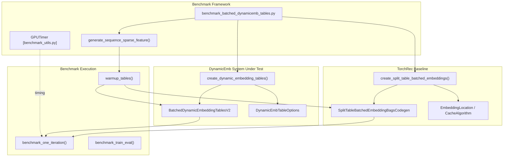
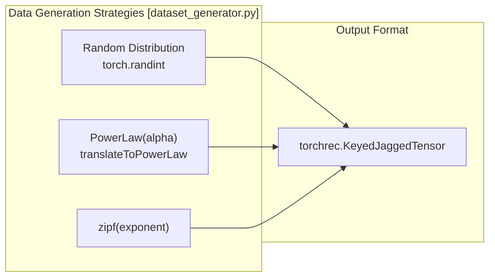
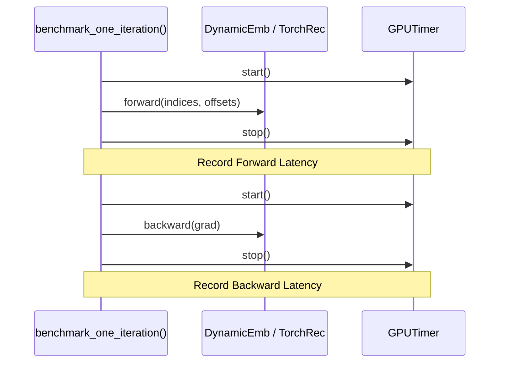
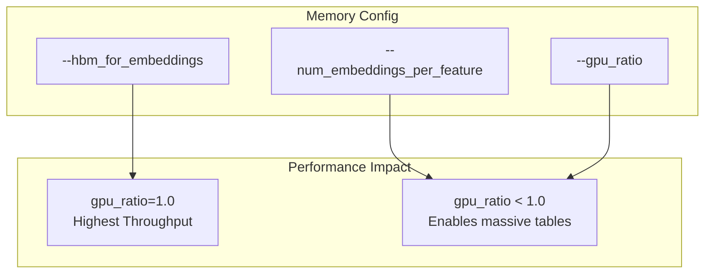

<!-- source: DeepWiki mcp.deepwiki.com · repo NVIDIA/recsys-examples · page 3.8 Benchmarks and Performance · fetched 2026-10-26 -->

# Benchmarks and Performance

<details>
<summary>Relevant source files</summary>

The following files were used as context for generating this wiki page:

- [corelib/dynamicemb/benchmark/README.md](corelib/dynamicemb/benchmark/README.md)
- [corelib/dynamicemb/benchmark/benchmark_batched_dynamicemb_tables.py](corelib/dynamicemb/benchmark/benchmark_batched_dynamicemb_tables.py)
- [corelib/dynamicemb/benchmark/benchmark_batched_dynamicemb_tables.sh](corelib/dynamicemb/benchmark/benchmark_batched_dynamicemb_tables.sh)
- [corelib/dynamicemb/benchmark/benchmark_bdet_results.png](corelib/dynamicemb/benchmark/benchmark_bdet_results.png)
- [corelib/dynamicemb/benchmark/benchmark_utils.py](corelib/dynamicemb/benchmark/benchmark_utils.py)
- [corelib/dynamicemb/benchmark/dataset_generator.py](corelib/dynamicemb/benchmark/dataset_generator.py)

</details>


This page documents the performance benchmarking framework for DynamicEmb, comparing it against TorchRec's native embedding tables. The benchmarks measure forward/backward pass latency, cache efficiency, and optimizer overhead under various workload configurations. For details on the core DynamicEmb architecture being benchmarked, see [Core Architecture and BatchedDynamicEmbeddingTablesV2](3.1). For information on distributed training performance, see [Distributed Training Architecture](5.1).

---

## Benchmark Overview

DynamicEmb provides two main benchmark suites to evaluate performance characteristics:

1. **EmbeddingCollection Benchmark**: Multi-GPU (8 GPU) test measuring distributed embedding lookup with deduplication overhead.
2. **BatchedDynamicEmbeddingTables Benchmark**: Single-GPU test comparing DynamicEmb against TorchRec baseline for forward/backward/evaluation operations.

The primary benchmark implementation is located in [corelib/dynamicemb/benchmark/benchmark_batched_dynamicemb_tables.py:1-847]() and provides comprehensive comparisons between `BatchedDynamicEmbeddingTablesV2` and TorchRec's `SplitTableBatchedEmbeddingBagsCodegen`.

Sources: [corelib/dynamicemb/benchmark/README.md:1-68](), [corelib/dynamicemb/benchmark/benchmark_batched_dynamicemb_tables.py:1-847]()

---

## Benchmark Architecture

The benchmark framework bridges the high-level configuration parameters to the low-level execution of both DynamicEmb and TorchRec backends.



Sources: [corelib/dynamicemb/benchmark/benchmark_batched_dynamicemb_tables.py:90-189](), [corelib/dynamicemb/benchmark/benchmark_batched_dynamicemb_tables.py:345-425](), [corelib/dynamicemb/benchmark/benchmark_batched_dynamicemb_tables.py:428-491](), [corelib/dynamicemb/benchmark/benchmark_utils.py:19-40]()

---

## Benchmark Configuration Parameters

The benchmark framework supports comprehensive configuration to test different workload scenarios via command-line arguments:

| Parameter Category | Configuration Options | Description |
|-------------------|----------------------|-------------|
| **Batch Size** | `--batch_size` (e.g., 65536) | Number of samples per iteration [corelib/dynamicemb/benchmark/benchmark_batched_dynamicemb_tables.py:91-96]() |
| **Table Capacity** | `--num_embeddings_per_feature` | Max unique embeddings in MB [corelib/dynamicemb/benchmark/benchmark_batched_dynamicemb_tables.py:98-102]() |
| **Optimizer Types** | `sgd`, `adam`, `exact_adagrad` | Optimizer for updates [corelib/dynamicemb/benchmark/benchmark_batched_dynamicemb_tables.py:116-121]() |
| **Feature Distribution** | `random`, `pow-law` | Access pattern distribution [corelib/dynamicemb/benchmark/benchmark_batched_dynamicemb_tables.py:124-128]() |
| **Cache Config** | `--gpu_ratio`, `--cache_algorithm` | LRU/LFU and GPU HBM ratio [corelib/dynamicemb/benchmark/benchmark_batched_dynamicemb_tables.py:158-168]() |
| **Index Deduplication** | `--use_index_dedup` | Unique index extraction flag [corelib/dynamicemb/benchmark/benchmark_batched_dynamicemb_tables.py:136-139]() |

Sources: [corelib/dynamicemb/benchmark/benchmark_batched_dynamicemb_tables.py:86-185](), [corelib/dynamicemb/benchmark/benchmark_batched_dynamicemb_tables.sh:1-90]()

---

## Benchmark Methodology

### Test Data Generation

The benchmark generates sparse features using distribution strategies implemented in `dataset_generator.py` and wrapped in `generate_sequence_sparse_feature()`:



**Power-law Distribution**: Models realistic access patterns where a small fraction of embeddings receive most lookups (parameter `alpha=1.05`), simulating "hot" embeddings [corelib/dynamicemb/benchmark/dataset_generator.py:16-23]().

Sources: [corelib/dynamicemb/benchmark/benchmark_batched_dynamicemb_tables.py:230-307](), [corelib/dynamicemb/benchmark/dataset_generator.py:1-77]()

### Timing and Measurement

The benchmark uses `GPUTimer` (built on `torch.cuda.Event`) for precise GPU timing, measuring three phases per iteration:



Sources: [corelib/dynamicemb/benchmark/benchmark_utils.py:19-40](), [corelib/dynamicemb/benchmark/benchmark_batched_dynamicemb_tables.py:514-530]()

---

## Performance Comparison: DynamicEmb vs TorchRec

### Baseline Comparison (No Caching)

The benchmark compares `BatchedDynamicEmbeddingTablesV2` against `SplitTableBatchedEmbeddingBagsCodegen` with full GPU memory allocation (`gpu_ratio=1.0`).

| Metric | Context | Observation |
|--------------|----------|------------|
| **Overhead** | Full GPU (24M capacity) | DynamicEmb typically incurs ~10-15% overhead compared to static TorchRec tables. |
| **Source of Latency** | Hash Operations | Overhead is due to index deduplication and hash table probing instead of direct array indexing. |

Sources: [corelib/dynamicemb/benchmark/README.md:36-44](), [corelib/dynamicemb/benchmark/README.md:56-67]()

### Caching Performance

When embeddings exceed GPU memory capacity, caching becomes critical. The benchmark tests cache efficiency with `gpu_ratio=0.1` (10% of embeddings cached in GPU HBM).

**Cache Hit Rate Calculation**:
The benchmark reports cache metrics via `RecordCacheMetrics` from the underlying storage layer:
- `cache_hit_rate = cache_hit / unique_num` [corelib/dynamicemb/benchmark/benchmark_batched_dynamicemb_tables.py:760-770]()
- `cache_miss = unique_num - cache_hit` [corelib/dynamicemb/benchmark/benchmark_batched_dynamicemb_tables.py:779-798]()

Sources: [corelib/dynamicemb/benchmark/benchmark_batched_dynamicemb_tables.py:760-798]()

---

## EmbeddingCollection Benchmark (Multi-GPU)

The distributed benchmark tests the overhead of `DynamicEmbeddingCollectionSharder` compared to TorchRec's native sharding on 8 H100 GPUs connected via NVSwitch.

### Deduplication Impact (Batch Size 65536)

| Configuration | TorchRec Raw Table (ms) | Dynamic Embedding Table (ms) |
|---------------|------------------------|------------------------------|
| **Open Dedup** | 14.88 | 21.56 |
| **Close Dedup** | 23.99 | 28.47 |

**Key Observations**:
1. **Deduplication Benefit**: Both systems benefit significantly from deduplication, reducing communication volume [corelib/dynamicemb/benchmark/README.md:34-41]().
2. **Context**: While DynamicEmb has higher raw lookup latency, these overheads diminish when considered within the context of the entire end-to-end model [corelib/dynamicemb/benchmark/README.md:43-44]().

Sources: [corelib/dynamicemb/benchmark/README.md:34-44]()

---

## Optimization Strategies

### Memory Management Optimizations

The benchmark allows testing different memory allocation strategies:



Sources: [corelib/dynamicemb/benchmark/benchmark_batched_dynamicemb_tables.py:345-491](), [corelib/dynamicemb/benchmark/benchmark_batched_dynamicemb_tables.sh:1-90]()

### Deduplication Optimization

Index deduplication reduces lookup overhead by eliminating redundant lookups within a batch. The benchmark controls this via the `--use_index_dedup` flag [corelib/dynamicemb/benchmark/benchmark_batched_dynamicemb_tables.py:136-139]().

- **Enabled**: Lower lookup count but adds the cost of the `segmented_unique` kernel.
- **Disabled**: Direct lookup for every index in the batch.

Sources: [corelib/dynamicemb/benchmark/benchmark_batched_dynamicemb_tables.py:136-143](), [corelib/dynamicemb/benchmark/README.md:18-22]()

---

## Running the Benchmarks

### BatchedDynamicEmbeddingTables Benchmark

Execute the single-GPU benchmark across multiple configurations:

```bash
bash ./benchmark/benchmark_batched_dynamicemb_tables.sh
```

Sources: [corelib/dynamicemb/benchmark/benchmark_batched_dynamicemb_tables.sh:1-90]()

### EmbeddingCollection Benchmark

Execute the multi-GPU distributed benchmark:

```bash
bash ./benchmark/benchmark_embedding_collection.sh <use_index_dedup> <use_dynamic_embedding> <batch_size>
```

Sources: [corelib/dynamicemb/benchmark/README.md:13-31]()

---

## Benchmark Results Format

Results are written to `benchmark_results.json` [corelib/dynamicemb/benchmark/benchmark_batched_dynamicemb_tables.py:820-840](). Key metrics include:
- `forward`: Forward pass latency during training.
- `backward`: Backward pass + optimizer update latency.
- `eval`: Forward-only latency (inference mode).
- `train`: Total training iteration latency (forward + backward).

Sources: [corelib/dynamicemb/benchmark/benchmark_batched_dynamicemb_tables.py:565-579](), [corelib/dynamicemb/benchmark/benchmark_batched_dynamicemb_tables.py:820-840]()

---

